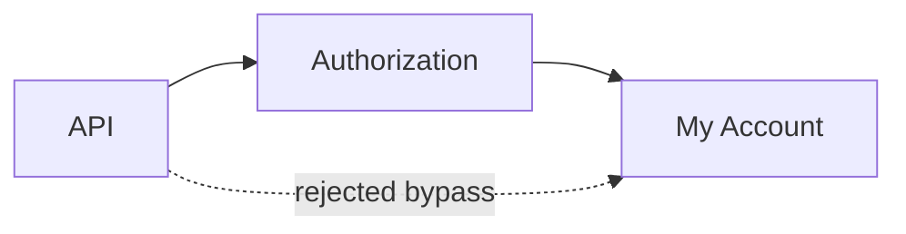
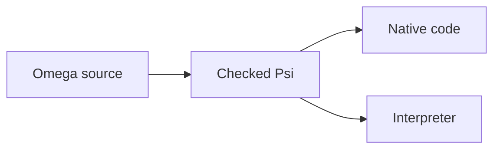

# Omega

Omega is a systems language built around explicit state machines, checked
contracts, and ownership of memory and resources. Its design aims to establish
safety before execution without runtime checks for facts already proved.
Performance comparisons require measurements of the actual compiler and workload.

A checked contract establishes what it states under its retained premises. It
does not prove that the specification captures every intention, that an admitted
OS contract is true, or that the compiler has no bugs. Ordinary source has no
`unsafe` block that waives checking: even inline assembly owes its contracts.

Omega's explicit calls and contracts make important questions inspectable:
- Does an API access the filesystem, including through dependencies?
- Can it crash? Does it promise termination, and under which premises?
- What resource bounds does its checked contract establish?

Omega is built for software where performance matters and failure is costly,
from user-facing applications to operating-system kernels.

Its first major application is **[Cathedral](https://github.com/CathedralOS/Cathedral)**,
an operating system developed alongside the language. Cathedral exercises memory
management, hardware access and resource isolation.

**Under development; not a completed release.** The Rust compiler is being
repaired against the specification. The design is ahead of implementation and
native support is unfinished. Unsupported constructs reject rather than falling
back to unchecked code. [Tasks](TASKS.md) and
[completion criteria](wiki/drafts/reference/rust_compiler_completion.md) record
remaining work. The examples below explain source contracts, not fresh compiler
or performance results.

[Language guide](wiki/language_guide/language_guide.md) ·
[Specification](wiki/README.md#current-specification-subjects) ·
[Examples](samples) ·
[VS Code highlighting](tools/vscode-omega/README.md) ·
[Contributing](#development)

## Failures Omega addresses

These are required design guarantees under the stated contracts and trust
boundaries, not a claim of completed implementation.

| Failure | Contract or mechanism |
| --- | --- |
| Use-after-free, double-free and dangling references | Ownership, lifetimes and borrow checking. |
| Out-of-bounds access | Proof of the selected operation's bounds and access requirements. |
| Stack overflow | Runtime recursive cycles are tail-only; whole-call stack demand must fit actual backing. |
| Data races | Borrowing, access modes and checked synchronization contracts. |
| Undeclared service use | Transitive reach contracts and separately admitted physical authority. |
| Integer overflow or division by zero | Exact operations owe safety proofs; explicitly selected policies retain their own behavior. |
| Unintended infinite loops | An authored `terminates` promise needs a progress proof. It is not a deadline. |
| Internal synchronization deadlock | Mandatory composition obligations under checked protocols and admitted assumptions. Implementation is unfinished; external response and starvation remain separate properties. |
| Dependency authority changes | Package review exposes changed reach and assumptions; it does not prove all permitted behavior benign. |
| Compiler supply-chain trust | A separate bootstrap project aims to reduce and expose the starting trust root. |

Calling from Omega does not make a foreign implementation safe if it lies about
its memory access or other admitted contracts. See
[concurrency](wiki/spec/language/concurrency.md) and
[proof contracts](wiki/spec/proofs/contracts.md) for the exact guarantees.

## Machines

A machine defines behavior, inputs and a contract checked across calls. Here
division may crash only when its denominator is zero:

```omega
machine divide(
    numerator: u32,
    denominator: u32
) -> u32
crashes Trap denominator == 0
{
    transition denominator == 0 {
        true -> zero_divisor()
        false -> numerator / denominator
    }

    machine zero_divisor() -> u32
    crashes Trap
    {
        crash Trap;
    }
}

machine distribute_damage_to_enemies(
    total_damage: u32,
    enemy_count: u32
) -> u32
crashes none
{
    transition enemy_count == 0 {
        true -> 0
        false -> divide(total_damage, enemy_count)
    }
}
```

The caller's zero-enemy branch returns directly. Its other branch establishes
`enemy_count != 0`, excluding the callee's trap condition. Remove the branch and
the caller must establish a nonzero count another way or change its contract.
This is not exception handling or an assertion asking the compiler to trust it.

Longer control flow uses nested machines and explicit transitions. Tail cycles
carry values and ownership without accumulating recursive frames.
[Machines](wiki/language_guide/chapter_3_machines.md) ·
[Nested machines and transitions](wiki/language_guide/chapter_4_nested_machines_transitions.md)

## Data

A `data` declaration is a record of fields or a sum of cases, never both.
Common metadata belongs in a record holding a sum:

```omega
data User {
    id: u64;
    active: bool;
}

data Command {
    command_id: u64;
    op: Operation;

    data Operation {
        case GetUser(user_id: u64);
        case CountUsers;
        case DeleteUser(user_id: u64);
    }
}

machine targets_one_user(command: &Command) -> bool {
    match command.op {
        Command::Operation::GetUser { user_id as _ } -> true
        Command::Operation::CountUsers -> false
        Command::Operation::DeleteUser { user_id as _ } -> true
    }
}
```

`command.command_id` is an ordinary record field, available independently of the
case in `command.op`. `user_id` is available only in the relevant case. Nesting
`Operation` gives the type a name under `Command`; the `op` field stores its
value. `as _` explicitly ignores a payload the helper does not need. See
[records and sums](wiki/spec/language/data_and_literals.md#records-sums-and-nested-declarations)
and [dispatch](wiki/spec/language/patterns.md).

## Domains and invariants

The data declaration keeps every valid player's health between 0 and 100.
Named domains describe additional facts: a player can respawn only when dead
and outside a cutscene, and respawning must leave them alive:

```omega
data Player
    requires self.health <= 100
{
    health: u32;
    in_cutscene: bool;
}

domain Player::Respawnable
requires
    self.health == 0 && !self.in_cutscene;

domain Player::Alive
requires
    self.health > 0;

machine respawn(player: &mut Player)
requires
    player in Player::Respawnable
ensures
    player in Player::Alive
{
    player.health = 100;
}

machine update(player: &mut Player) {
    transition player in Player::Respawnable {
        true -> respawn(player)
        false -> {}
    }
}
```

`requires` is the caller's obligation; `ensures` is the implementation's.
The branch establishes both respawn conditions. `respawn` proves `Alive` by
setting health to 100 while preserving the data invariant. Checking only zero
health leaves the cutscene condition unproved.

A domain adds no runtime tag or wrapper. Exclusive updates may temporarily open
an invariant window, but must restore the required relationships before an
observation relies on them. Membership and nominal qualification are distinct;
adding or removing a qualification uses an explicit domain cast.

Ordinary machines can prove mathematical theorems, and suitable computations
can run at compile time or be used in proofs without another implementation.
[Domains](wiki/language_guide/chapter_8_domains.md) ·
[Invariant windows](wiki/language_guide/chapter_11_invariant_windows.md) ·
[Mathematical proofs](wiki/language_guide/chapter_10_compile_time_proofs.md)

## Advanced Data

GetUser should produce a User, CountUsers a u64, and DeleteUser a bool.
This alternative Command schema relates its result type to the operation held
by its `op` field, while retaining common metadata and stable member identities:

```omega
data Command<T>
requires
    ((self.op in Operation::GetUser) && T == User)
    || ((self.op in Operation::CountUsers) && T == u64)
    || ((self.op in Operation::DeleteUser) && T == bool)
{
    #1 request_id: u64;
    #2 requested_at_ms: u64;
    #3 sequence: u32;
    #4 op: Operation;

    data Operation {
        #10 case GetUser(#1 user_id: u64);
        #11 case CountUsers;
        #12 case DeleteUser(#1 user_id: u64);
    }
}

let accepted: Command<User> = Command<User> {
    op: Command<User>::Operation::GetUser { user_id: 42 },
    ..
};

// Rejected: GetUser requires T == User, not bool.
let rejected: Command<bool> = Command<bool> {
    op: Command<bool>::Operation::GetUser { user_id: 42 },
    ..
};

machine execute<T>(
    connection: &mut Database,
    command: &Command<T>
) -> Result<T, DatabaseError>
{
    transition command.op {
        Command<T>::Operation::GetUser { user_id } -> database::get_user(connection, user_id)
        Command<T>::Operation::CountUsers -> database::count_users(connection)
        Command<T>::Operation::DeleteUser { user_id } -> database::delete_user(connection, user_id)
    }
}
```

The transition retains the established record's relationship, so each arm knows
the corresponding equality for `T`. `Database`, `DatabaseError`, `Result` and
the helper machines are supplied by the application or its libraries. The helpers
return `Result<User, DatabaseError>`, `Result<u64, DatabaseError>` and
`Result<bool, DatabaseError>`, respectively; each arm therefore supplies the
required result without a cast.

GetUser carries an ID, not a User: `T` describes the operation's result. The
explicit `..` requests zero values for omitted metadata and still owes the
complete invariant. The two Command declarations are alternative examples, not
one module. [Case constraints](wiki/spec/language/data_and_literals.md#case-constraints)
own these relationships.

`#N` identities are schema member identities, not memory offsets or runtime tags.
Each payload has its own field identities. Layout is a separate choice, checked
against the actual schema. A C-layout policy supports its declared record shapes;
it does not automatically support sums or every constrained type. Variable-length
protobuf encoding needs byte storage and checked encode/decode operations, not
just a different layout name.
[Layouts](wiki/spec/layouts/plans.md) · [Codecs](wiki/spec/layouts/codecs.md)

## Reach Reporting

A save-game operation writes its supplied file without permission to upload it
or launch another process:

```omega
machine save_game(save_file: File, bytes: &[u8]) -> IoResult
blocks
reaches FilesystemContentWrite
{
    block FilesystemService::write(save_file, bytes)
}
```

That row bounds transitive service use. Adding network, Console or process-launch
access outside the ceiling fails checking. The selected requirement's declared
row contributes reach, not the boundary trait's name alone.

`blocks` and call-site `block` describe waiting that occupies a worker.
`suspends` and `suspend` describe an incomplete call yielding to its executor.
Neither grants service access, and empty reach proves neither nonblocking
execution nor termination.

## Trust Boundaries

Omega checks calls into a foreign library against its contract; it cannot prove
the foreign implementation obeys that contract merely by declaring it.

```omega
use omega::language::core::time_authority;

data FileTime {
    low: u32;
    high: u32;
}

boundary trait WindowsWallClock:
    Calling<MicrosoftX64Policy>
{
    machine read(output: &mut CLayout<FileTime>)
        reaches ClockObservation
        crashes none;
}

machine read_wall_clock(output: &mut CLayout<FileTime>)
reaches ClockObservation
crashes none
{
    WindowsWallClock::read(output);
}

// In build.omg
machine build(builder: &mut Build) {
    Build::package(builder, "windows_wall_clock");
    Build::bind<WindowsWallClock::read>(
        builder,
        windows_x86_64,
        ForeignBinding::DllImport {
            import: DllImport::PeByName {
                library: "kernel32.dll",
                export: "GetSystemTimePreciseAsFileTime",
            },
        }
    );
}
```

The example assumes the named calling, layout and target declarations are in
scope. Build records binding intent, not proof of the OS implementation. The
consumer must admit the exact foreign contract. A wrapper cannot conceal its
reach, but reach checking does not sandbox native code. A post-call check also
cannot undo corruption or external effects that already occurred.
[Foreign bindings](wiki/spec/build/foreign_bindings.md#build-owned-native-binding) ·
[Reach contracts](wiki/spec/language/effects.md)

## Checked Inline Assembly

Assembly keeps its bounds, access, ownership and outcome obligations. Copying a
packet's sixteen-byte header still needs valid backing even when its instructions
are handwritten:

```omega
asm machine copy_header(
    packet: &[u8],
    destination: &mut [u8; 16]
)
requires packet.len >= 16
registers
    r10 = address_of(&packet[0]),
    r11 = address_of(&mut destination[0]),
    r9b = align_of(packet) >= 16 && align_of(destination) >= 16
{
    test r9b, r9b;
    jz unaligned;
    transition -> aligned;

    asm machine aligned
        requires align_of(packet) >= 16 && align_of(destination) >= 16
    {
        movdqa xmm0, [r10];
        movdqa [r11], xmm0;
        jmp done;
    }

    asm machine unaligned {
        movdqu xmm0, [r10];
        movdqu [r11], xmm0;
        transition -> done;
    }

    asm machine done {
        ret;
    }
}
```

The packet length and destination type establish bounds; borrows supply access.
**Addresses are not authority.** Removing the length requirement or moving the
store one byte forward leaves an unproved access. `transition` names the block
that follows directly without emitting a jump; `jmp` branches. Conditional-jump
targets are explicit and register clobbers are inferred.
[Assembly](wiki/spec/language/assembly.md) owns the supported semantics.

## Hardware access

Memory of the same size need not permit the same operations. Assume the
platform's `DeviceRegisters` policy exposes a write-only transmit register:

```omega
data UartRegisters {
    transmit: u32;
}

machine broken_reset(uart: &mut (UartRegisters in DeviceRegisters))
reaches DeviceIo
{
    let mut ram_word: u32 = 42;
    clear(&mut ram_word);
    write(&mut uart.transmit, 0);

    clear(&mut uart.transmit); // Rejected: cannot borrow MMIO as RAM.

    machine clear(word: &mut u32) {
        word = 0;
    }
}
```

The ordinary RAM loan and explicit device write are permitted. Exclusive access
to `uart` does not create the readable RAM reference required by `clear`.
Recasts and assembly preserve the same distinction. The platform supplies the
access policy, layout and actual mapping; Omega does not infer a datasheet from
a field name.
[Device loans](wiki/spec/resources/device_access.md) ·
[Storage authority](wiki/spec/resources/extents.md) ·
[Concurrency](wiki/language_guide/chapter_18_concurrency.md)

## Checks across multiple binaries & services

The topology design makes it possible to require that every permitted route
from API to My Account goes through Authorization:



An ordinary build-time topology library states the rule over verified component
facts. In outline:

```text
bind API.authorization -> Authorization.requests
bind Authorization.account -> MyAccount.requests
require only_via({API}, {MyAccount}, {Authorization})
```

The contract also covers a bypass through another service. Disconnecting the
account service does not satisfy `only_via`, which requires a route to exist.
This is planned contract behavior, not a report that the implementation is complete.

Independently built component descriptions must cover entries, outgoing
authority, callbacks, cleanup and selected providers. The library receives
captured component inputs and scoped Build output, not deployment credentials.
Installation separately checks owner policy and establishes the actual
connections. Publishing the plan grants no authority.

Graph algorithms stay in a library. The compiler supplies complete component
facts and selected providers establish connections under their OS/transport
contracts. Making Authorization unavoidable still leaves its own policy to
establish which user may do what to which account.
[Topology](wiki/spec/packages/topology.md) ·
[Build isolation](wiki/spec/build/scoped_execution.md) ·
[Implementation](TASKS.md#checked-boundary-topology)

## Omega's big bets

| The bet | What it demands |
| --- | --- |
| High assurance and high performance become the baseline. | Checked correctness and measured performance. |
| Malicious and buggy code proliferate. | Check claims about authority and behavior rather than trust labels. |
| Software reaches areas where failure is intolerable. | Explicit guarantees and trust assumptions. |
| Systems become increasingly distributed. | Contracts across services and binaries, not only within one program. |
| Coding intelligence becomes powerful and cheap. | Check abundant generated code, not merely make it easier to write. |
| Resource waste matters. | Expose storage and work costs rather than assume them away. |

## Installation

Published experimental bundles do not require Rust or a native linker. On Apple
Silicon macOS or Linux with Homebrew:

```sh
brew install cathedralos/omega/omega
```

Windows and other archives: [experimental downloads](https://github.com/CathedralOS/Omega/releases).
See [installation and supported hosts](wiki/installation.md). A downloadable
bundle is not completion of the language or its release gates.

## Building from source

Install Rust with `rustup`, clone this repository and run from its root. The
checked-in toolchain file selects the required Rust toolchain.

```sh
cargo run -p omega -- --check tests/fixtures/pass/constraints/scalar_requires_satisfied_by_literal/main.omg
```

This fixture expects source-check success: it passes `5` to a machine requiring
a positive value. The command does not build or execute a native program. Add
`--timings` to inspect stage durations; a backend choice is not a benchmark.

Root Build inputs can be restricted explicitly:

```text
omega --build-input build.omg --build-input main.omg --build-input templates --optional-build-input local.cfg main.omg
```

These are exact UTF-8 paths relative to the root source directory, not extra
host authority. Use the same input selection for review and compilation.
[The command-line contract](wiki/spec/build/command_line.md) defines input
selection, subsystem routing, optional source rewriting and validator requests.
For an application, start with the [CLI example](samples/cli/basics/cli_mvp/README.md),
which separates its intended result from implementation limitations.

## Compiler Pipeline

Omega source compiles to **Psi**, a portable program representation that can be
interpreted or realized as native code:



The lowered-form checker works on explicit values, places and control flow.
Publication retains the exact checked module and evidence. A consumer reuses
judgments only under authorization of that artifact and producer. The interpreter
also enforces actual operation safety and installed host permissions.

`omega run --both` compares native and Psi execution for the inputs and
observations actually exercised. Both can share an upstream source-meaning bug;
expected-result tests, rejection controls and applicable independent validators
remain necessary.
[Pipeline ownership](omega-rust/pipeline.md#verification-placement) ·
[Product admission](wiki/spec/terminal-psi/product.md#publication-and-separate-consumption)

The separate [bootstrap chain](bootstrap/README.md) aims to construct the compiler
from a small auditable starting point. It is not needed to work on the Rust compiler.

## Explore

| Goal | Start here |
| --- | --- |
| Learn the language | [Language guide](wiki/language_guide/language_guide.md) |
| Look up an exact rule | [Specification](wiki/README.md) |
| Explore programs and libraries | [Samples](samples) · [Bundled library](source/library) |
| Work on the current compiler | [Rust implementation](omega-rust/README.md) |
| Read self-hosted compiler sources | [Product source](source/README.md) |
| Understand bootstrap and trust | [Bootstrap](bootstrap/README.md) |
| Discuss a language change | [Proposals](wiki/proposals/README.md) · [Open decisions](OWNER_QUESTIONS.md) |

## Development

[Repository conventions](AGENTS.md#conventions-and-workflow) and
[local testing](tools/docs/testing.md) govern changes. Current work belongs on
[TASKS.md](TASKS.md), optimization on [TASKS_OPTIMIZER.md](TASKS_OPTIMIZER.md).
[Completion criteria](wiki/drafts/reference/rust_compiler_completion.md) name
release checks, not a full-suite requirement for every local repair.

## License

Licensed under either of

- Apache License, Version 2.0 ([LICENSE-APACHE](LICENSE-APACHE))
- MIT license ([LICENSE-MIT](LICENSE-MIT))

at your option.

Unless you explicitly state otherwise, any contribution intentionally submitted
for inclusion in this repository shall be dual licensed as above, without any
additional terms or conditions.
