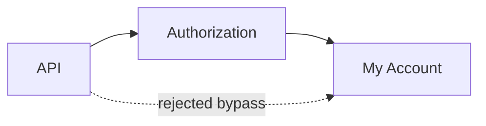
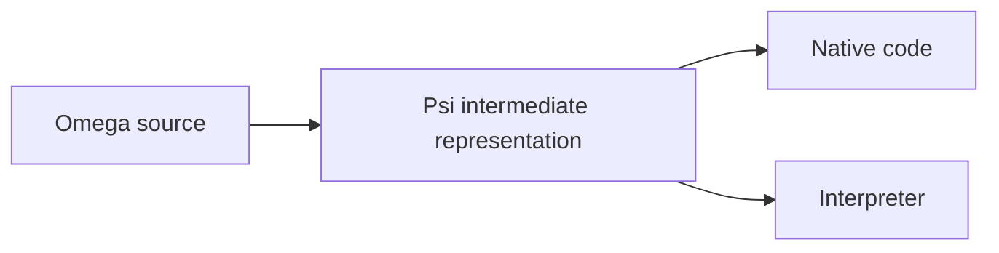

# Omega

Omega is a systems language built around explicit state machines, mathematical proofs, and ownership of memory and resources. It rules out whole classes of bugs while matching C's performance.

A program can only misbehave when a premise it trusts is false, such as an operating system API breaking its contract. There is no `unsafe` escape hatch: even inline assembly must satisfy checked contracts.

Because Omega programs are state machines, your codebase becomes a queryable graph that answers hard questions quickly:
- Does an API access the filesystem, including through its dependencies?
- Does an API call crash? Does it provably terminate? Under what conditions?
- Does a program perform well under load?

Omega is built for software where performance is critical and failure is costly, from user-facing apps to aircraft systems to OS kernels.

Its first major application is **[Cathedral](https://github.com/CathedralOS/Cathedral)**, an operating system being developed alongside the language. Cathedral applies the design to kernel problems: managing memory, controlling hardware, and running untrusted software.

**Pre-Alpha.** The Rust compiler is under active development. The language
design is ahead of its implementation; native support is not finished.

[Language guide](wiki/language_guide/language_guide.md) ·
[Specification](wiki/README.md#current-specification-subjects) ·
[Examples](samples) ·
[VS Code highlighting](tools/vscode-omega/README.md) ·
[Contributing](#development)

## Failures Omega addresses

These are design guarantees, within the stated trust boundaries:

| Failure | Guarantee | Mechanism |
| --- | --- | --- |
| Use-after-free / double-free / dangling references | ✅ Prevented | Ownership, lifetimes, borrow-checking |
| Out-of-bounds reads and writes | ✅ Prevented | Access validity proofs |
| Stack overflow | ✅ Prevented | Worst case stack calculations and tail-recursion only |
| Data races | ✅ Prevented| Borrow-checking and synchronization. |
| Hidden or unexpected service reach | ✅ Prevented | Queryable call reachability graphs with no circumvention. |
| Integer overflow / division by zero | 🌟 Prevented by default | Compile-time checked by default. |
| Unintended infinite loops | 🌟 Opt-in Prevention | Termination proofs. |
| Deadlocks / indefinite waits | 🌟 Preventable | Protocol proofs. |
| Dependency supply-chain attacks | 🌟 Preventable | Reviewable reach graphs, package manager reports. |
| Compiler supply-chain attacks | 🌟 Preventable | Auditable bootstrap chain. |

These guarantees rely on the contracts of external code and hardware. Calling
from Omega does not make safe a foreign function that lies about its memory
access, or an OS that breaks its contract.

## Machines

A machine defines behavior, its inputs, and its contract. It can look like an
ordinary function, but its contract is checked across calls. Here division may
crash only when its denominator is zero:

```omega
// This machine is obligated to report that it can crash when denominator is 0!
machine divide(
    numerator: u32,
    denominator: u32
) -> u32
crashes Trap denominator == 0
{
    transition denominator == 0 {
        true -> zero_divisor()
        false -> (numerator / denominator)
    }

    machine zero_divisor() -> u32
    crashes Trap
    {
        crash Trap;
    }
}

// This machine cannot crash, because the crashy 0 case is handled.
machine distribute_damage_to_enemies(
    total_damage: u32,
    enemy_count: u32
) -> u32
crashes Trap false
{
    transition enemy_count == 0 {
        true -> 0
        false -> divide(total_damage, enemy_count)
    }
}
```

`divide` may crash with `Trap` only under its condition; the caller's
`crashes Trap false` allows no crash. The zero-enemy branch returns directly.
On the other branch the checker knows `enemy_count != 0`, so it proves this
call cannot crash.

Remove the branch and call `divide` directly, and the caller must prove
a nonzero count another way or drop its no-Trap contract. This is not exception handling
or an assertion asking the compiler to trust the programmer.

Longer control flow uses nested machines and explicit transitions. Proved
tail loops carry values and ownership without growing the call stack.
[Machines](wiki/language_guide/chapter_3_machines.md)
[Nested machines and transitions](wiki/language_guide/chapter_4_nested_machines_transitions.md)

## Data
The `data` keyword is the only way to describe data in Omega.

```omega
data User {
    id: u64;
    active: bool;
}

data Command {
    command_id: u64;

    case GetUser(user_id: u64);
    case CountUsers;
    case DeleteUser(user_id: u64);
}

machine targets_one_user(command: &Command) -> bool {
    let Command { command_id as _, case as operation } = command;

    match operation {
        Command::GetUser { user_id as _ } -> true
        Command::CountUsers -> false
        Command::DeleteUser { user_id as _ } -> true
    }
}
```

`command_id` is present in every case and can be read as `command.command_id`
without matching first. `user_id` exists only in GetUser and DeleteUser. The
`let` pattern reads the common fields once and binds the case-specific part with
`case as operation`. This pattern cannot fail for a valid Command; an equivalent
one-arm match is also allowed. The match patterns name only
payload fields; `as _` explicitly ignores values this helper does not need.
All inline cases follow the common fields. See
[data decomposition](wiki/spec/language/patterns.md#data-and-case-decomposition)
and [irrefutable bindings](wiki/spec/language/patterns.md#irrefutable-data-bindings).

## Domains and invariants

The data declaration's `requires` keeps every valid player's health
between 0 and 100. Named domains describe further facts: a player may respawn only
when dead and outside a cutscene, and respawning must leave them alive:

```omega
data Player
    requires self.health <= 100
{
    health: u32;
    in_cutscene: bool;
}

domain Player::Respawnable
requires
    self.health == 0 && !self.in_cutscene;

domain Player::Alive
requires
    self.health > 0;

machine respawn(player: &mut Player)
requires
    player in Player::Respawnable
ensures
    player in Player::Alive
{
    player.health = 100;
}

machine update(player: &mut Player) {
    transition player in Player::Respawnable {
        true -> respawn(player)
        false -> {}
    }
}
```

`requires` is the caller's obligation; `ensures` is the implementation's
obligation. The branch in `update` proves both respawn conditions, and
`respawn` proves `Alive` by setting health to 100. Test only for zero health
and the call is rejected: the cutscene condition is still unproved.

The branch tests ordinary fields; a domain adds no runtime tag or wrapper. The
default domain must hold whenever the whole value is observed; exclusive
access may break it briefly and restore it. Setting health to
100 makes the player `Alive` and keeps the default domain.

Ordinary machines can also prove mathematical theorems, and suitable
computations can run at compile time or be used in proofs without a separate
implementation.
[Domains](wiki/language_guide/chapter_8_domains.md) ·
[Invariant windows](wiki/language_guide/chapter_11_invariant_windows.md) ·
[Mathematical proofs](wiki/language_guide/chapter_10_compile_time_proofs.md)

## Advanced Data

Suppose commands are sent as data. GetUser should produce a User, CountUsers a u64, and DeleteUser a bool indicating whether a user was deleted. A more complex declaration adds common metadata, stable identities for serialization, and GADT (generalized algebraic data type) constraints tying each command to its result type:
```omega
data Command<T>
requires
    ((self in Command::GetUser) && T == User)
    || ((self in Command::CountUsers) && T == u64)
    || ((self in Command::DeleteUser) && T == bool)
{
    #1 request_id: u64;
    #2 requested_at_ms: u64;
    #3 sequence: u32;

    #10 case GetUser(#1 user_id: u64);
    #11 case CountUsers;
    #12 case DeleteUser(#1 user_id: u64);
}

let accepted: Command<User> = Command::GetUser { user_id: 42, .. }; // Accepted.
let rejected: Command<bool> = Command::GetUser { user_id: 42, .. }; // Rejected: GetUser requires T == User.

machine execute<T>(
    connection: &mut Database,
    command: &Command<T>
) -> Result<T, DatabaseError>
{
    let (_, _, _, operation) = command;

    transition operation {
        Command::GetUser { user_id } -> database::get_user(connection, user_id)
        Command::CountUsers -> database::count_users(connection)
        Command::DeleteUser { user_id } -> database::delete_user(connection, user_id)
    }
}
```

The positional binding follows declaration order: request_id, requested_at_ms, sequence, then the case-specific part. `_` ignores each metadata field. The transition keeps the original Command's domain facts, so each case arm knows the matching equality for T.

`Database`, `DatabaseError`, and the `database::` helper machines are application-defined; their implementations are omitted here. The helpers return `Result<User, DatabaseError>`, `Result<u64, DatabaseError>`, and `Result<bool, DatabaseError>`, respectively. Every arm therefore returns `Result<T, DatabaseError>` without a cast.

GetUser carries only an ID, not a User: T describes what executing the command produces. The second construction is invalid on purpose: changing only its type argument breaks that relationship. The explicit `..` sets omitted metadata fields to zero; without it, every runtime field must be given. It does not bypass the case constraint. See [case constraints and GADT-style refinement](wiki/language_guide/chapter_1_data_values_literals.md#constraints-on-individual-cases).

The `#N` identities are neither offsets nor runtime tags, and each payload numbers its fields separately. The two Command declarations above are alternative examples, not declarations for one module.

The same data can be stored in different layouts. A custom layout policy uses compile-time reflection to choose a layout, and the compiler checks it. The declarations below illustrate storage types, not implicit conversions; assume a protobuf package supplies the named encoded representation:

```omega
// Instantiate under the standard Omega layout.
let command: Command<User>;

// Select C layout, which may be mandated by foreign API calls.
let command_c: CLayout<Command<User>>;

// Select a library-authored protobuf representation.
use protobuf;
let command_proto: ProtobufLayout<Command<User>>;
```

Variable-length protobuf encoding needs explicit byte storage and checked encode and decode operations; it is not just a fixed C-style layout.

## Reach Reporting

A save-game operation needs to write its supplied file. It does not need to
upload the save or launch another process:

```omega
machine save_game(
    save_file: File,
    bytes: &[u8]
) -> IoResult
blocks
reaches FilesystemContentWrite
{
    block FilesystemService::write(save_file, bytes)
}
```

`reaches FilesystemContentWrite` limits what this operation and everything it
calls may do. Adding network, Console or process-launch access anywhere in that
call chain fails to compile.

`blocks` and the call-site `block` state that the worker may be busy while the
operation waits. `suspend` instead pauses the call and returns control to its
executor. Neither grants extra service access.

## Trust Boundaries

Omega can check calls into a foreign library, but it cannot prove that the
library obeys its declared contract.

```omega
use omega::language::core::time_authority;

data FileTime {
    low: u32;
    high: u32;
}

boundary trait WindowsWallClock:
    Calling<MicrosoftX64Policy>
{
    machine read(output: &mut CLayout<FileTime>)
        reaches ClockObservation;
}

machine read_wall_clock(output: &mut CLayout<FileTime>)
reaches ClockObservation
{
    WindowsWallClock::read(output);
}

// In build.omg
machine build(builder: &mut Build) {
    Build::package(builder, "windows_wall_clock");
    Build::bind<WindowsWallClock::read>(
        builder,
        windows_x86_64,
        ForeignBinding::DllImport {
            import: DllImport::PeByName {
                library: "kernel32.dll",
                export: "GetSystemTimePreciseAsFileTime",
            },
        }
    );
}
```

The foreign implementation must be explicitly trusted to keep its contract; if
it lies, the caller's guarantees no longer hold. Wrapping the call cannot hide
its `ClockObservation` reach, but reach checking does not sandbox native code.

See [foreign bindings](wiki/spec/build/foreign_bindings.md#build-owned-native-binding)
and [reach contracts](wiki/spec/language/effects.md).

## Checked Inline Assembly

Omega supports checkable inline assembly. You may only write assembly that the
compiler can prove is safe.

Here, copying a packet's 16-byte header still needs bounds, alignment and access
proofs, even when the instructions are handwritten:

```omega
asm machine copy_header(
    packet: &[u8],
    destination: &mut [u8; 16]
)
requires packet.len >= 16
registers
    r10 = address_of(&packet[0]),
    r11 = address_of(&mut destination[0]),
    r9b = align_of(packet) >= 16 && align_of(destination) >= 16
{
    test r9b, r9b;
    jz unaligned;
    transition -> aligned;

    asm machine aligned
        requires align_of(packet) >= 16 && align_of(destination) >= 16
    {
        movdqa xmm0, [r10];
        movdqa [r11], xmm0;
        jmp done;
    }

    asm machine unaligned {
        movdqu xmm0, [r10];
        movdqu [r11], xmm0;
        transition -> done;
    }

    asm machine done {
        ret;
    }
}
```

The packet length and destination type prove the bounds; the borrows grant
access. **Addresses are not authority**. Removing the length requirement or moving the store one byte forward
leaves an unproved memory access.

`transition` names the block that follows directly, without emitting a jump;
`jmp` branches. Both targets of a conditional jump are explicit, and register
clobbers are inferred.

## Hardware access

Memory of the same size does not always allow the same operations.
Assume the platform's `DeviceRegisters` domain selects a policy for a
write-only transmit register:
writing sends data to the device, but borrowing it as ordinary read/write RAM
is not permitted. This example fails on purpose at the final borrow:

```omega
data UartRegisters {
    transmit: u32;
}

machine broken_reset(
    uart: &mut (UartRegisters in DeviceRegisters)
)
reaches DeviceIo
{
    let mut ram_word: u32 = 42;

    clear(&mut ram_word); // Valid: Ordinary RAM.
    write(&mut uart.transmit, 0);

    clear(&mut uart.transmit); // Rejected: cannot borrow MMIO as RAM.

    machine clear(word: &mut u32) {
        word = 0;
    }
}
```

The RAM borrow and explicit device write are permitted. The rejected call tries
to pass a device accessor to a helper requiring an ordinary RAM reference.
Even exclusive access to `uart` cannot create the missing access mode.
Recasts and checked assembly must respect that difference too.

The platform supplies the domain's access policy, independent layout and
mapping to the actual device. Omega checks against those contracts; it does not infer a datasheet from
a field name.

The same model extends to
[memory authority without runtime domain tags](wiki/spec/resources/extents.md)
and [provider selection under build policy](wiki/language_guide/chapter_19_capabilities_effects_boundaries.md).
[Device loans](wiki/spec/resources/device_access.md) ·
[Concurrency](wiki/language_guide/chapter_18_concurrency.md)


## Checks across multiple binaries & services

API, Authorization, and My Account will be independently built services.
Omega will check that every permitted invocation route from API to My Account
passes through Authorization:



An ordinary build-time topology library will state the rule over verified
components. In outline:

```text
bind API.authorization -> Authorization.requests
bind Authorization.account -> MyAccount.requests
require only_via({API}, {MyAccount}, {Authorization})
```

Adding `API -> Logging -> MyAccount` will fail too. Disconnecting My Account
will not make the rule pass: `only_via` also requires a route to exist.

The check will extend beyond the diagram:

- **Check independently built code.** Component evidence will list all
    entry points and outgoing authority, including callbacks, cleanup, and
    selected providers. A separate consumer will check it without merging the
    services' source.
- **Run the checker as ordinary build code.** A `Build::build_dependency`
    will give the build, not the application, access to the library. The helper will
    receive captured component inputs and one required output, not
    deployment credentials.
- **Enforce the actual connections.** The installer will receive the owner's
    policy separately from the plan, recheck it, and bind every endpoint before
    the application starts. Publishing a plan will grant no authority.

Graph algorithms and codecs will stay in a library. The compiler will produce
complete component facts; selected providers will enforce the
connections under explicit OS and transport contracts.

The topology will make Authorization unavoidable. Its own contracts must still
decide which user may do what to which account.

[Topology contract](wiki/spec/packages/topology.md) ·
[Build isolation and outputs](wiki/spec/build/scoped_execution.md) ·
[Implementation work](TASKS.md#checked-boundary-topology)

## Omega's big bets

| The bet | What it demands |
| --- | --- |
| High assurance and high performance become the baseline. | Correctness without sacrificing speed. |
| Malicious and buggy code proliferate. | Verify claims about capabilities, performance, and stability instead of trusting assertions. |
| Software permeates areas where failure is intolerable. | Guarantees strong enough for transportation, medicine, and operating systems. |
| Systems become increasingly distributed. | Checkable contracts across services and binaries, not just within one program. |
| Coding intelligence becomes powerful and cheap. | Design around checking abundant generated code, not merely making it easier to write. |
| Waste becomes unacceptable. | Stop treating garbage collection, emulation, and layers of bloat as unavoidable costs. |

## Installation

Published experimental bundles do not require Rust or a native linker.
On Apple Silicon macOS or Linux with Homebrew:

```sh
brew install cathedralos/omega/omega
```

Windows and other archive installs: [download a prerelease](https://github.com/CathedralOS/Omega/releases).
See [installation, a first native program, and upgrades](wiki/installation.md)
for supported hosts and instructions. Initial releases are unsigned and experimental.

## Building from source

Install Rust with `rustup`, clone this repository, and run from its root.
The checked-in toolchain file selects the required Rust version.

Start with a small precondition-checking case:

```sh
cargo run -p omega -- --check tests/fixtures/pass/constraints/scalar_requires_satisfied_by_literal/main.omg
```

It should succeed: its call passes `5` to a machine requiring a positive value.
This only checks source: no native program is built or run, and no debug
dumps are written. Add `--timings` to print stage durations and total time on
stderr; no timing file is written.

To limit the files the root build may read, list them (same syntax in
PowerShell and a POSIX shell):

```text
omega --build-input build.omg --build-input main.omg --build-input templates --optional-build-input local.cfg main.omg
```

Paths are exact UTF-8 `/`-separated names relative to the root source directory,
not host paths. A directory includes everything under it. List every root source
file the build reads; missing required, duplicate or nested entries are
rejected. Missing optional entries stay absent. Package preparation copies
the editable project without changing its permissions; dependencies keep their
own inputs.
The options apply to compilation, `--check`, `omega packages audit`, and new
package install/update commands, not `run`. Pass the same list to review, audit,
and compilation. A pending review keeps its list; `--resume` uses it
without repeating or overriding the input flags. Audit never changes acceptance.
Without these options, package inputs behave as before. They grant no
extra host access and publish no companion outputs. A changed build policy
still needs ordinary package acceptance.

For a full application, start with the [CLI example](samples/cli/basics/cli_mvp/README.md).
Its instructions separate the intended result from current compiler
limitations. The [command-line contract](wiki/spec/build/command_line.md) defines
subsystem routing, optional source rewriting and independent validator selection.

## Compiler Pipeline

Omega source compiles to **Psi**, a portable intermediate binary that can be
lowered to **native code** or **run by an interpreter** for scripting.



Psi is the portable output of source checking. A consumer reuses the checks a
trusted compiler made on that exact artifact; the interpreter enforces
operation safety and installed host permissions. When an artifact may run, and
what future untrusted interpretation requires, are defined in the
[product contract](wiki/spec/terminal-psi/product.md#publication-and-separate-consumption).
Development tests compare
native execution with the Psi interpreter using `omega run --both`.
The compiler's transformations are still trusted; native/Psi agreement covers
only the tested inputs and observations.
[Follow the pipeline →](omega-rust/pipeline.md#verification-placement)

The separate [bootstrap chain](bootstrap/README.md) aims to build the compiler
from a small auditable starting point. You do not need it to work on the Rust
implementation.

## Explore

| If you want to… | Start here |
| --- | --- |
| Learn the language | [Language guide](wiki/language_guide/language_guide.md) |
| Look up an exact rule | [Language and toolchain specification](wiki/README.md) |
| Explore programs and library code | [Samples](samples) · [Bundled library](source/library) |
| Work on the current compiler | [Rust implementation](omega-rust/README.md) |
| Read the self-hosted compiler sources | [Product source](source/README.md) |
| Understand bootstrap and trust | [Bootstrap](bootstrap/README.md) |
| Discuss a language change | [Proposals](wiki/proposals/README.md) · [Open decisions](OWNER_QUESTIONS.md) |

## Development

Current work puts finishing the Rust compiler ahead of self-hosting and the
bootstrap. The [compiler board](TASKS.md),
[optimizer board](TASKS_OPTIMIZER.md), and
[completion criteria](wiki/drafts/reference/rust_compiler_completion.md) describe the work.

Read [repository conventions](AGENTS.md#conventions-and-workflow) before changing
code. [Local testing](tools/docs/testing.md) covers focused checks and supported
development hosts.

## License

Licensed under either of

- Apache License, Version 2.0 ([LICENSE-APACHE](LICENSE-APACHE))
- MIT license ([LICENSE-MIT](LICENSE-MIT))

at your option.

Unless you explicitly state otherwise, any contribution intentionally submitted
for inclusion in this repository shall be dual licensed as above, without any
additional terms or conditions.
