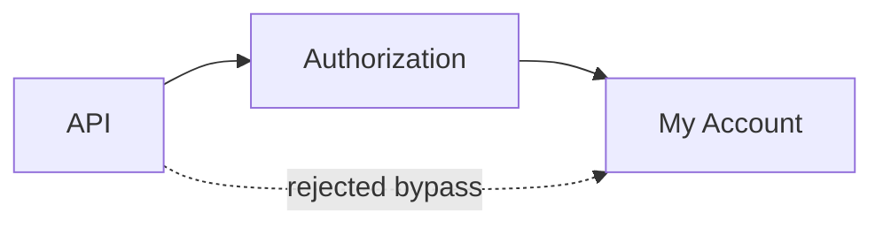
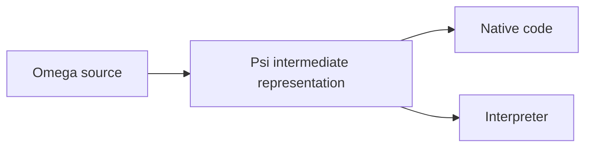

# Omega

Omega is a systems language built around explicit state machines, mathematical proofs, and ownership of memory and resources. Entire classes of bugs are eliminated while keeping performance on par with C.

Instability can only arise under faulty premises, such as a faulty Operating System API contract. There is no `unsafe` escape hatch: even inline assembly must satisfy checked contracts.

The state-machine structure of Omega turns your codebase into a queryable graph, allowing quick answers to hard questions:
- Does an API access the filesystem, including through its dependencies?
- Does an API call crash? Does it provably terminate? Under what conditions?
- Does a program perform well under load?

Omega is being built for software where performance is critical, and failure is costly; from user facing apps, to aircraft systems, to OS kernels.

Its first major application is **[Cathedral](https://github.com/CathedralOS/Cathedral)**, an operating system being developed alongside the language. Cathedral puts the design to work on kernel problems: managing memory, controlling hardware, and running untrusted software.

**Pre-Alpha.** The Rust compiler is under active development. The language
design is ahead of its implementation; native support is still being completed.

[Language guide](wiki/language_guide/language_guide.md) ·
[Specification](wiki/README.md#current-specification-subjects) ·
[Examples](samples) ·
[VS Code highlighting](tools/vscode-omega/README.md) ·
[Contributing](#development)

## Failures Omega addresses

These are design guarantees, within the stated trust boundaries:

| Failure | Guarantee | Mechanism |
| --- | --- | --- |
| Use-after-free / double-free / dangling references | ✅ Prevented | Ownership, lifetimes, borrow-checking |
| Out-of-bounds reads and writes | ✅ Prevented | Access validity proofs |
| Stack overflow | ✅ Prevented | Worst case stack calculations and tail-recursion only |
| Data races | ✅ Prevented| Borrow-checking and synchronization. |
| Hidden or unexpected service reach | ✅ Prevented | Queryable call reachability graphs with no circumvention. |
| Integer overflow / division by zero | 🌟 Prevented by default | Compile-time checked by default. |
| Unintended infinite loops | 🌟 Opt-in Prevention | Termination proofs. |
| Deadlocks / indefinite waits | 🌟 Preventable | Protocol proofs. |
| Dependency supply-chain attacks | 🌟 Preventable | Reviewable reach graphs, package manager reports. |
| Compiler supply-chain attacks | 🌟 Preventable | Auditable bootstrap chain. |

These guarantees rely on the contracts of external code and hardware. A foreign
function that lies about its memory access, or an OS that violates its contract,
is not made safe by calling it from Omega.

The 2026-10-22 optional reach-ceiling and ordinary entry-storage decisions are
ratified language contracts, not claims that their compiler migration is complete.
`OPTIONAL-REACH-CEILINGS`, `EXPLICIT-ENTRY-STORAGE`, and
`STATIC-MACHINE-MIGRATION` in [TASKS.md](TASKS.md) retain that implementation
and source-migration acceptance.

The 2026-10-28 [requirement-clause unification](wiki/spec/language/state_contracts.md#requirement-clauses)
retires `where` in favor of `requires` and direct assembly contract clauses.
The examples use the ratified spelling; `REQUIRES-UNIFICATION` in
[TASKS.md](TASKS.md) retains the compiler and source migration.

## Machines

A machine defines behavior, its inputs, and its contract. It can look like an
ordinary function, but its contract is checked across calls. Here division may
crash only when its denominator is zero:

```omega
// This machine is obligated to report that it can crash when denominator is 0!
machine divide(
    numerator: u32,
    denominator: u32
) -> u32
crashes Trap denominator == 0
{
    transition denominator == 0 {
        true -> zero_divisor()
        false -> (numerator / denominator)
    }

    machine zero_divisor() -> u32
    crashes Trap
    {
        crash Trap;
    }
}

// This machine cannot crash, because the crashy 0 case is handled.
machine distribute_damage_to_enemies(
    total_damage: u32,
    enemy_count: u32
) -> u32
crashes Trap false
{
    transition enemy_count == 0 {
        true -> 0
        false -> divide(total_damage, enemy_count)
    }
}
```

`divide` permits a guarded `Trap`; the caller's `crashes Trap false` permits none.
The zero-enemy branch returns directly. On the other branch, the checker knows
`enemy_count != 0` and disproves the callee's crash route for that call.

Remove the branch and call `divide` directly: the caller must prove a nonzero
count another way or relax its explicit no-Trap contract. This is not exception handling
or an assertion asking the compiler to trust the programmer.

Longer control flow uses nested machines and explicit transitions. Proved
runtime tail cycles carry values and ownership without growing the call stack.
[Machines](wiki/language_guide/chapter_3_machines.md)
[Nested machines and transitions](wiki/language_guide/chapter_4_nested_machines_transitions.md)

## Data
The `data` keyword is the only manner by which data is described in Omega.

```omega
data User {
    id: u64;
    active: bool;
}

data Command {
    command_id: u64;

    case GetUser(user_id: u64);
    case CountUsers;
    case DeleteUser(user_id: u64);
}

machine targets_one_user(command: &Command) -> bool {
    let Command { command_id as _, case as operation } = command;

    match operation {
        Command::GetUser { user_id as _ } -> true
        Command::CountUsers -> false
        Command::DeleteUser { user_id as _ } -> true
    }
}
```

`command_id` is present in every case and can be read as `command.command_id`
without matching first. `user_id` exists only in GetUser and DeleteUser. The
`let` pattern handles the common fields once and binds a case-only view with
`case as operation`. This decomposition cannot fail for a valid Command; an
equivalent one-arm outer match is also allowed. The match patterns name only
payload fields; `as _` explicitly ignores values this helper does not need.
All inline cases follow the common fields. See
[data decomposition](wiki/spec/language/patterns.md#data-and-case-decomposition)
and [irrefutable bindings](wiki/spec/language/patterns.md#irrefutable-data-bindings).

## Domains and invariants

The data declaration's `requires` clause keeps every valid player's health between
0 and 100. Named domains describe additional facts: a player may respawn only
when dead and outside a cutscene, and respawning must leave them alive:

```omega
data Player
    requires self.health <= 100
{
    health: u32;
    in_cutscene: bool;
}

domain Player::Respawnable
requires
    self.health == 0 && !self.in_cutscene;

domain Player::Alive
requires
    self.health > 0;

machine respawn(player: &mut Player)
requires
    player in Player::Respawnable
ensures
    player in Player::Alive
{
    player.health = 100;
}

machine update(player: &mut Player) {
    transition player in Player::Respawnable {
        true -> respawn(player)
        false -> {}
    }
}
```

`requires` is the caller's obligation; `ensures` is the implementation's
obligation. The branch in `update` establishes both respawn conditions, and
`respawn` establishes `Alive` by setting health to 100. Check only for zero health
and the call is rejected: the cutscene condition is still missing.

The branch tests ordinary fields. Domain qualification adds no runtime state
tag or wrapper. The default domain must hold whenever the whole value is
observed; exclusive mutation may temporarily break and then restore it. Setting
health to 100 establishes `Alive` while preserving the player's default domain.

Ordinary machines can also establish mathematical theorems, and eligible
computations can run at compile time or be referenced in proofs without a
separate implementation.
[Domains](wiki/language_guide/chapter_8_domains.md) ·
[Invariant windows](wiki/language_guide/chapter_11_invariant_windows.md) ·
[Mathematical proofs](wiki/language_guide/chapter_10_compile_time_proofs.md)

## Advanced Data
Suppose commands are sent as data. GetUser should produce a User, CountUsers a u64, and DeleteUser a bool indicating whether a user was deleted. A more complex declaration adds common metadata, stable identities for serialization, and GADT (generalized algebraic data type) constraints tying each command to its result type:
```omega
data Command<T>
requires
    ((self in Command::GetUser) && T == User)
    || ((self in Command::CountUsers) && T == u64)
    || ((self in Command::DeleteUser) && T == bool)
{
    #1 request_id: u64;
    #2 requested_at_ms: u64;
    #3 sequence: u32;

    #10 case GetUser(#1 user_id: u64);
    #11 case CountUsers;
    #12 case DeleteUser(#1 user_id: u64);
}

let accepted: Command<User> = Command::GetUser { user_id: 42 }; // Accepted.
let rejected: Command<bool> = Command::GetUser { user_id: 42 }; // Rejected: GetUser requires T == User.

machine execute<T>(
    connection: &mut Database,
    command: &Command<T>
) -> Result<T, DatabaseError>
{
    transition command {
        (_, _, _, operation) -> match operation {
            Command::GetUser { user_id } -> database::get_user(connection, user_id)
            Command::CountUsers -> database::count_users(connection)
            Command::DeleteUser { user_id } -> database::delete_user(connection, user_id)
        }
    }
}
```

The positional outer pattern follows authored order: request_id, requested_at_ms, sequence, then one case-only view. `_` ignores each metadata binding. The inner match retains the original Command's domain facts, so selecting a case establishes the corresponding equality for T.

`Database`, `DatabaseError`, and the `database::` helper machines are application-defined; their implementations are omitted here. The helpers return `Result<User, DatabaseError>`, `Result<u64, DatabaseError>`, and `Result<bool, DatabaseError>`, respectively. Every arm therefore returns `Result<T, DatabaseError>` without a cast.

GetUser carries only an ID, not a User: T describes what executing the command produces. The second construction is deliberately invalid because changing only its type argument breaks that relationship. Omitted metadata fields are zero-initialized here. See [case constraints and GADT-style refinement](wiki/language_guide/chapter_1_data_values_literals.md#constraints-on-individual-cases).

The `#N` identities are neither offsets nor runtime tags, and each payload has its own numbering scope. The two Command declarations above are alternative examples, not declarations to combine in one module.

The same semantic data can use different representations. Custom policies use compile-time reflection to choose a layout, subject to compiler validation. The declarations below illustrate storage types, not implicit conversions; assume a protobuf package supplies the named encoded representation:

```omega
// Instantiate under the standard Omega layout.
let command: Command<User>;

// Select C layout; the foreign API's actual ABI must still agree.
let command_c: CLayout<Command<User>>;

// Select a library-authored protobuf representation.
use protobuf;
let command_proto: ProtobufLayout<Command<User>>;
```

Variable-length protobuf encoding needs explicit byte storage and checked encode/decode operations; it is not merely a fixed C-style layout. These representation families, case/type constraints and separate case-view patterns describe the ratified design, with implementation work still tracked in [TASKS.md](TASKS.md), including `DATA-DECOMPOSITION`.

## Checked Inline Assembly

Copying a packet's 16-byte header must not read past a truncated packet or
overwrite a short destination. Moving the work into assembly does not remove
those obligations:

```omega
machine copy_header(
    packet: &[u8],
    destination: &mut [u8; 16]
)
requires packet.len >= 16
{
    let source_address: addr = address_of(&packet[0]);
    let destination_address: addr = address_of(&mut destination[0]);

    asm clobbers xmm0 {
        copy
            requires packet.len >= 16:
        movdqu xmm0, [source_address];
        movdqu [destination_address], xmm0
    }
}
```

The load needs 16 readable bytes; the store needs 16 writable bytes. The packet
length requirement and destination type establish the bounds, while the borrowed
arguments supply the necessary access. Numeric addresses alone grant nothing.
Shifting the store one byte forward would overrun the destination and leave an
unproved access obligation.

Label contracts are checked against instruction semantics, not trusted comments.
This SIMD snippet illustrates the intended contract; it is not a currently
validated `movdqu` example. Instruction and target support remain incomplete.

## Reach Reporting

A save-game operation needs to write its supplied file. It does not need to
upload the save or launch another process:

```omega
machine save_game(
    save_file: File,
    bytes: &[u8]
) -> IoResult
blocks
reaches FilesystemContentWrite
{
    block FilesystemService::write(save_file, bytes)
}
```

`reaches FilesystemContentWrite` is a ceiling on this operation and its checked
transitive calls. Adding network, Console or process-launch reach anywhere in
that call chain would exceed the ceiling. Reach describes service usage; the
supplied file and selected backing provide the actual authority.

`blocks` and the call-site `block` acknowledge that the worker may be occupied
while the operation waits. `suspend` instead parks an activation and returns
control to its executor. Neither grants additional service access.

## Hardware access

The same-sized memory is not always permitted to support the same operations.
Assume the platform's `UartMmio` policy describes a write-only transmit register:
writing sends data to the device, but borrowing it as ordinary read/write RAM
is not permitted. This example deliberately fails at the final borrow:

```omega
data UartRegisters {
    transmit: u32;
}

machine broken_reset(
    uart: &mut Placed<UartMmio, UartRegisters>
)
reaches DeviceIo
{
    let mut ram_word: u32 = 42;

    clear(&mut ram_word); // Valid: Ordinary RAM.
    uart.transmit.write(0);

    clear(&mut uart.transmit); // Rejected: cannot borrow MMIO as RAM.

    machine clear(word: &mut u32) {
        word = 0;
    }
}
```

The RAM borrow and explicit device write are permitted. The rejected call tries
to pass a device accessor to a helper requiring an ordinary RAM reference.
Even exclusive access to `uart` cannot manufacture the missing access mode.
Recasts and checked assembly must respect that distinction too.

The platform supplies the placement policy and its correspondence to the actual
device. Omega checks against those contracts; it does not infer a datasheet from
a field name. This is a policy-dependent design example, not a claim that the
shown invalid program or every placed-access operation is currently supported.

The same model extends to
[memory authority without runtime domain tags](wiki/spec/resources/extents.md)
and [provider selection under build policy](wiki/language_guide/chapter_19_capabilities_effects_boundaries.md).
[Device loans](wiki/spec/resources/device_access.md) ·
[Concurrency](wiki/language_guide/chapter_18_concurrency.md)


## Checks across multiple binaries & services

API, Authorization, and My Account will be independently built services.
Omega will check that every permitted invocation route from API to My Account
passes through Authorization:



An ordinary build-only topology library will express the rule over verified
component instances. In schematic form:

```text
bind API.authorization -> Authorization.requests
bind Authorization.account -> MyAccount.requests
require only_via({API}, {MyAccount}, {Authorization})
```

Adding `API -> Logging -> MyAccount` will fail too. Disconnecting My Account
will not make the rule pass: `only_via` also requires a route to exist.

The check will extend beyond the diagram:

- **Check independently built code.** Component evidence will account for all entries
    and outgoing authority, including callbacks, cleanup, and selected providers.
    An independent consumer will check it without merging the services' source trees.
- **Run the checker as ordinary build code.** A `build_depend` will grant library
    access to the build, not the application. The helper will receive captured
    component inputs and a linear output obligation, not deployment credentials.
- **Enforce the actual connections.** The installer will receive the owner's
    required policy independently of the plan, recheck it, and establish complete
    endpoint bindings before allowing application entry. Publishing a plan will
    grant no authority.

Graph algorithms and codecs will stay in a library. The compiler will establish
complete component facts; selected providers will enforce the actual connections
under explicit OS and transport contracts.

The topology will make Authorization unavoidable. Its own contracts will still
need to establish which user may perform which operation on which account.

[Topology contract](wiki/spec/packages/topology.md) ·
[Build isolation and outputs](wiki/spec/build/scoped_execution.md) ·
[Implementation work](TASKS.md#checked-boundary-topology)

## Omega's big bets

| The bet | What it demands |
| --- | --- |
| High assurance and high performance become the baseline. | Correctness without sacrificing speed. |
| Malicious and buggy code proliferate. | Verify claims about capabilities, performance, and stability instead of trusting assertions. |
| Software permeates areas where failure is intolerable. | Guarantees strong enough for transportation, medicine, and operating systems. |
| Systems become increasingly distributed. | Checkable contracts across services and binaries, not just within one program. |
| Coding intelligence becomes powerful and cheap. | Design around checking abundant generated code, not merely making it easier to write. |
| Waste becomes unacceptable. | Stop treating garbage collection, emulation, and layers of bloat as unavoidable costs. |

## Installation

Published experimental bundles do not require Rust or a native linker.
On Apple Silicon macOS or Linux with Homebrew:

```sh
brew install cathedralos/omega/omega
```

Windows and other archive installs: [download a prerelease](https://github.com/CathedralOS/Omega/releases).
See [installation, a first native program, and upgrades](wiki/installation.md)
for supported hosts and instructions. Initial releases are unsigned and experimental.

## Building from source

Install Rust with `rustup`, clone this repository, and run from its root.
The checked-in toolchain file selects the required Rust version.

Start with a small precondition-checking case:

```sh
cargo run -p omega -- --check tests/omega/pass/constraints/scalar_requires_satisfied_by_literal/main.omg
```

It should finish successfully: its call supplies `5` to a machine requiring
a positive value. This checks source; it does not emit or run a native program.
No debug dumps are generated. Add `--timings` for command-stage durations and
total elapsed time on stderr; no timing file is written.

To restrict the root build's readable inputs, pass an explicit inventory
(same syntax in PowerShell and a POSIX shell):

```text
omega --build-input build.omg --build-input main.omg --build-input templates --optional-build-input local.cfg main.omg
```

Paths are exact UTF-8 `/`-separated names relative to the root source directory,
not host paths. A directory includes its subtree. Include every consumed root
source file; missing required entries, duplicate or nested declarations reject.
Optional missing entries stay absent. Package preparation captures the editable
project without changing its permissions; dependencies retain their own inputs.
The options apply to compilation, `--check`, `omega audit packages`, and new
package install/update commands, not `run`. Pass the same inventory through
review, audit, and compilation. A pending review retains its selection;
`--resume` uses it without repeating or overriding the input flags. Audit never
changes acceptance. Without these options, existing package-inventory behavior
is unchanged. They grant
no extra host access and do not publish companion outputs. A changed build policy
still needs ordinary package acceptance.

For a full application, start with the [CLI example](samples/cli/basics/cli_mvp/README.md).
Its instructions distinguish the intended result from the current compiler
limitations.

## Compiler Pipeline

Omega source compiles to **Psi**, a portable intermediate binary that can be
lowered to **native code** or **run by an interpreter** for scripting.



Psi carries proof evidence so a receiving compiler or interpreter can check its
contracts and declared capabilities independently of the producer.
[Follow the pipeline →](omega-rust/pipeline.md)

The separate [bootstrap chain](bootstrap/README.md) works toward constructing
the compiler from a small auditable starting point. It is not required to work
on the Rust implementation.

## Explore

| If you want to… | Start here |
| --- | --- |
| Learn the language | [Language guide](wiki/language_guide/language_guide.md) |
| Look up an exact rule | [Language and toolchain specification](wiki/README.md) |
| Explore programs and library code | [Samples](samples) · [Bundled library](source/library) |
| Work on the current compiler | [Rust implementation](omega-rust/README.md) |
| Read the self-hosted compiler sources | [Product source](source/README.md) |
| Understand bootstrap and trust | [Bootstrap](bootstrap/README.md) |
| Discuss a language change | [Proposals](wiki/proposals/README.md) · [Open decisions](OWNER_QUESTIONS.md) |

## Development

Current work prioritizes finishing the Rust compiler before self-hosting and
bootstrap completion. The [compiler board](TASKS.md),
[optimizer board](TASKS_OPTIMIZER.md), and
[completion criteria](wiki/drafts/reference/rust_compiler_completion.md) describe the work.

Read [repository conventions](AGENTS.md#conventions-and-workflow) before changing
code. [Local testing](tools/testing.md) covers focused checks and supported
development hosts.

## License

Licensed under either of

- Apache License, Version 2.0 ([LICENSE-APACHE](LICENSE-APACHE))
- MIT license ([LICENSE-MIT](LICENSE-MIT))

at your option.

Unless you explicitly state otherwise, any contribution intentionally submitted
for inclusion in this repository shall be dual licensed as above, without any
additional terms or conditions.
