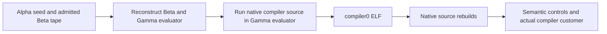

# Bootstrap: constructing the compiler

Bootstrap asks how to construct the Omega compiler from a declared, auditable
seed and then reproduce its self-rebuild. It is a construction problem with
competing implementations, separate from the product compiler's numbered
representation pipeline. [The governing mandate][b01] permits different stage
counts, languages, interpreters, VMs, native targets and documented accelerators.

This page maps source at `3f9ce43f0c9d179048911d18faa91ba93f60176d`.
No bootstrap compiler or customer was executed for this map. Historical
observations below are attributed to their records; a fresh run is *unverified*.
No peer has demonstrated the full Omega compiler construction and reproducible
self-rebuild required by [the completion rule][b02].

## Current peer paths

| Path | What supplies meaning and what it produces | Evidence and limits |
| --- | --- | --- |
| `interpreted/` | Audited Alpha execution floor; separately admitted Beta compiler tape; Beta-written Gamma evaluator; Gamma-written Delta compiler; Delta-written Epsilon evaluator; Epsilon-written bootstrap compiler. | [Path description][b03] records exercised Omega programs and unfinished product construction. Rebuilding the admitted Beta tape establishes identity; it does not eliminate that tape as a trust input. |
| `compiled_vm/` | A Gamma compiler written in Gamma, constructed through the retained seed route, emits independent Alpha tapes. It compiles the actual Delta compiler and Epsilon evaluator receipt. | [Source construction][b04] retains exact source, constructs the compiler, rebuilds it twice and runs refusal controls. [Recorded customers][b05] include an emitted Omega program, not an Omega compiler self-rebuild. Python `gamma.py` is an explicit additional semantic producer only on the accelerated route. |
| `independent/` | The shared Gamma frontend/lowering plus `native.gamma` emit native Linux x86-64 ELF executables. Its successors can execute without the Alpha interpreter. | [Implemented construction][b06] and [successor route][b07] exist. Native Epsilon initially remains an evaluator executing bootstrap-compiler source. A separate checked Epsilon module compiler has [scalar/enum][b08] and later [receiver/view storage][b24] customers; it still explicitly refuses unsupported constructs and is not a full compiled bootstrap compiler. |
| `proofs/` | Retained derivation-checking research. | [The mandate][b02] excludes formal bootstrap correctness certificates from current construction acceptance, while ordinary Omega safety, contracts and proofs remain required. |

The bootstrap index is stale: [`bootstrap/README.md`][b09] says the independent
implementation has not started. Its source and detailed README show native
construction, controls and successor work. This page follows those concrete
entrances and preserves the discrepancy rather than repeating the index claim.

## One concrete route: native Gamma construction

The implemented entrance is:

```sh
python3 bootstrap/independent/source_test.py
```

The source route requires Linux x86-64 and a positive watchdog. It uses the
audited Alpha seed, separately admitted Beta tape, host OS, Python and shell
invocation machinery. Python copies and frames source bytes on this route;
`--accelerated` additionally uses the Python Gamma compiler to supply language
meaning. These are distinct trust profiles. [Dispatcher][b10];
[trust boundary][b11].



*Current code route. The rebuilt compiler here compiles Gamma; this is an
intermediate construction check, not the Omega compiler's self-rebuild.*

1. [`reconstruct`][b12] stamps the admitted Beta tape into the Alpha seed,
   recompiles Beta source, compares the tape with the bound artifact, then uses
   the reconstructed Beta compiler to produce and compare the Gamma evaluator.
2. The native source is the [explicit composition][b13] of the shared Gamma
   compiler, frontend and native emitter. [`source_test.py`][b10] retains those
   bytes and a framed request, then runs the constructed evaluator to produce
   `compiler0.elf` on the reference route.
3. The [rebuild loop][b14] runs each resulting native compiler on the same
   compiler source and requires successful byte-identical results. This is a
   gate chosen by this implementation; the general mandate defines
   reproducibility without requiring every first/self-compiled generation to
   be byte-identical. [Comparison rule][b15].
4. The harness [records source/artifact identities and control results][b16].
   Malformed source must return its designated refusal with no output.
   [Boundary controls][b17] distinguish image capacity and returned OS-call
   failures. A watchdog expiration is an incomplete observation, not a language
   rejection. [Execution limits][b18].

The [retained native construction record][b19] reports compiler rebuilds,
semantic controls and a real Alpha-targeting compiler customer. Its
[successor record][b07] then follows native Delta and native Epsilon execution
to an Omega fixture. It explicitly says Epsilon is still the evaluator and
does not establish a standalone compiled bootstrap compiler or Omega self-rebuild.
Those source and artifact identities qualify the historical results; this atlas
does not convert them into current test passes or performance comparisons.

## Ownership and useful next measurements

The product being constructed remains [`source/psi` and `source/omega`][b20],
outside every variant. A small Omega program, a Gamma fixed point, or a compiled
lexical-classification module proves only the named customer. The independent
native backend also records an [auditability failure][b21] in its numeric
operation identities and sizing ladder; passing controls do not discharge it.

The later receiver/view milestone matters when reading the independent README:
its earlier scalar-only coverage paragraph is not the whole current capability.
[Storage compilation code][b25] supports scalar and view parameters while
refusing nominal parameter types; the [latest recorded customer][b24] compiles
the real request/UTF-8 module and reports that full bootstrap-compiler source
still stops at a nominal diagnostic parameter. Console text output also remains
unfinished. This is progress through an actual successor, not full acceptance.

`tools/bootstrap/paths.sh` [names source owners][b22]; it supplies no translation
semantics. A tool that does supply source-language meaning must be accounted for
as an implementation stage or accelerator. Byte transport, source composition,
stamping, observation and language implementation should therefore have different
edges in the map. [Mandate distinction][b23].

*Judgment:* compare peers using the same real successor where possible, recording
exact source, seed, accelerator profile, runtime prerequisites, actual output,
refusal controls, cold construction and iteration cost. Keep the remaining
Omega product customer explicit instead of assigning construction variants to
the Rust product's stage numbers. These recommendations apply the mandate's
[whole-chain comparison rules][b15]; no architecture selection is made here.

[b01]: https://github.com/CathedralOS/Omega/blob/3f9ce43f0c9d179048911d18faa91ba93f60176d/bootstrap/MINIMIZATION.md#L3-L38
[b02]: https://github.com/CathedralOS/Omega/blob/3f9ce43f0c9d179048911d18faa91ba93f60176d/bootstrap/MINIMIZATION.md#L106-L118
[b03]: https://github.com/CathedralOS/Omega/blob/3f9ce43f0c9d179048911d18faa91ba93f60176d/bootstrap/interpreted/README.md#L3-L40
[b04]: https://github.com/CathedralOS/Omega/blob/3f9ce43f0c9d179048911d18faa91ba93f60176d/bootstrap/compiled_vm/source_test.py#L61-L100
[b05]: https://github.com/CathedralOS/Omega/blob/3f9ce43f0c9d179048911d18faa91ba93f60176d/bootstrap/compiled_vm/README.md#L229-L250
[b06]: https://github.com/CathedralOS/Omega/blob/3f9ce43f0c9d179048911d18faa91ba93f60176d/bootstrap/independent/README.md#L3-L61
[b07]: https://github.com/CathedralOS/Omega/blob/3f9ce43f0c9d179048911d18faa91ba93f60176d/bootstrap/independent/README.md#L137-L200
[b08]: https://github.com/CathedralOS/Omega/blob/3f9ce43f0c9d179048911d18faa91ba93f60176d/bootstrap/independent/README.md#L234-L268
[b09]: https://github.com/CathedralOS/Omega/blob/3f9ce43f0c9d179048911d18faa91ba93f60176d/bootstrap/README.md#L15-L20
[b10]: https://github.com/CathedralOS/Omega/blob/3f9ce43f0c9d179048911d18faa91ba93f60176d/bootstrap/independent/source_test.py#L80-L110
[b11]: https://github.com/CathedralOS/Omega/blob/3f9ce43f0c9d179048911d18faa91ba93f60176d/bootstrap/independent/README.md#L51-L61
[b12]: https://github.com/CathedralOS/Omega/blob/3f9ce43f0c9d179048911d18faa91ba93f60176d/bootstrap/compiled_vm/source_test.py#L21-L35
[b13]: https://github.com/CathedralOS/Omega/blob/3f9ce43f0c9d179048911d18faa91ba93f60176d/bootstrap/independent/README.md#L10-L23
[b14]: https://github.com/CathedralOS/Omega/blob/3f9ce43f0c9d179048911d18faa91ba93f60176d/bootstrap/independent/source_test.py#L111-L117
[b15]: https://github.com/CathedralOS/Omega/blob/3f9ce43f0c9d179048911d18faa91ba93f60176d/bootstrap/MINIMIZATION.md#L65-L92
[b16]: https://github.com/CathedralOS/Omega/blob/3f9ce43f0c9d179048911d18faa91ba93f60176d/bootstrap/independent/source_test.py#L119-L165
[b17]: https://github.com/CathedralOS/Omega/blob/3f9ce43f0c9d179048911d18faa91ba93f60176d/bootstrap/independent/source_test.py#L47-L77
[b18]: https://github.com/CathedralOS/Omega/blob/3f9ce43f0c9d179048911d18faa91ba93f60176d/bootstrap/independent/README.md#L57-L90
[b19]: https://github.com/CathedralOS/Omega/blob/3f9ce43f0c9d179048911d18faa91ba93f60176d/bootstrap/independent/README.md#L113-L135
[b20]: https://github.com/CathedralOS/Omega/blob/3f9ce43f0c9d179048911d18faa91ba93f60176d/source/omega/README.md#L47-L53
[b21]: https://github.com/CathedralOS/Omega/blob/3f9ce43f0c9d179048911d18faa91ba93f60176d/bootstrap/independent/README.md#L92-L100
[b22]: https://github.com/CathedralOS/Omega/blob/3f9ce43f0c9d179048911d18faa91ba93f60176d/tools/bootstrap/paths.sh#L1-L5
[b23]: https://github.com/CathedralOS/Omega/blob/3f9ce43f0c9d179048911d18faa91ba93f60176d/bootstrap/MINIMIZATION.md#L93-L104
[b24]: https://github.com/CathedralOS/Omega/blob/3f9ce43f0c9d179048911d18faa91ba93f60176d/bootstrap/independent/README.md#L364-L414
[b25]: https://github.com/CathedralOS/Omega/blob/3f9ce43f0c9d179048911d18faa91ba93f60176d/bootstrap/independent/epsilon/storage_machines.delta#L16-L32
