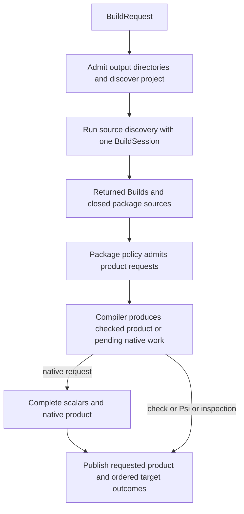
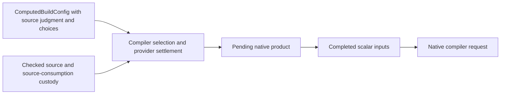
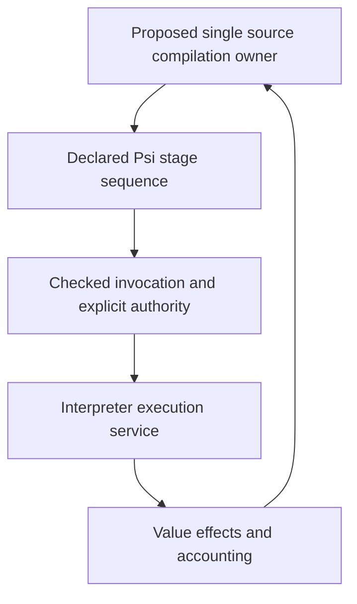

# Build and packages

Build decides which sources, entries, providers and settings a product uses.
Packages establish which source bytes and accepted decisions those choices may
refer to. The coordinator alternates between those owners and the compiler;
the native compiler receives the resulting program, target and completed
inputs. This is more than a configuration reader, and it is not a second
native pipeline. [The complete project operation][build-route] makes that
division visible.

**Evidence revision:** `3f9ce43f0c9d179048911d18faa91ba93f60176d`.
This page follows production source at that revision. Existing tests below are
evidence of intended assertions; their current execution results are
*unverified*. Proposed ownership changes are marked *judgment*. The [Psi
page](psi.md), [Omega page](omega.md), [interpreter page](interpreter.md) and
[CLI page](cli.md) cover the adjoining owners.

## The operation a caller actually requests

`orchestration::build(BuildRequest)` returns
`Result<Vec<TargetBuildOutcome>, BuildError>`. The request names a root path,
host/single/batch targets, a product, output directory, source-capture request,
optimization selections, timings, offline/verification options and explicit
stage validators. Each ordered target outcome contains either its own refusal
or a compiler output, timing data, optional published executable path and
validator rows. A failure before target work can start is the outer error.
These are [actual request and result fields][project-contract].

| Requested product | Where this route stops |
| --- | --- |
| `Check` | Produces a checked report; the coordinator uses a disposable workspace. |
| `Terminal` | Retains the canonical Psi artifact for a caller. This project operation does not automatically write a `.psi` file. |
| `Inspection { machine }` | Returns the requested machine's inspection artifact; requires one exact target and uses a disposable workspace. |
| `Native { destination: Published }` | Completes native work, runs requested validators, then writes the product. |
| `Native { destination: Retained }` | Keeps the native product in memory, allowing the CLI to interpret its exact Psi artifact before publication. |
| `Native { destination: RuntimeAdmission }` | Completes the runtime admission needed by `run --engine psi` without emitting machine code. |

The product and destination enums are [declared together][project-contract].
[Publication branches on those values][publication-route]; it does not infer
the stop point from whichever files happen to exist.

This is the package-project route in [build.rs][build-route] and
[project_compilation.rs][project-compilation]. A standalone source request
uses the same begin/execute/complete protocol through
[`compile_sources`, `check_source` or `produce_source`][source-route]. The
standalone execution loop can answer retained product queries, but explicitly
refuses provider-readiness or dependency-preparation pauses that require the
package scheduler. It does not silently turn into a package resolver.
See [`execute_build`][execute-build].

## Who owns each boundary

| Owner | Declared input → result | What remains this owner's responsibility |
| --- | --- | --- |
| `orchestration` | Project/package request → per-target results or package-command outcome | Holds compiler and package sessions together; drives suspended Builds, target scheduling and final publication. [Source][orchestration-owner] |
| `build-settings` | Admitted Build source and execution context → `ReturnedBuild` → `EvaluatedBuild` | Creates the interpreter activation, authenticates effects on the original Build value, reads its normal return and validates the return belongs to the prepared invocation. [Return][build-return], [completion][build-completion] |
| `source-acquisition` | Local root or Git request plus bounded storage custody → immutable source observation/snapshot | Captures exact bytes, establishes lineage/content identity, verifies retained storage and publishes snapshots. It does not accept package policy. [Public entrance][acquisition], [local implementation][local-capture] |
| `resolver-execution` | Operator-selected resolver executable, phase and working root → bounded process execution | Keeps executable and working-root custody; delegates process containment and limits to `bounded-process`. It produces no package review acceptance. [Source][resolver] |
| `package-manager` | Acquired sources, declarations, target, retained lock decisions → admitted compiler requests or proposed review/publication | Owns graph reconciliation, pins, aliases, accepted occurrences, review transactions and `omega.lock`. Ordinary compilation receives requests without running an inline review. [Admission][accepted-compilation] |
| `package-compilation` | Closed source graph plus target attachments → validated source-routing and handoff contracts | Separates shared source bytes/routing from per-target choices; ties generated output and source consumption to the exact source owner. [Inputs][package-inputs], [custody][source-custody] |
| `review-evidence` | Accepted source/module and checked product → inert review rows | Describes declarations and reached permissions, encodes canonical policy, and compares runtime rows with accepted consent. A description is not a grant. [Owner][review-owner], [comparison][permission-check] |
| `build-declarations` | Executed Build requests or conservative source projection → project/dependency declarations | Keeps validated roles, dependency purposes and the authored Build prelude. Syntax projection does not execute helpers or grant acquisition, execution or publication authority. [Source][build-declarations] |
| `build-output` | Captured source/output trees and generated units → materializable output | Commits to captured trees, checks reconstructed identities and carries generated source into checked package handoffs. [Capture contract][build-output], [handoff][handoff] |
| `products` | Checked compiler payload → pending/retained/published product | Defines the actual output carriers and publication receipts. `PendingNativeProduct` carries Psi, component inputs, accepted permissions, request and report settlement. [Carrier][pending-native] |

The coordinator's `BuildSession` is a deliberate join between independently
owned compiler and package state. A source request can stop while Build asks
for a dependency, then resume after the compiler prepares that dependency.
The [coordinator explains this dependency direction][orchestration-owner];
putting acquisition inside a numbered compiler stage would erase it.

Build's execution profile and the requested product target are separate inputs.
Source discovery uses its explicit execution profile or the supported host;
the resulting Build choices can bind several product targets. The caller's
source inventory also constrains acquisition itself: a scoped capture request
selects the root before Product discovery or Build filesystem reads consume
it. [Source discovery entrance][source-discovery]

## Follow a concrete source request

The [provider-readiness sample][readiness-build] registers local package
`backing` for **Build** use, suspends on
`Build::await_provider<ProgramImage, backing::TestImage>`, then calls
`ProgramImage::retained_suffix_start()`. It binds the product entry only when
the result is 64. Its [backing source][readiness-provider] defines a public
`TestImage` returning 64, another public provider returning 128, and a private
provider. These are ordinary Omega declarations, not names recognized by the
CLI.

1. `build` discovers the project and opens a retained Build session. Source
   discovery returns the closed source graph **and** the returned Build
   invocations. [Project entrance][build-route]
2. The readiness scheduler retains the paused activation. For an
   `InstallProvider` work item it settles the dependency graph, prepares the
   dependency product for `DependencyPurpose::Build`, asks
   `produce_package_build_provider` for the exact declaration, installs that
   provider into the paused activation, and schedules the same Build to run
   again. [Scheduler][readiness-scheduler]
3. On normal return, the activation extracts settings and takes committed
   entry, declaration, native-binding and exclusion effects from its binding
   host. It returns source requests, demanded sources, filesystem effects and
   the artifact's custody identity with those choices. A parked or failed
   activation cannot call this successful completion path. [Return][build-return]
4. Product compilation settles the returned Builds without rerunning them,
   admits the per-target requests through package policy, compiles them
   together, and reconciles completion with the package session.
   [Target compilation][project-compilation]
5. The compiler settles product providers against actual reached
   requirements. It recomputes reach when newly selected bodies expose more
   requirements, reuses execution inputs when the reached set is unchanged,
   and refuses a change to an already selected exact body.
   [Product settlement][settlement]

The same mechanism handles `Build::prepare_dependency`: the scheduler prepares
the dependency for the Build purpose and rejects an alias that names two
different prepared packages. [Preparation branch][readiness-scheduler]
Build dependencies and Product dependencies are distinct purposes; a helper
that executed during source discovery is not automatically a Product import.
The input representation keeps [separate dependency maps][package-inputs].

The integration test [build_provider_readiness.rs][readiness-tests] checks
the positive provider, changes only the provider name to expose the wrong
result, and refuses private or absent implementations. It uses the maintained
fixture under `omega-rust/tests/fixtures/pass/build/`, not the sample directory.
*Unverified:* this atlas review inspected those assertions and source paths;
it did not run the sample or tests.

## Where the program-derived values live

A crate dependency is not a data-flow diagram. The concrete storage and joins
are these. Here, **custody** means retained evidence and ownership that tie an
input to its exact source or invocation:

| Value | Producer and storage | Consumer and invariant |
| --- | --- | --- |
| Exact source bytes, roots and requester-relative aliases | Acquisition establishes the snapshot; `PackageCompilationSourceInputs` stores the source filesystem and per-package roots, captured trees, metadata, Product aliases and Build aliases behind an `Arc`. [Source][package-inputs] | Target forks share that source input. Rejoining target attachments validates the input contract; a target attachment is not a new source identity. |
| Target-specific dependency output and accepted semantic bindings | `PackageCompilationTargetInputs` stores the purpose, dependency `PackageBuildHandoff`s, accepted semantic bindings and component descriptions. [Source][package-inputs] | The compiler consumes the package input for that purpose and target. A handoff carries both target and Build execution profile, not one interchangeable target string. [Handoff][handoff] |
| Executed Build selections | `TerminalBuildBindingHost` keeps a mutex-protected state for one activation, authenticates the original structural receiver, and consumes exact prepare/commit tickets. The completed selections leave only after normal return. [Host][binding-host], [return][build-return] | Product resolution and admission must resolve them to actual declarations. A committed choice alone grants no runtime authority. |
| Complete evaluated Build result | `PreparedBuildExecution::complete` creates `ComputedBuildConfig` from the validated return, retaining its accepted Build source, executed request vectors, project declaration, observations and generated sources. [Producer][computed-build-producer], [fields][computed-build] | The compiler uses the returned configuration and its custody during source completion, entry/provider selection and reporting. This is actual retention of a source judgment, not merely a type imported from another crate. |
| Source-consumption identity | `BuildSourceCustody::seal` derives `CheckedSourceCustody` from frozen typed source, package input and generated-source custody; it records exact toolchain source digests and accepted semantic bindings. [Producer][source-custody] | `require_owner` rejects a different frozen source owner. The consumption record does not itself prove semantic acceptance. |
| Runtime permission acceptance | Package policy selects the root Product occurrence for the exact package and target from accepted lock state. [Selection][accepted-context] | `TerminalPermissionAcceptance::validate` compares exact canonical runtime permission, assumed-binding and component-assumption rows; mismatches require review. [Comparison][permission-check] |
| Calling-policy execution input | `prepare_provider_execution_inputs` joins retained Psi, reached boundaries, normalized Build supplies, target and declaration-selection authority. It stores the artifact and evaluator in a `CallingProgram`. [Producer][provider-inputs] | The evaluator executes a checked Psi policy for the exact signature and target. The returned register/stack plan still passes provider validation. [Execution][calling-policy] |
| Native work | `PendingNativeProduct` stores retained Psi, selected independent components, accepted permissions and a native request. [Fields][pending-native] | Orchestration completes scalar values and passes them in `NativeCompileRequest`; the native compiler receives no Build interpreter callback on this route. [Consumer][native-completion] |

Source acquisition also retains filesystem authority, not just path strings.
`SourceResolver` selects host Git outside package-controlled roots and holds
the storage lanes; [local snapshot resolution][local-capture] verifies its
lane before and after capture/publication. If that final identity check fails,
the operation returns that failure even if capture completed. The source
identity and the user's acceptance of its policy remain separate facts.
[Resolver construction][resolver-construction]

## Ordinary compilation, review and explicit validation

Ordinary package compilation checks source/compiler identity against retained
acceptance and selects the exact occurrence's inputs. An absent lock supplies
no accepted semantic bindings or restricted checkpoints; it does **not**
trigger an inline audit or write a new lock. This does not mean every unlocked
program is refused: the existing [unlocked standard-entry test][unlocked-test]
expects an ordinary default entry to run without a lock. Permission-bearing
cases still have their own admission requirements.
[Admission code][accepted-compilation], [occurrence selection][accepted-context]

Install, update and resume use
[`execute_package_command`][package-command]. Package policy owns the
transaction and proposed decisions; orchestration runs source discovery and
dependency-first review passes, then hands all results back for publication or
pending review. Read-only package audit uses
[`inspect_packages`][package-audit]. It can execute Build and compiler review
work, but its final transaction verifies that project/lock files stayed
unchanged. A failed source-discovery result is reported for each target; it
does not prevent the remaining target reports from being assembled. Read-only
does not mean no temporary or cache work.

Independent **stage validators** are a different operation again. At this
revision the registry contains `TargetOperationCorrespondence`,
`FixedFrameCorrespondence` and `SelectedInstructionRewriteReplay`.
Default compilation runs none. An explicit request retains the inputs its
validator needs and validates before native publication; a named validator for
a product that never produces its stage is refused. `--every-validator`
reports inapplicable validators as such. The [source registry][validators]
is newer than the orchestration README's one-validator description.

The publisher consumes only publishable retained output, refuses an already
published report, and records the resulting publication in the report.
Generated Build output is published through the same final operation.
[Product publication][product-publisher]

## Q-B: narrow input facts and retained source are different issues

**Observed.** Provider preparation currently receives `CheckedSourceCustody`
and a `ProductTerminalPublication`. It verifies the accepted source owner,
publishes through a retained result, maps native Build supplies through the
accepted source's elaboration, and borrows dependency-closure authority to
admit declaration selections. [Provider input construction][provider-inputs]
and [retained publication][product-code] show this real source-side join.
The word “Terminal” in a module name does not make it source-free.

**Observed.** Later native completion already has a narrower boundary.
It takes `PendingNativeProduct`, completes component/root scalar demands, and
constructs `NativeCompileRequest` from the resulting Psi, permissions,
components, target-dependent data and values. It calls either `compile` or
`admit_runtime`. It does not give the native compiler `PackageCompilationInputs`
or a live Build activation. [Complete operation][native-completion]

*Judgment:* Q-B should inventory the required fields at each crossing, then
carry their identities and acceptance evidence in the declared next input.
Moving all Build state into Terminal Psi would preserve the broad coupling
under another name. Equally, deleting source custody before the join would
discard the evidence used to reject a selection from the wrong package or
source owner. The migration must name when each association becomes settled
and who is responsible for carrying it forward. The owner’s linear-pipeline
ruling supplies the goal; it does not decide those field-level contracts.

## Q-C: compilation ownership must be separated from execution service

**Observed.** `source-compiler` already depends on `build-time-evaluation`.
The evaluator's manifest declares Psi 02, 03 and 04 dependencies, but that is
not proof of three production stage invocations. At this revision:

- Production `source_jobs.rs` prepares typed source through Psi 04, then
  calls `AcceptedTerminalSource::judge` for the requested invocation closure.
  It verifies the returned entry names the actual caller. [Source][source-job]
- Production retained-provider reconstruction calls Psi 04's
  `prepare_retained_product_application`. [Source][retained-provider]
- `BuildTimeSources` holds Psi 03's `SeededTypingBase` type.
  [Field][evaluation-context]
- The direct Psi 02 resolution and Psi 03 lowering calls inspected in
  `source_jobs.rs` are under `#[cfg(test)]`; the separate real-library test
  loader is also declared under that attribute. [Test boundary][job-tests],
  [test modules][job-test-modules]

Thus the existing question “calls Psi stages 02–04 directly” overstates the
production evidence. The real concern is that source-job compilation and
preparation coexist with evaluation services. Simply making the evaluator
call `source-compiler` adds the reverse of an existing dependency and creates
a cycle. [Source-compiler manifest][source-manifest],
[evaluator manifest][evaluator-manifest]

*Judgment:* give one driver ownership of source preparation and checking, with
a lower-level execution service that accepts the checked invocation and
returns a value, effects and accounting. The exact interfaces and placement
remain a design decision. This direction must also serve constant evaluation,
fixed layouts, provider applications and calling policies; naming it “the
Build script runner” would omit real consumers. The existing calling-policy
executor already demonstrates a checked-artifact input and a fresh
interpreter instance without re-entering source compilation.
[Calling-policy source][calling-policy]

This diagram is a *judgment* about ownership, not an implemented route or a
new owner ruling. The loop is an explicit request/result exchange for source
computation, not permission for a later native stage to reread earlier source.

## Existing checks that exercise these boundaries

| Existing check | What its assertions distinguish |
| --- | --- |
| [Build provider readiness][readiness-tests] | The named dependency provider is installed before the resumed call; wrong, private and missing choices are refused. |
| [Build native bindings][native-binding-tests] | One native supply per requirement/target; a different place on another target is allowed; missing requirements and demanded dependency supplies are checked. |
| [Shared compilation session][shared-tests] | A changed dependency contract is rechecked; failure can recover; an equal body hash with different dependency context is refused. |
| [Package command transaction][package-command-tests] | Update/resume retains the application session and leaves the accepted lock unchanged while review is pending. |
| [Package inspection transaction][package-audit-tests] | Inspection checks its receipt roster and final file identity. |
| [Source snapshot custody][snapshot-tests] | Snapshot writes and publication remain bound to the open stage; replacement and nested symlink substitution are refused. |
| [Explicit stage validator requests][validator-tests] | Requested validators run, default compilation runs none, unknown/inapplicable names refuse, and the full roster distinguishes inapplicable work. |

*Unverified:* no Rust build, runtime sample, package mutation, cross-target
execution, cache benchmark or validator run was performed for this page.
The review checked source references and document consistency. It establishes
ownership and control flow, not a fresh compiler capability certification.

[build-route]: https://github.com/CathedralOS/Omega/blob/3f9ce43f0c9d179048911d18faa91ba93f60176d/omega-rust/omega/build-system/orchestration/src/build.rs#L39-L128
[project-contract]: https://github.com/CathedralOS/Omega/blob/3f9ce43f0c9d179048911d18faa91ba93f60176d/omega-rust/omega/build-system/orchestration/src/lib.rs#L96-L193
[orchestration-owner]: https://github.com/CathedralOS/Omega/blob/3f9ce43f0c9d179048911d18faa91ba93f60176d/omega-rust/omega/build-system/orchestration/src/lib.rs#L3-L59
[project-compilation]: https://github.com/CathedralOS/Omega/blob/3f9ce43f0c9d179048911d18faa91ba93f60176d/omega-rust/omega/build-system/orchestration/src/project/project_compilation.rs#L29-L82
[source-discovery]: https://github.com/CathedralOS/Omega/blob/3f9ce43f0c9d179048911d18faa91ba93f60176d/omega-rust/omega/build-system/orchestration/src/compile/build_execution/source_resolution.rs#L238-L289
[source-route]: https://github.com/CathedralOS/Omega/blob/3f9ce43f0c9d179048911d18faa91ba93f60176d/omega-rust/omega/build-system/orchestration/src/compile/source_compilation.rs#L21-L115
[execute-build]: https://github.com/CathedralOS/Omega/blob/3f9ce43f0c9d179048911d18faa91ba93f60176d/omega-rust/omega/build-system/orchestration/src/compile/build_execution.rs#L138-L184
[build-return]: https://github.com/CathedralOS/Omega/blob/3f9ce43f0c9d179048911d18faa91ba93f60176d/omega-rust/omega/build-system/build-settings/src/activation.rs#L675-L725
[build-completion]: https://github.com/CathedralOS/Omega/blob/3f9ce43f0c9d179048911d18faa91ba93f60176d/omega-rust/omega/build-system/build-settings/src/build_evaluation.rs#L168-L254
[acquisition]: https://github.com/CathedralOS/Omega/blob/3f9ce43f0c9d179048911d18faa91ba93f60176d/omega-rust/omega/packages/source-acquisition/src/lib.rs#L1-L61
[local-capture]: https://github.com/CathedralOS/Omega/blob/3f9ce43f0c9d179048911d18faa91ba93f60176d/omega-rust/omega/packages/source-acquisition/src/local/operations.rs#L183-L198
[resolver]: https://github.com/CathedralOS/Omega/blob/3f9ce43f0c9d179048911d18faa91ba93f60176d/omega-rust/omega/packages/resolver-execution/src/lib.rs#L1-L29
[resolver-construction]: https://github.com/CathedralOS/Omega/blob/3f9ce43f0c9d179048911d18faa91ba93f60176d/omega-rust/omega/packages/source-acquisition/src/source_resolver.rs#L94-L135
[accepted-compilation]: https://github.com/CathedralOS/Omega/blob/3f9ce43f0c9d179048911d18faa91ba93f60176d/omega-rust/omega/packages/package-manager/src/operations/accepted_compilation.rs#L1-L17
[accepted-context]: https://github.com/CathedralOS/Omega/blob/3f9ce43f0c9d179048911d18faa91ba93f60176d/omega-rust/omega/packages/package-manager/src/operations/accepted_compilation.rs#L440-L464
[package-inputs]: https://github.com/CathedralOS/Omega/blob/3f9ce43f0c9d179048911d18faa91ba93f60176d/omega-rust/omega/packages/package-compilation/src/package_compilation.rs#L1-L130
[source-custody]: https://github.com/CathedralOS/Omega/blob/3f9ce43f0c9d179048911d18faa91ba93f60176d/omega-rust/omega/packages/package-compilation/src/source/source_consumption_checked_sources.rs#L21-L159
[handoff]: https://github.com/CathedralOS/Omega/blob/3f9ce43f0c9d179048911d18faa91ba93f60176d/omega-rust/omega/packages/package-compilation/src/build_handoffs.rs#L1-L80
[review-owner]: https://github.com/CathedralOS/Omega/blob/3f9ce43f0c9d179048911d18faa91ba93f60176d/omega-rust/omega/packages/review-evidence/src/lib.rs#L1-L34
[build-declarations]: https://github.com/CathedralOS/Omega/blob/3f9ce43f0c9d179048911d18faa91ba93f60176d/omega-rust/omega/packages/build-declarations/src/lib.rs#L1-L65
[build-output]: https://github.com/CathedralOS/Omega/blob/3f9ce43f0c9d179048911d18faa91ba93f60176d/omega-rust/omega/packages/build-output/src/lib.rs#L1-L54
[permission-check]: https://github.com/CathedralOS/Omega/blob/3f9ce43f0c9d179048911d18faa91ba93f60176d/omega-rust/omega/packages/review-evidence/src/permission_acceptance.rs#L19-L99
[pending-native]: https://github.com/CathedralOS/Omega/blob/3f9ce43f0c9d179048911d18faa91ba93f60176d/omega-rust/omega/compilation/products/src/compilation_products.rs#L14-L46
[readiness-build]: https://github.com/CathedralOS/Omega/blob/3f9ce43f0c9d179048911d18faa91ba93f60176d/samples/cli/probes/provider_readiness/build.omg#L3-L25
[readiness-provider]: https://github.com/CathedralOS/Omega/blob/3f9ce43f0c9d179048911d18faa91ba93f60176d/samples/cli/probes/provider_readiness/backing/main.omg#L1-L12
[readiness-scheduler]: https://github.com/CathedralOS/Omega/blob/3f9ce43f0c9d179048911d18faa91ba93f60176d/omega-rust/omega/build-system/orchestration/src/compile/build_execution/source_resolution_readiness.rs#L691-L745
[settlement]: https://github.com/CathedralOS/Omega/blob/3f9ce43f0c9d179048911d18faa91ba93f60176d/omega-rust/omega/compilation/compiler/src/execution_settlement.rs#L202-L342
[binding-host]: https://github.com/CathedralOS/Omega/blob/3f9ce43f0c9d179048911d18faa91ba93f60176d/omega-rust/omega/build-system/build-settings/src/host/bindings.rs#L1-L65
[computed-build]: https://github.com/CathedralOS/Omega/blob/3f9ce43f0c9d179048911d18faa91ba93f60176d/omega-rust/omega/compilation/products/src/evaluated_build.rs#L44-L154
[computed-build-producer]: https://github.com/CathedralOS/Omega/blob/3f9ce43f0c9d179048911d18faa91ba93f60176d/omega-rust/omega/build-system/build-settings/src/activation/preparation.rs#L222-L300
[provider-inputs]: https://github.com/CathedralOS/Omega/blob/3f9ce43f0c9d179048911d18faa91ba93f60176d/omega-rust/omega/compilation/compiler/src/terminal/provider_execution.rs#L14-L143
[product-code]: https://github.com/CathedralOS/Omega/blob/3f9ce43f0c9d179048911d18faa91ba93f60176d/omega-rust/omega/compilation/compiler/src/terminal/product_code.rs#L10-L49
[calling-policy]: https://github.com/CathedralOS/Omega/blob/3f9ce43f0c9d179048911d18faa91ba93f60176d/omega-rust/omega/build-system/build-settings/src/calling_policy_execution.rs#L1-L176
[native-completion]: https://github.com/CathedralOS/Omega/blob/3f9ce43f0c9d179048911d18faa91ba93f60176d/omega-rust/omega/build-system/orchestration/src/compile/native_completion.rs#L73-L182
[package-command]: https://github.com/CathedralOS/Omega/blob/3f9ce43f0c9d179048911d18faa91ba93f60176d/omega-rust/omega/build-system/orchestration/src/package/package_commands.rs#L28-L97
[package-audit]: https://github.com/CathedralOS/Omega/blob/3f9ce43f0c9d179048911d18faa91ba93f60176d/omega-rust/omega/build-system/orchestration/src/package/package_inspection.rs#L1-L89
[validators]: https://github.com/CathedralOS/Omega/blob/3f9ce43f0c9d179048911d18faa91ba93f60176d/omega-rust/omega/build-system/orchestration/src/project/stage_validators.rs#L1-L112
[publication-route]: https://github.com/CathedralOS/Omega/blob/3f9ce43f0c9d179048911d18faa91ba93f60176d/omega-rust/omega/build-system/orchestration/src/project/publication.rs#L24-L120
[product-publisher]: https://github.com/CathedralOS/Omega/blob/3f9ce43f0c9d179048911d18faa91ba93f60176d/omega-rust/omega/compilation/products/src/publication.rs#L26-L67
[source-manifest]: https://github.com/CathedralOS/Omega/blob/3f9ce43f0c9d179048911d18faa91ba93f60176d/omega-rust/psi/compilation/source-compiler/Cargo.toml#L7-L27
[evaluator-manifest]: https://github.com/CathedralOS/Omega/blob/3f9ce43f0c9d179048911d18faa91ba93f60176d/omega-rust/psi/compilation/build-time-evaluation/Cargo.toml#L11-L43
[source-job]: https://github.com/CathedralOS/Omega/blob/3f9ce43f0c9d179048911d18faa91ba93f60176d/omega-rust/psi/compilation/build-time-evaluation/src/source_jobs.rs#L604-L668
[retained-provider]: https://github.com/CathedralOS/Omega/blob/3f9ce43f0c9d179048911d18faa91ba93f60176d/omega-rust/psi/compilation/build-time-evaluation/src/product/retained_provider_selections.rs#L120-L128
[evaluation-context]: https://github.com/CathedralOS/Omega/blob/3f9ce43f0c9d179048911d18faa91ba93f60176d/omega-rust/psi/compilation/build-time-evaluation/src/source_frontier.rs#L296-L339
[job-tests]: https://github.com/CathedralOS/Omega/blob/3f9ce43f0c9d179048911d18faa91ba93f60176d/omega-rust/psi/compilation/build-time-evaluation/src/source_jobs.rs#L1060-L1095
[job-test-modules]: https://github.com/CathedralOS/Omega/blob/3f9ce43f0c9d179048911d18faa91ba93f60176d/omega-rust/psi/compilation/build-time-evaluation/src/source_jobs.rs#L4720-L4734
[readiness-tests]: https://github.com/CathedralOS/Omega/blob/3f9ce43f0c9d179048911d18faa91ba93f60176d/omega-rust/omega/application/tests/build_provider_readiness.rs#L27-L101
[native-binding-tests]: https://github.com/CathedralOS/Omega/blob/3f9ce43f0c9d179048911d18faa91ba93f60176d/omega-rust/omega/application/tests/build_native_bindings.rs#L87-L263
[shared-tests]: https://github.com/CathedralOS/Omega/blob/3f9ce43f0c9d179048911d18faa91ba93f60176d/omega-rust/omega/build-system/orchestration/tests/shared_compilation.rs#L17-L79
[package-command-tests]: https://github.com/CathedralOS/Omega/blob/3f9ce43f0c9d179048911d18faa91ba93f60176d/omega-rust/omega/build-system/orchestration/src/package/package_commands.rs#L148-L200
[package-audit-tests]: https://github.com/CathedralOS/Omega/blob/3f9ce43f0c9d179048911d18faa91ba93f60176d/omega-rust/omega/build-system/orchestration/src/package/package_inspection.rs#L97-L170
[snapshot-tests]: https://github.com/CathedralOS/Omega/blob/3f9ce43f0c9d179048911d18faa91ba93f60176d/omega-rust/omega/packages/source-acquisition/src/custody/tests/snapshots.rs#L18-L172
[validator-tests]: https://github.com/CathedralOS/Omega/blob/3f9ce43f0c9d179048911d18faa91ba93f60176d/omega-rust/omega/application/tests/stage_validator_requests.rs#L57-L164
[unlocked-test]: https://github.com/CathedralOS/Omega/blob/3f9ce43f0c9d179048911d18faa91ba93f60176d/omega-rust/omega/application/tests/unlocked_std_entry.rs#L1-L38
