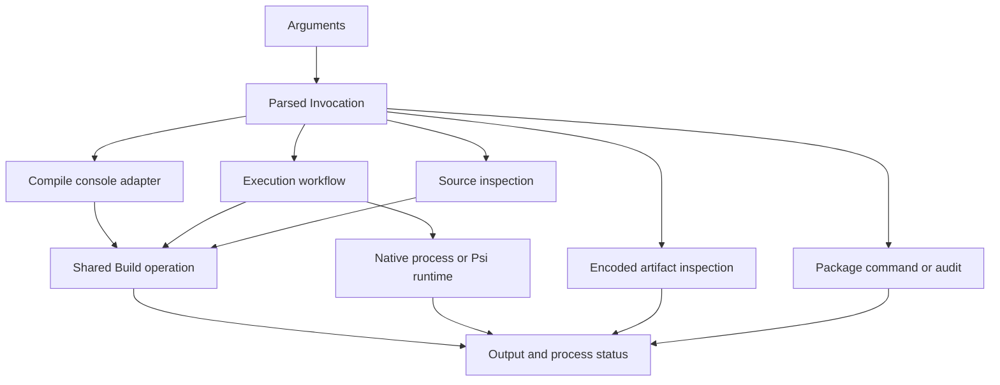

# CLI

The `omega` executable parses a complete request, selects its owner and turns
the result into console output and a process status. Build compilation belongs
to `orchestration`; execution and inspection still have substantial application
code. Calling the entire application “only a router” hides those operations.
[`main.rs`][main] is the router; [`execution/`][run-project] and
[`inspection/`][inspection] are complete workflows below it.

**Evidence revision:** `3f9ce43f0c9d179048911d18faa91ba93f60176d`.
This page describes source at that revision. Tests are identified as existing
assertions, not fresh passing results. *Unverified* marks execution not
performed in this review; *judgment* marks proposals. See [Build and
packages](build-and-packages.md) for compilation coordination and
[the interpreter](interpreter.md) for Psi execution internals.

## Startup and the actual command surface

The Cargo package and binary are `omega`, under
`omega-rust/omega/application/`. Startup first checks the internal native
provider-worker protocol. A child launched for a foreign call can enter that
worker before normal command parsing. Ordinary startup then removes the
global `--verbose` flag, parses an `Invocation`, obtains one host execution
budget, and dispatches on a compiler worker. Failure to parse exits 64;
failure to start the worker budget reports an error. [Startup][main]

The parser selects `packages`, `psi`, `source` or `run` from the first token.
Otherwise it puts the token back and parses the default compile invocation.
The current default is `omega <root.omg>` or `omega --check <root.omg>`;
the top-level dispatch has no separate `build` subcommand.
Flat `install`, `update`, `audit` and `inspect-terminal` are explicitly retired.
[`Invocation` and parsing][parser] are the source of truth when a README
uses an older spelling.

| Surface | Owner called from the console adapter | Result boundary |
| --- | --- | --- |
| `omega [--check] ... <root.omg>` | `commands::compile` constructs `orchestration::BuildRequest` | Ordered target reports or compilation refusals; native products are published unless checking. [Source][compile-command] |
| `omega run ... <root.omg>` | `commands::run` calls `execution::run_project` or `run_project_cases` | Compiled product plus host/Psi outcome, captured output and optional comparison. [Source][run-command] |
| `omega psi inspect --machine ... <root.omg>` | `inspection::inspect_terminal` calls the shared Build operation | Requested machine's checked artifact; no native image. [Source][inspection] |
| `omega psi inspect --artifact ...` | `inspection::inspect_terminal_artifact` admits encoded bytes | Validated artifact and summary without Build, source acquisition or guest execution. [Source][inspection] |
| `omega packages install ...` or `update ...`, including their `--resume`/`--discard` forms | `commands::packages` calls package/orchestration operations | Published change, pending review, discarded review or failure. [Source][package-command] |
| `omega packages audit --project ...` | `orchestration::inspect_packages` | Read-only project policy report; target failures and decision requirements remain visible. [Source][package-audit] |
| `omega packages audit --kind local\|git ...` | `package_manager::operations::inspect_package_source_locator` | Source acquisition/inspection report, without accepting that package into a project. [Source][source-audit] |
| `omega source rewrite ...` | Parser refusal | Specified but not implemented; help can show its syntax. [Source][source-parser] |

The graph shows operation ownership, not simultaneous execution. Package
commands use their review coordinator, which can request compiler work; their
edge to output does not imply they are parser-only operations.

## Compile requests preserve target and product intent

`commands::compile::run` translates parsed arguments into a `BuildRequest`.
No target names means `BuildTargets::Host`; one name becomes `Single`; several
names become an explicit target set. `--check` chooses `ProjectProduct::Check`;
the ordinary case chooses a published native product. Requested validators,
optimization rollback, restricted-action verification and caller-named Build
input capture travel in that same request. [Translation][compile-command]

The adapter formats single or batch outcomes and optional reports; it does
not invoke Psi or Omega stages. Compilation status is distinct from CLI
usage: the request contract uses 0 for complete, 1 for rejected, 2 for
incomplete because private provisions ran out, and 3 for an internal failure.
For a batch, an internal failure outranks rejection, and rejection outranks
incompleteness. A report-write failure must also be handled by the console
adapter. [Compile status policy][compile-status], [usage status][parser]

Explicit validators are not ordinary compilation checks. The current registry
has `TargetOperationCorrespondence`, `FixedFrameCorrespondence` and
`SelectedInstructionRewriteReplay`. Their requests make the producer retain
the earlier inputs needed for independent validation. They run before
published native output is written; default compilation runs none. A named
validator that cannot apply is refused; `--every-validator` enumerates the
registry and reports inapplicable entries. [Registry][validators],
[publication boundary][publication]

This also differs from `--verify`: that request rechecks under retained pins
without exercising accepted restricted Build grants. It is not shorthand for
the independent stage-validator roster. The distinctions are
[declared on `BuildRequest`][build-contract] and enforced by
[package product admission][package-admission].

## Run uses the exact product compilation produced

The parser chooses `native` by default, `psi` for an explicit engine, or the
two-engine comparison for `--both`. `--engine` and `--both` cannot be combined.
Case inputs require an output directory, cannot use a target override, and
currently refuse Psi-only execution. A Psi work budget is allowed only when
Psi will actually execute. [Argument constraints][run-parser]

`run_project` allocates a temporary directory and calls the same
`orchestration::build` as compilation. Native and comparison requests ask for
`NativeDestination::Retained`; Psi-only requests ask for
`RuntimeAdmission`. The compilation adapter requires exactly one target
outcome and returns its `CompileReport`. [Build request][run-compilation]

For a comparison, `interpret_product` obtains the Psi artifact from that
report's retained native program. For Psi-only execution, it obtains the
artifact directly from the report. It refuses if the report has lost its
artifact. The runtime request receives the same runtime provisions, target,
work budget and private entry data produced by compilation; it does not
recompile source or rerun Build. [Artifact and runtime request][interpret-product]

The application explicitly delegates a host filesystem namespace, matching-host
native services, a host clock, target-specific x86 flags when applicable, a
private sequential memory-ordering environment and an isolated domain exit.
It also supplies a command for the native provider helper. Those are actual
host capabilities in the request, not authority inferred from entry selection.
Their eventual admission is the runtime's responsibility. The atlas must not
repeat the older application README's broad “isolated hosted root” description
as a statement of this current caller's filesystem delegation.
[Runtime request fields][interpret-product]

| Run selection | Behavior in the application source |
| --- | --- |
| Native, no target override | Publish the retained executable, validate component process inputs, launch it with inherited stdin, capture its output and observe its process status. |
| Native with `--target` | Compile and publish for that target; return `TargetOnly` without launching the image or reading stdin. |
| `--both`, host execution | Interpret the report's Psi artifact before publication consumes the native payload, then publish/run native and compare the outcomes. |
| `--both --target ...` | Follow the target-only path; no host or Psi run is performed. The parser separately refuses a Psi work budget for this non-executing case. |
| `--engine psi` | Request runtime admission, interpret directly with caller stdin, and return a Psi outcome without emitting or launching a native image. |

The control flow is in [`run_project`][run-project] and
[`run_terminal`][run-terminal]. Psi-only execution still uses native runtime
admission for the selected target's entry/providers; “no emitted image” does
not mean “skip target and provider admission.”

When `--both` first reports a missing standard-input provision, the application
captures stdin to a finite replay file, invokes Psi again with it, and later
gives those same bytes to native. If Psi completes without a stdin request,
the native child receives null stdin; ordinary native-only execution inherits
the caller's input. The replay and publication order are explicit in
[`run_project`][run-project]. Multi-case execution compiles once and uses
[one retained report for its inputs][case-runs].

Comparison checks the host presentation of termination, including recognized
crash causes, and separately checks private-entry backing observations when
present. It does **not** generally compare stdout/stderr or full effect traces.
Exhausted work, a pending host effect, unavailable host capability or a Psi exit
argument that the host truncates can produce a **declined comparison**. A
native exit of zero does not convert that decline into agreement.
[Comparison][comparison], [private entry comparison][run-project]

`commands::run` forwards stdout/stderr as raw bytes before its own diagnostics
and flushes both streams. Its reserved harness/Psi statuses include 200 for
execution/compilation or forwarding failure, 201 for divergence, 202 for
incomplete compilation, 203 for a Psi guest crash and 204 for a declined
single-run comparison. Case reporting has its own batch handling. These
statuses are command-specific; package audit's status 3 is not the compiler
request's internal-failure verdict. [Run status handling][run-command],
[output forwarding][output-forwarding],
[package audit handling][package-audit]

## A concrete CLI trace and its test

The integration test [`both_exit_status_comparison.rs`][comparison-test]
launches the real binary as
`omega run --both main.omg` in
`omega-rust/tests/fixtures/run/cli/both_comparison_verdict`. Its positive case
expects native/Psi agreement. Its twin adds a small `--psi-work-budget`, expects
the native program to exit zero, and still expects the command to report
`DECLINED` and status 204.

The traced route is:

1. [`arguments::parse`][parser] produces `Invocation::Run`;
   [`main`][main] selects `commands::run`.
2. [`commands::run`][run-command] constructs `RunRequest`, preserving the
   engine choice, target, captured-input request and work budget.
3. [`execution::compilation::compile`][run-compilation] asks Build for a
   retained native product. Build resolves source/package input, performs
   compiler and provider admission, completes native work and returns the
   report. The [Build page](build-and-packages.md) follows those operations.
4. [`interpret_product`][interpret-product] passes the report's artifact and
   provisions to the Psi runtime. Native publication and execution then use
   that same report. [Run lifecycle][run-project]
5. [`compare_interpretation`][comparison] keeps “no completed Psi result”
   distinct from a matching exit. The console adapter maps the decline to
   204. [Status branch][run-command]

*Unverified:* the command and its test were not run for this atlas review.
The trace is source-backed; it is not a new cross-engine or cross-host result.

## Inspection and package commands have different effects

Source inspection requests one named machine through Build with `verify: true`
and an empty stage-validator request. Encoded-artifact inspection instead calls
`CanonicalTerminalArtifact::from_bytes`. Decoding and validation do not run
the guest or establish source package acceptance. These two routes should
remain separate in the atlas even though one public command selects them.
[Inspection implementations][inspection]

The source form can write the checked artifact to the caller's `--output`
path. The encoded-artifact form only reads and summarizes; its parser refuses
source, target, machine or output arguments, and its reader enforces a byte
limit before decoding. [Console adapter][inspection-adapter],
[argument separation][inspection-parser]

The package command adapter creates one retained `BuildSession` and passes it
through the complete review operation. When the user explicitly requests
`--dangerously-accept-all`, the adapter edits pending decisions and resumes
for a bounded number of rounds, reporting that the decisions were accepted
unread. Ordinary commands do not choose that flag for the user. Discard is a
package-file operation; it does not run compilation. [Package adapter][package-command]

Project package audit returns a report and indicates whether review remains
necessary; source audit opens acquisition storage and reports the selected
local/Git source. Neither is a compiler-stage validator. The project audit
coordinator can run Build and checks, but verifies unchanged project/lock
identity before it finishes. [Audit adapter][package-audit],
[source audit][source-audit], [read-only coordinator][audit-coordinator]

## What the atlas should change

*Judgment:* show the console adapter, execution coordinator and source/artifact
inspection as distinct boxes within the application boundary. Keep compiler
sequencing in the shared Build/compiler route. This makes the intended small
CLI router visible without claiming the entire application crate is already
that small.

*Judgment:* show four separate kinds of checks: source semantic acceptance,
package policy review, artifact admission and explicitly requested independent
stage validation. They have different inputs, effects and failure meanings.
Combining them under an “audit” arrow would conceal both ordinary behavior and
the work only an explicit request enables.

The runtime's source is the authority for available host adapters. The
application request and a selected provider do not prove every operation is
executable; the runtime can refuse missing provisions and decline comparison.
The [interpreter page](interpreter.md) maps those capabilities. *Unverified:*
this source review does not certify the hosted target matrix.

## Existing focused tests

| Existing check | What its assertions cover |
| --- | --- |
| [Argument parser tests][parser-tests] and [run parser tests][run-parser-tests] | Public routing, retired spellings, option validation and preservation of caller source inputs. |
| [Stage validator requests][validator-tests] | Default no-validator route; named requests, fixed-frame retention, complete roster and inapplicable names. |
| [Two-engine exit comparison][comparison-test] | Agreement versus work-exhaustion decline with a successful native run. |
| [Comparison unit tests][comparison-unit-tests] | Invalid native evidence fails comparison; absent capability declines; a truncated Unix exit argument is not agreement. |
| [Named Psi inspection][inspection-tests] | Exact named-machine output and refusal of missing/ambiguous names before writing. |
| [Psi runtime admission][runtime-tests] | Psi-only route and retention of native borrowed-storage layout facts. |
| [Unlocked standard entry][unlocked-test] | A default standard-library entry can run without a lock; absence of a lock is not a blanket refusal. |

No compiler tests were executed for this documentation-only work. Link and
consistency checks establish that the cited source exists at the evidence
revision; runtime assertions remain *unverified* here.

[main]: https://github.com/CathedralOS/Omega/blob/3f9ce43f0c9d179048911d18faa91ba93f60176d/omega-rust/omega/application/src/main.rs#L47-L95
[parser]: https://github.com/CathedralOS/Omega/blob/3f9ce43f0c9d179048911d18faa91ba93f60176d/omega-rust/omega/application/src/arguments/mod.rs#L29-L103
[source-parser]: https://github.com/CathedralOS/Omega/blob/3f9ce43f0c9d179048911d18faa91ba93f60176d/omega-rust/omega/application/src/arguments/mod.rs#L197-L215
[compile-command]: https://github.com/CathedralOS/Omega/blob/3f9ce43f0c9d179048911d18faa91ba93f60176d/omega-rust/omega/application/src/commands/compile.rs#L59-L139
[compile-status]: https://github.com/CathedralOS/Omega/blob/3f9ce43f0c9d179048911d18faa91ba93f60176d/omega-rust/omega/application/src/commands/compile.rs#L1-L44
[run-command]: https://github.com/CathedralOS/Omega/blob/3f9ce43f0c9d179048911d18faa91ba93f60176d/omega-rust/omega/application/src/commands/run.rs#L1-L163
[output-forwarding]: https://github.com/CathedralOS/Omega/blob/3f9ce43f0c9d179048911d18faa91ba93f60176d/omega-rust/omega/application/src/commands/run.rs#L305-L344
[run-parser]: https://github.com/CathedralOS/Omega/blob/3f9ce43f0c9d179048911d18faa91ba93f60176d/omega-rust/omega/application/src/arguments/run.rs#L188-L239
[run-project]: https://github.com/CathedralOS/Omega/blob/3f9ce43f0c9d179048911d18faa91ba93f60176d/omega-rust/omega/application/src/execution/mod.rs#L189-L303
[run-terminal]: https://github.com/CathedralOS/Omega/blob/3f9ce43f0c9d179048911d18faa91ba93f60176d/omega-rust/omega/application/src/execution/mod.rs#L306-L353
[run-compilation]: https://github.com/CathedralOS/Omega/blob/3f9ce43f0c9d179048911d18faa91ba93f60176d/omega-rust/omega/application/src/execution/compilation.rs#L39-L94
[interpret-product]: https://github.com/CathedralOS/Omega/blob/3f9ce43f0c9d179048911d18faa91ba93f60176d/omega-rust/omega/application/src/execution/compilation.rs#L96-L132
[case-runs]: https://github.com/CathedralOS/Omega/blob/3f9ce43f0c9d179048911d18faa91ba93f60176d/omega-rust/omega/application/src/execution/mod.rs#L424-L520
[comparison]: https://github.com/CathedralOS/Omega/blob/3f9ce43f0c9d179048911d18faa91ba93f60176d/omega-rust/omega/application/src/execution/mod.rs#L524-L615
[inspection]: https://github.com/CathedralOS/Omega/blob/3f9ce43f0c9d179048911d18faa91ba93f60176d/omega-rust/omega/application/src/inspection/mod.rs#L56-L103
[inspection-adapter]: https://github.com/CathedralOS/Omega/blob/3f9ce43f0c9d179048911d18faa91ba93f60176d/omega-rust/omega/application/src/commands/inspect.rs#L30-L101
[inspection-parser]: https://github.com/CathedralOS/Omega/blob/3f9ce43f0c9d179048911d18faa91ba93f60176d/omega-rust/omega/application/src/arguments/inspect.rs#L81-L96
[package-command]: https://github.com/CathedralOS/Omega/blob/3f9ce43f0c9d179048911d18faa91ba93f60176d/omega-rust/omega/application/src/commands/packages.rs#L39-L99
[package-audit]: https://github.com/CathedralOS/Omega/blob/3f9ce43f0c9d179048911d18faa91ba93f60176d/omega-rust/omega/application/src/commands/packages.rs#L102-L117
[source-audit]: https://github.com/CathedralOS/Omega/blob/3f9ce43f0c9d179048911d18faa91ba93f60176d/omega-rust/omega/application/src/commands/packages.rs#L120-L148
[audit-coordinator]: https://github.com/CathedralOS/Omega/blob/3f9ce43f0c9d179048911d18faa91ba93f60176d/omega-rust/omega/build-system/orchestration/src/package/package_inspection.rs#L1-L89
[validators]: https://github.com/CathedralOS/Omega/blob/3f9ce43f0c9d179048911d18faa91ba93f60176d/omega-rust/omega/build-system/orchestration/src/project/stage_validators.rs#L1-L112
[publication]: https://github.com/CathedralOS/Omega/blob/3f9ce43f0c9d179048911d18faa91ba93f60176d/omega-rust/omega/build-system/orchestration/src/project/publication.rs#L69-L120
[build-contract]: https://github.com/CathedralOS/Omega/blob/3f9ce43f0c9d179048911d18faa91ba93f60176d/omega-rust/omega/build-system/orchestration/src/lib.rs#L134-L146
[package-admission]: https://github.com/CathedralOS/Omega/blob/3f9ce43f0c9d179048911d18faa91ba93f60176d/omega-rust/omega/packages/package-manager/src/operations/accepted_compilation.rs#L244-L261
[comparison-test]: https://github.com/CathedralOS/Omega/blob/3f9ce43f0c9d179048911d18faa91ba93f60176d/omega-rust/omega/application/tests/both_exit_status_comparison.rs#L1-L61
[parser-tests]: https://github.com/CathedralOS/Omega/blob/3f9ce43f0c9d179048911d18faa91ba93f60176d/omega-rust/omega/application/src/arguments/mod.rs#L330-L430
[run-parser-tests]: https://github.com/CathedralOS/Omega/blob/3f9ce43f0c9d179048911d18faa91ba93f60176d/omega-rust/omega/application/src/arguments/run.rs#L242-L330
[validator-tests]: https://github.com/CathedralOS/Omega/blob/3f9ce43f0c9d179048911d18faa91ba93f60176d/omega-rust/omega/application/tests/stage_validator_requests.rs#L57-L164
[comparison-unit-tests]: https://github.com/CathedralOS/Omega/blob/3f9ce43f0c9d179048911d18faa91ba93f60176d/omega-rust/omega/application/src/execution/mod.rs#L618-L678
[inspection-tests]: https://github.com/CathedralOS/Omega/blob/3f9ce43f0c9d179048911d18faa91ba93f60176d/omega-rust/omega/application/tests/named_psi_inspection.rs#L25-L135
[runtime-tests]: https://github.com/CathedralOS/Omega/blob/3f9ce43f0c9d179048911d18faa91ba93f60176d/omega-rust/omega/application/tests/psi_runtime_admission.rs#L166-L228
[unlocked-test]: https://github.com/CathedralOS/Omega/blob/3f9ce43f0c9d179048911d18faa91ba93f60176d/omega-rust/omega/application/tests/unlocked_std_entry.rs#L1-L38
