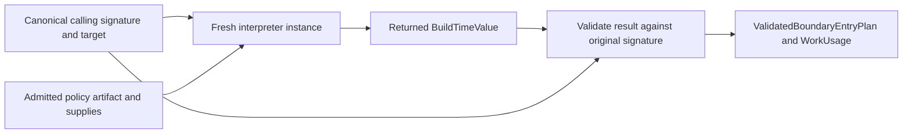

# The Psi interpreter and its hosts

The Psi interpreter executes a produced program. It keeps immutable code,
creates separate mutable instances, binds the supplies each instance needs,
then advances operations under a work meter. Compilation uses this engine
for supported compile-time computations; the engine does not call the
compiler. Omega supplies target-aware host adapters outside Psi.
[Engine entrance][engine]; [dependency boundary][manifest]; [host owner][host-owner]

**Evidence scope.** This page follows
`3f9ce43f0c9d179048911d18faa91ba93f60176d`. All source links are pinned to
that revision. Code and tests were inspected; no execution tests were run.
Runtime results are therefore **unverified** in this review. “Terminal Psi”
below denotes the internal representation and API names; the public product
is Psi. [Psi compilation](psi.md) explains how a program is produced;
[Build and packages](build-and-packages.md) explains who requests work and
grants host effects.

## From produced code to an instance

This is the embedding lifecycle, not a proof-verification diagram. Runtime
supply admission can be empty for a program that needs no installation.
Loaded bytes still need the host's execution-trust decision discussed below.

| Boundary | Named input and output | What it establishes |
| --- | --- | --- |
| Load or borrow code | `TerminalProgram::load(&[u8])`, `load_envelope(&[u8])`, `borrow(TerminalExecutionView)` or `retain(RetainedTerminalCode)` produce `TerminalProgram` | `load` decodes semantic bytes; `load_envelope` decodes a canonical envelope; borrowed and retained routes reuse existing code. One shared immutable owner keeps the program identity and catalogs. [Code][load] |
| Admit runtime supplies | `admit_runtime_supplies(TerminalRuntimeSupplyRequest) -> Result<TerminalRuntimeSupplies, TerminalInterpretError>` | Joins the program to its provider installation, entry, target selections, target layouts and optional host environments. A provider installation from another execution identity or target context from another semantic identity is rejected. [Code][supplies] |
| Create an instance | `instantiate(TerminalInstantiation) -> Result<TerminalInstance, TerminalArtifactInterpretError>` | Prepares independent execution state from scalar arguments, structural contents, installation, optional invocation account and scalar admission. It does not decode code again. [Entrance][instantiate]; [request fields][request] |
| Bind an import | `bind_import(BoundaryMachineId, impl TerminalImportAdapter)` | Requires the exact declared signature. Unknown, duplicate, unneeded or provider-realized imports refuse; externally completing boundaries require their own admission. [Code][bind] |
| Run or resume | `invoke(&mut WorkMeter) -> Result<TerminalExecutionStatus, TerminalInstanceError>` | Refuses missing imports/completion bindings before guest execution, then resumes the instance's existing state. [Code][invoke] |
| Release state | `close() -> Result<(), TerminalInstanceCloseError>` | Clears runtime state and bindings after completion, or before any invocation. An invoked instance that is still active returns `Busy`; repeated close is harmless. [Code][close] |

`TerminalExecutionStatus` distinguishes `Complete`, `SponsorExhausted`,
`AwaitingEffect`, `HostComputationPending`, `Crashed` and
`ExternalCompletion`. An exhausted budget is a suspension, not evidence of
successful completion or a false program contract. Callers decide whether to
replenish work or return that status. [Status definition][status]

The implementation separates the dispatch loop (`engine_execution`), saved
call frames (`engine_calls`), ownership and claims (`engine_custody`),
terminators, and runtime storage. Frames retain identities into the immutable
module rather than copies of complete block graphs. Code ownership and
runtime value storage are separate. [Implementation map][engine];
[code and frame ownership][storage-contract]

The resume loop reads the current machine, block and operation index, charges
an operation before executing it, and remembers pending effects and component
calls. Completed results and crashes return their recorded status on a later
resume. Execution errors retain the machine, block and operation site and
become the instance's recorded failure. This is why resumption needs the
existing instance rather than a fresh call with the same arguments.
[Resume mechanism][resume]

Structural input contents do not manufacture ownership or reference
authority. Entry preparation binds actual contents; custody checks compare an
owned argument's exact path and linear claims against its declared structure.
At an external call, the engine stages writable buffers and checks their
writeback before committing them. Rejecting a response cannot undo host
effects already performed, so a host adapter's behavior remains a separate
obligation. [Entry contents][inputs]; [owned claims][custody];
[buffer validation][writeback]; [host-effect limit][effect-limit]

## A concrete route: execute one calling policy

A calling policy is an Omega program that returns a proposed calling plan.
Its execution does not itself authorize arbitrary register or stack choices.
`build-settings::evaluate_terminal_calling_policy` takes a
`TerminalCallingPolicyInvocation` and returns
`Result<(ValidatedBoundaryEntryPlan, WorkUsage), String>`.
[Actual entry][policy-entry]

1. Provider planning supplies the retained artifact, callable entry,
   `CallingPolicySignature`, target, invocation account and prior admission.
   The executor checks that the signature's target matches the target
   profile, admits target selections and layouts, and checks that admission
   names this exact invocation. [Inputs and identity checks][policy-entry]
2. It borrows the artifact as `TerminalProgram`, admits runtime supplies and
   asks for execution requirements. A missing boundary provider produces an
   error naming the callable and target. It completes demanded scalar
   applications before entry. [Requirements][policy-requirements]
3. It requires one structural signature argument and a structural result,
   encodes the calling signature into contents, and creates a fresh instance
   with those contents, admitted installation and account.
   [Argument construction][policy-arguments]
4. It invokes under `WorkMeter`. Anything except a complete structural or
   scalar-case result is an error for this caller, including a suspended or
   crashed invocation. It reads the returned `BuildTimeValue`, charges result
   custody, decodes the proposed plan, and calls
   `validate_calling_policy_result(plan, signature)` before returning the
   validated plan and work usage. [Execution and result checks][policy-result]

**Authority boundary.** The interpreter owns execution and value custody.
The invocation admission owns permission to execute that program with those
supplies. Provider planning owns the meaning and validation of the returned
calling plan. A returned structure becomes a plan only after the final check.
This trace is a source-level route, **not a fresh successful policy run**.
[Executor's ownership contract][policy-entry]

## Compile-time execution has the same engine

The source evaluator follows the same artifact route. A prepared source job
fixes its actual caller and inputs, crosses Psi 04, and calls
`AcceptedTerminalSource::judge` for an invocation publication. Its execution
method requires that admission match the published invocation, encodes
structural inputs, calls `TerminalProgram::instantiate`, then `invoke` and
transports the result back to compiler-owned `BuildTimeValue`.
[Job preparation][source-job]; [job execution][source-execute]

The source evaluator, not the engine, installs computed results into source
and typed representations. It refuses unavailable providers or external
authority; it also rejects target observations on a target-independent
invocation. These restrictions prevent an ambient host fact from becoming a
constant merely because an interpreter can compute it.
[Evaluation ownership][evaluation]; [invocation restrictions][source-admit]

The crate dependencies follow that direction: `build-time-evaluation`
depends on `terminal-interpreter`; the interpreter depends on representation,
semantic, installation, accounting and proof-admission libraries, with no
source-producing stage or Omega package in its manifest. Proof-admission
usage here does not make the interpreter a source checker. For example,
closed crash-guard checks use the mathematical meaning of a supplied value.
[Evaluator manifest][eval-manifest]; [engine manifest][manifest];
[closed crash guards][crash]

**Judgment.** Preserve this engine boundary while repairing the source
sequencing described in [Psi compilation](psi.md). Moving source preparation
into the interpreter would introduce the dependency direction the existing
engine avoids. The necessary repair is to isolate source-job preparation
from artifact execution, with explicit results between them.

## Target-aware execution belongs to Omega

`omega/interpreter/terminal-runtime` adapts an already-produced canonical
artifact and `TerminalRuntimeProvisions` to the Psi engine. Its
`TerminalRuntimeRequest` supplies the target, optional native image for
layout inspection, entry receipt, exact provisions, work budget, finite
standard-input stream, clock and explicit filesystem/native-service/domain
exit delegations. Its result, `TerminalRuntimeObservation`, contains status,
buffered output, effects, private entry storage observations and work usage.
[Request and observation][host-request]

`execute_sliced` checks that provisions name the same program, entry and
deployment target. It establishes entry storage, instantiates the program,
binds host imports and component products, then repeatedly invokes the same
instance when the sponsor replenishes work. This path does not rerun Build
or compile source. [Identity checks][host-identity]; [execution loop][host-loop]

External native adapters live in `native-provider-runtime`, which consumes
source-free compilation products and runs fixed-frame adapters in a private
provider process. Its worker reply does not establish Psi ownership, loan or
completion obligations. Those remain with semantic admission and interpreter
custody. The private-process design is described in the source; this audit
did not validate its containment guarantees or platform coverage.
[Native adapter owner][native-owner]

Interpreted Omega provider bodies can run in the engine; external mechanisms
need adapters. Target-aware host integration is not a substitute for
unsupported native lowering. Interpreter/native comparisons belong to
comparison callers and tests. [Domain boundary][host-boundary]

## What loading and execution do not establish

Canonical decoding checks representation closure and identity. It does not
prove that the compiler's translation was correct or authorize a producer's
code to run. `TerminalProgram::load` calls
`ClosedTerminalModule::from_semantic_bytes`; it does not run Psi 06 or a
whole-artifact proof verifier. [Load implementation][load]; [codec contract][codec]

**Current implementation gap.** The interpreter README says the admission
contract requires explicit trust in the exact producer artifact until
untrusted-artifact containment is audited, and says the byte-loading API does
not yet accept that trust witness. The current signatures confirm that gap.
The atlas must not label byte loading as fully authorized execution or claim
that safe Rust proves guest isolation. [Admission limit][trust-gap]

Likewise, the compilation README's link to a `terminal-verification`
directory is stale at this revision. No such package is present. The current
map therefore distinguishes source checking, supplied-certificate admission,
canonical structural decoding, runtime supply checks and the host's trust
decision rather than collapsing them into one “verified” arrow.
[Pinned stale link][stale-verifier]; [Psi discussion](psi.md)

## Existing examples and limits of this review

| Existing check | What its assertions cover | Status here |
| --- | --- | --- |
| `loading_an_envelope_keeps_identity_with_its_owned_semantics` | Loads a declaration artifact, drops the original bytes/artifact, then checks retained identity and declaration text. [Definition][load-test] | Source-inspected; not run. It does not execute a machine. |
| `retained_execution_preserves_identity_and_resumes_without_decoding` | Builds the existing recursion fixture, rejects mismatched deployment provisions, compares complete ordinary and one-unit-sliced execution, and asserts no additional module decoding. [Definition][runtime-test]; [fixture][fixture] | Source and fixture exist; compilation and execution remain unverified in this review. |
| `private_entry_recipe_requires_exact_installed_geometry` | Checks private entry geometry against an actual supplied canonical artifact. [Definition][geometry-test] | Explicitly ignored unless a qualification supplies `OMEGA_ENTRY_RAM_CANONICAL_ARTIFACT`; not run. |

The presence of these tests and APIs does not establish support for every
program, target, external mechanism or storage shape. The host-runtime README
also identifies unfinished common loaded/borrowed views and a production
artifact-execution command. Those are implementation limits, not reasons to
draw compilation inside the runtime. [Remaining runtime work][runtime-limits]

This documentation change checks pinned source paths, line anchors, diagrams
and adjacent-page consistency. It makes no new performance, native-coverage
or execution-safety claim.

[engine]: https://github.com/CathedralOS/Omega/blob/3f9ce43f0c9d179048911d18faa91ba93f60176d/omega-rust/psi/interpreter/src/lib.rs#L1
[manifest]: https://github.com/CathedralOS/Omega/blob/3f9ce43f0c9d179048911d18faa91ba93f60176d/omega-rust/psi/interpreter/Cargo.toml#L11
[host-owner]: https://github.com/CathedralOS/Omega/blob/3f9ce43f0c9d179048911d18faa91ba93f60176d/omega-rust/omega/interpreter/terminal-runtime/src/lib.rs#L1
[load]: https://github.com/CathedralOS/Omega/blob/3f9ce43f0c9d179048911d18faa91ba93f60176d/omega-rust/psi/interpreter/src/embedding.rs#L2555
[supplies]: https://github.com/CathedralOS/Omega/blob/3f9ce43f0c9d179048911d18faa91ba93f60176d/omega-rust/psi/interpreter/src/embedding.rs#L2610
[instantiate]: https://github.com/CathedralOS/Omega/blob/3f9ce43f0c9d179048911d18faa91ba93f60176d/omega-rust/psi/interpreter/src/embedding.rs#L2805
[request]: https://github.com/CathedralOS/Omega/blob/3f9ce43f0c9d179048911d18faa91ba93f60176d/omega-rust/psi/interpreter/src/embedding.rs#L3032
[bind]: https://github.com/CathedralOS/Omega/blob/3f9ce43f0c9d179048911d18faa91ba93f60176d/omega-rust/psi/interpreter/src/embedding.rs#L1607
[invoke]: https://github.com/CathedralOS/Omega/blob/3f9ce43f0c9d179048911d18faa91ba93f60176d/omega-rust/psi/interpreter/src/embedding.rs#L1799
[close]: https://github.com/CathedralOS/Omega/blob/3f9ce43f0c9d179048911d18faa91ba93f60176d/omega-rust/psi/interpreter/src/embedding.rs#L1914
[status]: https://github.com/CathedralOS/Omega/blob/3f9ce43f0c9d179048911d18faa91ba93f60176d/omega-rust/psi/interpreter/src/boundary_values.rs#L1348
[storage-contract]: https://github.com/CathedralOS/Omega/blob/3f9ce43f0c9d179048911d18faa91ba93f60176d/omega-rust/psi/interpreter/README.md#L47
[resume]: https://github.com/CathedralOS/Omega/blob/3f9ce43f0c9d179048911d18faa91ba93f60176d/omega-rust/psi/interpreter/src/engine_execution.rs#L2679
[inputs]: https://github.com/CathedralOS/Omega/blob/3f9ce43f0c9d179048911d18faa91ba93f60176d/omega-rust/psi/interpreter/README.md#L93
[custody]: https://github.com/CathedralOS/Omega/blob/3f9ce43f0c9d179048911d18faa91ba93f60176d/omega-rust/psi/interpreter/src/engine_custody.rs#L514
[writeback]: https://github.com/CathedralOS/Omega/blob/3f9ce43f0c9d179048911d18faa91ba93f60176d/omega-rust/psi/interpreter/src/boundary_effects.rs#L1030
[effect-limit]: https://github.com/CathedralOS/Omega/blob/3f9ce43f0c9d179048911d18faa91ba93f60176d/omega-rust/psi/interpreter/README.md#L515
[policy-entry]: https://github.com/CathedralOS/Omega/blob/3f9ce43f0c9d179048911d18faa91ba93f60176d/omega-rust/omega/build-system/build-settings/src/calling_policy_execution.rs#L1
[policy-requirements]: https://github.com/CathedralOS/Omega/blob/3f9ce43f0c9d179048911d18faa91ba93f60176d/omega-rust/omega/build-system/build-settings/src/calling_policy_execution.rs#L80
[policy-arguments]: https://github.com/CathedralOS/Omega/blob/3f9ce43f0c9d179048911d18faa91ba93f60176d/omega-rust/omega/build-system/build-settings/src/calling_policy_execution.rs#L149
[policy-result]: https://github.com/CathedralOS/Omega/blob/3f9ce43f0c9d179048911d18faa91ba93f60176d/omega-rust/omega/build-system/build-settings/src/calling_policy_execution.rs#L188
[source-job]: https://github.com/CathedralOS/Omega/blob/3f9ce43f0c9d179048911d18faa91ba93f60176d/omega-rust/psi/compilation/build-time-evaluation/src/source_jobs.rs#L616
[source-execute]: https://github.com/CathedralOS/Omega/blob/3f9ce43f0c9d179048911d18faa91ba93f60176d/omega-rust/psi/compilation/build-time-evaluation/src/source_jobs.rs#L402
[evaluation]: https://github.com/CathedralOS/Omega/blob/3f9ce43f0c9d179048911d18faa91ba93f60176d/omega-rust/psi/compilation/build-time-evaluation/README.md#L3
[source-admit]: https://github.com/CathedralOS/Omega/blob/3f9ce43f0c9d179048911d18faa91ba93f60176d/omega-rust/psi/compilation/build-time-evaluation/src/source_jobs.rs#L260
[eval-manifest]: https://github.com/CathedralOS/Omega/blob/3f9ce43f0c9d179048911d18faa91ba93f60176d/omega-rust/psi/compilation/build-time-evaluation/Cargo.toml#L11
[crash]: https://github.com/CathedralOS/Omega/blob/3f9ce43f0c9d179048911d18faa91ba93f60176d/omega-rust/psi/interpreter/README.md#L493
[host-request]: https://github.com/CathedralOS/Omega/blob/3f9ce43f0c9d179048911d18faa91ba93f60176d/omega-rust/omega/interpreter/terminal-runtime/src/execution.rs#L67
[host-identity]: https://github.com/CathedralOS/Omega/blob/3f9ce43f0c9d179048911d18faa91ba93f60176d/omega-rust/omega/interpreter/terminal-runtime/src/execution.rs#L174
[host-loop]: https://github.com/CathedralOS/Omega/blob/3f9ce43f0c9d179048911d18faa91ba93f60176d/omega-rust/omega/interpreter/terminal-runtime/src/execution.rs#L350
[native-owner]: https://github.com/CathedralOS/Omega/blob/3f9ce43f0c9d179048911d18faa91ba93f60176d/omega-rust/omega/interpreter/native-provider-runtime/src/lib.rs#L1
[host-boundary]: https://github.com/CathedralOS/Omega/blob/3f9ce43f0c9d179048911d18faa91ba93f60176d/omega-rust/psi/interpreter/README.md#L17
[codec]: https://github.com/CathedralOS/Omega/blob/3f9ce43f0c9d179048911d18faa91ba93f60176d/omega-rust/psi/compilation/representations/terminal-psi/codec/src/lib.rs#L16
[trust-gap]: https://github.com/CathedralOS/Omega/blob/3f9ce43f0c9d179048911d18faa91ba93f60176d/omega-rust/psi/interpreter/README.md#L61
[stale-verifier]: https://github.com/CathedralOS/Omega/blob/3f9ce43f0c9d179048911d18faa91ba93f60176d/omega-rust/psi/compilation/README.md#L18
[load-test]: https://github.com/CathedralOS/Omega/blob/3f9ce43f0c9d179048911d18faa91ba93f60176d/omega-rust/psi/interpreter/src/embedding.rs#L3139
[runtime-test]: https://github.com/CathedralOS/Omega/blob/3f9ce43f0c9d179048911d18faa91ba93f60176d/omega-rust/omega/interpreter/terminal-runtime/tests/retained_runtime.rs#L12
[fixture]: https://github.com/CathedralOS/Omega/blob/3f9ce43f0c9d179048911d18faa91ba93f60176d/tests/fixtures/pass/calls/machine_self_call_recursion_compile/main.omg#L1
[geometry-test]: https://github.com/CathedralOS/Omega/blob/3f9ce43f0c9d179048911d18faa91ba93f60176d/omega-rust/psi/interpreter/src/embedding.rs#L3173
[runtime-limits]: https://github.com/CathedralOS/Omega/blob/3f9ce43f0c9d179048911d18faa91ba93f60176d/omega-rust/omega/interpreter/terminal-runtime/README.md#L20
