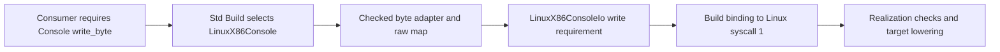

# Bundled library: source, providers and compiler operations

`source/library/` supplies reusable Omega declarations and implementations. It
also contains the exact declarations through which the compiler exposes some
primitive operations. Those are distinct mechanisms: importing a package,
selecting an OS provider and authenticating a compiler-owned operation each
cross a different boundary. The [library's own rules][l01] explicitly say that
a folder or catalog label neither admits a package nor proves it works on a
target.

This page reads source at `3f9ce43f0c9d179048911d18faa91ba93f60176d`.
The routes and test definitions are current source facts. Runtime execution,
including the representative Console customer, is *unverified* in this map.
The grouping and proposed follow-up views are *judgment*.

## How a program receives library declarations

The Rust producer [locates its bundled library][l02] using an explicit absolute
root, the installed bundle, or a development checkout. A release build checks
the library against its embedded content digest and has no checkout fallback.
Missing/incomplete roots or a digest mismatch fail; installation identity is
not an import search path or proof of every library operation's semantics.
[Validation][l03]; [release contract][l04].

Package-aware imports preserve two routes. `omega::language::core` resolves to
the reserved toolchain core root. Other bundled library imports must use an
ordinary declared package dependency and the requester's alias; the compiler
rejects an attempted bundled-path shortcut. [`reconciled_package_import`][l05]
contains both decisions. For example, a consumer [declares std as a path
dependency][l06], then [imports `omega_language_std::Console`][l07]. The name
comes from [std's Build declaration][l08], not from a magical global std prefix.
Package authority and trust admission remain with [Build/packages](build-and-packages.md).

## One concrete route: a Console byte on Linux x86-64

The [`default_console_provider_reached` fixture][l07] asks to write `K` and a
newline and exit zero. Its application Build binds entries and depends on
std; it does not select Console itself. Std's [Build helper][l09] chooses
`LinuxX86Console` and binds `LinuxX86ConsoleIo::write` to syscall 1 for
`linux_x86_64`.

*Current source route for the Linux x86-64 provider; the diagram records
selection and implementation, not a fresh runtime observation.*

The library owns the following pieces:

1. [`Console`][l10] declares the public operations and their effects. Reading
   may block and trap; output declares the Console effect and no crash.
2. [`LinuxX86Console`][l11] is an ordinary implementation. Its text writer
   calls a [checked slice-walking helper][l12]; its byte writer delegates to
   `LinuxX86ConsoleBytes`.
3. The [byte map and raw map][l13] call `posix_console_write_byte`, which
   passes descriptor 1, a mutable cell and count 1 to `Raw::write`.
   [`LinuxX86ConsoleIo`][l14] declares the foreign signature and calling policy.
   The raw declaration itself does not choose a syscall.
4. [Std's Build binding][l09] supplies that target-specific choice. Realization
   consumes these choices and checks the providers and call plans; see the
   [Omega map](omega.md). The library declaration is not itself a sealed ABI plan.

The companion [POSIX read adapter][l15] accepts exactly one transferred byte
or EOF and traps on other counts. The write adapter [stores but does not inspect
the returned count][l16]; do not describe this API as guaranteeing delivery or
reporting write errors merely because its source compiles.

The [application test][l17] checks that dependency-supplied choices reach the
consumer without Build/provider-discovery refusals. That assertion is narrower
than runtime success. The same file contains a Windows emission/execution
customer, and [Psi inspection tests][l18] reopen the Console artifact. These
are focused validation entrances; this documentation change ran none of them.

## Where compiler-supplied meaning begins

Ordinary library bodies are checked Omega code. The exceptional compiler-owned
operations use [`SealedIntrinsicCatalog`][l19]. A match requires the exact
package-relative file, declaration path and source bytes. Before this lookup,
[`symbols::sealed_intrinsic_at`][l20] requires toolchain-origin source outside
an ordinary admitted package identity. Copying a file or its names into a
consumer package therefore does not acquire compiler custody.

Even a catalog match grants identity only; each consumer must still authenticate
signature, supply mode and contracts. [Catalog contract][l21]. For example,
[`NativeFloats`][l22] is a sealed arithmetic implementation selected by the
target realization table rather than by ordinary Build provider selection.
This differs from the authored Console adapters above. The [catalog tests][l23]
cover lookalike/changed sources and private Console adapters receiving no
hosted catalog identity. The atlas should keep the catalog's semantic ownership
visible when planning to remove language-specific material from foundation.

## Representative library owners

| Area | Concrete mechanism | Limit to retain on the map |
| --- | --- | --- |
| Core traversal | [`iteration::for_each`][l24] lends each slice element to a statically selected callback and ranks recursion by slice length. | Ordinary checked source and callback contracts; the declaration does not establish every callback combination on every host. |
| Core numeric/layout/storage vocabulary | [Core API guidance][l25] separates numeric queries from compiler-recognized names; the [sealed catalog][l21] separately names operations whose implementation belongs to the compiler. | Do not turn every core declaration into an intrinsic or every intrinsic into an OS provider. |
| Allocation | [`alloc/build.omg`][l26] defines an ordinary package; [`alloc/vec.omg`][l27] uses caller-supplied qualified storage for a concrete `u32` vector. | This is not a completed generic `Vec<T>`; arbitrary resident values and cleanup need the lifecycle described in the [library status][l28]. Provider selection alone creates no allocator state or backing. |
| Hosted services | [`std/build.omg`][l08] configures clock, filesystem, Console, process exit and GUI seams through providers and foreign bindings. | Preserve the distinct service/effect identities and target-specific calling contracts. [Hosted reach][l29] does not grant physical authority to opaque code. |
| Bounded workers | [`blocking-executor`][l30] declares queues and moved-custody/completion contracts. | Executable queues, worker loops and provider integration remain open; these declarations do not demonstrate a running executor or server. |

*Judgment:* grow this page through real consumers: one checked helper, one
storage lifecycle and one hosted provider at a time. For each, retain the
package/Build input, exact contract, target, expected behavior and intended
refusal. A library catalog should link those observations instead of turning
declarations or source size into a support matrix. This follows the
[existing consumer rule][l01].

[l01]: https://github.com/CathedralOS/Omega/blob/3f9ce43f0c9d179048911d18faa91ba93f60176d/source/library/README.md#L3-L25
[l02]: https://github.com/CathedralOS/Omega/blob/3f9ce43f0c9d179048911d18faa91ba93f60176d/omega-rust/omega/packages/package-compilation/src/source/toolchain_library.rs#L17-L80
[l03]: https://github.com/CathedralOS/Omega/blob/3f9ce43f0c9d179048911d18faa91ba93f60176d/omega-rust/omega/packages/package-compilation/src/source/toolchain_library.rs#L83-L108
[l04]: https://github.com/CathedralOS/Omega/blob/3f9ce43f0c9d179048911d18faa91ba93f60176d/tools/release/README.md#L33-L52
[l05]: https://github.com/CathedralOS/Omega/blob/3f9ce43f0c9d179048911d18faa91ba93f60176d/omega-rust/omega/packages/package-compilation/src/source/source_imports/package_selection.rs#L186-L258
[l06]: https://github.com/CathedralOS/Omega/blob/3f9ce43f0c9d179048911d18faa91ba93f60176d/tests/fixtures/run/providers/default_console_provider_reached/build.omg#L1-L8
[l07]: https://github.com/CathedralOS/Omega/blob/3f9ce43f0c9d179048911d18faa91ba93f60176d/tests/fixtures/run/providers/default_console_provider_reached/main.omg#L1-L19
[l08]: https://github.com/CathedralOS/Omega/blob/3f9ce43f0c9d179048911d18faa91ba93f60176d/source/library/std/build.omg#L1-L18
[l09]: https://github.com/CathedralOS/Omega/blob/3f9ce43f0c9d179048911d18faa91ba93f60176d/source/library/std/build.omg#L661-L683
[l10]: https://github.com/CathedralOS/Omega/blob/3f9ce43f0c9d179048911d18faa91ba93f60176d/source/library/std/console.omg#L25-L58
[l11]: https://github.com/CathedralOS/Omega/blob/3f9ce43f0c9d179048911d18faa91ba93f60176d/source/library/std/console.omg#L139-L156
[l12]: https://github.com/CathedralOS/Omega/blob/3f9ce43f0c9d179048911d18faa91ba93f60176d/source/library/std/console.omg#L380-L403
[l13]: https://github.com/CathedralOS/Omega/blob/3f9ce43f0c9d179048911d18faa91ba93f60176d/source/library/std/console.omg#L223-L243
[l14]: https://github.com/CathedralOS/Omega/blob/3f9ce43f0c9d179048911d18faa91ba93f60176d/source/library/std/console.omg#L78-L86
[l15]: https://github.com/CathedralOS/Omega/blob/3f9ce43f0c9d179048911d18faa91ba93f60176d/source/library/std/console.omg#L319-L337
[l16]: https://github.com/CathedralOS/Omega/blob/3f9ce43f0c9d179048911d18faa91ba93f60176d/source/library/std/console.omg#L339-L343
[l17]: https://github.com/CathedralOS/Omega/blob/3f9ce43f0c9d179048911d18faa91ba93f60176d/omega-rust/omega/application/tests/build_native_bindings.rs#L242-L284
[l18]: https://github.com/CathedralOS/Omega/blob/3f9ce43f0c9d179048911d18faa91ba93f60176d/omega-rust/omega/application/tests/named_psi_inspection.rs#L82-L103
[l19]: https://github.com/CathedralOS/Omega/blob/3f9ce43f0c9d179048911d18faa91ba93f60176d/omega-rust/psi/foundation/language-core/src/sealed_intrinsics.rs#L590-L614
[l20]: https://github.com/CathedralOS/Omega/blob/3f9ce43f0c9d179048911d18faa91ba93f60176d/omega-rust/psi/foundation/symbols/src/lib.rs#L45-L99
[l21]: https://github.com/CathedralOS/Omega/blob/3f9ce43f0c9d179048911d18faa91ba93f60176d/omega-rust/psi/foundation/language-core/src/sealed_intrinsics.rs#L1-L20
[l22]: https://github.com/CathedralOS/Omega/blob/3f9ce43f0c9d179048911d18faa91ba93f60176d/source/library/core/float_provider.omg#L1-L4
[l23]: https://github.com/CathedralOS/Omega/blob/3f9ce43f0c9d179048911d18faa91ba93f60176d/omega-rust/psi/foundation/language-core/src/sealed_intrinsics.rs#L653-L710
[l24]: https://github.com/CathedralOS/Omega/blob/3f9ce43f0c9d179048911d18faa91ba93f60176d/source/library/core/iteration.omg#L1-L20
[l25]: https://github.com/CathedralOS/Omega/blob/3f9ce43f0c9d179048911d18faa91ba93f60176d/source/library/README.md#L27-L56
[l26]: https://github.com/CathedralOS/Omega/blob/3f9ce43f0c9d179048911d18faa91ba93f60176d/source/library/alloc/build.omg#L1-L6
[l27]: https://github.com/CathedralOS/Omega/blob/3f9ce43f0c9d179048911d18faa91ba93f60176d/source/library/alloc/vec.omg#L28-L40
[l28]: https://github.com/CathedralOS/Omega/blob/3f9ce43f0c9d179048911d18faa91ba93f60176d/source/library/README.md#L58-L81
[l29]: https://github.com/CathedralOS/Omega/blob/3f9ce43f0c9d179048911d18faa91ba93f60176d/source/library/README.md#L129-L144
[l30]: https://github.com/CathedralOS/Omega/blob/3f9ce43f0c9d179048911d18faa91ba93f60176d/source/library/blocking-executor/README.md#L1-L30
