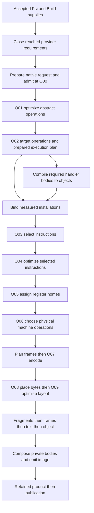
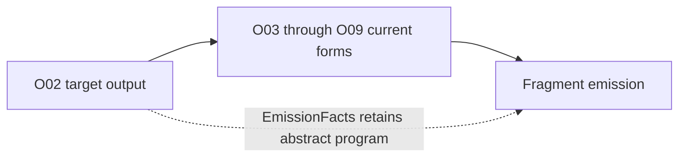
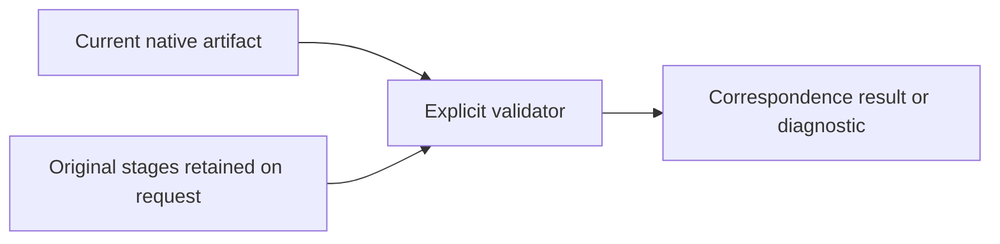

# Omega: from selected Psi to a native product

Omega turns a checked portable program into code for one target. It selects and
admits outside providers, lowers the program to instructions, assigns registers,
encodes and lays out bytes, builds objects and images, then hands a retained
product to publication. Today several of these operations sit outside the
numbered stages. The map below shows that current route before the proposed
linear pipeline.

**Evidence:** source revision
`3f9ce43f0c9d179048911d18faa91ba93f60176d`; pinned source links below and the
[generated counts](../evidence/data/counts.json) and [dependency graph](../evidence/data/graph.json).
This is a source review, not a fresh native execution test. Stage destination
names and migration recommendations are **judgment**. The six
[owner rulings](../rulings.md) are unchanged.

## The input boundary

The [native facade][compile] accepts `RetainedTerminalArtifact` and
`NativeCompileRequest`; Build has supplied completed scalar applications.
[`prepare`][prepare] joins the retained proposal, installation assumptions,
component inputs and private-entry memory recipes, then checks the required
scalar values are present. Its errors preserve the image request alongside
diagnostics so the caller retains the failed request's context.

This facade is source-free, but the entire path to it is not. The compiler's
[provider settlement][closure] still works with accepted source publication and
[policy preparation][provider-inputs] still takes checked source custody. The
Psi/Omega firewall must be assessed at both boundaries, not inferred from the
facade's signature alone.

An outside call has several kinds of identity: which program requested it,
which declaration/body was chosen, and which target plan implements it. The
[selected execution][selected] checks target agreement; later installation
[binding][bound] checks program, target, entry and admitted placement. Moving
these records must preserve their checked construction, not just their fields.

## Current route: order within one native body

Solid arrows below show the main transformations. The handler branch matters:
the root can pause after O02 while another native body is compiled. This is a
per-body route with a driver coordinating dependent bodies, not one whole-program
pass through every box.

The [native pipeline driver][pipeline] orders O01–O09. The [object coordinator][object-route]
prepares handlers, binds installations, emits the root, then lowers remaining
referenced callback thunks and composes private objects. The [fragment wrapper][fragment-route]
orders the transformations after O09. [Image realization][image] returns the
retained artifact; [products][publish] owns the call that writes it.

## Realization closes demand; admission checks choices

| Owner | Rust lines | What its result means |
| --- | ---: | --- |
| `provider-planning` | 7,231 | A selected target's supply for reached requirements, including calling-policy results. |
| `provider-admission` | 26,491 | Checked provider, entry and installation records; late binding of measured installation facts. |
| `provider-selection` | 1,874 | Selected instances, exact bodies and applications joined to the retained declarations. |
| `trust-model` | 708 | Obligations reconstructed from declarations, grants and selected provider evidence. |
| `selected-dispatch` | 105 | One target-matched realized provider closure, retained for native and Psi consumers. |

The total is 36,409 lines, including tests. These are ownership units, not five
successive stages.

The [closure loop][closure-loop] starts from the actual entry's reached
requirements and explicit Build selections. Chosen bodies can introduce more
requirements. The loop reruns policy-input preparation when the reached set
changes, realizes supply, and joins the resulting exact bodies. It terminates
when the binding set is unchanged and refuses replacement of a prior choice.
Available but unused code does not independently demand a provider.

Calling policies are executable programs: [Build supplies their evaluator][policy-evaluator],
and preparation retains the program artifacts and selection authority. The
native [proposal constructor][proposal] also closes provider specializations,
realizes task activations and checks selected provider ownership. These are
producers despite the constructor living under `representations/`.

Admission is not finished at early provider selection. [O00 realization][admission]
admits native providers and the executable entry and captures provisions for
Psi execution. Later, [installed handlers][handler-demand] are emitted before
their installer needs a numeric stack guard. The coordinator caches those
objects for this compilation, rejects cyclic executable resource dependencies,
and derives requirements from the emitted objects. [Binding][bound] joins them
to the admitted cohort and current program before instruction selection.

`SelectedExecution::settle` is a convenience route, not the only constructor.
The compiler uses public [`from_realization`][selected] after it closes demand.

### A concrete boundary: Console on Linux x86-64

The library's [Build declaration][console-build] selects `LinuxX86Console`
for `Console`, then binds `LinuxX86ConsoleIo::write` to `Syscall { number: 1 }`.
The [provider methods][console-provider] call console helpers; the
[raw implementation][console-raw] reaches the I/O boundary. Terminal Psi keeps
the program's required operations; provider settlement connects reached
requirements to this target selection and calling plans. Native lowering uses
the admitted realization to produce target operations.

This trace establishes who declares and chooses the binding. It does not assert
that every Console method is one syscall, that all available Console code is
reached, or that this review executed a Console sample.

## Numbered stages and their current representations

The table describes ordinary native production. Admission tokens, optimization
receipts and explicitly retained replay inputs are related evidence; they are
not interchangeable with the current executable program.

| Current operation | Declared input → produced form | Fact established for the next operation |
| --- | --- | --- |
| O00: Terminal Psi to abstract operations | Retained canonical Psi, selected execution and completed native inputs → `VerifiedNativeArtifactInput` / [`AbstractOperationPlan`][abstract] with admitted facts | Bind native lowering and provider/entry evidence to this program and target. [Facade sequence][compile] [admission][admission] |
| O01: abstract optimization | Verified input → optimized abstract plan | Apply selected abstract rewrites and carry projection/work identities. [Driver][pipeline] |
| O02: target lowering and preparation | Optimized abstract plan, lowering facts and target/provider request → [`TargetOperationPlan`][target] and `PreparedExecutionPlan` | Resolve concrete operation, call, storage and proof facts needed for selection. [Driver][pipeline] |
| Later installation binding | Prepared plan plus measured handler requirements and admitted cohorts → `BoundInstallationAuthority` | Bound facts name the same program, target and entries; selection receives plain facts, not authority constructors. [Binding][bound] |
| O03: instruction selection | Prepared execution plan, bound installations and register environment → [`SelectedInstructionPlan`][selection] | Choose instruction/register constraints without reading an abstract program or source module. [Contract][selection-readme] |
| O04: selected optimization | Selected program and carried analysis/custody → selected allocation input | Publish current instructions, analyses and optimization record; retain full rewrite run only on request. [Driver][physical] |
| O05: register allocation | Selected allocation input → [`AllocatedProgram`][allocation] | Assign register homes needed for physical lowering. [Driver][physical] |
| O06: physical planning | Current allocation facts → [`PostAllocationMachineProgram`][machine] | Choose physical operations and preservation requirements before frames and encoding. [Driver][frame-route] |
| Unnumbered frame planning | Current physical program plus frame policy → `FramedMachineProgram` | Fix frame geometry and protocol for encoding. [Driver][frame-route] |
| O07: layout-independent encoding | Framed machine program → `EncodedMachineProgram` | Produce actual instruction bytes/encoding rows while keeping required instruction and frame columns. [Forms][encoding] |
| O08: resolved layout | Current encoding → `ResolvedMachineProgram` | Choose exact function-relative placements and resolve their encodings. [Driver][frame-route] |
| O09: layout optimization | Current resolved layout → same form | Rewrite layout under its carried selection/budget contract. [Driver][frame-route] |

`machine-code` is a family with several roots, not one representation whose
name explains every operation. [The root definitions][encoding] distinguish
framed, encoded and resolved programs. Stable native vocabulary lets these
forms name common identities without granting access to an earlier program.

## After O09: functions, objects, images and publication

The current [fragment route][fragment-route] exposes the work that the backend
name hides:

| Operation | Output and consumer |
| --- | --- |
| Assemble fixed-frame realization | Current resolved program and whole-function exit contract for fragment emission. [Driver][frame-route] |
| Emit function fragments | Unplaced [`FunctionFragmentEmissionPlan`][fragments] records and fixups. |
| Apply function frames | Prologue/epilogue insertion, byte reflow and repaired branch displacements. |
| Place text | One text section with function/block/instruction spans and internal-call resolution. |
| Build relocation-free object container and `ObjectArtifact` | Current bytes plus object layout, semantic attribution and evidence for later composition. |
| Compose private functions and entry receiver | Root and referenced callback objects joined into the published object. [Coordinator][callback-composition] |
| Emit requested image | Executable/component image construction and target format writers. Direct executable dispatch chooses ELF, Mach-O or PE from the target's object format. [Format dispatch][formats] |
| Retain native product | `RealizedNativeProduct` holds a requested artifact and optional runtime provisions. [Return][image] |
| Publish product | `products::publish_compilation` chooses the publication route, stages exact bytes and records receipts. [Entry][publish] [native publication][native-publish] |

“Object publication” in this route does not necessarily write a filesystem
product. `PublishedFragmentObject` is an internal completed object. Actual
product publication runs in `products`; some implementation, including
[macOS application package writing][package-publish], still lives under backend
`native-artifact`. The migration should move that implementation to its product
owner while keeping image construction in the compilation route.

Components and private callbacks are separately lowered bodies under the same
native driver; the diagram is not a claim that the entire application consists
of one machine function. The compiler uses reached object references to avoid
emitting unused callback bodies. [Composition][callback-composition]

## Current bypass: EmissionFacts

The driver extracts [`EmissionFacts`][emission-facts] from O02's result. It keeps
admitted lowering facts, a shared **whole optimized abstract program**, and
projection/Terminal/final-unit identities. Emission later receives those beside
the resolved machine program and installation authority. That is a genuine
bypass around the representations between selection and emission.

**Judgment:** inventory every emission consumer and materialize the needed
records in the current forms. Moving the same `Arc` into `machine-code` would
change packaging without removing earlier-program access. Exact fields and
retention cost remain **unverified** until the inventory and implementation are
complete; this review claims no memory or performance improvement.

The declaration-selection ledger in Psi is different: its definition is
misplaced in foundation but the value already travels through typed trees.
Definition location, stored value and producer must be mapped separately.

## Explicit verification is a separate route

When `retain_native_stage_inputs` is false, the driver drops the original
target, allocation, encoding and layout inputs as they become unnecessary.
When requested, it retains those originals for correspondence audits.
[Retention logic][retention] This does not remove the ordinary `EmissionFacts`
bypass described above.

[Target-operation verification][audit] requires the retained target input and
calls the preparation verifier plus a borrowed-storage reconstruction routine.
[Fixed-frame verification][frame-audit] compares current output with retained
allocation, machine, encoding and baseline layout. These functions refuse when
required custody is missing. They are not evidence that every default compile
replays O02/O03.

Production still performs checks at admission, foreign/import boundaries and
object/image handoffs. Distinguishing explicit replay from ordinary production
does not mean ordinary production performs no validation.

**Judgment:** move explicit validators beside the representation they check,
with independent checking APIs and an explicit retained-evidence input. Merely
moving a file preserves its dependency on producer stages. Remove each
stage-call allowance only after that call is gone; preserve independent checks
rather than sharing the producer's logic by default.

## Runtime use is another consumer

`admit_runtime` shares native provider/entry admission and returns provisions
for Psi execution. The [runtime-admission route][psi-admission] also performs
abstract optimization and captures borrowed-storage layouts, then stops before
machine emission. It is not equivalent to compiling and running a native image.

The native runtimes read admitted carriers and image/provision records. Some
carrier definitions currently live in a producing crate, for example the
[admitted intrinsic type used by terminal-runtime][runtime-carrier]. A move of
admission into numbered stages must split that interface so runtimes do not
start importing or executing a stage merely to read a record.

## Proposed route and migration dependencies

The [complete migration plan](../plans/foundation-and-backend.md#3-recommended-destination-and-stage-contracts)
contains the proposed contract figure and phase table. **Judgment:** close source
and logical providers before native planning, then carry demanded bodies through
physical planning, resource binding and one encoding boundary. Image construction
must consume completed executable bodies. This differs from today's per-body
route and late bridge production shown above.

The [planning gates](../plans/foundation-and-backend.md#8-planning-completion-gates-before-implementation)
must establish the unresolved ordering. O03 currently needs bound installation
facts, while those facts depend on compiled handlers. Numeric consumers must be
classified, generated body effects made explicit and resource binding shown to
preserve prior register/frame choices. Cyclic resource demand must still be
refused. The current code does not prove that this proposed separation works.

The [integrated execution plan](../plans/foundation-and-backend.md#9-one-integrated-execution-plan)
orders one coordinated cutover, including semantic encoder ownership, carried
ABI plans, O07/O08 encoding alternatives, emission facts, runtimes, independent
checks and deletion of replaced paths. These are coupled obligations, not a set
of separately adopted package moves. [Questions](../questions.md) retain the
recommendations that still need a ruling. No compiler implementation or owner
ruling changes in this atlas update.

[abstract]: https://github.com/CathedralOS/Omega/blob/3f9ce43f0c9d179048911d18faa91ba93f60176d/omega-rust/omega/compilation/representations/abstract-operations/src/lib.rs#L29
[admission]: https://github.com/CathedralOS/Omega/blob/3f9ce43f0c9d179048911d18faa91ba93f60176d/omega-rust/omega/compilation/native-compiler/src/realization.rs#L44
[allocation]: https://github.com/CathedralOS/Omega/blob/3f9ce43f0c9d179048911d18faa91ba93f60176d/omega-rust/omega/compilation/representations/register-homes/src/lib.rs#L301
[audit]: https://github.com/CathedralOS/Omega/blob/3f9ce43f0c9d179048911d18faa91ba93f60176d/omega-rust/omega/compilation/backend/images/image-emission/src/function_fragments/replay/validation.rs#L71
[bound]: https://github.com/CathedralOS/Omega/blob/3f9ce43f0c9d179048911d18faa91ba93f60176d/omega-rust/omega/compilation/realization/provider-admission/src/installation_binding.rs#L60
[byte-encoder]: https://github.com/CathedralOS/Omega/blob/3f9ce43f0c9d179048911d18faa91ba93f60176d/omega-rust/psi/foundation/semantic-vocabulary/src/identity_encoding.rs#L5
[call-plan]: https://github.com/CathedralOS/Omega/blob/3f9ce43f0c9d179048911d18faa91ba93f60176d/omega-rust/omega/compilation/backend/calling-conventions/src/plans/call_plan_evaluation.rs#L25
[callback-composition]: https://github.com/CathedralOS/Omega/blob/3f9ce43f0c9d179048911d18faa91ba93f60176d/omega-rust/omega/compilation/native-compiler/src/realization/object_emission.rs#L115
[callback-encoder]: https://github.com/CathedralOS/Omega/blob/3f9ce43f0c9d179048911d18faa91ba93f60176d/omega-rust/omega/compilation/pipeline/08_selected-form-encoding-to-resolved-layout/src/ordinary.rs#L676
[closure]: https://github.com/CathedralOS/Omega/blob/3f9ce43f0c9d179048911d18faa91ba93f60176d/omega-rust/omega/compilation/compiler/src/execution_settlement.rs#L202
[closure-loop]: https://github.com/CathedralOS/Omega/blob/3f9ce43f0c9d179048911d18faa91ba93f60176d/omega-rust/omega/compilation/compiler/src/execution_settlement.rs#L260
[compile]: https://github.com/CathedralOS/Omega/blob/3f9ce43f0c9d179048911d18faa91ba93f60176d/omega-rust/omega/compilation/native-compiler/src/compile.rs#L14
[console-build]: https://github.com/CathedralOS/Omega/blob/3f9ce43f0c9d179048911d18faa91ba93f60176d/source/library/std/build.omg#L677
[console-provider]: https://github.com/CathedralOS/Omega/blob/3f9ce43f0c9d179048911d18faa91ba93f60176d/source/library/std/console.omg#L139
[console-raw]: https://github.com/CathedralOS/Omega/blob/3f9ce43f0c9d179048911d18faa91ba93f60176d/source/library/std/console.omg#L223
[emission-facts]: https://github.com/CathedralOS/Omega/blob/3f9ce43f0c9d179048911d18faa91ba93f60176d/omega-rust/omega/compilation/native-compiler/src/pipeline.rs#L261
[encoding]: https://github.com/CathedralOS/Omega/blob/3f9ce43f0c9d179048911d18faa91ba93f60176d/omega-rust/omega/compilation/representations/machine-code/src/layout.rs#L261
[formats]: https://github.com/CathedralOS/Omega/blob/3f9ce43f0c9d179048911d18faa91ba93f60176d/omega-rust/omega/compilation/backend/images/image-emission/src/image.rs#L1823
[fragment-route]: https://github.com/CathedralOS/Omega/blob/3f9ce43f0c9d179048911d18faa91ba93f60176d/omega-rust/omega/compilation/backend/artifacts/native-artifact/src/fragment_object_publication.rs#L167
[fragments]: https://github.com/CathedralOS/Omega/blob/3f9ce43f0c9d179048911d18faa91ba93f60176d/omega-rust/omega/compilation/representations/machine-code/src/fragments.rs#L41
[frame-audit]: https://github.com/CathedralOS/Omega/blob/3f9ce43f0c9d179048911d18faa91ba93f60176d/omega-rust/omega/compilation/backend/images/image-emission/src/function_fragments/replay/validation.rs#L7
[frame-route]: https://github.com/CathedralOS/Omega/blob/3f9ce43f0c9d179048911d18faa91ba93f60176d/omega-rust/omega/compilation/native-compiler/src/pipeline.rs#L200
[handler-demand]: https://github.com/CathedralOS/Omega/blob/3f9ce43f0c9d179048911d18faa91ba93f60176d/omega-rust/omega/compilation/native-compiler/src/realization/callback_thunks.rs#L117
[image]: https://github.com/CathedralOS/Omega/blob/3f9ce43f0c9d179048911d18faa91ba93f60176d/omega-rust/omega/compilation/native-compiler/src/realization.rs#L95
[machine]: https://github.com/CathedralOS/Omega/blob/3f9ce43f0c9d179048911d18faa91ba93f60176d/omega-rust/omega/compilation/representations/post-allocation-machine/src/program.rs#L18
[native-publish]: https://github.com/CathedralOS/Omega/blob/3f9ce43f0c9d179048911d18faa91ba93f60176d/omega-rust/omega/compilation/products/src/publication.rs#L70
[object-route]: https://github.com/CathedralOS/Omega/blob/3f9ce43f0c9d179048911d18faa91ba93f60176d/omega-rust/omega/compilation/native-compiler/src/realization/object_emission.rs#L57
[package-publish]: https://github.com/CathedralOS/Omega/blob/3f9ce43f0c9d179048911d18faa91ba93f60176d/omega-rust/omega/compilation/backend/artifacts/native-artifact/src/package_publication.rs#L280
[path-encoder]: https://github.com/CathedralOS/Omega/blob/3f9ce43f0c9d179048911d18faa91ba93f60176d/omega-rust/psi/foundation/semantic-vocabulary/src/structural_path_encoding.rs#L3
[physical]: https://github.com/CathedralOS/Omega/blob/3f9ce43f0c9d179048911d18faa91ba93f60176d/omega-rust/omega/compilation/native-compiler/src/pipeline.rs#L145
[pipeline]: https://github.com/CathedralOS/Omega/blob/3f9ce43f0c9d179048911d18faa91ba93f60176d/omega-rust/omega/compilation/native-compiler/src/pipeline.rs#L84
[policy-evaluator]: https://github.com/CathedralOS/Omega/blob/3f9ce43f0c9d179048911d18faa91ba93f60176d/omega-rust/omega/build-system/build-settings/src/calling_policy_execution.rs#L45
[prepare]: https://github.com/CathedralOS/Omega/blob/3f9ce43f0c9d179048911d18faa91ba93f60176d/omega-rust/omega/compilation/native-compiler/src/preparation.rs#L26
[proposal]: https://github.com/CathedralOS/Omega/blob/3f9ce43f0c9d179048911d18faa91ba93f60176d/omega-rust/omega/compilation/representations/abstract-operations/verified-optimization-input/src/native_proposal.rs#L240
[provider-inputs]: https://github.com/CathedralOS/Omega/blob/3f9ce43f0c9d179048911d18faa91ba93f60176d/omega-rust/omega/compilation/compiler/src/terminal/provider_execution.rs#L14
[psi-admission]: https://github.com/CathedralOS/Omega/blob/3f9ce43f0c9d179048911d18faa91ba93f60176d/omega-rust/omega/compilation/native-compiler/src/realization.rs#L152
[publish]: https://github.com/CathedralOS/Omega/blob/3f9ce43f0c9d179048911d18faa91ba93f60176d/omega-rust/omega/compilation/products/src/publication.rs#L26
[retention]: https://github.com/CathedralOS/Omega/blob/3f9ce43f0c9d179048911d18faa91ba93f60176d/omega-rust/omega/compilation/native-compiler/src/pipeline.rs#L173
[runtime-carrier]: https://github.com/CathedralOS/Omega/blob/3f9ce43f0c9d179048911d18faa91ba93f60176d/omega-rust/omega/interpreter/terminal-runtime/src/execution/host_imports.rs#L365
[selected]: https://github.com/CathedralOS/Omega/blob/3f9ce43f0c9d179048911d18faa91ba93f60176d/omega-rust/omega/compilation/realization/selected-dispatch/src/selected_execution.rs#L14
[selection]: https://github.com/CathedralOS/Omega/blob/3f9ce43f0c9d179048911d18faa91ba93f60176d/omega-rust/omega/compilation/representations/selected-instructions/src/lib.rs#L181
[selection-readme]: https://github.com/CathedralOS/Omega/blob/3f9ce43f0c9d179048911d18faa91ba93f60176d/omega-rust/omega/compilation/pipeline/03_target-operations-to-selected-instructions/README.md#L1
[target]: https://github.com/CathedralOS/Omega/blob/3f9ce43f0c9d179048911d18faa91ba93f60176d/omega-rust/omega/compilation/representations/target-operations/src/lib.rs#L28
