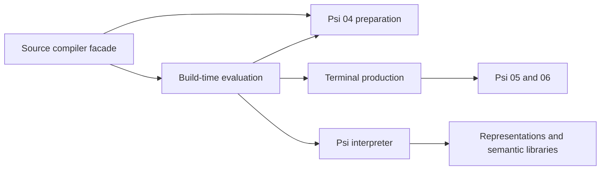

# Psi compilation

Psi gives source its target-neutral meaning and publishes the portable program
Omega consumes. In the Rust reference compiler, the important boundary is
acceptance: typed trees describe a program; only the lowered-form checking
route can accept it. Native provider choice, register placement and image
emission belong to [Omega](omega.md), while execution belongs to the
[interpreter](interpreter.md). [Source: domain contract][domain]

**Evidence scope.** This page traces the code at
`3f9ce43f0c9d179048911d18faa91ba93f60176d`. Source links below are pinned to
that revision. The audit checked source, manifests and test definitions; it
did not run compiler or interpreter tests. Runtime behavior is **unverified**
here. “Terminal Psi” names the internal terminal representation; the public
product is Psi. This map covers `omega-rust/psi/`; the Omega-written
`source/psi/` is a separate, partial implementation whose own README limits
its scalar execution gate to unqualified `u8` machines. [Product status][product]

## What crosses each stage

The diagram names transformations of one prepared source request. It is not
a claim that the current coordinator performs one uninterrupted pass: source
activation and compile-time evaluation interrupt that larger workflow, as
described below. Nor does a box imply that every language construct works.

| Stage | Actual entrance and values | Work and limit of its authority |
| --- | --- | --- |
| 00, source files to tokens | `lex_sources(LoadedSources) -> Result<LexedSources, Vec<Diagnostic>>` | Lexes retained source text and keeps its source identity and metadata. Lexical failures carry the original location. [Code][p00] |
| 01, tokens to syntax trees | `parse_sources(LexedSources, &mut SyntaxTrees) -> Result<ParsedSources, Vec<Diagnostic>>` | Writes syntax nodes and returns the source/root associations. Parsing identifies authored structure; it does not prove contracts. [Code][p01] |
| 02, syntax to resolved trees | `resolve(ResolutionRequest) -> Result<SymbolResolvedTrees, Vec<Diagnostic>>` | Resolves names against source scope, top-level bindings and an optional retained base. The request explicitly carries source custody; source-free test forests have different visibility inputs. Deferred and extension entrances support staged source activation. [Code][p02] |
| 03, resolved to typed trees | `lower_symbol_resolved_trees(&SymbolResolvedTrees) -> Result<TypedTrees, Diagnostic>` | Validates resolved semantics, constructs typed declarations and expressions, and carries semantic records forward. The production facade also uses `SeededTypingBase` to extend the exact retained predecessor. [Lowering][p03]; [facade][continuation] |
| 04, typed preparation | `prepare_typed_trees(TypedTrees, &PreparationRequest) -> Result<(FrozenTypedTrees, TypedPreparation), Vec<Diagnostic>>` | Runs specialization, domain applications and record patterns in that order, then freezes the result. `TypedPreparation` is request metadata, with no judgment receipt. Deferred layouts, opaque representation selections and wire demands without a serving pass refuse explicitly. [Pass list][p04-passes]; [entrance and refusals][p04] |
| 05, structural lowering | `prepare_compilation(&TypedTrees, Compilation, TerminalPublication) -> PreparedSource` | Emits `TerminalCompilation` plus `SourceCorrespondence`. It gathers the entry closure, generic forms, selected conformance witnesses and their relationships while typed source is available. Formation failures remain data for stage 06 to judge. [Code][p05] |
| 06, lowered-form checking | `judge_compilation(TerminalCompilation) -> Vec<Result<RouteVerdict, CompilationRefusal>>` | Checks the prepared forms and witnesses without consulting typed source or invoking an earlier stage. Accepted closures contain elaboration, discharge and obligation evidence seals. Other outcomes publish no accepted artifact. [Entrance][p06]; [verdict types][verdict] |

The public parsing facade also fuses 00 and 01 per source: it calls `Lexer`,
retains source backing, calls `parse`, and recycles token scratch. It preserves
lexical-error priority across the batch. Thus a diagram of the representations
does not imply that every program materializes an entire separate
`LexedSources` batch. [Fused source ingress and tests][fused]

## Who sequences the work today

`source-compiler` owns the source entrances: `SourceInput`,
`SourceCompilationRequest`, `SourceContinuation`, `CompletedSource` and
`SourcePreparationRequest`. A continuation retains a seeded typed base,
pending resolved bodies and pending evaluations. Completing selected source
bodies alternates the deferred resolution and typing operations until none of
those bodies remains. That is existing orchestration to account for in a
linearization plan, not an already linear whole-program implementation.
[Request and retained state][source-state]; [completion loop][continuation]

Preparation currently evaluates fixed-layout applications, domain access
plans, const arguments and constant initializers before invoking Psi 04.
It checks materialization receipts, then returns `FrozenSource` with frozen
trees, accounting and demanded constants. A failed preparation keeps usage
accounting with its diagnostics. [Preparation sequence][source-preparation]

`terminal-production` owns the next sequence. `AcceptedTerminalSource::judge`
retains the exact `Arc<FrozenTypedTrees>`, asks 05 to prepare the compilation,
then asks 06 for verdicts. It refuses missing correspondence between accepted
forms and their source. `produce` publishes either portable canonical code or
invocation code, keeps evidence, and attaches source selections, provenance
and Build companions to that same owner. The checker consumes the program
half of 05's output; the publication owner retains the source half. This is
the current data route, including the correspondence retained outside the
checker. [Judgment][accepted]; [publication][publication]

The two publication forms matter. A compile-time invocation can publish code
for one checked dependency closure; that does not claim a whole package was
checked or that portable output was requested. The source-job producer fixes
the actual requesting caller before preparation and checks that acceptance
returned that same caller. [Invocation preparation][job-prepare]

## Trace a selected call through the representations

For a call with an authored declaration-selection occurrence, the selection
ledger already travels through typed trees. The shared location of its type
definition is a different ownership question from the location of its values.

1. `SymbolResolvedTrees` owns `AuthoredDeclarationSelections` and recording
   methods associate source occurrences with selected declarations.
   [Storage and recording][resolved-ledger]
2. Psi 03 calls `retain_authored_declaration_selections` with that ledger.
   `TypedTreeTables` contains the field, whose type is currently defined in
   `language_semantics::declaration_selection`. [Transfer][ledger-transfer];
   [typed storage][typed-ledger]
3. Psi 05 reads `self.typed.authored_declaration_selections().get(occurrence)`.
   It refuses a missing ledger row or a selection resolved to another
   declaration; it also explicitly refuses the intrinsic and late-bound cases
   in this call-reading path. [Consumer and errors][ledger-consumer]

**Judgment.** Moving this vocabulary out of foundation must preserve the
occurrence identities, ledger transfer and consumer checks. Drawing an arrow
from foundation that skips typed trees would misdescribe the present code and
suggest a data-flow repair that has already happened.

## Checking, proof admission and publication are different jobs

Stage 06's prover searches for certificates from the hypotheses and semantic
axioms at an obligation. Its output is checked; search success alone is not
acceptance. `proof-admission::accept_certificate` validates the goal and
premises, walks the supplied proof, checks that its conclusion matches the
goal and records mathematical-core admission. Proof admission runs no search
of its own. [Prover][prover]; [certificate admission][proof]; [admission contract][proof-contract]

There is a useful concrete test of that boundary. The stage-06 test helper
constructs a machine adding two `u32` formals. With each operand constrained
to at most 100, the test expects one safety obligation and checks its kernel
evidence. The adjacent tests remove those premises, or add `u32::MAX` and 1,
and expect the addition to remain unproved. This tests proof requirements;
it is not a runtime overflow experiment. **Unverified:** these tests were
inspected, not executed for this atlas update. [All three test definitions][addition-tests]

The result preserves distinct failure meanings:

- `Rejected` records unproved supported obligations, invalid formations,
  violations, unestablished storage, conflicting loans or exceeded service
  reach.
- `Incomplete` records a goal form for which the prover has no rule.
- `FallBack` is an old variant name for unsupported constructs. The source
  explicitly says no fallback checker runs.
- `CompilationRefusal` reports defects such as failed identity relationships.

None is an accepted closure. Failure to find proof is not a proof that the
proposition is false. [Verdict contract][verdict]

**Current limit.** The bounded certificate checker and the mathematical-core
translation have different coverage. `accept_certificate` may return an
acceptance whose core decision is `Refused(family)` when that translation
does not cover a rule family; a covered but invalid translation errors.
The map must not describe every accepted bounded certificate as already
translated and judged by the mathematical core. [Exact distinction][core-coverage]

Canonical sealing is another boundary. `ClosedTerminalModule` keeps a module,
closed types, bytes and identity together; its definition expressly says this
does not establish checker acceptance or producer trust. `terminal-wire`
owns canonical encoding and structural closure, while `terminal-codec` owns
the sealed module and envelope. The digest identifies bytes; it does not
authorize execution. [Closed module][closed]; [codec contract][codec]

**Stale documentation found.** The pinned compilation README links to
`representations/terminal-psi/verification/README.md`, but that directory and
a `terminal-verification` package are absent from this tree. The existing
link is not evidence of a working independent whole-artifact verifier.
Proof admission, structural decoding and interpreter startup must be shown
separately. [Stale link][stale-verifier]; [actual loading route](interpreter.md)

## Compile-time evaluation and the plan's dependency problem

Build-time evaluation is compilation work that uses the interpreter. The
interpreter never calls the source workflow. A source job prepares and checks
an invocation, publishes its code, admits its exact target and supplies,
executes it, and converts its returned value into `BuildTimeValue` for the
compiler. Missing imports, providers, external completions or unavailable
target observations refuse at admission. [Preparation][job-prepare];
[admission][job-admit]; [execution][job-execute]

The following is a **current dependency/call diagram**, not stage order:

`source-compiler` already depends on `build-time-evaluation`, so making the
whole evaluator depend on that facade would create a crate cycle. In
production, the evaluator directly invokes Psi 04 for an invocation and
prepares retained Product applications through another Psi 04 entrance.
It also stores the Psi 03 `SeededTypingBase` type. Direct Psi 02 resolution
and Psi 03 lowering calls found in this audit are in tests, even though the
crates appear in ordinary manifest dependencies. A manifest edge, a retained
type and a call into a stage are three different kinds of evidence.
[Facade manifest][source-manifest]; [evaluator manifest][eval-manifest];
[production invocation][job-prepare]; [Product preparation][retained-product];
[retained type][seeded-type]; [test boundary][job-tests]

**Judgment for Q-C.** Give one sequencing owner the source continuation and
the task of preparing each requested evaluation program. Pass admitted code,
arguments, supplies and accounting to an executor that cannot call a source
stage. Return a result tied to that invocation before continuing compilation.
Extract the source-stage calls and relocate `SeededTypingBase` custody before
reversing any dependency. Preserve the existing exact-caller, source-consent,
target and accounting checks; a common facade name alone would not resolve
them. This is a migration proposal, not another owner ruling.

## Coverage and review checks

Source evidence supports the route above, but not a claim of full language
or product support. Source preparation explicitly refuses source-selection
authority it cannot admit and opaque representation requests; Psi 04 refuses
unserved layout, representation and wire requests. Other constructs can reach
05 or 06 and then be refused. An accepted small example cannot remove those
boundaries. [Preparation limits][source-limits]; [Psi 04 limits][p04]

Useful existing checks, all **runtime-unverified in this review**, are the
fused-ingress source-order/error-priority tests, the resolved-tree ledger
ownership test, Psi 05's left-to-right operand/call-argument test, and the
three arithmetic obligation tests above. These are test definitions, not
fresh passing results. [Ingress][fused]; [ledger ownership][ledger-test];
[operand order][order-test]; [arithmetic][addition-tests]

For this documentation change, validation is confined to pinned paths and
line anchors, diagram syntax and consistency with adjacent atlas pages.
The [full migration plan](../plans/foundation-and-backend.md) owns proposed
crate moves; [Build and packages](build-and-packages.md) owns the application
and package scheduling boundary.

[domain]: https://github.com/CathedralOS/Omega/blob/3f9ce43f0c9d179048911d18faa91ba93f60176d/omega-rust/psi/README.md#L3
[product]: https://github.com/CathedralOS/Omega/blob/3f9ce43f0c9d179048911d18faa91ba93f60176d/source/psi/README.md#L3
[p00]: https://github.com/CathedralOS/Omega/blob/3f9ce43f0c9d179048911d18faa91ba93f60176d/omega-rust/psi/compilation/pipeline/00_source-files-to-tokens/src/lex_sources.rs#L14
[p01]: https://github.com/CathedralOS/Omega/blob/3f9ce43f0c9d179048911d18faa91ba93f60176d/omega-rust/psi/compilation/pipeline/01_tokens-to-syntax-trees/src/parser.rs#L20
[p02]: https://github.com/CathedralOS/Omega/blob/3f9ce43f0c9d179048911d18faa91ba93f60176d/omega-rust/psi/compilation/pipeline/02_syntax-trees-to-symbol-resolved-trees/src/resolution.rs#L1967
[p03]: https://github.com/CathedralOS/Omega/blob/3f9ce43f0c9d179048911d18faa91ba93f60176d/omega-rust/psi/compilation/pipeline/03_symbol-resolved-trees-to-typed-trees/src/lowerer.rs#L1596
[p04-passes]: https://github.com/CathedralOS/Omega/blob/3f9ce43f0c9d179048911d18faa91ba93f60176d/omega-rust/psi/compilation/pipeline/04_typed-trees-to-typed-trees/src/preparation.rs#L25
[p04]: https://github.com/CathedralOS/Omega/blob/3f9ce43f0c9d179048911d18faa91ba93f60176d/omega-rust/psi/compilation/pipeline/04_typed-trees-to-typed-trees/src/preparation.rs#L95
[p05]: https://github.com/CathedralOS/Omega/blob/3f9ce43f0c9d179048911d18faa91ba93f60176d/omega-rust/psi/compilation/pipeline/05_typed-trees-to-terminal-psi/src/compilation.rs#L17
[p06]: https://github.com/CathedralOS/Omega/blob/3f9ce43f0c9d179048911d18faa91ba93f60176d/omega-rust/psi/compilation/pipeline/06_terminal-psi-to-terminal-psi/src/verdict.rs#L1440
[verdict]: https://github.com/CathedralOS/Omega/blob/3f9ce43f0c9d179048911d18faa91ba93f60176d/omega-rust/psi/compilation/pipeline/06_terminal-psi-to-terminal-psi/src/verdict.rs#L1
[fused]: https://github.com/CathedralOS/Omega/blob/3f9ce43f0c9d179048911d18faa91ba93f60176d/omega-rust/psi/compilation/source-compiler/src/lib.rs#L117
[source-state]: https://github.com/CathedralOS/Omega/blob/3f9ce43f0c9d179048911d18faa91ba93f60176d/omega-rust/psi/compilation/source-compiler/src/source_compilation.rs#L894
[continuation]: https://github.com/CathedralOS/Omega/blob/3f9ce43f0c9d179048911d18faa91ba93f60176d/omega-rust/psi/compilation/source-compiler/src/source_compilation.rs#L1091
[source-preparation]: https://github.com/CathedralOS/Omega/blob/3f9ce43f0c9d179048911d18faa91ba93f60176d/omega-rust/psi/compilation/source-compiler/src/source_checking.rs#L119
[accepted]: https://github.com/CathedralOS/Omega/blob/3f9ce43f0c9d179048911d18faa91ba93f60176d/omega-rust/psi/compilation/terminal-production/src/accepted.rs#L49
[publication]: https://github.com/CathedralOS/Omega/blob/3f9ce43f0c9d179048911d18faa91ba93f60176d/omega-rust/psi/compilation/terminal-production/src/accepted.rs#L108
[resolved-ledger]: https://github.com/CathedralOS/Omega/blob/3f9ce43f0c9d179048911d18faa91ba93f60176d/omega-rust/psi/compilation/representations/symbol-resolved-trees/src/lib.rs#L606
[ledger-transfer]: https://github.com/CathedralOS/Omega/blob/3f9ce43f0c9d179048911d18faa91ba93f60176d/omega-rust/psi/compilation/pipeline/03_symbol-resolved-trees-to-typed-trees/src/lowerer.rs#L1622
[typed-ledger]: https://github.com/CathedralOS/Omega/blob/3f9ce43f0c9d179048911d18faa91ba93f60176d/omega-rust/psi/compilation/representations/typed-trees/src/lib.rs#L1457
[ledger-consumer]: https://github.com/CathedralOS/Omega/blob/3f9ce43f0c9d179048911d18faa91ba93f60176d/omega-rust/psi/compilation/pipeline/05_typed-trees-to-terminal-psi/src/read/calls.rs#L515
[prover]: https://github.com/CathedralOS/Omega/blob/3f9ce43f0c9d179048911d18faa91ba93f60176d/omega-rust/psi/compilation/pipeline/06_terminal-psi-to-terminal-psi/src/prove.rs#L1
[proof]: https://github.com/CathedralOS/Omega/blob/3f9ce43f0c9d179048911d18faa91ba93f60176d/omega-rust/psi/compilation/proof-admission/src/proof.rs#L164
[proof-contract]: https://github.com/CathedralOS/Omega/blob/3f9ce43f0c9d179048911d18faa91ba93f60176d/omega-rust/psi/compilation/proof-admission/README.md#L7
[addition-tests]: https://github.com/CathedralOS/Omega/blob/3f9ce43f0c9d179048911d18faa91ba93f60176d/omega-rust/psi/compilation/pipeline/06_terminal-psi-to-terminal-psi/src/tests.rs#L404
[core-coverage]: https://github.com/CathedralOS/Omega/blob/3f9ce43f0c9d179048911d18faa91ba93f60176d/omega-rust/psi/compilation/proof-admission/src/proof.rs#L214
[closed]: https://github.com/CathedralOS/Omega/blob/3f9ce43f0c9d179048911d18faa91ba93f60176d/omega-rust/psi/compilation/representations/terminal-psi/codec/src/closed_module.rs#L1
[codec]: https://github.com/CathedralOS/Omega/blob/3f9ce43f0c9d179048911d18faa91ba93f60176d/omega-rust/psi/compilation/representations/terminal-psi/codec/src/lib.rs#L3
[stale-verifier]: https://github.com/CathedralOS/Omega/blob/3f9ce43f0c9d179048911d18faa91ba93f60176d/omega-rust/psi/compilation/README.md#L18
[job-prepare]: https://github.com/CathedralOS/Omega/blob/3f9ce43f0c9d179048911d18faa91ba93f60176d/omega-rust/psi/compilation/build-time-evaluation/src/source_jobs.rs#L616
[job-admit]: https://github.com/CathedralOS/Omega/blob/3f9ce43f0c9d179048911d18faa91ba93f60176d/omega-rust/psi/compilation/build-time-evaluation/src/source_jobs.rs#L260
[job-execute]: https://github.com/CathedralOS/Omega/blob/3f9ce43f0c9d179048911d18faa91ba93f60176d/omega-rust/psi/compilation/build-time-evaluation/src/source_jobs.rs#L402
[source-manifest]: https://github.com/CathedralOS/Omega/blob/3f9ce43f0c9d179048911d18faa91ba93f60176d/omega-rust/psi/compilation/source-compiler/Cargo.toml#L7
[eval-manifest]: https://github.com/CathedralOS/Omega/blob/3f9ce43f0c9d179048911d18faa91ba93f60176d/omega-rust/psi/compilation/build-time-evaluation/Cargo.toml#L11
[retained-product]: https://github.com/CathedralOS/Omega/blob/3f9ce43f0c9d179048911d18faa91ba93f60176d/omega-rust/psi/compilation/build-time-evaluation/src/product/retained_provider_selections.rs#L120
[seeded-type]: https://github.com/CathedralOS/Omega/blob/3f9ce43f0c9d179048911d18faa91ba93f60176d/omega-rust/psi/compilation/build-time-evaluation/src/source_frontier.rs#L303
[job-tests]: https://github.com/CathedralOS/Omega/blob/3f9ce43f0c9d179048911d18faa91ba93f60176d/omega-rust/psi/compilation/build-time-evaluation/src/source_jobs.rs#L1060
[source-limits]: https://github.com/CathedralOS/Omega/blob/3f9ce43f0c9d179048911d18faa91ba93f60176d/omega-rust/psi/compilation/source-compiler/src/source_checking.rs#L65
[ledger-test]: https://github.com/CathedralOS/Omega/blob/3f9ce43f0c9d179048911d18faa91ba93f60176d/omega-rust/psi/compilation/representations/symbol-resolved-trees/src/lib.rs#L1106
[order-test]: https://github.com/CathedralOS/Omega/blob/3f9ce43f0c9d179048911d18faa91ba93f60176d/omega-rust/psi/compilation/pipeline/05_typed-trees-to-terminal-psi/src/tests.rs#L304
