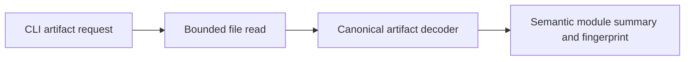

# Tools: product operations and repository work

The shipped `omega` command and the repository's tools have different jobs.
`omega` compiles, runs, inspects and manages packages; repository tools build it,
check changes, select test customers and retain evidence. A tool's location does
not tell us what authority its output carries. The [application dispatch][t01]
and [`xtask` dispatch][t02] are the concrete entrances.

This page maps source at `3f9ce43f0c9d179048911d18faa91ba93f60176d`.
It records implementations and test definitions, not fresh compiler or tool
execution results. Those runs are *unverified* here. Grouping tools by what
their results establish is *judgment*.

## Responsibilities and authority

| Tool family | Input and output | What the result establishes |
| --- | --- | --- |
| Shipped `omega` commands | CLI requests enter compilation, `run`, `psi inspect`, package and audit owners. | Each command follows its subsystem's checks. Inspection alone grants no installation, execution or native authority. [Dispatch][t01]; [inspection contract][t03]; [CLI map](cli.md). |
| Shared host support | `bounded-process`, `platform-custody` and `artifacts` provide child-process control, filesystem identity/retained operations, and output/measurement support. | Mechanisms shared by product owners, not independent commands or evidence that every host works. [Foundation owners][t04]. |
| Repository rules and CI | `xtask check-rules`, `fmt`, `check-boundary`; workflow events supply a diff, title/body or merge tree. | A pass establishes only those rules/checks. Admission conditionally type-checks Rust/Cargo changes; it is not the complete release matrix. [Commands][t02]; [actual admission workflow][t05]. |
| Sample verification and qualification | Explicit sample selections, authored outcomes, a producer and host target become observations and retained records. | Expected native/Psi behavior for those customers and that producer; source-meaning bugs shared by both engines remain possible. [Qualification implementation][t06]; [limits of agreement][t07]. |
| Benchmarking | `omega-bench` takes fixed workloads and candidate executables, retaining observations and validating completed runs. | Measurements about named workloads and hosts, not language acceptance or bootstrap correctness. [Benchmark entrance][t08]. |
| Bootstrap helpers | Source manifests, declared bytes, seeds and process invocations become successor artifacts or observations. | Packing is transport; a semantic producer or accelerator adds a trust dependency. See [bootstrap](bootstrap.md) and [the distinction][t09]. |
| Agent/repository coordination | `doctor`, `claims`, `worktree`, `provenance`, branch cleanup and `tools/swarm/` support host readiness and ownership. | A claim identifies an owner, not a live worker or a verified result. Provenance audits the active transcript. [Coordination][t10]; [provenance source][t11]. |
| Editor support | `tools/vscode-omega/` packages a TextMate grammar and editor configuration. | Syntax highlighting only; no language server, compiler dependency or background process. [Extension scope][t12]. |
| Release support | `tools/release/` retains the bundle contract, supplemental licenses and historical host records. | A matching executable/library layout is a distribution requirement. Old release records are not current qualification; standalone release scripts and draft-release workflows are retired. [Release status][t13]. |

The generic statement that developer tools live in `foundation/` should not be
read as an inventory of shipped commands. The current inspection implementation
lives under `application/src/inspection/`, while `foundation/` contains the
shared mechanisms named above. Follow the command's actual dispatcher and owner.
[Tooling index][t14]; [inspection ownership][t03].

## One shipped route: inspecting a saved Psi artifact

```sh
omega psi inspect --artifact program.psi < /dev/null
```



*Current route from source. It renders an artifact; no execution grant is
created by this path.*

The [argument parser][t15] rejects `--artifact` combined with source-selection
arguments. [`commands::inspect`][t16] bounds file reading, calls
`inspect_terminal_artifact`, reports a failure with exit 1, and prints the
summary and fingerprint only after success. The [inspection operation][t17]
uses `CanonicalTerminalArtifact::from_bytes`, the external artifact decoder.
An invalid artifact therefore cannot pass merely because it has the right
filename.

The alternative source mode requests a named machine through
[`orchestration::build`][t18] with `ProjectProduct::Inspection`; it does not
maintain a second source compiler. Optional `--output` writes the resulting
artifact. The [focused CLI test][t19] requires missing or ambiguous names to
fail without writing one, while the [round-trip test][t20] reopens a published
artifact and compares its fingerprint. These are validation entrances, not
fresh pass claims.

## One repository route: qualifying an exact customer

`mbx xtask qualify --samples <exact-sample-path> --output <new-directory>` is
deliberately narrower than a repository-wide sweep. Its [path parser][t24]
rejects duplicate or escaping paths; its [request checks][t21] reject an
unsupported host target, missing authored outcomes and an output directory
that already exists. [`execute`][t06] then:

1. requires a clean committed tree and retains its exact source archive;
2. prepares and verifies the producer before observing each selected sample;
3. saves the sample outcomes, verifies the producer again and compares source
   identities after execution;
4. returns failure for an unexecuted selection, incorrect outcome or changed
   source/producer instead of relabeling it as a pass.

The executable samples and deliberate rejection controls remain ordinary
customers. Discovery metadata is a runner's instruction, not package admission
or language meaning. [Sample-role contract][t22]. This distinction matters when
interpreting an old pass stamp or a directory-wide count.

## Planning implications

*Judgment:* give product tools the same input/owner/output treatment as compiler
subsystems, and give repository tools an explicit statement of what their
result proves. Keep benchmark records, bootstrap evidence, CI admission and
runtime qualification separately labeled rather than collapsing them to a
single “verified” badge.

There is a concrete documentation mismatch to preserve in the map:
[`tools/ci/README.md`][t23] describes admission as rules and formatting with no
compiler build, but [the workflow][t05] now conditionally runs a type check on
the merge tree. This page follows the executable workflow; repairing that
owner's README is outside this documentation slice.

[t01]: https://github.com/CathedralOS/Omega/blob/3f9ce43f0c9d179048911d18faa91ba93f60176d/omega-rust/omega/application/src/main.rs#L47-L95
[t02]: https://github.com/CathedralOS/Omega/blob/3f9ce43f0c9d179048911d18faa91ba93f60176d/tools/xtask/src/main.rs#L72-L125
[t03]: https://github.com/CathedralOS/Omega/blob/3f9ce43f0c9d179048911d18faa91ba93f60176d/omega-rust/omega/application/src/inspection/README.md#L3-L27
[t04]: https://github.com/CathedralOS/Omega/blob/3f9ce43f0c9d179048911d18faa91ba93f60176d/omega-rust/omega/foundation/README.md#L3-L23
[t05]: https://github.com/CathedralOS/Omega/blob/3f9ce43f0c9d179048911d18faa91ba93f60176d/.github/workflows/admission.yml#L72-L108
[t06]: https://github.com/CathedralOS/Omega/blob/3f9ce43f0c9d179048911d18faa91ba93f60176d/tools/xtask/src/qualification.rs#L36-L118
[t07]: https://github.com/CathedralOS/Omega/blob/3f9ce43f0c9d179048911d18faa91ba93f60176d/wiki/README.md#L55-L61
[t08]: https://github.com/CathedralOS/Omega/blob/3f9ce43f0c9d179048911d18faa91ba93f60176d/tools/benchmark/README.md#L3-L43
[t09]: https://github.com/CathedralOS/Omega/blob/3f9ce43f0c9d179048911d18faa91ba93f60176d/bootstrap/MINIMIZATION.md#L93-L104
[t10]: https://github.com/CathedralOS/Omega/blob/3f9ce43f0c9d179048911d18faa91ba93f60176d/tools/swarm/README.md#L27-L49
[t11]: https://github.com/CathedralOS/Omega/blob/3f9ce43f0c9d179048911d18faa91ba93f60176d/tools/xtask/src/provenance.rs#L1-L39
[t12]: https://github.com/CathedralOS/Omega/blob/3f9ce43f0c9d179048911d18faa91ba93f60176d/tools/vscode-omega/README.md#L1-L6
[t13]: https://github.com/CathedralOS/Omega/blob/3f9ce43f0c9d179048911d18faa91ba93f60176d/tools/release/README.md#L3-L26
[t14]: https://github.com/CathedralOS/Omega/blob/3f9ce43f0c9d179048911d18faa91ba93f60176d/tools/README.md#L3-L6
[t15]: https://github.com/CathedralOS/Omega/blob/3f9ce43f0c9d179048911d18faa91ba93f60176d/omega-rust/omega/application/src/arguments/inspect.rs#L81-L97
[t16]: https://github.com/CathedralOS/Omega/blob/3f9ce43f0c9d179048911d18faa91ba93f60176d/omega-rust/omega/application/src/commands/inspect.rs#L28-L102
[t17]: https://github.com/CathedralOS/Omega/blob/3f9ce43f0c9d179048911d18faa91ba93f60176d/omega-rust/omega/application/src/inspection/mod.rs#L97-L103
[t18]: https://github.com/CathedralOS/Omega/blob/3f9ce43f0c9d179048911d18faa91ba93f60176d/omega-rust/omega/application/src/inspection/mod.rs#L56-L81
[t19]: https://github.com/CathedralOS/Omega/blob/3f9ce43f0c9d179048911d18faa91ba93f60176d/omega-rust/omega/application/tests/named_psi_inspection.rs#L106-L141
[t20]: https://github.com/CathedralOS/Omega/blob/3f9ce43f0c9d179048911d18faa91ba93f60176d/omega-rust/omega/application/tests/named_psi_inspection.rs#L25-L55
[t21]: https://github.com/CathedralOS/Omega/blob/3f9ce43f0c9d179048911d18faa91ba93f60176d/tools/xtask/src/qualification.rs#L150-L192
[t22]: https://github.com/CathedralOS/Omega/blob/3f9ce43f0c9d179048911d18faa91ba93f60176d/samples/README.md#L52-L105
[t23]: https://github.com/CathedralOS/Omega/blob/3f9ce43f0c9d179048911d18faa91ba93f60176d/tools/ci/README.md#L7-L12
[t24]: https://github.com/CathedralOS/Omega/blob/3f9ce43f0c9d179048911d18faa91ba93f60176d/tools/xtask/src/qualification.rs#L15-L33
