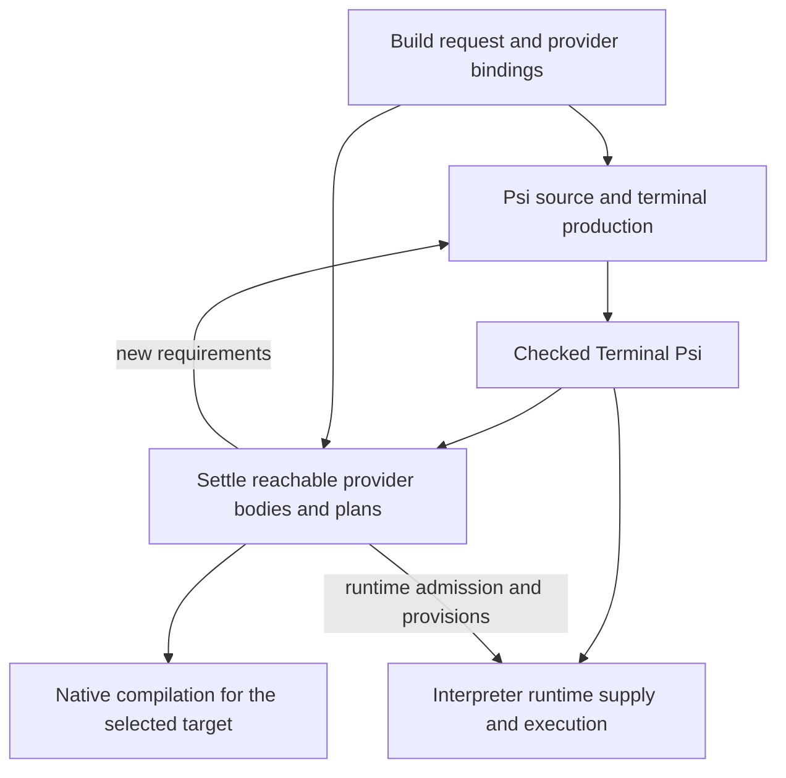
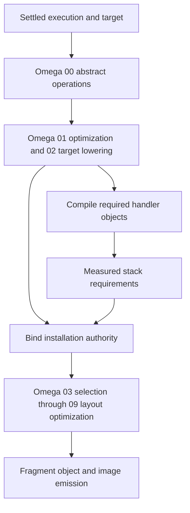
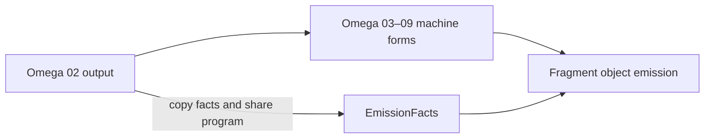
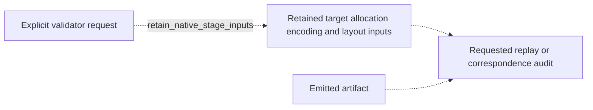
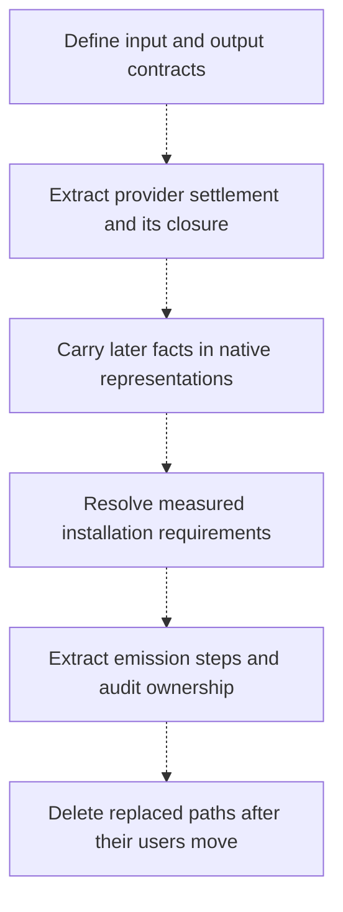

# Pipeline diagrams

The compiler has a numbered Psi route and a numbered native route, plus
drivers that settle providers, bind installations, and emit artifacts. The
owner wants one linear pipeline. The diagrams below distinguish the present
code from the contracts that migration still needs.

## Current route: source, providers, and execution

**Observed.** Build supplies the target and provider bindings. The compiler
produces Terminal Psi, settles reachable provider bodies, and chooses an
execution route. Provider settlement can discover more requirements, so it
repeats until the choices stop changing. This diagram compresses each driver;
the [Psi](../../subsystems/psi.md), [Omega](../../subsystems/omega.md),
[Build](../../subsystems/build-and-packages.md), and
[interpreter](../../subsystems/interpreter.md) pages name their inputs and outputs.

The loop belongs to
[`execution_settlement.rs`](../../../omega-rust/omega/compilation/compiler/src/execution_settlement.rs#L202).
Product Psi execution also uses the selected target's provider and entry
admission: `admit_runtime` returns provisions without emitting an image.
The Terminal Psi arrow carries the artifact; decoding its bytes does not
authorize execution. The interpreter page covers the more general embedding
lifecycle.

## Current native order: installation binding happens later

**Observed.** Early provider plans cannot contain measurements that native
compilation has not made. After Omega 02, the native driver compiles required
handler objects, obtains stack requirements, and binds installations before
Omega 03. Handler compilation can recurse; cyclic resource dependencies are
refused. This is an order for each emitted body, not a claim that the whole
program currently traverses one linear sequence.

See the
[`native-compiler` driver](../../../omega-rust/omega/compilation/native-compiler/src/pipeline.rs#L1)
and [handler-object compilation](../../../omega-rust/omega/compilation/native-compiler/src/realization/callback_thunks.rs#L78).
The [Omega page](../../subsystems/omega.md) distinguishes frame planning,
encoding, layout, fragment emission, objects, images, and product packaging.

## A real value path beside the native forms

**Observed.** `emission_facts` copies admitted lowering facts from Omega 02's
output and shares the optimized abstract program. Fragment emission receives
those facts separately from the successive machine forms. Sharing the
program does not copy the whole program.

The source describes this directly in
[`pipeline.rs:265`](../../../omega-rust/omega/compilation/native-compiler/src/pipeline.rs#L265).
**Proposed — judgment.** Define which facts later forms must carry, then
remove the separate argument. A smaller retained program or faster compile
is *unverified* until measured.

By contrast, `declaration_selection` is **not** evidence of missing value
flow through typed trees. Stage 02's selection values reach
[`TypedTreeTables.authored_declaration_selections`](../../../omega-rust/psi/compilation/representations/typed-trees/src/lib.rs#L1466)
through [stage 03](../../../omega-rust/psi/compilation/pipeline/03_symbol-resolved-trees-to-typed-trees/src/lowerer.rs#L1622),
and [stage 05](../../../omega-rust/psi/compilation/pipeline/05_typed-trees-to-terminal-psi/src/read/calls.rs#L515)
reads them there. The location of a type's definition and the route of its
values are separate ownership questions.

## Explicit audits retain earlier inputs

**Observed; requested audits only.** When `retain_native_stage_inputs` is
enabled, the driver keeps earlier inputs so validators can compare or replay
them. Without those inputs, these explicit audits refuse. Ordinary emission
uses the current machine program and `EmissionFacts`; the audit arrow below
does not describe the default compile route.

The
[audit implementation](../../../omega-rust/omega/compilation/backend/images/image-emission/src/function_fragments/replay/validation.rs#L1)
states that distinction. A migration must decide who owns these checks and
their retained inputs; moving their files alone does not remove the stage
calls or Cargo dependencies.

## Proposed ownership: contracts before numbering

**Judgment.** Make provider settlement an explicit step before Omega 00,
and place program-derived data in the representations that carry it.
Preserve later installation binding until the plan defines how measured
handler requirements arrive. Extract the remaining emission work in a
dependency-safe order. Exact stage numbers and the whole-program treatment
of recursive handler compilation remain open in [Q-F and Q-G](../../questions.md).

These arrows order planning dependencies. They are not implemented pipeline
stages. The [migration plan](../../plans/foundation-and-backend.md) names the
intermediate contracts and deletion conditions. The
[owner rulings](../../rulings.md) remain the authority for the destination.

## Size is evidence, ownership is a judgment

The figures at the top are generated from
[`counts.json`](../../evidence/data/counts.json). They count all tracked Rust
source lines within Cargo package directories, including test files, under
the counting rules in the [evidence manifest](../../evidence/data/manifest.json).
A directory total does not prove that all its work belongs in one stage.
The plan must trace each producer, consumer, authority, and refusal condition.

Text scans identify observed names, not every Rust use. A dependency with no
observed use still needs resolver-aware verification before deletion. See
the [evidence guide](../../evidence/README.md) for the repaired target-directory
scan and the limits of the generated data.
