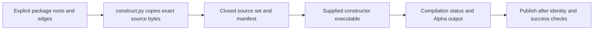

# The repository beyond the Rust pipeline

The full codebase contains a Rust reference producer, a compiler being written
in Omega, libraries used by programs, and several ways to construct that compiler
from a small seed. A Rust crate graph covers the first implementation; it cannot
stand in for the whole repository. [AGENTS.md][r01] names these owners explicitly.

This map reads source at `3f9ce43f0c9d179048911d18faa91ba93f60176d`.
Links below pin that revision. *Current* means present in the source;
runtime success is *unverified* unless an observation is identified explicitly.
The grouping and proposed atlas coverage are *judgment*.

## Owners and boundaries

| Owner | Entrance and result | Authority and status |
| --- | --- | --- |
| Rust reference producer, `omega-rust/` | The [`omega` application][r02] routes compilation, execution, inspection and package commands. See [Psi](psi.md), [Omega](omega.md), [CLI](cli.md), [interpreter](interpreter.md), and [Build/packages](build-and-packages.md). | Maintained reference producer and differential comparator. Its output is implementation evidence; the specification owns required language behavior. [Repository roles][r01]; [specification status][r03]. |
| Omega-written product, `source/psi/` and `source/omega/` | Psi owns target-neutral source processing. Omega's construction application calls a shared compilation library and currently emits Alpha tapes for its supported subset. | One product split by responsibility, outside the bootstrap variants. Self-compilation is unfinished; its source exceeds its own supported backend. [Psi status][r04]; [Omega status][r05]. |
| Bundled library, `source/library/` | Core declarations, ordinary package dependencies, checked helpers, target providers and sealed compiler operations. See [library](library.md). | Inclusion in this tree does not admit a package or prove support on a target. [Library contract][r06]. |
| Bootstrap construction, `bootstrap/` | Peer interpreted, compiled-VM and independent native paths construct successors from declared seeds. See [bootstrap](bootstrap.md). | Governed by `MINIMIZATION.md`; no peer is selected. A completed path must construct the actual Omega compiler and reproduce its self-rebuild. [Architecture mandate][r07]; [completion rule][r23]. |
| Tests, `tests/` and crate-local tests | An owning test selects a program, observes its specified result, or requires the intended refusal. | `tests/fixtures/` supplies Rust-owned programs; `tests/psi/` and `tests/product/` exercise Omega-written source. `tests/omega/` and its corpus runner are retired. [Test ownership][r08]; [retirement][r09]. |
| Samples, `samples/` | Miniature projects with Build entries and authored output/exit expectations enter `sample-gate`. | Discovery roles control test selection, not package trust. A library-only sample is exercised through a consumer. A directory is not automatically one executable. [Sample rules][r10]. |
| Documentation, `wiki/`, root guidance and `atlas/` | Specification, guide, proposals, drafts, operating instructions and planning pages. | `wiki/spec/` states current contracts; proposals are not current rules. Atlas is a planning workspace, not a compiler input. [Documentation roles][r03]; [Atlas rules][r11]. |
| Product tools and repository tools | Inspection/package commands ship in `omega`; `tools/xtask`, CI, benchmarking, bootstrap helpers and agent coordination maintain or assess the repository. See [tools](tools.md). | A diagnostic, benchmark, source packer or claim has its own limited authority; none substitutes for language checking. [Product dispatch][r02]; [repository tools][r12]. |

## One concrete route: materializing the Omega compiler's source

`source/omega/construct.py` is a useful entrance because it names exactly what
the Omega-written compiler must eventually compile. Its package list contains
the construction application, compilation library, Psi, std and core. Its
dependency edges and toolchain roles are explicit invocation inputs. It records
Build files but **does not execute them**. [Inputs][r13].

The current mechanism is:



*Current route from source; the arrow through a constructor is conditional on
supplying an executable. This diagram is not a completed self-rebuild claim.*

1. [`compiler_input`][r14] collects sorted `.omg` sources from the explicit
   roots, excluding Build declarations and invocation build directories. It
   preserves package ownership and unit bytes, selects the declared entry and
   records byte intervals and hashes. Filenames do not synthesize modules.
2. [`entry_start`][r15] reads the framed source set, retains packages, edges and
   units, selects the entry name, then calls `compilation_finish`. The shared
   [`Compilation` pipeline][r16] resolves, types, checks and lowers before the
   Alpha emitter. This is an early closed-input interface; it neither acquires
   packages nor authenticates an untrusted graph. [Interface limit][r17].
3. The application [`publish`][r18] writes bytes only after a successful
   compilation status and an output-capacity check. The host wrapper separately
   requires exit zero, nonempty output and unchanged source/producer identities
   before replacing the requested output artifact. It retains the actual
   result even when publication fails. [Wrapper publication][r19].

Fresh validation for this map ran:

```sh
python3 source/omega/construct.py --input /tmp/omega-atlas-worker5-construction/input.bin
```

That command completed and wrote the input and manifest at the pinned revision.
No `--compiler` was supplied, so no compiler execution or self-compilation was
tested. The observed input SHA-256 was
`49db8b2280bb8a963d9425f8c5ef2e0aacfb2a73b5965a5a5d624d84d9cd1b2d`.
The corresponding execution and rejection cases live in the
[Alpha product gate][r20]; their current pass status is *unverified* here.

## What the full atlas should preserve

*Judgment:* put this repository map above the subsystem pages. Show the Rust
product's numbered pipeline within its own map, then show the Omega-written
implementation's correspondence and missing coverage separately. Bootstrap
construction is another view over inputs, producers and trust assumptions, not
another numbered product stage. This follows the product ownership split and
bootstrap's explicit permission to change construction topology. [Roles][r01];
[bootstrap authority][r07].

The source itself supplies two cautions for future updates. The diagram in
[`source/README.md`][r21] presents bootstrap and self-rebuild without their status;
[`source/omega/README.md`][r05] explicitly says neither works yet. Likewise,
the bootstrap index says the independent implementation has not started, but
its [implementation and evidence][r22] exist. The detailed subsystem pages mark
these contradictions; this mapping change does not rewrite those owners.

[r01]: https://github.com/CathedralOS/Omega/blob/3f9ce43f0c9d179048911d18faa91ba93f60176d/AGENTS.md#L11-L19
[r02]: https://github.com/CathedralOS/Omega/blob/3f9ce43f0c9d179048911d18faa91ba93f60176d/omega-rust/omega/application/src/main.rs#L47-L95
[r03]: https://github.com/CathedralOS/Omega/blob/3f9ce43f0c9d179048911d18faa91ba93f60176d/wiki/README.md#L3-L24
[r04]: https://github.com/CathedralOS/Omega/blob/3f9ce43f0c9d179048911d18faa91ba93f60176d/source/psi/README.md#L3-L19
[r05]: https://github.com/CathedralOS/Omega/blob/3f9ce43f0c9d179048911d18faa91ba93f60176d/source/omega/README.md#L47-L53
[r06]: https://github.com/CathedralOS/Omega/blob/3f9ce43f0c9d179048911d18faa91ba93f60176d/source/library/README.md#L3-L25
[r07]: https://github.com/CathedralOS/Omega/blob/3f9ce43f0c9d179048911d18faa91ba93f60176d/bootstrap/MINIMIZATION.md#L18-L38
[r08]: https://github.com/CathedralOS/Omega/blob/3f9ce43f0c9d179048911d18faa91ba93f60176d/tests/README.md#L3-L31
[r09]: https://github.com/CathedralOS/Omega/blob/3f9ce43f0c9d179048911d18faa91ba93f60176d/tests/README.md#L46-L56
[r10]: https://github.com/CathedralOS/Omega/blob/3f9ce43f0c9d179048911d18faa91ba93f60176d/samples/README.md#L3-L10
[r11]: https://github.com/CathedralOS/Omega/blob/3f9ce43f0c9d179048911d18faa91ba93f60176d/atlas/README.md#L3-L10
[r12]: https://github.com/CathedralOS/Omega/blob/3f9ce43f0c9d179048911d18faa91ba93f60176d/tools/README.md#L18-L30
[r13]: https://github.com/CathedralOS/Omega/blob/3f9ce43f0c9d179048911d18faa91ba93f60176d/source/omega/construct.py#L17-L30
[r14]: https://github.com/CathedralOS/Omega/blob/3f9ce43f0c9d179048911d18faa91ba93f60176d/source/omega/construct.py#L64-L101
[r15]: https://github.com/CathedralOS/Omega/blob/3f9ce43f0c9d179048911d18faa91ba93f60176d/source/omega/application/construction/main.omg#L325-L339
[r16]: https://github.com/CathedralOS/Omega/blob/3f9ce43f0c9d179048911d18faa91ba93f60176d/source/omega/compilation/pipeline.omg#L99-L176
[r17]: https://github.com/CathedralOS/Omega/blob/3f9ce43f0c9d179048911d18faa91ba93f60176d/source/omega/README.md#L17-L23
[r18]: https://github.com/CathedralOS/Omega/blob/3f9ce43f0c9d179048911d18faa91ba93f60176d/source/omega/application/construction/main.omg#L297-L322
[r19]: https://github.com/CathedralOS/Omega/blob/3f9ce43f0c9d179048911d18faa91ba93f60176d/source/omega/construct.py#L119-L143
[r20]: https://github.com/CathedralOS/Omega/blob/3f9ce43f0c9d179048911d18faa91ba93f60176d/tests/product/alpha/README.md#L1-L37
[r21]: https://github.com/CathedralOS/Omega/blob/3f9ce43f0c9d179048911d18faa91ba93f60176d/source/README.md#L12-L19
[r22]: https://github.com/CathedralOS/Omega/blob/3f9ce43f0c9d179048911d18faa91ba93f60176d/bootstrap/independent/README.md#L25-L61
[r23]: https://github.com/CathedralOS/Omega/blob/3f9ce43f0c9d179048911d18faa91ba93f60176d/bootstrap/MINIMIZATION.md#L106-L117
