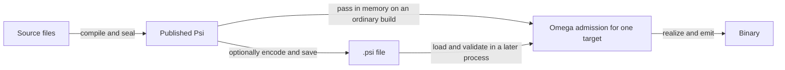
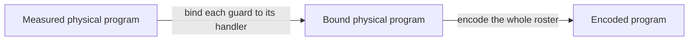

# Psi and Omega representation pipeline

**Psi takes source files and publishes a portable Psi program. Omega takes that program for one target and produces a binary.** In an ordinary build the driver passes **Published Psi** directly to Omega in memory. Saving a `.psi` file is optional. Each numbered directory names the representation it consumes and the one it produces. Reuse the existing Rust crates. The Windows native pipeline now runs from stage 01 through stage 18. A stage that refuses a program reports a diagnostic and that route ends.

## The rule for every compiler change

During this migration, record new laws in this handoff. At completion, review them with the owner before promoting any into standing repository instructions.

**Specification files are read-only during implementation.** Use the spec as the answer key. Record proposed clarifications or changes in this handoff. Editing a specification requires a separate, explicit owner request for that edit.

**One saved program, one file.** Ordinary compilation passes Psi in memory.
An explicit save writes one self-contained `.psi`. Prove this on Windows by
copying only the file to an empty directory, starting a fresh process with the
producer’s source and cache unavailable, then inspecting, interpreting and
building it. With identical target inputs and permissions, compare the result
and native executable with the in-memory build. Runtime permissions come from
the receiving host. [Psi publication contract](wiki/spec/terminal-psi/product.md#publication-and-separate-consumption)

**A → B → C. The stage that produces C must be able to run from B alone.** This holds for every adjacent pair of public stages in Psi and Omega. A stage may compute a new fact from its input. An existing fact that can change meaning, target choices, diagnostics, work charged, authority or emitted bytes must arrive in that input.

```text
A ── first transformation ──▶ B ── second transformation ──▶ C
```

**Example.** Suppose A owns an import that C needs. The first transformation issues B with the import identity and evidence C needs. The second consumes B. If the driver has to remember the import and pass it alongside B, the B contract is incomplete. Putting a callback to the driver inside B, or giving B a key that retrieves the old program from a registry, leaves the same reach-around. A stable identity that refers to a record carried in B is fine. [Existing object handoff][object-side]

**When B appears insufficient**, trace the missing fact to its first legitimate producer. If already known, carry the narrow fact and its provenance through B. If it becomes knowable later, defer the decision, reorder the work, or put the coupled operations under one public stage owner. Record the counterexample on the board before improvising a new path. An internal loop can earn one stage. Per-file streaming reuses storage while each parser still receives its file’s tokens. At the Omega entrance, admit Published Psi, target inputs and receiving-host authority into the first representation. The ordinary route then follows the same adjacent-stage rule.

**What earns a checked box.** For each public transformation, identify the real caller that hands over B and the implementation that issues C. Show that required earlier producers, driver state, registries and callbacks are unavailable to that implementation. Exercise it using a legitimately issued B with its declared data, keeping earlier producer services inaccessible. Check the result or refusal against its fixture and inspect the production dependency graph and API for alternate paths. Compile-time visibility, dependency checks and the isolation test cover different ways an apparently linear signature can still reach around. Apply this rule on the in-memory route; isolation does not require serializing every stage.

**Folding code into a stage leaves its data dependencies to prove.** Follow each production caller from the first stage that knows a fact to the stage that uses it. Require the immediately preceding stage's issued output at every call. Include hosted entries, private callbacks, component exports and foreign adapters in this trace. A fixed-width pass can carry its issued entry forward unchanged. Keep every migration change in existing crates. Moving an implementation under a numbered directory earns credit only when its caller passes the preceding stage’s issued result and the implementation reads the required facts from that result.

**Every public stage is independently testable.** Give the stage a legitimately issued input representation and call its production transformation directly. Check a property of the output that this stage owns. For an input the stage is responsible for refusing, pin the reason and the affected record or operation. Where source provenance survives, carry the authored location into the diagnostic. Use the adjacent integration test to prove the ordinary caller passes the issued result onward. Keep inherited failures attributed to the stage that actually detected them.

**Status · proposed migration, one implementation PR.** This draft covers the Rust reference compiler used by the CLI. The implementation checkpoints share one branch. The destination is two independently browsable pipelines joined by Published Psi, the sealed portable program whose on-disk encoding is `.psi`. Four boundaries still need experiments before the directory names can be fixed: resolution and typing, target realization, where callable demand closes, and handler binding. The current-work table records the verified Windows results. The integrated migration remains open. The owner requested one integrated migration. Exact stage splits are proposals pending the experiments below. This document is a planning handoff. [Migration checklist](#migration-checklist) · [Laws learned from repairs](#architecture-laws-learned-from-repairs) · [Why the dependencies exist](#why-the-pipeline-reaches-back) · [Current work and next action](#current-work-and-next-action)

*judgment* marks a proposed design. *unverified* marks a property nobody has demonstrated yet. Source links are pinned to `aa8030676ef2`, which includes #4030 and the authored-syntax change #4053. `045a2345054b` is the commit just before #4030 and supplies the old directory names. `main` was at `0b90bdbaaa6d` when this page was revised; that one later commit changes only `checking/prove.rs`. [Source tree][current] · [Earlier Psi stages][old-psi] · [Earlier Omega stages][old-omega]

## Current work and next action

Maintain this table in the working copy of the plan. Update it at the end of each checklist item, experiment or coherent batch, including work that stops midway. On resuming after an interruption, open this table first.

| Field | Current entry |
| --- | --- |
| Objective | Separate browsable Psi and Omega pipelines. Each stage reads one form and produces one form. Source streams per file. Published Psi crosses the normal boundary in memory. |
| Phase | Stage 11 binds each complete function body. The encoder receives that issued body. Layout carries its execution facts and installation authority to object construction. Image emission receives the finished object. |
| Branch and entry layout on Windows | Stage 12 issues the branch encodings. Stage 13 binds the alternatives to each function and instruction. Stage 14 selects the supplied short form and stage 15 patches the carried form after frame placement. Hosted entries, physical stack switches, private callbacks, component exports and foreign adapters all resolve their fields at stage 13, pass through stage 14 at fixed width and arrive at stage 16 as stage 15 fragments. Two existing source files moved from stage 15 to stage 13. The workspace still contains 176 crates. |
| Windows evidence for this handoff | The three layout crates passed 71 unit tests. The manual scaling measurement stayed ignored. Four compile-fail tests rejected callers that skipped a stage. Four native publication tests passed, including the linked callback and a replay that refused the wrong function roster for branch alternatives. The encoding identity test bound all nine template fields. All-target Clippy passed for nine crates. The contract inventory passed. The Windows CLI type-checked. |
| Exit and image handoff on Windows | Stage 12 binds each return, trap, call and ordinary instruction to its encoded byte span, decoded footprint and selected calling convention. Stage 13 carries those records forward. Stage 14 issues the settled offsets and frame with those obligations. Stage 15 checks them and publishes register and machine effects under the function and instruction that own them. Stages 16 and 17 consume that record for CPU state, installed faults and temporary stack use. Explicit replay reads its separately retained original. |
| Exit and image evidence | All 11 exit tests passed, including rejection of a Linux convention on the same x86 register model used by Windows. Four native publication tests passed. A weak reference expired after ordinary object construction and remained live with explicit replay. Image readback agreed with the independently planned CPU effects in both modes. Six image tests passed for function-local register effects and stack accounting. Four compile-fail clients passed, including attempts to open the original instruction program from the exit checker’s input and from an ordinary object. All-target Clippy passed for eight crates and the Windows CLI type-checked. The contract inventory covers the 41 declarations in the relaxation interface and the 24 in the placed-body readback. |
| Entry handoff on Windows | Stage 10 issues hosted, physical, private callback, component and foreign entry recipes. Stage 11 binds each recipe. The bound callback carries its machine identity and arrival bridge. The bound foreign adapter carries its selected import and application identity. Stage 12 encodes those inputs. Stages 13 through 16 resolve the fields, retain fixed widths, place the fragment and issue the object. Stage 17 consumes that object. Explicit bridge replay lives in the native driver. Three existing files moved with it. The workspace has 176 crates. |
| Entry verification on Windows | Six compile-fail clients rejected a foreign issuer, skipped binding, an extracted entry submitted to relaxation, a raw plan at image emission, a bridge without its imports, and changed import parts. Four native publication tests passed. The sponsor test emitted an ELF adapter and checked its full ABI and application identity. Three foreign ABI checks and 14 ARM64 frame protocol tests passed. The Windows CLI type-checked. All-target Clippy passed for twelve affected crates. The contract inventory includes the 35 declarations in stage 11’s binding interface. The initial C execution run omitted Clang because it was outside PATH. The later branch-placement run below used its installed Windows path. |
| ARM64 entry transfer | The Darwin ABI fixture passes a four-byte value from stack offset eight to an internal slot at offset two. On Windows the planner initially refused that transfer. After planning carried the exact offset, independent decoding found that its scratch register effects were missing. The planned operation now accounts for the address register used by the encoder. All 23 bridge replay tests passed, including the original fixture. |
| Function bodies on Windows | The driver previously sent a stage 10 body to stage 12 and held a separate object publication until stage 15 finished. Stage 11 now issues a body containing its bound frame, facts and installation authority. Stage 12 checks the facts against its actual encoding. Stages 13, 14 and 15 carry an opaque type parameter, so their implementations cannot read the semantic fields. Placement checks the complete encoded context and frame. Stage 16 reads the contracts from the placed text. Stage 17 emits the object before the driver attaches any explicitly requested replay. |
| Function body evidence | Four Windows publication tests passed, including a substituted placement, a replay from another program and successful attachment of the genuine replay after refusal. Eight compile-fail examples passed across encoding and layout, including submitting a stage 10 body to stage 12 and reading semantic fields during placement. The Windows CLI type-checked, all-target Clippy passed for 15 packages, and the contract inventory passed. |
| Frame branch widening on Windows | When a prologue or epilogue moves a branch target, stage 15 checks the displacement field, scale and reference offset supplied by encoding. It chooses the next larger form supplied for that instruction, shifts later fixups by the actual byte growth and checks the resulting keys and widths. Eight frame tests and three field tests passed for x86 and ARM64, including signed reach limits and refusal of misaligned ARM targets. Four native publication tests and four C ABI tests passed. The Windows host ran the actual C retention, stack, floating-point and record calls using Clang 20.1.2 at C:/SoftwareDevelopmentKits/LLVM/bin/clang.exe. The Windows CLI and all-target Clippy for both changed crates passed. |
| Installed handler branches on Windows | The bound installation scope declares whether a body needs branch evidence for a fatal handler. Encoding and layout carry that obligation to frame placement. Placement decodes each branch against its original edges, final frame offsets, register reads and machine effects. The resulting object carries the checked instruction numbers, offsets and exact branch bytes. Image fault analysis compares each final byte range before using an instruction to discharge the relative-branch fault obligation. Ordinary scalar objects omit this evidence and refuse requests for it. Eight frame tests passed, including x86 and ARM64 single-bit substitutions and shortened functions. Four publication tests passed. The Windows CLI type-checked and all-target Clippy passed for nine packages. These checks exercised branch placement and publication. A complete installed fatal-handler image has yet to be exercised on this revision. |
| Native replay on Windows | Target lowering issues its optional audit record with the function’s facts. Selection, allocation, frame planning and binding carry that record forward. When requested, stage 12 attaches the original instructions to their actual encoding. Stages 13 through 15 carry the publication to stage 16. Stage 17 takes its audit inputs from that object. The compile report owns the full rewrite, allocation and layout records for each root, callback and component. The object verifier uses those records for an explicit comparison. |
| Native replay evidence | The Windows CLI type-checked. All-target Clippy passed for 16 affected packages. Four native publication tests passed, including callback-to-root substitution and a second compilation with the same emitted identity. Seven compile-fail tests passed in image emission and machine code. The selected-allocation fixture rejected the high-pressure program’s archive when checking the low-pressure program. The contract inventory passed. The component path type-checked. A full component image with the validators requested still needs an execution check. |
| One request through native body compilation | Stages 08, 10 and 12 decide what to retain from the request carried by the body. Their public entrances take one stage input. Stage 12 returns one encoded program. Stage 16 issues the current object and keeps its placement history only for requested audits. Stage 17 accepts that issued result. The driver has no separate target, instruction archive or retention switch to supply at object emission. The full allocation and layout records stay in the compile report. |
| Issued object evidence on Windows | Four native publication tests passed through the new entrance. The same tests exercised ordinary builds, requested audits, a substituted private function, and separate compilations with identical output. Five documentation tests passed for stages 08, 10 and 12. Six passed in image emission and native artifact publication, including refusal of an object view offered without the stage 16 result. All-target Clippy passed for the affected crates, the Windows CLI type-checked, and the contract inventory passed. |
| Binding, encoding and placement | Stage 11 checks the installation against the function's contracts and frame. Stage 12 compares those identities with its actual encoded program, including its entry, work schedule and allocation manifest. Stages 13 and 14 carry the result with that encoding and release it to placement only for the matching layout context and frame. Stage 15 passes the identity, placed text and frame readback directly to stage 16. Only a requested audit retains the working frame application and resolved program. On Windows, all four native publication tests passed. They observed the encoding released before ordinary object construction, retained it for replay, and rejected another program’s frame application. Seven documentation tests passed across encoding and placement, including clients that tried to open the publication or recover the layout from ordinary text. All-target Clippy passed for the nine affected compiler packages. The boundary checker still reports the 33 dependency paths in the next row. |
| Layout checks on Windows | Stage 12 checks the frame prologue and epilogue against the bound frame on an audit request. Stage 13 checks the baseline before shortening is permitted. Stage 14 compares the relaxed rows and branch targets with that baseline and the encoder’s permitted forms. Stage 15 reads the final branch bits against the carried form. Independent object replay still checks the final layout using ISA decoding. Windows passed 24 relaxation tests, 30 placement tests (one existing test ignored), four physical-publication tests and all-target Clippy for nine changed packages. Stage 15 has no production dependency on encoding admission. The boundary checker still reports 28 paths from stages 12–15 into earlier forms and three consumers of stage 18. |
| Last verified result | At local checkpoint `b3e3a5050325` on Windows and again with the rebuilt driver at `dc5074c36110`, `omega --emit-psi saved/main.psi --target windows_x86_64 main.omg` wrote exactly one 556,815-byte Psi file to the output directory. After the producer exited and its source directory was deleted, fresh processes inspected the relocated file, ran both engines with exit 0, and built a 1,536-byte executable identical to the direct build and the pinned Windows reference. SHA-256 `7ca15b52cf0df716aa82b7801b5440b3014b4f15ed7168b65674a36cfb21b2d6`. Withheld authorization and a different manifest both refused. The host accepted the manifest printed by the separate producer. The consumer had no source directory, library path or producer build directory. |
| Independent Windows consumer | Local checkpoint `3e38c8ce40ff`. Built a separate executable against the 120 local library crates needed by `published-program` in a checkout containing zero `.omg` files and no Psi source stages. A clean build exposed embedded library sources in the shared catalogs and target entry identities. The producer now checks exact library bytes. The receiver compares the corresponding revision commitments. The independent executable refused a substituted manifest and compiled the authorized scalar Psi file into the exact reference PE above. The PE exited 0 with empty stdout and stderr. All nine bundled declaration tests passed on Windows. The target entry test reproduced all six target package fingerprints from their source bytes. The codec test confirmed the manifest binds the exact publication section. The dependency boundary check passed. |
| Publication after source release | Local checkpoint `dc5074c36110`. The Windows test `publication_survives_releasing_the_typed_source_and_checker` judged the existing `specialized_branch_selection_quiet_exit` fixture, prepared its publication input, dropped the checker and confirmed the last typed-source owner was gone. It then published portable Psi and compared its semantic identity with the checked module. The test passed. Project-level source inspection can still retain a typed owner. |
| Earlier Windows Console comparison | The Windows driver at `dc5074c36110` compiled 237 source files into one 2,447,506-byte `console.psi` with manifest `3e803ace23f5c3c60b2dddd5b029757fe06f44904abf1b78df3747b146b9ddfa`. A fresh `omega run --both --trusted-artifact <manifest> console.psi` with the library unavailable refused before execution because it had no Windows bindings for `WindowsConsoleIo::set_mode` and `write`. With the fixture’s two authored Build inputs, the direct source run made it past provider selection and refused the hosted `ProcessExitPrimitive` on Windows. The pinned Windows compiler at `37b94b326af6` also exited 200 on the direct compilation and printed byte-identical diagnostics (stderr SHA-256 `c70fd511ed64594c3f128fc1adf42a16b104a3d95dad3a4c4a4d1d20745bb880`). The explicit `run --target` mode compiles only. Use `run --both` with no target for a host execution comparison. |
| Windows process exit experiment | The existing Windows exit fixture returned 37 in both engines through the kernel32 ExitProcess import. In a temporary copy of the standard library, binding the same import in place of its Windows process-exit provider let the unchanged Console source print `K\n` and exit 0 natively. The interpreter refused boundary 6 and the comparison exited 201. Inspecting the 2,446,490-byte artifact from this exact experiment identified boundary 6 as `ProcessExit::exit_process`. The runtime discarded the selected external leaf before computing the interpreter’s requirements. A focused test now preserves that choice, rejects registration as an ordinary import or duplicate, and still requires separate authority for the process domain. With the interpreter fix and the same temporary library, the full run printed exactly `K\n` and both engines exited 0. At that checkpoint the repository library selected its checked provider, and its core primitive had no Windows implementation. |
| Windows Console with the repository library | On the Windows workstation the unchanged `default_console_provider_reached` fixture printed exactly `K\n` and both native and Psi exited 0. From the fixture directory run `omega run --both --build-input build.omg --build-input main.omg main.omg`. The selected standard-library provider still executes its checked body. The native compiler maps the authenticated core exit primitive to the Windows calling convention and the kernel32 ExitProcess import. Psi ends its simulated process with the same status. The pinned Windows reference refused this fixture before emission. |
| Source-free nonzero process exit | A 543,986-byte Psi file containing the existing core primitive test program, manifest `aaf6676d3c561dce1bd1defddb1b33a8c811d3d1dc34aec685ad1765d3d7dbd7`, produced native/Psi agreement on exit 7 in a fresh process after deleting the source and removing the library path. Its separately emitted 1,536-byte PE also exited 7, SHA-256 `21bd45d32fee28ca5de091af1e1ba1b7773a35cf32ba1340282e209666e4d1ad`. A substituted manifest refused before writing an image. |
| Dependency activation | On the Windows workstation, the Linux-target check accepted the dormant dependency and rejected the same overflowing `bump` when checked directly and through a helper. The candidate's complete diagnostics matched the pinned Windows reference after normalizing the temporary directory name. The resolver now selects pending bodies using its own admitted file set. Whole-source and selected-file completion share the loop that resolves and types each batch. Four existing resolution handoff tests passed, including refusal of a completion from another source. |
| Saved target-dependent arithmetic | `target_layout_derived_constant` produced a 571,520-byte Psi file on Windows for the Linux x86-64 profile, manifest `1514705295c260bb21cbf89c4db7567da2613d9e96e0f905668549a22145a2c2`. The old inspector rejected its arithmetic. The range reader omitted machine parameters from the scalar types it used to check operands. After including machine formals, the rebuilt inspector accepted the exact same bytes. With the library unavailable, the receiving compiler emitted a 65,536-byte ELF from the Linux file. A separate Windows publication of the same source ran in both engines with exit 0 and produced a 1,024-byte PE. Both images matched the pinned Windows compiler's direct output byte for byte for their respective targets. The ELF was compared on Windows. |
| One saved program for four targets | On Windows, the scalar call fixture saved one 557,032-byte Psi file for all four hosted targets. Its manifest was `8b95148b9a41d1d94c2bdcb8239d5f14e3586970458b9de40d49bb328a42c80c`. After deleting the source and removing access to the library, four fresh compiler processes each built one executable from that file. Every executable matched both the direct source build and the pinned Windows reference byte for byte. The Windows executable and the Psi interpreter both exited 0. Linux and macOS execution remain for later host triage. A separate save with an invalid entry returned an error and preserved the previous Psi file byte for byte. |
| Independent consumer for all four targets | On Windows a separately linked executable built against the current native compiler used the saved scalar file with the library unavailable. Cargo listed 120 local library dependencies and no Psi source stage. All four emitted images matched the pinned Windows reference byte for byte. The Windows scalar executable exited 0. The same consumer emitted the exact exit-7 PE recorded above from a different Psi file. A substituted manifest refused before writing. Asking the publication stage to save those two different programs to one existing file returned an error, preserved its bytes and marked neither product as written. |
| Imports and private functions | The physical planner selects each body's import recipes, optional Windows helper and private function references. Encoding and placement carry them in the machine program. Object construction emits the import and callback relocation records and compares the finished symbols with those bindings. The driver completes the root and private objects before image assembly. On Windows the callback test checks an omitted import, a substituted import with the same count, and an omitted private function against the real object. The roster test refuses its last private body before entering image assembly. A filesystem check for failure of a real last object remains open. The image-emission crate still builds other object records, including byte-literal relocations. |
| Active item | Source and saved-program compilation now receive evaluated native bindings and accepted package permissions in one installation tied to the artifact manifest and target. The Windows test `saved_program_uses_the_hosts_evaluated_native_binding` deleted the producer project, reopened its saved file, confirmed the missing-binding refusal, then supplied the evaluated installation and ran the resulting PE with exit 0. The saved-file CLI now reads the receiving host’s explicitly selected application lock. With no configured lock it supplies an empty installation. The paired artifact and installation are checked before the saved-program driver reads either permissions or boundary numbers. All-target Clippy passed on Windows for the 28 packages in the native stage move. Object emission now receives the resolved target profile and entry machine. The checked private-RAM recipe carries its entry parameter, so native emission can compare it directly without copying the structural-type catalog. The old `installed_entry_storage/local` sample refused its `core::Access` import on both the candidate and reference before reaching that comparison. Function placement still depends on earlier compiler forms through physical program facts and installation admission. |
| Windows host package bindings | Completed package Builds retain the full callable identity, the checked service contract, the target locator and the evaluation receipt. The native compiler joins those records to the requirements reached in the receiving program. Package declaration and terminal permissions still come from the host. In a fresh Windows process a native-only consumer reopened a 1-file process-ID program (manifest `1cd401e26cdb73491b30e5cf2677b37ac8c49334a9b70fcc82f554ae76488bd5`). A separate fixture host supplied its reviewed package record after the producer project had been deleted. The resulting 1,536-byte PE exited 0, SHA-256 `0f630a9ace9c83830b2bfbaf73a342626b6f4202fa9a64be523f9aab69e05575`. An empty installation, a substituted host record pin, and a substituted program manifest each refused before writing output. The host record and pins were supplied by the fixture harness. This run used a separate consumer executable. |
| Saved programs and the host package lock | The package reviewer now writes evaluated native binding receipts to the existing application lock. A Windows CLI build completed with both saved-program commands wired to read a host-selected lock. The host selects the absolute path with `OMEGA_HOST_PACKAGE_LOCK` and pins its bytes with `OMEGA_HOST_PACKAGE_LOCK_SHA256`. The program manifest is checked separately. The receiver takes role permissions from the root Product occurrence and bindings from its Product dependency graph. Older locks have no native binding receipts. The Windows test `reopened_program_uses_the_host_pinned_package_lock` completed in 72.98 seconds. It published the process-ID program, reviewed its fixture package with `omega packages update`, kept the host lock outside the program directory, and deleted the producer. Fresh CLI processes compiled and ran the program with the library unavailable. The PE and both engines exited 0. Withholding the installation or substituting its SHA-256 refused before image output. The focused CLI test passed again in 84.77 seconds. The stock Console CLI stopped during explicit package review, before opening the saved program. Full review checks unused declarations. The checker refused the POSIX `posix_errno` helper in the standard library because its boundary returns a provider-owned `&i32`. The Windows `K` program never reached execution in this run. A separate native-only receiver refused the first stock host record because its permission table used the reserved absent slot for a named operation. The permission constructors now start with the canonical empty table. A focused test writes and reopens the permission and checks that its operation name survives. The original stock host record predates this repair. |
| Target operations and explicit audits | Target lowering now publishes the prepared instruction-selection plan and seals the original operations there when a validator requests them. Ordinary lowering releases its working program before returning. The native driver carries the optional archive to the object. The Windows physical publication regression compared ordinary and retained output and exercised the changed-literal refusal. |
| Native execution scope at object emission | The object now retains the reached function and boundary IDs and the callback operation and application coordinates. Earlier lowering keeps the target selection, provider choices and callback plans. Native image validation uses the carried IDs to check boundary coverage and floating-point operations. The two Windows execution-scope tests passed. They cover calls in all blocks, dormant scalar work and the effect of a target change on selected source bodies. The callback integration and the remaining placement dependencies are open. |
| Reopened Console with reviewed bindings | The Windows compiler integration test `a_completed_plain_binding_keeps_its_receipt_and_calling_identity` passed in 4,774.44 seconds. It closed the producing session, verified the source state was released, reopened the published bytes, applied reviewed bindings from the host and ran the resulting Windows executable. It printed exactly `A` and exited 0. The separate CLI acceptance uses the original saved program that prints `K` and a host-issued package lock. |
| Entry planning and installed handlers | Physical program entries now receive the measured handler stacks and the one handler's checked function, inbound ABI and parent installation. Component exports and private callbacks use the same view of the installation. Entry planning cannot query the other callbacks, helpers or provider plans through that input. All-target Clippy passed for the entry planner, installation verifier and native compiler. The native compiler now passes the target body and the installations admitted for that body together to instruction selection. All three physical publication tests passed on Windows. The crate dependency on installation admission is still present. |
| Physical planning and emission | Physical planning now binds the measured installations to its prepared instructions and returns the framed body, those same installations, and the machine facts it derived. Root and private functions follow this path. The native driver no longer looks through the frame to reconstruct stack usage, calls, CPU effects, storage, faults or image references. Object verification can still compare those facts against the retained instructions. The contract inventory covers the planner entrance, installation binding and machine fact production. All-target Clippy passed on Windows for all six affected crates. The three physical publication tests passed. Explicit object replay also compares per-function temporary stack demands against the retained instructions. |
| Root and private target bodies | Native program planning lowers the root and uses the callback and interrupt permissions carried by that target body to find its private functions. It consumes one admitted program, takes its provider settlements and installation, and returns the root together with the transitive set of reachable functions. Object emission receives those bodies, the checked entry, runtime provisions and observation counters. Its interface no longer accepts the native realization request or the earlier verified artifact. The driver previously saved an independent copy of callback permissions before lowering. The contract inventory covers the request, returned bodies and private entry contracts. All-target Clippy passed on Windows for the nine affected crates. The three physical publication tests passed, including independent target replay and linked callback objects. The normal Windows CLI test reopened the independently saved process-ID program with its pinned host package lock and passed in 35.37 seconds. |
| Private callable demand | Native program planning reads callback occurrences directly from the checked proposal. A reached function must match its original placement, identity and registrar operation in the current body’s admitted callbacks or interrupts. A dense placement index preserves proposal order among siblings and schedules a body once. Provider preparation and the driver no longer build or forward a separate list of thunk settlements. The Windows fixture linked its real callback, scheduled repeated references once, and rejected a missing placement and a substituted registrar. Its explicit full-module input retains the registrar even when the callback is the entry. The pruned-versus-reached unsupported body experiment remains open. The four physical publication tests, all-target Clippy for four crates, formatting and the contract inventory passed. The stock CLI ran the record callback loop in both engines in 26.07 seconds. The separately linked native consumer reproduced the four saved scalar images byte for byte on Windows and the PE exited 0. |
| Function placement and object publication | The encoder binds the program, target, entry, allocation roots, callback and interrupt permissions, physical call and stack facts, and frame to the emitted body. Function placement reads the optimized layout and carries its encoded context and frame into the placed text. Object construction accepts that text with its matching publication. Explicit verification compares the physical contracts again against the supplied placement. A Windows regression accepted the scalar program’s own placement and refused the placement from a separate boundary-call program. The four physical publication tests, all-target Clippy for five crates, formatting and the contract inventory passed. The Windows CLI reopened the process-ID program with its host lock in 67.88 seconds. The dependency checker still reaches abstract operations, target operations and the Terminal codec through native verification. |
| Object emission and retained machine facts | The object keeps one publication for its semantic program, frame readback, handler authority, contracts, statistics and stack plan. The image shares the immutable call records with the object. Entry checks read the selected machine, target and execution scope from the admission that issued them. Explicit replay still uses the separately retained instructions. |
| Standard library review on Windows | The refusal in `posix_errno` also occurs in a three-declaration program that reads a provider-owned integer. The result and its input lifetime can be reconstructed from the boundary contract. The checker then requested a caller storage address for that provider-owned referent. The current repair routes this read through the permission for the exact provider invocation. All 14 returned-reference checks passed on Windows, including an immediate read and refusal of a write while the same input is still borrowed. The Windows CLI then spent 1,609.95 seconds checking the full standard library and refused the package with 62 diagnostics. The grouped report shows filesystem handle contracts, path and array bounds, indexed clauses and invalid reference formation. It issued no host lock and the original saved Console program did not run through the CLI. A source file containing two Omega machines reproduced the bounds refusal without importing the library. For an array of length 8184 the checker refused both a safe index `start + position` with `position < count` and the one-past-end case with `position <= count`, given `count <= 8184 - start`. The checker now translates the strict operand bound across exact addition. Its proof uses integer discreteness, addition and transitivity. On Windows the stock CLI accepted the safe program and refused the inclusive one with the original array-bounds diagnostic. This check covers the isolated index failure. The full library diagnostic count is from the earlier review. |
| Independent Windows Console host | A separately reviewed application supplied 63 Windows bindings, two package permission rows and three accepted roles. The saved Console program refused its write and set-mode calls. The host did supply both bindings. The local-package identity computed for the worktree standard library begins `7d6cb712`. The file requires `941293ee`, the identity computed for the copy in the original temporary directory. Both exact digests reproduce from the package name, local source context and canonical directory. The receiving host must independently admit the package that owns the callable. The second application reviewed the matching standard library and supplied 63 evaluated bindings, two permission rows and two accepted roles. Its fixture-issued host record has SHA-256 `97610e3690ad099e59b7f7499a89f47ecd9775100e73fe1588b2c0a8fbf10c4e`. With the producer directory temporarily unavailable and no source or library path, fresh receivers at `aa48a429e18e` and `31ce285e0e76` compiled the original 2,447,506-byte Console file. Their Windows executables both have SHA-256 `6c9836fef56dea0841dc8fbf9ac4e99f764bf48cd72629f43c77d8771c4d6743`. At `31ce285e0e76` the independent host ran both the Psi interpreter and the PE. Each exited 0, wrote bytes 75 and 10 (K and newline), and produced empty stderr. Withholding the host installation, supplying the independently reviewed worktree library, or changing the host pin refused before creating any output file. The receiving host used the fixture package reviewer. The stock CLI still needs a successful standard-library review to issue its application lock. |
| POSIX metadata buffers in Windows package review | The earlier review named `linux_arm64_posix_decode_metadata`. The library used `&filesystem.stat_buf[0]` to form a view of an entire stat record. A Windows program containing the Linux ARM64 layout and the actual `PosixFilesystem` declaration reproduced the refusal. The existing checker regression also refuses enlargement of a one-byte field loan. Nine such casts occurred in the Linux ARM64, Linux x86-64 and macOS ARM64 library implementations. The candidate lends the aligned 144-byte stat buffer. Its Linux ARM64 view contains the 128-byte ABI record followed by the 16 unused bytes of that buffer. An instrumented Windows check located the selected field at offset zero and confirmed a 144-byte target aligned to eight. It then refused the enclosing record geometry with `MissingCarrierLayout` because a sibling is an enum. Reference-view checking now supplies the pointer, descriptor and case-tag geometry from each retained layout input. All four representation-geometry tests passed. One test accepts a buffer following an eight-byte enum tag and refuses the same view when another retained target puts the buffer at offset four. All-target Clippy passed for terminal-semantics with an existing manifest warning about storage-access. The Windows three-layout run got past the earlier ARM64 view refusal, then exited 200 in 972.6 seconds. Its next diagnostic was in a second source file left in the experiment directory. Bytes 1929–1930 of words.omg are the cast in read, and the diagnostic names read at that exact span. Rerun the unchanged three-layout main.omg alone to measure its native and Psi behavior. The package review is separate. |
| Windows native image provider evidence | Native artifact construction now freezes the chosen provider identities, grants, bindings and native execution reports from one provider admission before it receives the object. Image issuance checks the artifact, selected entry, target and exact provider selection carried by the object. The Windows callback fixture refused a substituted provider selection and still published its ordinary image. All-target Clippy passed for provider admission, native artifact and the native compiler. All three physical publication tests and the stock CLI test for reopening the saved process-ID program passed. |
| Native-only scalar comparison | Separately linked consumers built on Windows at `aa48a429e18e` and `31ce285e0e76` reopened the same saved scalar file and reproduced all four previously compared images byte for byte. The Windows PE exited 0 with empty stdout and stderr. The other three images were compared on Windows. |
| Branch layout on Windows | Branch relaxation now hands function placement the final layout together with the trace that produced it. Only the relaxation pass can construct the pair. The driver forwards it intact, and both current-layout and original-input verification read the trace from it. All 23 relaxation tests, all-target Clippy for the four changed crates and the pipeline contract check passed. The subsequent placement change sends the optional originals directly to the object auditor. |
| Entry placement and object audit on Windows | Entry bridges, callable entries, private entries and hosted and physical program entries carry the issuing type through both placement and object construction. Image publication accepts the physical planner’s issuing type. The fixed-frame auditor compares the separately retained original machine program with the issued layout and uses independently reconstructed callee-save requirements to check the final frame. The ordinary function placement API takes only its layout and an observation counter. All four physical-publication tests and three foreign-adapter compile-fail examples passed. All-target Clippy, format and the contract ledger passed. The architecture checker reports one violation, the image emitter’s dependency on entry planning. |
| Foreign adapter object on Windows | Image emission previously accepted a planner-issued bridge, a locator, an application commitment and an independently supplied encoded import program. Physical planning now selects the import body for that locator and binds it to the bridge and application. Encoding, placement and object construction each issue the whole adapter. The production driver forwards those results. The Windows loader fixture built the provider DLL, emitted the adapter DLLs and called the real C provider successfully in 7.17 s using `CC=C:/SoftwareDevelopmentKits/LLVM/bin/clang.exe`. Three compile-fail clients exercised a completed object with another issuer, an issued bridge missing its import program and a genuine object dismantled to replace its import bytes. All-target Clippy passed for the ten affected crates. Formatting and the contract inventory passed. Image emission still names the entry planner's issuing type. |
| Adapter symbols and relocations on Windows | Object construction now issues the text section, export commitment and name, normalized import symbol, and the relocation from the placed call field to that symbol. Image emission consumes those tables through the ordinary object linker. The Windows loader fixture produced identical SHA-256 digests on parent `23819eb6513b` and candidate for all four DLLs. In acquire, register, complete and release order they were `13600a02c5072eadb9024d3aa626d1a5cdaa6bb68f4e4aff9f83a69e2ce39817`, `fbb7cbe910af3d94c3b75d489f29231ba24feae751bc7740adb775cd05f5d357`, `9dc0a654df6e84877407aef81fe97b7bc90c0ad3bcae0e22b7b266c180d41185` and `4844b3fafc6bd3fbde6902e27a41ed706a0f5a2468b900a9c0c1a7343e29d674`. The DLLs loaded and called the C provider. Three compile-fail clients still rejected the wrong issuer, a bare bridge and substituted imports. All-target Clippy passed for object-file, image, image-emission, native-compiler and image-fixtures. The boundary check still reports the single image-emission dependency on entry-planning. |
| Native execution scope on Windows | The scope previously selected callback bodies by walking reached registrar operations but copied every proposed registration into the emission record. The walk now marks the matching proposals and emits the reached registrations in their original order. Native planning also issues the exact boundary application demands with the scope. Provider settlement reads those demands and checks their artifact identity. Independent artifact validation still reconstructs the demands from the original module. Whole-module scalar preparation reads the module and its storage layouts directly. On Windows the same canonical artifact retained its callback body, registrar and demand when entered through the registrar, and omitted all three through its other entry. The three execution-scope tests passed, the native driver compiled and all-target Clippy passed for the five affected crates on the settled source. This proves scope selection. Image emission or refusal for a reached, unsupported body remains open. |
| Windows path prefix | The stock Windows filesystem drops the named path domain before taking a prefix. A small source program reproduced both package diagnostics in 6.9 seconds. Lowering forwards the same shared byte descriptor into a new block for the cast. The checker lost the underlying byte facts at that block. Following the actual incoming jump preserves the NUL-free predicate and still refuses a partial UTF-8 sequence. The first focused test passed in 0.02 seconds after a 91-second build. The expanded test accepted both ASCII and NUL-free prefixes and refused a UTF-8 prefix ending midway through a character. It took 0.03 seconds after a 97-second build. All-target Clippy passed for terminal-semantics and the checker, with the existing unused storage-access manifest warning. The rebuilt Windows CLI accepted the NUL-free path prefix in 10.47 seconds. With an unqualified path containing a NUL it refused at main.omg line 7, column 20 in 6.41 seconds, naming the missing byte predicate. The combined stock library review is outstanding. |
| Windows edit loop | With the repository-pinned `mbx 1.29.2-omega.1`, two no-change `mbx check --locked -p native-compiler --lib` runs took 59.13 s and 55.53 s wall time. Git’s multi-pack index covered 3 packs. A command-local, low-priority `git multi-pack-index write --no-bitmap` took 12.78 s and indexed 36,594 packs. The next two identical checks took 4.70 s and 4.91 s. Reading the same committed Cargo.lock returned the same SHA-256 before and after. The exact physical-publication mismatch test then passed in 4.95 s including mbx startup. The full allocation-handoff harness took 608.60 s of test execution on the earlier replay edit. |
| Image and runtime handoff on Windows | The process-ID fixture built identical Windows executables from source and from its saved Psi file after deleting the producer project. The authorized executable exited 0. The receiver refused a missing binding and a binding for a different service. The Psi interpreter route admitted the saved program with its original entry signature and Windows target. This test took 57.15 seconds. Runtime admission records both the authored providers and the complete execution selection, which includes direct host calls. The root object carries the runtime forward to its image. Publication consumes that finished image. Five compile-fail tests and all-target Clippy for eight packages passed. |
| Next action | Close the dependencies from physical stages into earlier compiler forms and exercise substitution of a runtime from another program. The separate zero-decode source fixture now declares its checked provider as a named implementation and its body as a static machine. Stage 05 refuses its write at index 8 because array lowering cannot use a provider-computed extent there. Keep the original array bound and expected exit 70. Stock saved-file Console, a complete installed fatal-handler image, and the integrated Windows reference comparison remain open. |
| Open questions | Resolution and typing, target realization, transitive callable closure, and handler binding still need experiments. The scalar direct and fresh-process routes passed on Windows. The independent Windows host ran the provider-dependent Console program in both engines. The stock CLI Console route and matching-host matrix remain open. [Dependency explanations](#why-the-pipeline-reaches-back) |

At the earlier physical-stage checkpoint the Windows checkout had 18 consecutively numbered native stages and 176 workspace packages. The native-program, physical-planning and runtime-provisions packages were removed. Stages 05–10 preserve the selected body’s semantic facts, private references and installation authority through the ordinary path. The native CLI compiled. All-target Clippy passed for the nine affected physical-stage and driver packages. Five external clients failed to compile as expected, four physical-publication tests passed and the boundary checker’s 17 unit tests passed. The workspace boundary audit still reports dependencies that bypass stages. The broader compiler all-target check also hit a discarded mbx build-script result while the checkout was changing. The settled CLI and affected physical stages have their own checks above. Independent image/output comparisons remain open.

The isolated three-record POSIX metadata fixture on the earlier Windows CLI at `243f79c3b216` exited 200 in 935 seconds. The compiler refused source selection question 429 because the package’s `PosixFilesystem` build-time invocation selected the toolchain declaration across the closed-contract boundary. This records a separate source/build refusal on that revision.

### Integration with main

The Windows migration through `584f2573669` was integrated onto `94c1d7a0efb`. This keeps the separate V2 workspace, current borrow syntax, and main's newer proof and package-review implementations. The Windows results above were obtained on the migration checkout before combining it with main.

The active-case visitor introduced on main asks the lowering type reader which sum cases are proved empty. That query currently crosses from Psi stage 04 to stage 05. Move its proof input into the typed trees so specialization can consume it there. The native stage-isolation violations and the computed array extent fixture also remain open.

### Local agent handoff

**Prove the goal on one machine before using another.** For this migration, use the Windows workstation for edits, builds, debugging and end-to-end checks. Keep one worktree and one build directory warm. When the integrated candidate passes the original acceptance on Windows, record its commit and results. Only then run that commit on the other hosted targets to find platform-specific failures. Make each repair on the workstation and verify it there before retrying the affected host.

**Organize the compiler first.** Move complete transformations and their callers together using the representation map. Compile the affected crates and their driver after each batch. Run the runtime tests and executable comparisons once the architecture settles on Windows. Triage the other hosts afterward.

Start in an existing Omega clone. Create this worktree once, then reuse it across edits. The branch includes the verified compiler commit and this Markdown.

```bash
git fetch origin refs/heads/slice/native-entry-custody
git worktree add -b work/representation-pipeline ../omega-pipeline-local FETCH_HEAD
cd ../omega-pipeline-local
git merge-base --is-ancestor 8c8a6933f62bd6b5c5c9a0377e53130edd67f48a HEAD
```

1. Read the current-work table, the [entry comparison](#review-record-for-the-linux-entry), and the [verification laws](#verification-laws-learned-from-the-entry-slice). The hashes there are the reusable Linux baseline. Use the qualified mbx version in `tools/mbx-version`. For first-time setup follow the [repository commands](AGENTS.md#commands).
2. For a local smoke check of this handoff, run `mbx test --locked -p omega --test native_entry_custody`. Reuse the recorded Linux results during development. Compare Linux executable bytes on Linux during platform triage.
3. Follow the current-work table in this checkout. The boundary checker flags the image emitter’s direct dependency on the entry planner. The emitter currently names `PhysicalRecipeOrigin` to admit only planner-issued entries. Inspect this contract and the three foreign adapter refusal examples in `image-emission/src/entries.rs` before changing it.
4. Before switching tasks, update the current-work table and the affected checklist row in this file. Record the commit, observed result, work still open and the next command. Keep newly discovered reach-backs visible here.

### Check an architectural change on the warm Windows build

Choose a focused command from the [tests by layer](#focused-tests-by-layer).

| When | Check | Evidence it supplies |
| --- | --- | --- |
| While moving code | Move the producer, representation and readers together. Compile the real consumer with `mbx check --locked -p native-compiler --lib` for a native handoff. Choose the affected consumer for other handoffs. | Catches broken types and callers while the architecture is still moving. |
| When the ownership change settles | Run the boundary check and all-target Clippy for the affected crates once. Select the existing test by name that exercises the new contract. Run a behavioral case earlier when its result would change the design. | Confirms the production dependency, the actual caller and the refusal the change must preserve. |
| When the slice is ready for review | Use the same target, inputs and flags as the pinned parent. Compare the selected outcomes and full calling plans, emit the scalar executable once, compare bytes, and run that executable. | Detects changed behavior that a dependency check or a successful compilation would miss. |
| When scope expands | Run the affected package, codec and authorization checks on the workstation. | Covers the newly affected behavior. |
| After the integrated candidate passes on the workstation | Run the recorded revision on the remaining hosted targets. | Checks the same candidate against each platform's reference. |

Keep one Windows worktree, target directory and profile warm. Run one build command at a time against that directory. Continue source work while a settled batch’s test runs. Attribute its result to the source it built. For the entry declaration use `mbx test --locked -p omega --test native_entry_custody`. For the rule that prevents another body’s original inputs from being attached, use `mbx test --locked -p native-compiler --lib physical_publication_tests::object_publication_rejects_placed_code_from_a_different_program -- --exact`. Compare complete plans and executables at integrated review. Run Console when Console or package settlement changes. Record build time separately from fixture execution.

If a no-change check becomes slow, measure wall time as well as Cargo time. On this checkout `mbx` consulted Git for earlier lockfiles. When the time is in Git, check whether its multi-pack index covers the pack files and time the same command before and after an index refresh. Index maintenance is occasional workstation work. The compiler's build script fingerprints the actual source tree. Its current Windows build declared 3,787 watched paths. Editing that tree during all-target compiler Clippy caused mbx to discard example and test results. Once a batch enters this check, use the time for code reading or handoff updates and start the next source edit after the command finishes.

On Windows the pinned mbx adapter skipped shared-cache storage for rebuilt crates including terminal-semantics, terminal-wire and terminal-codec. Its checksum guard requires a file change token, and its non-Unix `change_token` returns `None`. Cargo can still reuse outputs in the warm target directory. Keep that directory through the migration. To evaluate a future Windows cache repair, measure a real rebuild and check that a same-size source edit with a restored modification time cannot reuse stale output.

For standard-library review, group the existing diagnostics by compiler cause and reduce each uncertain cause to the declarations needed to reproduce it. The Windows path prefix produced both of its stock diagnostics in 6.9 seconds with a small CLI program. Compile each stage move through its real consumer, run the focused program when the contract settles, and rebuild the CLI once for a group of checker repairs. Run the complete package review when the combined result can issue the host lock.

For the Windows array-bounds repair, run the two remaining-capacity checker tests with `mbx test --locked -p terminal-psi-to-checked-terminal-psi --lib remaining_capacity`. Once the checker accepts the safe program and refuses the one-past-end program, rebuild the CLI once and run `omega --check main.omg` in each reproducer directory. The first repaired CLI build took 41.28 seconds in Cargo. The two programs took 10.54 and 7.07 seconds to check. On the final source both checker tests and all-target Clippy passed. Cargo rebuilt the CLI in 42.75 seconds, and the safe and refused programs took 9.96 and 6.06 seconds. The previous full library review took 1,609.95 seconds. Use that package review to confirm the combined repairs and issue the host lock.

**Reuse the parent.** Record the Git revision, fixture and library tree IDs, host and target, Rust and mbx versions, feature set, build flags, input, exit status and expected result hashes in the row. Reuse matching evidence on later candidates. Refresh the affected baseline when a key changes or a run proved nondeterministic. Compare the saved facts and image hash for each new candidate. A cached compile alone supplies no behavioral result.

### Return to the plan after each work unit

1. **Before starting**, read the A → B → C rule, the current entry, the relevant checklist row and its acceptance test. Write the active row and revision in the table. Choose an observable result that would decide the question.
2. **After the work**, return to that same row. Record what actually happened, the revision, fixture or inventory command, and a link to its result. Check the box when its stated evidence exists. For partial work, record the last successful observation, the first failure or missing fact, and the exact next check.
3. **Account for discoveries before switching tasks.** Attach a new caller, side input or counterexample to the affected row. Add a row when no existing one owns it. If it changes stage ownership, update the stage table, diagram and experiment record together. Keep the evidence that superseded the earlier decision.
4. **Set the next action and reread it.** Update the table above with the last verified result and one concrete next action. At a phase boundary, compare the affected rows with the [work order](#work-order) and [acceptance criteria](#acceptance). At final handoff, reconcile every open row, exception and pending host run. A fresh agent should be able to reproduce the last result and take the next action using the plan alone.

**One shared board.** A solo agent uses the current-work table and checklist directly. With several agents, the coordinator records each active assignment below and remains the writer of the board. Workers can investigate different parts of the same question. Give each a named deliverable and record file overlap before assigning edits. Workers return their revision, evidence, counterexample or blocker, and next action. The coordinator reconciles those results against the checklist. A worker finishing its assignment closes only the part its evidence covers.

| Active checklist row or subtask | Agent | Files or investigation scope | Evidence or next action |
| --- | --- | --- | --- |
| Native entry declaration custody | Codex | Psi portable publication → Omega executable entry preparation | Verified on Linux. The scalar ELF, full plans and refusal matched the parent. |
| Provider calling policy requester | Codex, worker-21 | Psi source selections → portable publication → Omega provider execution | Traced both production entrances and selected the Windows raw Console write fixture. |

## Why change the compiler #4030 just merged

PR #4030 removed several backward dependencies, kept streaming and produced tested binaries. It also did two things this plan wants to undo. [Merge][merge]

1. **It put all seven Psi transformations inside one crate.** `01_source-compilation` holds lexing, parsing, resolution, typing, preparation, lowering and checking as modules under [`src/operations/`][source-ops]. Only lexing, parsing and `source-syntax` have their own `Cargo.toml`. A reader opening the folder no longer sees the order of the forms, and Rust cannot stop one operation from reaching into another's private state.
2. **It left program facts travelling beside the native stages.** The driver still passes a proposal, an artifact, optimization choices, permissions and imports separately into planning. [Caller][native-caller] The [side-input table](#close-the-side-inputs) lists nine such cases.

The old folder names were not accurate either, which is why this plan does not simply restore them. In the old native driver, allocation and post-allocation planning ran in their numbered stages, and then the driver itself called `machine_emission::stage_function_frame` before stage 07 could encode. The folder sequence hid a real transformation. [Historical frame construction][old-frame] The rule this plan follows: keep a historical name only when the receiving code can run on exactly that named input.

**This reverses a recorded recommendation.** [Question Q-C](https://github.com/CathedralOS/Omega/blob/aa8030676ef29dd7506dbb2111e4f1ae57e81004/atlas/questions.md) recommends one source-settlement stage that owns all of Psi 00–06, because resolution and typing alternate and a coordinator wrapped around the old stage calls "is not the replacement". #4030 implemented that. Separate resolution and typing earn separate numbers only if their public handoff is forward-only. The [resolver and typer loop](#the-resolver-and-typer-loop) describes the fallback.

## Migration decisions

- **Owner direction from the planning discussion.** Keep Psi and Omega independently browsable, preserve the streamed first stages, use one input and one output representation per public transformation, and deliver one integrated migration. An ordinary build passes Published Psi in memory. Saving a file is optional. Exact crate splits and the placement of shared definitions still need evidence.
- **Landing.** Deliver the direct Published Psi handoff and optional file loader, both stage trees, production callers, enforcement and documentation in one PR. The first source-free build is an internal checkpoint. Capture the exact pre-migration parent before editing. Inside the PR, steps 0–2 come first: they fix the stage list for both trees, and no directory moves until this page records that list.
- **Stage ownership.** Proposed default: one crate per public transformation, one local counter per pipeline, and an explicit invariant for each same-form pass. Lexing and parsing keep their per-file schedule.
- **Resolution and typing.** Prove the forward handoff on real deferred bodies. If it changes observable work, activation or diagnostics, give the same-revision iteration one public owner, `syntax-trees-to-typed-trees`. Later Psi numbers shift by one. Generated bytes still enter through a new source revision.
- **Scope.** The Omega-written compiler under `source/psi/pipeline/` has different final forms. Record the difference in the architecture map. Implementation here targets the Rust compiler. [Omega-written Psi][self-psi]
- **Atlas decisions.** Keep Q-C open until the deferred-body proof settles its owner. Keep Q-F open until executable-body closure and late binding are proved. Keep Q-G open until a named Omega stage demonstrably joins target bindings to checked candidates, produces ABI plans and closes provider demand. Link each answer to the working caller and a falsifying test. [Earlier questions](https://github.com/CathedralOS/Omega/blob/aa8030676ef29dd7506dbb2111e4f1ae57e81004/atlas/questions.md)

## Why the pipeline reaches back

For each suspect edge, ask **“When could the producing stage first know this fact?”** If it knew the fact before returning, specify what its output must carry. If the fact first becomes knowable later, identify the event that reveals it. Deferring a decision, changing the order, or giving two operations one public owner are all possible outcomes. The observations below describe the pinned implementation. Proposed repairs and tests remain open.

| Question | Why the current compiler does it | Decision and evidence needed to close it |
| --- | --- | --- |
| Does parsing send an AST back to the lexer? | The ordinary worker lexes one file and parses its tokens immediately. Generated **new bytes** can start another source revision. The observed **same-revision** feedback is resolution and typing of deferred bodies. [Streamed caller][stream] · [Generated-source handoff][generated-selection] | Preserve per-file token reuse and error precedence. Exercise a generated-source extension separately from deferred-body activation. Record which revision, selections and work charges the continuation owns. |
| Why does typing call the resolver again? | Resolution retains pending bodies. Typed symbols, domains and service reach can supply allocation facts needed to complete them. The driver asks the resolver to finish selected bodies, types the results, and repeats. Eagerly activating everything could expose an unused invalid body or consume the caller’s budget. [Allocation preparation][typed-feedback] · [Actual loop][feedback] | Compare the parent and candidate on the same unused invalid body, then activate it. Record activation order, diagnostic and work at the budget threshold. Keep separate stages only if a forward handoff preserves these results. Otherwise one public stage owns the iteration. |
| Why can Omega still ask Psi about a call? | The checked source owns frozen typed trees. Omega publication uses source selections for entry custody, and provider preparation reads those selections plus package custody for permissions. A weak pointer compares producer identity. The actual reads identify the facts that need new owners. [Checked owner][checked-owner] · [Publication][published] · [Provider and permission reads][provider-reads] | Use a provider-dependent program. Drop the typed owner **before publication**, then release the frontend and live Build session before Omega admission. Record each missing fact. Source choices and identities belong to Published Psi. Target bindings and receiving-host authority enter with the invocation. Classify package permissions by issuer and subject. Repeat through the saved-file route with authorization withheld. |
| Why can planning a body reveal another provider or callback? | Selecting a provider can expose requirements in its body. Planning the root and its callbacks reveals surviving private references transitively. Optimization can erase executable work while the portable program still owes pre-optimization semantic checks. [Provider closure and policy inputs][closure-question] · [Private-reference walk][callback-walk] · [Portable semantic history][semantic-history] | Select a provider that introduces another requirement. Prune an unsupported callback, then keep it reachable. Compare three parent results independently: obligations checked, provider and ABI choices admitted, and bodies emitted. Record the last pass that changes each set. If their owners differ, name both handoffs before fixing the numbers. |
| Why does instruction selection need a frame measurement? | The installer emits a stack guard for **another body**, the handler. The guard needs that handler’s measured stack requirement. Constants used in the guard can affect later instruction rewrites. Moving the number later could change the code being measured. [Selection read][guard-requirement] · [Stack check][guard-stack-check] · [Constant rewrite][guard-opt] | Compare reachable handler and installer pairs around actual stack and encoding thresholds. Record selected instructions, frame sizes, charged work and final bytes. Keep late binding if these remain stable. Otherwise bind at the point where they become stable or give the coupled operations one owner. |
| Why do objects, images and products still take earlier inputs? | The driver attaches imports after constructing the object. Image verification needs semantic obligations as well as final byte ranges and currently receives earlier artifacts separately. Build attaches runtime provisions after finishing the native artifact. These are distinct handoffs with different evidence needs. [Object construction][object-side] · [Image inputs][late-psi] · [Late provisions][late-provisions] | Have the object issuer own its imports and references. Carry checkable obligations to their final ranges and preserve independent verification. Issue a complete requested product. Swap an import, occurrence, byte range or runtime provision and require the appropriate receiver to refuse it. See the [side-input tests](#close-the-side-inputs). |

### How to recognize a recurring boundary problem

Compare traces of **one fact at a time**. Record the fact and subject, where it first becomes knowable, where it is issued, the first reader that needs it, and how that reader actually gets it. Count distinct producers and handoffs. Several CLI commands reaching the same helper are evidence about route coverage and share one underlying handoff.

| Observation in the trace | Hypothesis | Test that distinguishes it |
| --- | --- | --- |
| The predecessor already owns the fact, but a later reader asks the driver for it. | The predecessor’s output is incomplete. | Carry only the owned fact in the output. Remove access to the driver’s copy. Compare behavior, authority and work with the parent. |
| The reader receives an earlier compiler owner to answer a narrow question. | The boundary exposes more state than the consumer needs. | Project the required fact with its subject identity, drop the earlier owner, then try both the valid subject and a substituted one. |
| A later choice reveals work for an earlier operation on the same subject. | The split may hide a genuine feedback loop. | Trace dormant and activated variants. Try the forward handoff and compare activation, diagnostics and work. If that fails, record the counterexample and test a single public owner. |
| The apparent feedback refers to a different subject or revision. | The issue may be cross-body scheduling or newly admitted input. | Record both identities. For a handler, test late binding against real frame thresholds. For generated source, trace its fresh input revision and charged work. |

For each proposed pattern, write down what it predicts on a second, independently traced handoff and one case where the rule should fail. For example, carrying an already known import can complete an object. That remedy would require a different argument for a handler stack size that only becomes known after measurement. Record the observed outcome, revision and fixture beside the hypothesis. One counterexample can disprove a universal stage split. Repetition alone cannot establish a shared crate or justify another stage.

## Names and directory ownership

Keep the compiler pipeline linear. Each numbered stage consumes the preceding representation and emits its successor. Use `X-to-X` for a pass that preserves the representation and `X-to-Y` for a conversion. Use the existing stage crates and native driver. Do not create additional crates for migration work.

After folding crates, trace each value from the stage that establishes it through every intervening output to the stage that consumes it. A field read, a helper call and an argument supplied by the driver all count as inputs. Each stage must obtain the information it needs from its declared input. Exercise the normal compiler entrance and check that a later stage refuses evidence issued for a different body, even when both bodies produce identical bytes.

**Omega** names the whole compiler and also its target-specific half. Write **the Omega pipeline** for the second meaning wherever both are in play. **Psi** names the frontend and its portable format. **Terminal Psi** is the internal form the frontend checks before publication. Published Psi owns the checked program and its portable evidence. Its public `.psi` encoding supports saving, inspection and separate consumption. "Native emission" describes work inside Omega.

*judgment*. Keep the existing domain paths. Opening either `pipeline/` folder should show its transformations in order. [Current Psi tree][current-psi] · [Current Omega tree][current-omega]

```text
omega-rust/
  psi/compilation/pipeline/
    00_source-files-to-tokens/
    01_tokens-to-syntax-trees/
    02_syntax-trees-to-symbol-resolved-trees/
    03_symbol-resolved-trees-to-typed-trees/
    04_typed-trees-to-typed-trees/
    05_typed-trees-to-terminal-psi/
    06_terminal-psi-to-checked-terminal-psi/
    07_checked-terminal-psi-to-published-psi/
  omega/compilation/pipeline/
    01_compilation-request-to-admitted-inputs/
    02_provider-demand-to-selected-execution/
    03_terminal-psi-to-abstract-operations/
    04_abstract-operations-to-abstract-operations/
    05_abstract-operations-to-target-operations/
    06_target-operations-to-selected-instructions/
    07_selected-instructions-to-selected-instructions/
    08_selected-instructions-to-register-homes/
    09_register-homes-to-post-allocation-machine/
    10_post-allocation-machine-to-framed-machine/
    11_framed-machine-to-bound-framed-machine/
    12_bound-framed-machine-to-selected-form-encoding/
    13_selected-form-encoding-to-resolved-layout/
    14_resolved-layout-to-resolved-layout/
    15_resolved-layout-to-placed-functions/
    16_placed-functions-to-objects/
    17_objects-to-image/
    18_finished-products-to-installed-files/
```

**A stage is named for the Rust type it emits.** Psi means the portable, target-neutral form, so a form that already carries a target's bindings and ABI plans is not called Psi; "target-bound program" is a placeholder until step 2 names the real type. On the Psi side, today's type for the checked form is `AcceptedTerminalSource`. Confirm `checked-terminal-psi` and `published-psi` against the types stages `06` and `07` actually return.

Three placements are still open and each needs an answer in [step 1](#work-order):

- **Today's `00_compilation-inputs`.** It admits target names, product options, rollback requests and installation assumptions "before an individual target starts source or native planning". [Stage 00 today][inputs-stage] It runs before Psi but lives under `omega/`, and today Psi's `01` and Omega's `00`, `02`–`10` share one counter. With two counters, say which requests belong to the Psi invocation, which to the Omega invocation, and where the code that admits each one lives. Psi may not import it from `omega/`.
- **The drivers.** The top-level driver composes the two public entrances. The Psi driver schedules streamed files. The Omega driver advances one target-scoped program. Name the crate for each and say what `compiler/`, `native-compiler/` and `products/` keep.
- **Omega's first stage name.** The first two candidate names separate receiving-host admission from target realization. Finalize the split against their input types, invariants and production callers.

Each stage exposes one transformation, its input and result types, and a benchmark. Measure the real streamed lex-then-parse pair as well as each stage alone, so the timing includes buffer reuse.

## The whole route

The overview shows both ways to reach the same Omega entrance.



The two maps below summarize the proposed ordinary build. Some arrows group several adjacent transformations for readability. The stage tables and their issuing and receiving APIs determine the individual handoffs. The four arrows whose label says *prove* are the boundaries step 2 has to settle.

Psi, one file at a time per worker until the syntax pages are complete:


Omega, for one target invocation:


These diagrams use only the syntax the atlas builder accepts: `flowchart LR`, `id[label]` and labeled `-->` arrows. Node colors come from `tools/atlas/artifacts/diagrams.json`, not from the Markdown.

**Reading the two entrances.** Syntax pages accumulate while each worker reuses its token buffer. A Build that admits new source starts a new Psi revision. At the other entrance, a target invocation carries the published artifact, receiving-host authority, target description, bindings, policy, budgets and declared binary dependencies. Omega’s stages receive their successive forms from there. The default Psi route selects no Psi optimization. A nonempty selection currently refuses before publication. [File loop][stream] · [Publication refusal][opt-refusal] · [Admission contract][host-admission]

**Follow one call.** Source calls `Console::write`. Psi records the exact requirement application and its checked candidates in the public program. Given that published program and the Linux invocation, Omega joins the matching Build binding to the eligible candidate, admits the calling plan, then lowers the reached call. For a Linux x86-64 binding that realizes write as system call 1, that number belongs to target realization. A Windows invocation supplies its own binding for the same portable demand. A changed Build source set is a different comparison. [Portable product][portable-spec] · [Current demand projection][projection]

The historical [colored pipeline map](https://github.com/CathedralOS/Omega/blob/aa8030676ef29dd7506dbb2111e4f1ae57e81004/atlas/artifacts/pipeline-map/original.html) is retained as a reference.

### What qualifies as one representation

- The caller passes one current program value. Every input that can change the program's meaning, the decisions taken, the verdict or the output bytes has a named producer. A fact enters either at invocation or at the stage that computes it, and then travels in each later form until its last reader.
- The result has one owner and a documented invariant. For a `Y → Y` pass, say what it improves or checks and what input would show the pass is missing. Each stage can be run with only the previous stage's output.
- A `Context` holding the earlier syntax tree, a Build handle, a provider registry and a callback fails this rule even when it is the only Rust argument. An `Arc`, weak pointer or identifier that can open those objects is also a dependency. A representation may contain tables, bodies and owned provenance that together describe the current program.
- A worker may use private scratch space and stream one file or chunk at a time. Trace collection watches the call from outside. If a validation request changes what must be kept, the request and the evidence it needs travel in the representation. A validator can refuse a result. Only the stage that produces a form can issue the next one.

## Proposed Psi stages

*judgment*. Use the old spellings where their handoffs are accurate. Each row gets a real Cargo crate, an input type, an output type and a caller in the tree. The links show where the code is today.

| Proposed Psi directory | What the stage must own | Code to separate |
| --- | --- | --- |
| `00_source-files-to-tokens` | For one admitted file: the bytes, source identity, span coordinates and literal data its parser needs. | [Lexer][lexer] and [the streamed caller][stream]. |
| `01_tokens-to-syntax-trees` | Read that file's tokens, produce its syntax page, then recycle scratch. Keep the authored spelling and roots. | [Parser][parser] and [exact-byte adoption][adopt]. Package discovery can reuse the same parsed page. |
| `02_syntax-trees-to-symbol-resolved-trees` | Publish scoped declarations, stable authored identities, lexical uses and the finite candidates for uses that depend on types. Keep unresolved facts at their occurrence. | [Resolver][resolver]. Today the deferred route receives selections and allocation state back from typing. |
| `03_symbol-resolved-trees-to-typed-trees` | Type the resolved program. Typed selections and generated specializations get identities that do not require rewriting resolver tables. | [Typing][typing] and [today's loop back into resolution][feedback]. |
| `04_typed-trees-to-typed-trees` | Finish requested preparation and evaluation. Keep the exact work charged, a frozen typed form and any refusal. | [Preparation][prep] and [source judgment entrance][source-judge]. |
| `05_typed-trees-to-terminal-psi` | Produce the complete input to the lowered-form checker, including demanded generic bodies, witnesses and installation reach. Tie each checked program to its provenance. | [Structural lowering][lowering] takes a separate compilation roster and publication mode today. The [factory][factory] still adjusts conditional reach before judgment. |
| `06_terminal-psi-to-checked-terminal-psi` | The lowered-form checker decides acceptance of the exact unoptimized module. Preserve rejection, incomplete work and invalid input. | [Judgment][judge] · [Accepted source][factory] |
| `07_checked-terminal-psi-to-published-psi` | Seal the accepted subject, its verdict, portable requirements and declared evidence into a self-contained Published Psi value. The combined driver hands that value to Omega directly. A caller requesting a saved artifact uses its canonical encoding. Empty selection performs no pass or second check. A nonempty selection retains its current refusal. | [`SourcePublication::publish`][psi-publish] in Psi, and the parts of Omega's `02_portable-publication` that describe the portable program. [Manifest][pub-manifest] · [Public product][portable-spec] · [Selection refusal][opt-refusal] |

**Optimization contract.** The specified future route checks the unoptimized module, runs selected Psi passes in canonical order, checks the resulting module, then publishes evidence for that exact result. A failure of the second check is a compiler defect. This migration preserves the current refusal for a nonempty selection. Its tests distinguish that refusal from a source error and from the successful empty-selection route. [Specification][opt-order]

**Streaming is part of the contract.** Workers can overlap files in a batch. On one worker, file A is lexed and immediately parsed before the token storage serves file B. Keep three behaviors: a later lexical error outranks an earlier parse error, reused pages are checked by exact bytes and index, and #4053's authored transitions, assembly and token spellings survive. Test a changed file with the same name, and a reused page under a different scope. [File loop][stream] · [Reuse controls][reuse-tests] · [Authored assembly][asm-tests]

### The resolver and typer loop

**Typing calls back into resolution today, twice.** This is the main obstacle to giving resolution and typing distinct public stages.

- When generated source extends the program, the Psi driver takes authored declaration selections from typing and passes them to the resolver. [Generated-source handoff][generated-selection]
- When the driver activates deferred bodies, it loops: typing prepares allocation state from typed symbols, domains and service reach; the resolver completes the selected machine bodies; typing types them; repeat until none are pending. [Allocation handoff][typed-feedback] · [The loop][feedback]

Part of the protection this plan wants already exists. `lower_seeded_extension` refuses a continuation paired with another resolved base (`CrossPairedResolvedBase`) and one whose retained roots changed (`RetainedResolvedRootsChanged`). [Existing refusals][continuation-refusals] Step 1 lists which refusals exist before step 2 adds tests.

*judgment*. Try the forward design first: the resolver publishes stable identities and every admissible candidate, and the typer finishes the selection without calling the resolver. New source bytes always start a new revision at the Psi entrance. If the forward design changes which bodies run, an error message or the charged work, record the exact program that shows it. In that case the same-revision iteration belongs inside one merged public stage. In either design the resolver receives only named data for the program it already authenticated. [Copied tables][resolved-tables]

### Build can supply new source

Record when Build itself is compiled and evaluated, what value and cost come back, and which newly admitted bytes become a new source input. A child compilation has its own source and enters through the normal entrance. Require exact provenance and cost when the parent resumes, including on failure. If a source body can only be activated after typing, show its forward contract on real Build and package fixtures before fixing the boundary. Reading unused invalid source eagerly would change the language's behavior. The package diagnostic path that rescans bundled build files also needs a named producer for its spelling inventory. [Build continuation][build-resume] · [Import discovery][discovery]

## What Psi publishes and what Omega supplies

*judgment*. Write down the published artifact and its independent reader first. Psi publishes the executable program, its identities, its declared external requirements, calling declarations, and evidence a reader can check on its own. Psi publishes the logical requirement and any body choice source semantics already fixed. Omega binds the open requirements and chooses how each reached call is realized on the selected target; the concrete ABI, instruction or system-call number is attached there. Specify the version, decoding limits and identity and compatibility rules. Source-oriented debug information stays optional and inert: a reader must have no way to use it to restart the source compiler.

| Owner | Can provide | Proof of the boundary |
| --- | --- | --- |
| Psi publisher | A sealed portable program with its identity, declared requirements and evidence. | Drop the typed-source owner before publication. Exercise the in-memory handoff, then separately save and load the value and check its canonical identity. |
| Native invocation | Receiving-host authorization for the exact artifact digest and producer, one target, its admitted description, bindings, policy, budgets and permitted imports for this run. | Freeze a target-scoped first input. Different targets may choose different providers from identical portable bytes. The native stages never consult live Build state. |
| Omega compiler | A binary from the portable program for that invocation. | Link a native-only consumer against the published Psi format. Build and run it with the source compiler crates and source files unavailable. |
| Shared definitions | Only definitions that named producers and consumers actually need. The portable wire schema, stable identifiers and a bounded codec are candidates. | Record which side writes and reads each shared definition, why a side-local definition cannot serve, and the limits of any executable method. |

**The in-memory handoff.** The combined driver gives Omega the sealed value and the admitted invocation inputs. It requires neither a temporary Psi file nor an encode/decode round trip. A caller requesting persistence invokes the writer. A file consumer performs bounded decoding and structural validation, recovers the same portable program identity, then uses the same Omega admission and lowering code. Both routes bind authorization to the exact program and producer. The file carries no host authorization of its own. [Portable product][portable-spec] · [Separate consumption][host-admission]

**Receiving-host authority.** Inspection uses bounded canonical decoding and structural checks. Native consumption also requires the receiving host to authorize this artifact and producing process. Admit that authority once into the target invocation and carry its subject forward. A digest copied from the file cannot issue host authority. Cover standalone, combined and embedding entrances with the same admission rule. [Separate consumption][host-admission]

**The format crates already exist.** `terminal-psi`, `terminal-psi/wire` and `terminal-psi/codec` sit under `psi/compilation/representations/` and do not depend on the source compiler. [Codec manifest][codec-manifest] Step 3 starts by checking whether these three are already the "smallest Psi format crate both sides can use", and names what is missing if they are not. Do not create a new format crate before that check.

**Publication has to cross the firewall.** Psi stage `07` cannot import Omega crates, and today's publication crate is an Omega crate. `02_portable-publication` lives under `omega/` and depends on four Omega crates: `target`, `effects` (`native-effects`), `backend-plan` (`provider-plans`) and `package-compilation`. [Manifest][pub-manifest] Psi already owns `SourcePublication::publish`, which produces the `PortableTerminalProgram`. [Psi publication][psi-publish] Step 1 sorts the Omega crate's contents into two groups: what describes the portable program moves to Psi `07` or the format crates, and what needs a target, a provider plan or a package stays with Omega's entrance or realization stage. `provider_demand.rs` is the first file to classify. [Published provider demand][projection]

**How far the source compiler reaches into Omega today.** Seven Omega crates take `source-compiler` (`01_source-compilation`) as a normal dependency: `build-settings`, `compiler`, `02_portable-publication`, `products`, `build-declarations`, `package-compilation` and `review-evidence`. Two more take it only for tests: `03_native-program-planning` builds its fixtures by calling `source_compiler::lowering::lower_bodies` and `source_compiler::checking::discharge` [Fixture][native-test-fixture], and `image-emission` declares it as a dev-dependency. Compute the native-only consumer’s production dependency closure to identify which edges must move. A combined driver can legitimately depend on both compilers. Use prebuilt published fixtures to exercise the source-free route independently of tests that compile source. Reproduce the list from the repository root:

```bash
grep -rl --include=Cargo.toml '01_source-compilation"' omega-rust
```

**The clearest single case.** `PublishedProgram` holds a `Weak` pointer to the source compiler's `PortableTerminalProgram`. Its constructor reads source selections and projects entry custody, and its crate imports the source compiler and package compilation. The weak pointer does not prove the compiler re-reads source at run time. It does mean the published type depends on a source-side Rust identity. Split source-local deduplication from the portable data and prove custody against the sealed artifact's identity. Keep every existing refusal for substituted programs and grants. [Published type and constructor][published] · [Manifest][pub-manifest]

**Values that depend on the target need a home.** If Build chooses a different entry or source set, record the new input. If a value depends on a target's address model or a selected provider, carry the demand in the published Psi program and settle it against the native invocation. Say how the Psi interpreter binds the same demand. Build orchestration completes scalar demands for the root and for individual components today; reproduce the exact charge, result and refusal for a demand that is actually reached. A folded target-dependent value must never silently become a portable constant. [Build caller][component-scalars] · [Scalar evaluator][scalar-eval] · [Published provider demand][projection]

The CLI can already write and inspect a `.psi` file, which proves readback for inspection. The standalone native build from that file is *unverified*. Define one Omega entrance for a sealed Published Psi value. The combined command supplies it in memory. The file loader supplies it after validating the encoded artifact. If the existing portable bytes omit a required fact, first name its owner and the compatibility cost; any wire-format change needs an explicit decision and old-format tests. [Public inspection test][inspect-test] · [Portable product specification][portable-spec]

**A boundary Rust can enforce.** Psi owns its writer and its transformations. Omega owns its native loader and transformations. A combined CLI depends on both. A Cargo build of the Omega stages must succeed with the Psi stage crates physically absent, and with no source compiler hidden behind a workspace feature, re-export or build script.

## Proposed Omega stages

*judgment*. These are the historical names, used as a starting vocabulary to test against the real representations. A new invariant or program form earns a new stage. Final names and numbers follow the sequence step 2 verifies, including any binding or framing stage it shows is needed.

| Historical Omega directory | What must cross the boundary in the repaired compiler |
| --- | --- |
| New entrance and realization before the historical `00` | Candidate new `00_native-invocation-to-admitted-psi` verifies the exact artifact and host authority and freezes target inputs. Candidate new `01_admitted-psi-to-target-bound-program` joins each reached requirement to its checked candidate and binding, evaluates admitted calling policies, and issues provider and ABI plans for that subject. Demonstrate transitive provider demand and refusal for a missing or cross-paired binding before settling Q-G. |
| Historical `00_terminal-psi-to-abstract-operations` | Its new predecessor would be the target-bound program. The proposed consumer reads the sealed choices and produces abstract operations. Renumber it and all successors consecutively after the proofs. Historical numbers below describe the old tree. |
| `01_abstract-operations-to-abstract-operations` | Transform abstract operations using their admitted choices, proof obligations and work budget. Keep the semantic identity and name the invariant of each rewrite. |
| `02_abstract-operations-to-target-operations` | Lower all demanded bodies to target operations. Candidate point for closing the callable roster. Establish exact agreement with post-optimization private references in the transitive callback experiment below. No later lookup into portable code can create a new body. |
| `03_target-operations-to-selected-instructions` | Select instructions for the whole roster. Keep symbolic guard and entry references whose locations become known later. |
| `04_selected-instructions-to-selected-instructions` | Apply instruction rewrites while keeping register and effect requirements, provenance and the complete callable roster. |
| `05_selected-instructions-to-register-homes` | Assign homes and spills for the selected instructions and the admitted target register model. Carry the exact assignment, frame requirements and machine identities forward. |
| `06_register-homes-to-post-allocation-machine` | Produce executable physical alternatives and frame recipes. Handlers demanded independently need measured costs for the later binding of their installers. |
| `07_post-allocation-machine-to-selected-form-encoding` | Take the fully framed and bound program and encode every body, bridge and entry. Name a separate framed or bound form if the producer and consumer establish one; the old driver called the framer outside these stages. [Historical call][old-frame] |
| `08_selected-form-encoding-to-resolved-layout` | Place encoded alternatives and fixups for all kept bodies. Carry the bytes and patch fields branch relaxation needs. |
| `09_resolved-layout-to-resolved-layout` | Relax eligible branches and recheck frame-dependent distances. Publish resolved offsets and evidence for the finished layout. |
| `resolved-layout-to-objects`, then `objects-to-image` (unnumbered until the sequence is fixed) | Objects carry sections, symbols, imports and relocation evidence. Image construction places the sealed objects and completes the executable bytes. File installation receives a finished image and issues a receipt only after a successful write. |

The native driver calls the numbered transformations directly. Stage 10 frames each retained body, stage 11 binds installations from measured frames, and stage 12 encodes the bound bodies. Stages 13–18 resolve layout, relax branches, place functions, emit objects, build images and install finished products. The dependency audit tracks remaining access to earlier stages. [Current stage map](omega-rust/pipeline.md#connected-program-route)

## Close the side inputs

The classifications and destinations here are *judgment*. Each row pairs a place in today's code with a test that would disprove the proposed repair.

| Observed on the reviewed revision | Required ownership | Test that would disprove it |
| --- | --- | --- |
| The driver passes a native proposal and artifact alongside optimization choices, permissions, imports, scalars and installation assumptions. [Caller][native-caller] | Admit external choices at the entrance. The producing stage carries their exact program, target, provenance and remaining uses. The next stage reads one target-bound program. | Run the same portable bytes under two targets. Swap a binding, scalar address model or grant from the other run. Require the intended refusal. |
| Instruction selection reads each handler's measured stack requirement while it selects the installer, so the root waits for handler bodies to be planned first. Later binding takes a frame, resources, handler table and root as four separate arguments. [Requirement read][guard-requirement] · [Handler order][handler-loop] · [Binding][bind] · [Caller][bind-caller] | Keep a symbolic guard with known effects, register constraints and encoding alternatives. After every body's frame is measured, bind the guard from the measured program that stage emits. This earns a new form only if it changes an invariant of the whole program. | Reject a mutated measurement with identical total bytes, a swapped placement or root, and a demanded cycle. Check shared handlers, unreachable cycles and the exact stack threshold. Prove a late value cannot change instruction selection or frame size. |
| The root can already have a native plan when the driver asks for plans for private callables. [Root and callback route][callback-caller] · [Callable lowering][callables] | Carry candidate identity and the facts possible calls need. Close the *demanded* roster at the last operation that can select it, before physical planning. Keep lazy refusal and per-body costs. | A callback the target cannot support, pruned by optimization, stays unused. The same callback when reached refuses. No callback can re-enter an earlier producer. |
| The driver keeps imports and private references beside the object and attaches them later. [Object handoff][object-side] | Encoding owns generated bytes, layout owns placement, and the object issuer owns the complete symbols, imports and relocations the image reads. | Remove or exchange one import or private identity. Require an object or image refusal. Force the last object to fail and check that no image was installed. |
| The shared `native-effects` crate resolves selected grants against candidate plans and declaration identities. [Grant resolution][grants] · [Trust caller][trust] | Put the decision in its real numbered stage. An independent verifier can check an issued row against its stated evidence. Shared grant or layout records need documented producers and consumers. | Exercise duplicate, missing, wrong-package and wrong-application grants. A shared record whose API can make a fresh selection fails review. |
| The runtime can construct an installation from a proposal. Stage 10 also calls image code to install a macOS package. [Runtime][runtime] · [Publication][product-write] · [Image installer][image-write] | Compiler and native admission issue the completed installation. The runtime binds host resources to it. Only the publishing host writes finished files and records a completed installation. | Run Psi-only and retained-image routes. Change the target or manifest, or remove the native layout. Refuse the affected operation. A failed write or missing path cannot yield an installed-product receipt. |
| Native image publication still receives the Terminal Psi program, selected plans, provider evidence and physical originals separately. Physical evidence derivation reads the Terminal module to recover occurrence identities. [Image entrance][late-psi] · [Evidence derivation][semantic-evidence] | Carry each reached body's independently checkable semantic obligations through lowering, then bind them to real object ranges and final image bytes. Record unresolved proof obligations. | Swap the Terminal occurrence or the final linked range while keeping the producer's reported digest. The receiver must detect the mismatch. Test ordinary output and explicit replay. |
| Build can attach runtime provisions after it receives the native product. [Caller][late-provisions] · [Product setter][published-add] | Make the complete runtime installation part of the requested product when it is issued. Attaching transient host resources has its own execution boundary. | A component grant, target or roster from another build cannot amend an already issued product. |
| Explicit validation can keep earlier forms for replay. [Retained object][object-side] · [Object verifier][audit] | Admit a named validation request at entry. Check each transition while its real inputs and outputs exist. Carry identity-bound evidence for later independent checks. Normal output cannot grant access to an earlier compiler stage. | Validated and ordinary builds emit identical program bytes. Missing requested originals, mismatched owners or mutated facts still refuse. Disable all producer callbacks in a verifier-only build. |



This handoff is earned only if the stage that produces the measured program has already tied every reached handler's measurement to its physical body and placement. Renaming a tuple of four driver references would keep the existing dependency.

**The symbolic guard is not yet shown to be possible.** Instruction selection reads the handler's measured `required_bytes()` in `validate_stacks`, and guard values become ordinary machine constants: `aligned` materializes `alignment - 1`. [Stack check][guard-stack-check] · [Alignment mask][guard-materialization] Two later steps treat such constants specially. Spilling can copy a `MaterializeI64` literal, and a physical optimization rewrites an exact zero to an `xor`. [Spill path][spill-materialization] · [Zero rewrite][guard-opt] A placeholder value could therefore change register use, instruction bytes or the accepted budget. Trace the real guard constants through these decisions and test values on each side of a rewrite threshold. The byte and refusal tests in the table decide whether the design is viable.

**Transitive callback experiment.** Pin a program whose root retains callback A, whose A retains callback B, and whose candidate C is unsupported on this target. In the first variant optimization prunes C. Record the exact retained identities, reference edges, per-body work, diagnostics and output on the parent. In the twin, keep C reachable and record its refusal. Require the proposed closure stage to reproduce both outcomes and include B without any later stage asking for a newly lowered body. If a later pass changes an edge, move closure to the last transformation that can change demand or combine those transformations under one owner. Keep this experiment separate from proving that an installer can bind measured handler resources. [Root and recursive callback walk][callback-walk]

## What can stay shared

For each shared public type or function, record its definition, its real writer, every production reader and the exact fact they must agree on. Follow trait implementations, conversions, constructors, re-exports and methods on data records. Record why ownership by the producing stage plus a narrow published definition is not enough. Default to stage ownership until the evidence names real readers in more than one stage. [Existing contract inventory][ledger]

A candidate worth defending is the layout record with a machine identity, offset and length. Layout computes the values, objects carry them, and the image reader checks concrete bytes and relocations independently. Record encoding and bounds checks belong with the data definition. Searching for a provider, choosing a new deployment or synthesizing instructions changes a program and needs a numbered stage. The same rule applies to pure functions. [Layout record][layout-data] · [Producer][layout-writer] · [Image reader][layout-reader]

**`psi/foundation/` needs the same treatment.** Ruling 3 says foundation holds primitives only. It still has eight crates (`arena`, `bignum`, `compiler-storage`, `diagnostics`, `execution-admission`, `graphs`, `source-text`, `wire`), and 63 Omega manifests reference it. Step 1 classifies each as a primitive or as something with compiler meaning that belongs to a stage. This plan does not claim any of them is misplaced; nobody has checked.

The Omega-written Psi compiler is outside this migration’s proposed implementation scope. Its typing operation takes both syntax trees and name resolution as arguments. [Omega-written Psi][self-psi] · [Typing caller][self-call]

## Migration checklist

**Start here after a handoff.** The boxes track implementation and verification. Implementation and verification boxes are open. The pinned physical inventory below has been generated and reconciled. Use the [causal explanations](#why-the-pipeline-reaches-back) for the reasons, the [work order](#work-order) for sequencing, and the [acceptance criteria](#acceptance) for the expected results. A checked box must point to evidence on the candidate revision. Baseline evidence belongs to its own revision.

For each box, record the accountable crate or boundary, the actual caller, the fixture or inventory command, the revision and the result. While incomplete, leave it unchecked and add a one-line note with the last verified result and next action. If an experiment combines two stages, retain both checklist entries and point them to their common owner and counterexample. If an old entry disappears, record its replacement or removal evidence.

### Establish the coverage baseline

- [ ] **Pin the comparison.** Record parent and candidate revisions, toolchain, targets, features, flags, bindings, budgets and fixture hashes. Capture parent successes, existing refusals and known failures separately.
- [ ] **Enumerate contracts.** The reviewed ledger at `aa8030676ef2` lists 52 roots and 1,746 distinct file/item pairs. They comprise 926 carried records, 488 definitions, 166 producers, 94 checkers, 41 test-support items and 31 host operations. Regenerate counts on the actual parent. Account for every old pair as retained, moved, split, merged or removed, and every new pair as an addition or successor. [Pinned ledger][ledger]
- [ ] **Find what the ledger omits.** Independently enumerate workspace manifests, normal and build dependencies, applicable target and feature variants, public entrances, drivers and stage constructors. Walk production callers from the CLI, Build, packages, embedding APIs and runtime. Check re-exports, trait implementations, callbacks and feature-gated paths. Compare by identity with the ledger. A production caller outside its roots becomes a new inventory row. [Existing boundary checker][boundary-checker]
  - On parent `aa8030676ef2`, `cargo metadata --locked --no-deps --format-version 1` and the Atlas `scanlib.Workspace` reader identified 157 workspace packages, 1,523 normal workspace dependency declarations, one build dependency and 170 development dependencies. Cargo listed two procedural macro targets and three custom build targets. `tools/atlas/evidence/scripts/stage_dependencies.py` found 36 normal or build declarations from outside numbered stages into them. The caller walk must still establish which production paths use these declarations.
- [ ] **Map both directions.** For each form, trace forward from its issuer to every reader and backward from each reader to the origin of every decision-bearing field. Record when a fact becomes knowable, where it is carried, its last reader, and any external permission used. Check cached handles, closures, driver collections and late setters. File moves alone leave this box open.
- [ ] **Place shared and host code.** Classify the drivers, compilation inputs, format crates, foundation crates, and definitions shared by multiple stages. Record real writers/readers and any methods that choose or transform a program. Classify test-only routes separately. Record the Omega-written compiler’s scope and map its stage-name differences.

Use one row per discovered item or handoff in the inventory. A single fixture may cover many rows if its trace identifies each one.

| Parent file/item or new item | Route and actual caller | Producer → input form → reader | Candidate owner and disposition | Positive result and negative control or justified exception | Evidence revision and status |
| --- | --- | --- | --- | --- | --- |
| Starting example: `provider_demand.rs::capture_origins` | Portable publication and provider preparation; trace all callers on the parent | Source selections, package custody and invocation bindings → provider origins | Proposed split between Published Psi and Omega admission; trace issuer of each permission | Provider-dependent program after source-owner drop; withhold or cross-pair authority | Open · [parent reads][provider-reads] |

At Windows checkpoint `31ce285e0e76`, the ledger covers 64 roots and 2,032 distinct file/item pairs. The reviewed parent `aa8030676ef2` has 52 roots and 1,746 pairs. Of the 1,225 pairs present under the same path and item, 57 have a different Rust signature. The raw difference contains 521 parent-only and 807 candidate-only pairs. Git rename detection at 50 percent similarity pairs 395 of those by identical item name in corresponding files. Of these, 364 retain the same Rust signature and 31 changed. That leaves 126 parent-only and 412 candidate-only pairs outside file renames. A further 29 have a unique item name, kind and signature on each side of that remainder. These are candidates for moves across split files. Their issuers and readers still require review. The largest unpaired parent groups before those 29 matches are portable publication (41), the native compiler driver (20), product entry (18), and physical program facts (15).

### Physical line inventory at the reviewed revision

The file-by-file inventory is reproducible from Git. Its path/object pairs were compared with an independent listing of the pinned Git tree. All 40,692 entries matched. To inspect the baseline or candidate, run the command below from the Omega checkout. It prints one row per tracked path and the totals to standard error. Change the revision argument for the candidate. Use the table in this document for decisions and checklist status.

```bash
python3 - aa8030676ef29dd7506dbb2111e4f1ae57e81004 <<'PYTHON'
import csv
import json
import subprocess
import sys
from collections import Counter
from pathlib import PurePosixPath

rev = sys.argv[1]
tree = subprocess.check_output(["git", "ls-tree", "-rz", "--full-tree", rev])
entries = []
for entry in tree.split(b"\0"):
    if entry:
        header, name = entry.split(b"\t", 1)
        mode, kind, oid = header.decode().split()
        entries.append((name.decode(), mode, kind, oid))

ledger = json.loads(subprocess.check_output(
    ["git", "show", rev + ":omega-rust/pipeline-contracts.json"]))
items = Counter(row["file"] for row in ledger["items"])
manifests = {PurePosixPath(name).parent for name, *_ in entries
             if name.endswith("/Cargo.toml")}
writer = csv.writer(sys.stdout, delimiter="\t", lineterminator="\n")
writer.writerow(["path", "git_object", "kind", "physical_lines",
                 "line_range", "nearest_manifest", "ledger_items"])
totals = Counter()
cache = {}
with subprocess.Popen(["git", "cat-file", "--batch"], stdin=subprocess.PIPE,
                      stdout=subprocess.PIPE) as reader:
    for name, mode, kind, oid in entries:
        totals["entries"] += 1
        line_count = None
        label = "gitlink"
        if kind == "blob":
            if oid not in cache:
                reader.stdin.write((oid + "\n").encode())
                reader.stdin.flush()
                size = int(reader.stdout.readline().split()[2])
                data = reader.stdout.read(size)
                assert len(data) == size and reader.stdout.read(1) == b"\n"
                try:
                    data.decode("utf-8")
                    is_text = b"\0" not in data
                except UnicodeDecodeError:
                    is_text = False
                cache[oid] = (data.count(b"\n") + int(bool(data) and
                              not data.endswith(b"\n"))) if is_text else None
            line_count = cache[oid]
            label = "text" if line_count is not None else "binary/non-UTF8"
            if mode == "120000":
                label = "symlink"
        totals[label] += 1
        totals["physical lines"] += line_count or 0
        if name.startswith("omega-rust/") and name.endswith(".rs") and label == "text":
            totals["omega-rust Rust files"] += 1
            totals["omega-rust Rust lines"] += line_count
            totals["omega-rust Rust files with ledger items"] += int(name in items)
        manifest = next((str(d / "Cargo.toml") for d in PurePosixPath(name).parents
                         if d in manifests), "")
        writer.writerow([name, oid, label, line_count,
                         f"1-{line_count}" if line_count else "", manifest, items[name]])
    reader.stdin.close()
    assert reader.wait() == 0
print(dict(totals), file=sys.stderr)
PYTHON
```

The scan read 40,612 text files with 3,048,738 physical lines, including comments, blanks, tests, documents and fixture data. It classified 79 binary or non-UTF-8 files separately and recorded the pinned submodule at `samples/apps/squalr`. The submodule contents, untracked files and build-generated outputs fall outside this Git snapshot. Counts use LF delimiters and include a final unterminated line. The file inventory counts each path once even when paths share a blob.

Under `omega-rust/`, 2,802 Rust files contain 1,681,655 physical lines. Only 61 of those files contain items named in the contract ledger. Together those 61 files contain 13,950 lines. Ledger entries describe selected definitions and do not establish coverage of every line in those files. All behavior-review entries remain open. The memory/file, authority and linearity experiments still need independent evidence.

| Area under `omega-rust/` | Rust files including tests | Physical Rust lines | Files with ledger items |
| --- | ---: | ---: | ---: |
| `host-support` | 2 | 934 | 0 |
| `omega/application` | 80 | 10,409 | 0 |
| `omega/build-system` | 53 | 14,913 | 1 |
| `omega/compilation/compiler` | 93 | 40,489 | 5 |
| `omega/compilation/native-compiler` | 22 | 5,393 | 5 |
| `omega/compilation/pipeline` | 291 | 331,667 | 11 |
| `omega/compilation/products` | 27 | 4,108 | 4 |
| `omega/compilation/representations` | 326 | 188,428 | 18 |
| `omega/compilation/target-description` | 132 | 44,816 | 0 |
| `omega/compilation/verification` | 95 | 42,946 | 1 |
| `omega/host-support` | 33 | 4,755 | 0 |
| `omega/interpreter` | 61 | 21,216 | 4 |
| `omega/packages` | 612 | 102,119 | 7 |
| `psi/compilation/access-admission` | 8 | 3,823 | 0 |
| `psi/compilation/layout-planning` | 1 | 121 | 0 |
| `psi/compilation/pipeline` | 616 | 478,846 | 5 |
| `psi/compilation/proof-admission` | 41 | 61,804 | 0 |
| `psi/compilation/representations` | 217 | 218,020 | 0 |
| `psi/compilation/terminal-installation` | 9 | 10,018 | 0 |
| `psi/evaluation` | 15 | 5,703 | 0 |
| `psi/foundation` | 30 | 15,162 | 0 |
| `psi/interpreter` | 19 | 63,459 | 0 |
| `psi/runtime` | 11 | 11,634 | 0 |
| `test-support` | 8 | 872 | 0 |

**Gaps to trace first.** Psi terminal-installation serves interpretation, compiler evaluation and native realization. Psi artifact-evaluation consumes admitted code and supplies. Target-description carries target-specific facts into Omega. Build scripts also affect compiler identity and bundled-library custody. For each of these, inspect callers, features and generated inputs before assigning stage ownership. A zero in the ledger column identifies an inventory gap, not an architectural violation. [Installation consumers][line-installation] · [Evaluation contract][line-evaluation] · [Compiler build identity][line-build] · [Package build inputs][line-package]

- [ ] **Reconcile line ranges.** On the implementation parent and candidate, assign each in-scope file a boundary owner and disposition. For mixed files split into contiguous ranges by declaration or responsibility, including tests, generated sections, comments and blanks. Record path, blob, first/last line, classification, owner and evidence. Check that sorted ranges cover line 1 through the recorded last line with zero gaps or overlaps. For an out-of-scope file record the reason and any production callers that still depend on it.
- [ ] **Trace the areas beyond numbered stages.** Check Psi representations, admission, evaluation, interpreter, runtime and foundation, plus Omega target-description, verification, packages, host support and CLI. Distinguish source producers, consumers, independent verifiers, fixtures and inert data. Record actual dependency direction and line-range evidence.
- [ ] **Account for build-time code.** Map build scripts, proc macros, included and generated Rust, environment-dependent features, and bundled-library discovery to their consuming configurations. Record the producing input and reviewed output when a generated expansion affects production. Classify the submodule and binary assets by actual compiler dependency before expanding scope.
- [ ] **Enforce the candidate comparison.** Regenerate the physical inventory on the candidate. Recheck ranges on every new or changed blob, track moved and deleted files, and review configuration-specific behavior separately. A line can be physically accounted for while its behavior or test evidence is open.

### Account for every public route

- [ ] Source checking and declaration-only products, including incomplete work and a real refusal.
- [ ] Authored source, package import discovery, reused syntax pages, generated Build revisions and child compilation accounting.
- [ ] Ordinary native build from Published Psi in memory, with Psi file I/O and round-trip decoding disabled.
- [ ] Explicit save/load and standalone native compilation without source files, source crates or the Build session. Cover tampered bytes and authorization tied to the exact producer and artifact.
- [ ] Psi interpretation, native execution, combined execution, runtime-only admission and execution of retained products.
- [ ] Published-file inspection, named validation, replay, embedding APIs and saved permissions. Include untrusted inspection and refused native execution of the same artifact. The Windows independent Console receiver at `31ce285e0e76` now covers the authorized native and Psi runs, a withheld installation, a different package owner and an incorrect host pin. See the current-work table for the outstanding stock CLI route.
- [ ] Target-scoped checks, package and component builds, exports, foreign adapters, independent component authority, and install/write failure at a protected destination.
- [ ] Add every additional production entrance found by the independent caller walk. Give each route a normal caller, a reachable success or documented existing refusal, and a negative control at its own boundary.

### Focused tests by layer

Choose the row for the contract being changed. Omega has one number per transformation, in execution order. The link opens the test and the command selects it from the Windows worktree. Start with the consumer compile check while moving code. Run the selected test once the contract settles. The companion review checklist below names the additional evidence required to close each transformation.

These examples cover different amounts of the pipeline. The saved-program admission check uses the real CLI, the publication check releases its upstream owners, and the placement check exercises the adapter call field directly. Record how the input was issued, the output or refusal observed, and the real downstream caller before declaring a public handoff independently tested.

#### Psi from source through publication

| Layer | What the test checks | Run one test |
| --- | --- | --- |
| 00 · Files → tokens | Report the earlier source error when parallel jobs finish out of order [Test](omega-rust/psi/compilation/pipeline/00_source-files-to-tokens/tests/source_batches.rs#L79) | `mbx test --locked -p source-compiler --test lexing_source_batches --features test-support lexing_preserves` |
| 01 · Tokens → syntax trees | Read syntax names after releasing the token and source rows [Test](omega-rust/psi/compilation/pipeline/01_tokens-to-syntax-trees/tests/unit/source_parsing.rs#L243) | `mbx test --locked -p source-parser --lib syntax_names` |
| 02 · Syntax trees → resolved trees | Keep declaration slots and reject missing or duplicate declarations [Test](omega-rust/psi/compilation/pipeline/02_syntax-trees-to-symbol-resolved-trees/constants/receiving_applications.rs#L315) | `mbx test --locked -p syntax-trees-to-symbol-resolved-trees --lib selected_inputs_keep` |
| 03 · Resolved trees → typed trees | Retain a boundary parameter’s qualification in its typed header [Test](omega-rust/psi/compilation/pipeline/03_symbol-resolved-trees-to-typed-trees/src/bodyless_headers_tests.rs#L6) | `mbx test --locked -p symbol-resolved-trees-to-typed-trees --lib a_bodyless_boundary` |
| 04 · Typed-tree preparation | Report the requested transformation when no pass handles it [Test](omega-rust/psi/compilation/pipeline/04_typed-trees-to-typed-trees/src/driver.rs#L308) | `mbx test --locked -p typed-trees-to-typed-trees --lib requested_work` |
| 05 · Typed trees → Psi | Lower record operands in source order and establish the record once [Test](omega-rust/psi/compilation/pipeline/05_typed-trees-to-terminal-psi/src/tests.rs#L2613) | `mbx test --locked -p typed-trees-to-terminal-psi --lib a_record_literal` |
| 06 · Lowered-form checker | Accept a NUL-free or ASCII prefix and refuse a prefix that may split UTF-8 [Test](omega-rust/psi/compilation/pipeline/06_terminal-psi-to-checked-terminal-psi/src/tests/byte_domains.rs#L715) | `mbx test --locked -p terminal-psi-to-checked-terminal-psi --lib removing_a_domain_keeps` |
| 07 · Checked program → Published Psi | Publish the judged module after releasing the typed source and checker [Test](omega-rust/psi/compilation/pipeline/07_checked-terminal-psi-to-published-psi/src/accepted.rs#L844) | `mbx test --locked -p checked-terminal-psi-to-published-psi --lib publication_survives` |

#### Omega admission and target lowering

| Layer | What the test checks | Run one test |
| --- | --- | --- |
| 01 · compilation request → admitted inputs | Bind the host’s trust to the exact artifact requested by the publisher [Test](omega-rust/omega/compilation/pipeline/01_compilation-request-to-admitted-inputs/src/lib.rs#L275) | `mbx test --locked -p compilation-inputs --lib provider_admission_binds_host_trust` |
| 02 · provider demand → selected execution | Use the default calling policy only when the exact application is absent [Test](omega-rust/omega/compilation/pipeline/02_provider-demand-to-selected-execution/src/provider_execution_inputs.rs#L502) | `mbx test --locked -p provider-demand-to-selected-execution --lib native_default` |
| 03 · terminal psi → abstract operations | Require full-module scalar work when the input has no selected execution scope [Test](omega-rust/omega/compilation/pipeline/03_terminal-psi-to-abstract-operations/src/artifact_lowering/artifact_admission.rs#L908) | `mbx test --locked -p terminal-psi-to-abstract-operations --lib raw_native` |
| 04 · abstract operations → abstract operations | Preserve block ownership when the optimizer removes a node [Test](omega-rust/omega/compilation/pipeline/04_abstract-operations-to-abstract-operations/src/abstract_optimization/control_flow_analyses_tests.rs#L283) | `mbx test --locked -p abstract-operations-to-abstract-operations --lib optimized_publication` |
| 05 · abstract operations → target operations | Keep the scalar operands and require the exact admitted fact [Test](omega-rust/omega/compilation/pipeline/05_abstract-operations-to-target-operations/src/preparation/legalization_instruction.rs#L1124) | `mbx test --locked -p abstract-operations-to-target-operations --lib retained_scalar_execution` |

#### Omega instructions, register allocation, frames and encoding

| Layer | What the test checks | Run one test |
| --- | --- | --- |
| 06 · target operations → selected instructions | Preserve write-only access and reject wider access [Test](omega-rust/omega/compilation/pipeline/06_target-operations-to-selected-instructions/src/instruction_selection/selection.rs#L932) | `mbx test --locked -p target-operations-to-selected-instructions --lib field_storage_access` |
| 07 · selected instructions → selected instructions | Require a known carrier that fits the scalar before materializing it [Test](omega-rust/omega/compilation/pipeline/07_selected-instructions-to-selected-instructions/src/selected_rewrites/literal_fold_rewrites.rs#L3918) | `mbx test --locked -p selected-instructions-to-selected-instructions --lib scalar_materialization_requires` |
| 08 · selected instructions → register homes | Choose an admitted recovery candidate for incompatible register homes [Test](omega-rust/omega/compilation/pipeline/08_selected-instructions-to-register-homes/src/allocation/assignment.rs#L2088) | `mbx test --locked -p selected-instructions-to-register-homes --lib incompatible_interval` |
| 09 · register homes → post allocation machine | Preserve the baseline instruction when a later instruction reads its flags [Test](omega-rust/omega/compilation/pipeline/09_register-homes-to-post-allocation-machine/src/machine/optimization.rs#L794) | `mbx test --locked -p register-homes-to-post-allocation-machine --lib a_later_flag` |
| 10 · post allocation machine → framed machine | Refuse a frame larger than the supported displacement [Test](omega-rust/omega/compilation/pipeline/10_post-allocation-machine-to-framed-machine/src/frame_layout.rs#L1148) | `mbx test --locked -p post-allocation-machine-to-framed-machine --lib frames_past` |
| 11 · framed machine → bound framed machine | Match a guard to the handler at the claimed placement [Test](omega-rust/omega/compilation/pipeline/11_framed-machine-to-bound-framed-machine/src/lib.rs#L98) | `mbx test --locked -p installation-binding --lib a_guard_must` |
| 12 · bound framed machine → selected form encoding | Reject a system call paired with another selection record [Test](omega-rust/omega/compilation/pipeline/12_bound-framed-machine-to-selected-form-encoding/src/row_encoding.rs#L1280) | `mbx test --locked -p native-encoding --lib system_call_encoding_rejects` |

Stages 07 through 10 accept the result issued by the immediately preceding stage. Their compile-fail examples try to pass bare instruction, allocation or machine records. Run those examples with `mbx test --locked --doc -p selected-instructions-to-selected-instructions -p selected-instructions-to-register-homes -p register-homes-to-post-allocation-machine -p post-allocation-machine-to-framed-machine`. The native publication fixture exercises the valid sequence and its audited forms. Target lowering seals the body’s instructions, private references and semantic facts. Selection binds the admitted installations to that body. Rewriting, allocation and machine lowering carry the same immutable record. Frame publication checks the references actually selected and derives emission facts from those instructions. The dependency checker restricts who can issue and open the record. The driver can retain originals for an explicitly requested audit.

#### Omega layout, objects, images and installation

| Layer | What the test checks | Run one test |
| --- | --- | --- |
| 13 · selected form encoding → resolved layout | Detect incompatible fallthrough constraints [Test](omega-rust/omega/compilation/pipeline/13_selected-form-encoding-to-resolved-layout/src/order_suite.rs#L257) | `mbx test --locked -p selected-form-encoding-to-resolved-layout --lib ordinary::tests::conflicting_or_cyclic` |
| 14 · resolved layout → resolved layout | Recompute layout and retain the shorter eligible branch [Test](omega-rust/omega/compilation/pipeline/14_resolved-layout-to-resolved-layout/src/x86_branch_relaxation.rs#L1080) | `mbx test --locked -p resolved-layout-to-resolved-layout --lib eligible_near` |
| 15 · resolved layout → placed functions | Validate the offset, alignment and unresolved operand of an adapter call [Test](omega-rust/omega/compilation/pipeline/15_resolved-layout-to-placed-functions/src/entry_placement.rs#L181) | `mbx test --locked -p function-layout --lib closed_call_fields` |
| 16 · placed functions → objects | Preserve separate callback placements and their fixup coordinates [Test](omega-rust/omega/compilation/pipeline/16_placed-functions-to-objects/src/relocation_free_object/mod.rs#L1420) | `mbx test --locked -p object-file --lib saved_object` |
| 17 · objects → image | Patch a signed displacement at its limit and reject the first value outside it [Test](omega-rust/omega/compilation/pipeline/17_objects-to-image/image/tests/relocation_rejections.rs#L190) | `mbx test --locked -p image --test relocation_rejections x86_64_rel32_patches` |
| 18 · finished products → installed files | Require agreement between the package and executable receipts [Test](omega-rust/omega/compilation/pipeline/18_finished-products-to-installed-files/src/package_path_tests.rs#L100) | `mbx test --locked -p product-publication --lib package_path` |

#### Scope selection and physical evidence

| Contract | What the test checks | Run one test |
| --- | --- | --- |
| Native execution scope | Retain the callback body, registration and boundary demand only for the entry that reaches them [Test](omega-rust/omega/compilation/representations/abstract-operations/verified-optimization-input/src/native_execution_scope.rs#L930) | `mbx test --locked -p verified-optimization-input --lib emission_records` |
| Framed instruction origins | Reject substituted boundary sources or scratch slots [Test](omega-rust/omega/compilation/pipeline/10_post-allocation-machine-to-framed-machine/src/boundary_settlements.rs#L308) | `mbx test --locked -p post-allocation-machine-to-framed-machine --lib boundary_sources` |

The Windows CLI admission test also saves the program and reopens it using the receiving host’s pinned package lock. Run `mbx test --locked -p omega --test named_psi_inspection reopened_program_uses`. [CLI test](omega-rust/omega/application/tests/named_psi_inspection.rs#L232)

**Windows evidence.** All 28 table selections and the CLI admission test passed on the Windows workstation. The direct admission test exercised missing host trust, authorized readback, and substitution of another artifact with identical program semantics. All-target Clippy passed for the admission crate.

**Evidence still needed.** For native planning, the two-entry test checks callback selection and the boundary demand. The unsupported callback still needs an emitted-image success when dormant and the specific native refusal when reached. For instruction rewriting, the listed test checks one scalar rewrite. The public pass still needs its threshold and register-preservation evidence. For placement, the listed test checks one call field. Integrated review must also retain the program and issuer through object construction and image emission.

The CLI offers three independent requests for a compiled program. `TargetOperationCorrespondence` compares target operations with their optimized input. `FixedFrameCorrespondence` checks fixed-frame output against allocation, encoding and layout inputs. `SelectedInstructionRewriteReplay` checks repeatability of an enabled rewrite. Use `--validator <name>` for one request and `--every-validator` for the applicable registry at review. The report distinguishes a pass from an inapplicable check and names its reason. [Registry](omega-rust/omega/build-system/orchestration/src/project/stage_validators.rs#L29)

### Account for each proposed transformation

Each box below covers the actual production caller, input/output type, invariant, work charged, and the receiving stage. Historical Omega numbers and provisional splits are described in the [Omega table](#proposed-omega-stages). Record the final directory name on each row once ownership is proved.

**Psi**

- [ ] Source files → tokens. Preserve per-file token storage reuse and lexical error precedence.
- [ ] Tokens → syntax trees. Verify authored spellings, scope and exact-byte page reuse.
- [ ] Syntax trees → symbol-resolved trees. Account for candidate identities and deferred occurrences.
- [ ] Symbol-resolved trees → typed trees. Run the dormant/activated body pair. Record whether resolution and typing share an owner.
- [ ] Typed trees → typed trees. Prove preparation, evaluation, refusal and exact work at the threshold.
- [ ] Typed trees → Terminal Psi. Carry the requested roster, witnesses, reach and provenance into checking.
- [ ] Terminal Psi → checked Terminal Psi. Compare acceptance, rejection and incomplete work on the exact subject.
- [ ] Checked Terminal Psi → Published Psi. Drop the typed owner before publication. Preserve the empty-selection path and current nonempty-selection refusal. Check optional encoding separately.

**Omega**

- [ ] Native invocation → admitted program. Freeze target inputs and host authority. Cross-pair artifact and issuer.
- [ ] Admitted program → target-bound program. Trace the selected provider, its transitive requirement and exact ABI plan.
  - On Windows, the checked standard-library process-exit provider reaches the authenticated core primitive. Provider admission selects the kernel32 import and its single 32-bit argument. The Windows Console regression passed with the repository library. The saved exit-7 program exercised the same import without source. The provider-dependent saved Console file still refuses with an empty Windows installation.
- [ ] Target-bound program → abstract operations. Consume the sealed choices and verify the generated entry.
- [ ] Abstract operations → abstract operations. Account for each enabled pass, its invariant and budget.
- [ ] Abstract operations → target operations. Compare semantic obligations, admitted choices and emitted bodies on pruned/reachable callback twins.
- [ ] Target operations → selected instructions. Include effects and symbolic references for reached handlers, bridges and adapters.
- [ ] Selected instructions → selected instructions. Exercise rewrite thresholds and preserve required registers and effects.
- [ ] Selected instructions → register homes. Account for allocation, spills and frame requirements.
- [ ] Register homes → post-allocation machine. Measure reachable physical bodies and their frame recipes.
- [ ] Framing and handler binding. Record which stage owns each operation and test placement, cycles and stack thresholds. If a new form is necessary, enter it in the ordered map.
- [ ] Framed and bound program → encoding. Account for every body, bridge, entry and helper.
- [ ] Encoding → resolved layout. Verify placement, alternatives and fixups.
- [ ] Resolved layout → resolved layout. Exercise relaxation and distance thresholds.
- [ ] Resolved layout → objects. Seal sections, symbols, imports, relocations and private references.
- [ ] Objects → image. Bind semantic obligations to final byte ranges. Complete publication and installation at their documented owners.

### Close each observed side input

Use the corresponding source links and falsifying test from the [side-input table](#close-the-side-inputs). The four experiments settle resolution/typing, realization, callable closure and handler binding. Record counterexamples and the resulting owner in the [experiment record](#next-session).

- [ ] Native proposal, artifact, policy, scalar/address model, imports and installation assumptions. Verify their issuer, target and last reader.
- [ ] Handler measurement and four-argument installation binding. Swap a measurement or placement and exercise the exact threshold.
- [ ] Root and private callable planning. Exercise transitive reach with an unsupported callback pruned, then reachable.
- [ ] Imports and private references attached after object construction. Swap or drop an import and fail the last object before installation.
- [ ] Grant decisions in shared native-effects code. Check wrong-owner, wrong-application, duplicate and missing grants.
- [ ] Runtime reconstruction and filesystem installation. Check retained-image and Psi-only routes, and failed writes without an installation receipt.
- [ ] Image emission receiving Terminal Psi, provider plans and physical originals separately. Change an occurrence or final byte range and verify refusal.
- [ ] Runtime provisions attached after product issuance. Reject amendments from another build.
- [ ] Replay and validation retaining earlier forms. Compare ordinary and validated output, reject mismatched originals, and run the verifier without producer callbacks.

### Verify the candidate and reconcile the map

- [ ] Record matching-host results separately for **linux_x86_64**, **linux_arm64**, **macos_arm64**, and **windows_x86_64**. For each, compare the direct build and authorized saved-file build independently to the parent on pinned native fixtures. Record output and exit code, deterministic bytes, refusals and work as applicable.
- [ ] Verify the separate source-only fixtures for streaming, error order, generated revisions and budgets. Record target coverage where the result depends on target input.
- [ ] Run the clean native-only build and boundary checks across supported feature and target configurations. Negative clients must fail to import earlier producers, mint successors or inject unissued facts. Apply the [adjacent-stage isolation check](#the-rule-for-every-compiler-change) to every public transformation, including same-form passes. Link the actual caller, isolation fixture and dependency/API evidence to its row.
- [ ] Re-run the independent inventory on the candidate merge tree. List the identities present on only one side of each comparison: discovered callers vs mapped callers, ledger items vs classified items, map arrows vs implemented transitions, and claimed routes vs test evidence. Resolve each difference or record its scope and supporting evidence. Equal totals alone can conceal a missing item and an unrelated addition.
- [ ] Update the full architecture map, stage directories, contract ledger, rulings, questions, Atlas page registry and diagram metadata, plus the other files under [what this plan replaces](#what-this-plan-replaces). Rebuild the map and follow one Console call across both pipelines. Check that the direct and optional file routes are visible.
- [ ] Record all outstanding failures, exclusions, unavailable host runs and unverified positives in the [resume point](#next-session). An open compiler contract or unverified in-scope route remains visible when handing the work to another session.

## First reviewable slice: native entry declaration custody

Test one fact on one Linux x86-64 program with an actual native entry. The fact is which authenticated declaration owns the selected entry schema. On the pinned parent, Omega’s publication constructor queries the frontend’s `source_selections()` and stores the result by declaration ID. Executable preparation later reads that stored result to settle the entry calling plan. Dropping the source after the current constructor returns would exercise the existing cache and miss the dependency. [Current projection][published] · [Production reader][pilot-entry-reader]

1. Capture the parent’s selected declaration, custody, entry calling plan, executable result and exact diagnostics for the supported negative fixture. Verify that the fixture hits the production reader.
2. Trace whether Published Psi already carries enough authenticated data to answer that one question. Use it if it does. Otherwise identify the missing fact and its issuer. Keep host authorization and target bindings explicit. Preserve the current per-declaration refusal behavior when an entry is unused.
3. Route the ordinary consumer through the proposed handoff. In the isolation fixture, make the frontend selection service unavailable **before Omega constructs or reads its entry metadata**. Compare the valid declaration and calling plan with the parent. Try a missing or substituted declaration for the same test and require refusal at the appropriate boundary. Run the ordinary Linux executable fixture as a separate regression check.
   If construction still needs a source owner for unrelated fields, isolate the entry-custody projection itself, report the other dependencies by name, and limit the evidence claim to that field.
4. Pause here for review. Show the old and new call paths, the smallest diff, and a short parent/candidate results table with reproducible commands. An unchanged executable accompanied by another driver argument, context lookup or callback to source fails the architectural test. Record any required wire-format decision before expanding the slice.

This checkpoint sits on the migration branch. Its result establishes one declaration handoff. Provider-demand closure, complete source-free native compilation and other targets retain their own checklist entries.

### Review record for the Linux entry

The parent is `aa8030676ef29dd7506dbb2111e4f1ae57e81004`. The verified compiler commit is `8c8a6933f62bd6b5c5c9a0377e53130edd67f48a`, with Git tree `4f199332c1ba63b8de1a151875f7705e070049f9`. The local test run used commit `be9c27692505e7a79fc4fcba3e0a430c6d907495`. GitHub email privacy required new commit metadata for the push. The tested and published compiler trees have the identical tree ID above. The temporary branch adds this handoff in a subsequent documentation commit. [Local checkout instructions](#local-agent-handoff)

| Boundary | Pinned parent | Candidate |
| --- | --- | --- |
| When Psi publishes a portable program | Retains the source selection service beside the artifact. | Reads the authenticated custody of each distinct entry-schema declaration, preserving either its owner or the existing refusal. Publishes those results in memory. |
| When Omega constructs its publication | Calls the selection service to reconstruct an entry table. | Retains the exact entry metadata issued by Psi. The lookup at executable preparation still takes the selected schema ID. |
| When Omega settles the entry | Uses the schema owner with the accepted target binding and declaration permissions. | Uses the issued owner with those same binding and permission checks. |

**Acceptance results recorded November 18, 2026.** Both trees used Linux x86-64, GNU host, default workspace features and the same scalar source, Build file and library. The test drives the production entry selection, custody reader and calling-plan settlement functions. The image command goes through the ordinary CLI.

| Observation | Parent `aa8030676ef2` | Candidate `8c8a6933f62b` |
| --- | --- | --- |
| Selected entry schema and custody | ID 734, `toolchain-contract::LinuxX86_64Application`, `ToolchainContract` | Identical |
| Substitute the selected machine's declaration for the schema | `selected declaration has no authenticated source custody` | Identical |
| Semantic and physical calling applications | 31,542 bytes of raw plan text, SHA-256 `af34dbdd9690ab2cc3d068639a8b365292302a45da5616902b2ad6d417fecd9c` | Byte-identical |
| Complete plan, including storage | Ordered map comparison SHA-256 `45535c63cb844e5c62ed8aab9910542099d022607f57ee5e9911a59e04d7c826` | Identical keys, values and ordered sequences |
| Scalar executable and execution | 65,536 bytes, SHA-256 `2144b478b5defe4655ee74336b27f3b99e36c387404f6bc175972304c7dec83c`. Exit 0, empty output. | Byte-identical. Exit 0, empty output. |
| Release frontend selections before the Omega custody lookup | The parent's bridge constructs the entry table by querying source selections. | Verified the bridge retains Psi's exact metadata allocation and the weak selection reference expires before lookup. The positive, refusal and calling-plan settlement all passed. |

The pinned parent also passed Console `run --both` with native and interpreter exit 0. The candidate comparison used the scalar executable. The full workspace suite, saved-file route, other targets and provider-demand closure remain open. The cold candidate CLI build took 13m 22s with two jobs and 83 misses. Building the two targeted tests with the warm CLI dependencies took 5.17s. Their actual executions took 32.23s and 33.27s. The permanent test alone is the ongoing edit-loop check. Before the temporary-branch push, all-target Clippy passed for the four changed crates (`omega`, `terminal-psi`, `source-compiler`, and `portable-publication`) in 2m 31s with warnings denied.

**Fixture selection.** The custody witness is `tests/fixtures/run/calls/scalar_contract_route_exit/main.omg`, which explicitly binds the Linux entry. The parent also ran `samples/cli/basics/cli_mvp/main.omg`, which requests the standard library through Build. The ordinary executable comparison uses the same scalar fixture as the custody witness. A first attempt to use that Console sample through bare `orchestration::check_source` failed on the parent with `dependency requests require coordinator settlement before Product compilation`. The ordinary CLI runs package settlement. The regression test uses the standalone scalar fixture at the custody boundary.

**Review scope.** The serialized schema records a declaration ID and can record a package identity. That does not establish every custody variant, including `ToolchainContract`. The source issuer therefore records the authenticated outcome in the portable program held in memory. An absent source selection retains the parent refusal. The test exercises a substituted declaration. It does not demonstrate a saved-file positive. Omega's bridge still reads artifact, evidence and application presence from its source publication and keeps a weak owner identity for its cross-pairing check. Provider demand still reads source selections separately.

**Reproduce on Linux x86-64.** Use the repository's qualified `mbx` for each checkout. The comparison used `mbx 1.29.2-omega.1` and `nightly-2026-09-04`, dev and test opt-level 1, debug info disabled and incremental compilation disabled. The scalar fixture tree is `3e7fdd8af4972fe7a3ba1c6ae4c1b03b7988ca06`, the Console tree is `2ad20517bc98221b66c041ab233e938725474daa`, and the bundled library tree is `04a3cbef3a6a053200594fb29ff5070331dc0c77`.

```bash
export CARGO_PROFILE_DEV_OPT_LEVEL=1 CARGO_PROFILE_TEST_OPT_LEVEL=1
export CARGO_PROFILE_DEV_DEBUG=0 CARGO_PROFILE_TEST_DEBUG=0 CARGO_INCREMENTAL=0
export OMEGA_LIBRARY_ROOT="$PWD/source/library"
mbx build --locked -p omega
# OMEGA_BIN names the debug/omega produced by this build.
"$OMEGA_BIN" --target linux_x86_64 --build-dir "$OUT/product" tests/fixtures/run/calls/scalar_contract_route_exit/main.omg
"$OUT/product/omega-program"
sha256sum "$OUT/product/omega-program"
```

For a direct comparison of both complete calling plans, save the following observer as `omega-rust/omega/application/tests/entry_slice_observation.rs` in each review worktree. Set `ENTRY_SLICE_RESULT` to a distinct absolute output prefix for each tree. Run `mbx test --locked -p omega --test entry_slice_observation -- observe_selected_entry --exact`. Compare the `.subject` files with `cmp`. The semantic and physical calling applications compare byte-for-byte in the raw plan dump. The attached storage plan contains one unordered `HashMap<Box<str>, ProviderIdentityId>` in `declaration-contracts/src/service_surface.rs`. Its entries printed in different orders. For the complete plan, sort just those full key/value rows with the comparison below, then use `cmp` on the resulting `.ordered-plans` files. Remove the temporary observer after comparison. The persistent candidate regression is `mbx test --locked -p omega --test native_entry_custody`.

<details>
<summary>Parent and candidate observer</summary>

```rust
// Temporary observation harness compiled against both trees, without changing production code.
#[test]
fn observe_selected_entry() {
    use std::path::PathBuf;
    std::thread::scope(|scope| {
        compiler::checked::spawn_compile_worker(scope, || {
            let main = PathBuf::from(env!("CARGO_MANIFEST_DIR"))
                .ancestors()
                .nth(3)
                .unwrap()
                .join("tests/fixtures/run/calls/scalar_contract_route_exit/main.omg");
            let checked = orchestration::check_source(
                &mut compiler::CompilationSession::default(),
                compiler::CheckedCompileRequest::new(&main, Some("linux_x86_64")),
            )
            .result
            .unwrap_or_else(|failure| panic!("{:?}", failure.into_diagnostics()));
            let published = checked.into_published().unwrap();
            let program = published.program();
            let selection = products::PublishedNativeEntry::for_program(
                program.artifact(),
                published.execution(),
            )
            .unwrap();
            let schema = selection.schema_declaration();
            let name = program
                .artifact()
                .semantic_module()
                .identities
                .text(schema)
                .unwrap();
            let custody = program.entry_schema_custody(schema).unwrap();
            let module = program.artifact().semantic_module();
            let contract = module.program_entry_contract("linux_x86_64").unwrap();
            let other = module
                .machine(contract.entry)
                .unwrap()
                .declaration
                .as_ref()
                .unwrap()
                .semantic_declaration;
            assert_ne!(schema, other);
            let refusal = program.entry_schema_custody(other).unwrap_err();
            let binding = selection
                .binding_role()
                .and_then(|role| published.package_inputs().accepted_semantic_binding(role));
            let entry = selection
                .settle_calling_plans(
                    custody,
                    binding,
                    published.package_inputs().declaration_permissions(),
                )
                .unwrap();
            let plans = entry.calling_plans().expect("both native calling plans");
            let prefix = std::env::var("ENTRY_SLICE_RESULT").unwrap();
            std::fs::write(
                format!("{prefix}.subject"),
                format!("{schema:?}\n{name}\n{custody:?}\n{refusal}\n"),
            )
            .unwrap();
            std::fs::write(format!("{prefix}.plans"), format!("{plans:#?}\n")).unwrap();
        })
        .unwrap()
        .join()
        .unwrap();
    });
}
```

</details>

<details>
<summary>Reproduce the full plan comparison</summary>

Save as `order_slots.py` and run `python3 order_slots.py parent.plans candidate.plans` followed by `cmp parent.ordered-plans candidate.ordered-plans`. The parser fails if the map shape changes. Every key, value, ordered sequence and surrounding byte is preserved.

```python
import re
import sys
from pathlib import Path

for arg in sys.argv[1:]:
    path = Path(arg)
    data = path.read_text()
    start = "                    slots: {\n"
    end = "                    },\n"
    assert data.count(start) == 1, "expected one provider identity lookup table"
    before, table = data.split(start)
    entries, after = table.split(end, 1)
    rows = re.findall(r'^                        ".*": ProviderIdentityId\(\n                            \d+,\n                        \),\n', entries, re.M)
    assert rows and "".join(rows) == entries, "unexpected lookup-table shape"
    path.with_suffix(".ordered-plans").write_text(before + start + "".join(sorted(rows)) + end + after)

```

</details>

### Windows provider comparison

The ordinary build needs the package owner of the schema that selected a calling policy. Psi can identify that owner before publishing code. In the pinned parent, Omega reconstructs it from source selections when preparing native provider demand.

| Source at `aa8030676ef2` | What the code establishes |
| --- | --- |
| `operations/lowering/src/selection_questions.rs:1268` and `operations/production/src/source_selection_publication.rs:1664` under Psi source compilation | The issuer validates the symbol, reads its package or source origin, and records its exact identity, custody and Build or Product purpose. |
| `operations/lowering/src/calling_publication.rs:384` | A portable calling request names the schema by its declaration identity. Each instance also names the full application, policy and signatures. |
| Omega `02_portable-publication/src/provider_demand.rs:42` and Psi `terminal-installation/src/selection_questions.rs:33` | Both native demand and explicit inspection use the same projection. It joins the artifact's requested declarations to Product selections, retains conflicting owners as refusals, and binds the result to the artifact and invocation. |
| Omega `03_native-program-planning/src/provider_execution_inputs.rs:231` | The reader joins the declaring application to the reached requirement. It supplies the requester and package permission scope when admitting the policy, then evaluates the admitted ABI signature. The selected provider and the policy machine each have a different role from the schema requester. |
| Omega `compilation/compiler/src/execution_settlement.rs:158` and `compilation/compiler/src/terminal/provider_execution.rs:20` | The normal compile and the explicit inspection entrance both require this handoff. Target-scoped bindings, dependency permissions and accepted package authority each have an independent issuer. |

The first provider comparison uses the existing `compiler` integration test `a_completed_plain_binding_keeps_its_receipt_and_calling_identity`. It reaches a real Console write through a dependency Build, checks the selected method and rejects substitutions of its locator and calling ABI. A further control must read the issued schema owner after releasing source and reject a mismatched artifact. This fixture alone does not prove standalone native compilation.

At `fbf9dfa73ed5`, Psi issues the calling declaration owners and releases the source selections and Build companions. Omega authenticates a precomputed program by its exact artifact allocation. The Windows scalar executable matched the reference byte for byte and exited 0. The entry regression released the typed source, rejected a program from a second compilation with equal semantics and settled the original entry. On the workstation, both reference and candidate accepted the dormant dependency and refused the overflow in `bump` when the dependency was checked directly or reached by a helper. The fixture binds its entry for `linux_x86_64`, so those source checks named that target explicitly. The two long Console comparisons were stopped during the organization work. Their runtime results remain open.

```sh
mbx test --locked -p compiler --test target_supply -- a_completed_plain_binding_keeps_its_receipt_and_calling_identity --exact
```

The local Windows host runs the pinned Rust nightly and `mbx 1.29.2-omega.1` with default features, dev/test optimization 1, debug 0 and incremental compilation disabled. The shared worktree uses Idle priority, 24 compile jobs and logical CPUs 8–31.

The Windows parent fixture is Git blob `83d1ec96cfdf29ece7ee481ce7934f1e4bfb05bc` and its bundled library tree is `04a3cbef3a6a053200594fb29ff5070331dc0c77`. The test binary built in 4m 11s. Windows declares the raw write in `WindowsConsoleIo: Calling<WindowsX64ScalarCalling>`; its declaration and chosen policy are separate inputs to the calling plan.

Earlier parent runs used the Linux x86-64 VM for dependency controls and attempted the scalar fixture on the arm64 Mac mini and Windows x86-64 VM. The Mac used a checkout-local writable disk cache because its configured external volume was unmounted. The results below belong to the parent. Linux arm64 execution remains open for platform triage after the candidate passes on Windows.

| Parent fixture and matching host | Measured result |
| --- | --- |
| `scalar_contract_route_exit`, Windows x86-64 workstation | Windows reference `37b94b326af6bfbd873cd8cb7d526b882cb91857` adds CLI access to the existing Windows stdin method on parent `aa8030676ef2`. The CLI emitted a 1,536-byte PE with SHA-256 `7ca15b52cf0df716aa82b7801b5440b3014b4f15ed7168b65674a36cfb21b2d6`. It exited 0 with empty stdout and stderr. Fixture tree `3e7fdd8af4972fe7a3ba1c6ae4c1b03b7988ca06`, library tree `04a3cbef3a6a053200594fb29ff5070331dc0c77`. All-target Clippy passed for `bounded-process`. The Windows CLI private observation test passed its exact-byte, refusal and failed-spawn cases. |
| `scalar_contract_route_exit`, Darwin arm64 | The combined compiler at `aa8030676ef2` emitted an arm64 Mach-O with SHA-256 `26e2ff84e32795b6068f7af864bd97e6edcb10fd38a2acde0f1f5d2760050fa0`. It exited 0 with empty stdout and stderr on the Mac mini. Fixture tree `3e7fdd8af4972fe7a3ba1c6ae4c1b03b7988ca06`, library tree `04a3cbef3a6a053200594fb29ff5070331dc0c77`, Rust `a69a63265`, mbx `1.29.2-omega.1`, six jobs. Direct and saved-file candidate comparisons remain open. |

The contract comparison script reports identities for each added, removed and changed row. At the entry checkpoint, six rows describing entry metadata moved from Omega to Psi. Four rows were added for the Psi constructor, its declaration-custody import, its issuer and Omega's re-export. Two existing Omega rows changed and 1,738 remained identical. An independent Git tree listing matched all 40,692 parent paths and all 40,696 entry-checkpoint paths to their object IDs. This accounts for the entry diff. The final candidate and mixed-file ownership review remain open.

```sh
python3 tools/atlas/evidence/scripts/compare_pipeline_contracts.py aa8030676ef2 435b87a2b3bf
```

## Work order

Each step has a result that closes it and a condition that stops the plan. Steps 1 and 2 change no directory names.

**Size as proposed.** The two trees name 8 Psi stages and 14 Omega stages (two new, ten historical, objects and image). They replace one Psi stage crate and ten numbered Omega stage directories. Acceptance compares native fixtures per applicable target and source-only fixtures in their relevant source configurations. Before starting a step, write down how many crates it creates or moves and how many test programs and target builds it needs, and apply the [host build budget](https://github.com/CathedralOS/Omega/blob/aa8030676ef29dd7506dbb2111e4f1ae57e81004/tools/docs/build_slot.md).

| Step | Work | Closes when | Stop and return to the owner if |
| --- | --- | --- | --- |
| 0 | Pin the exact parent of the migration and capture its normal source and combined-build results for the comparison fixtures. Record toolchain, target, input hashes, bindings, budgets and flags. Record baseline failures and any nondeterministic fields before comparing outputs. | Independent reference results and reproducible commands are retained for acceptance 5. | The parent fails a comparison fixture it should pass, or two identical parent runs differ in a field the comparison needs. |
| 1 | **Inventory the entrances.** For each public stage record the Rust input and return type, every program-affecting field and its producer, the real caller, the next reader, and what an ordinary build may keep. Cover source, generated Build, checked and imported Psi, target-scoped checks, runtime-only, native, components and validators. Place `00_compilation-inputs`, the drivers and the `psi/foundation` crates. List the refusals that already exist. | Every row cites `file:line` at one pinned revision, and counts come from a script under `evidence/scripts/`. | The inventory finds a side input this plan has no row for. Add the row first. |
| 2 | **Prove the four candidate boundaries** on real routes: deferred resolution and typing, target realization from checked candidates and bindings through issued ABI plans, transitive callable closure after pruning, and symbolic handler binding. Where a counterexample requires it, merge the resolver and typer stage, move callable closure, or relocate handler binding. | Each experiment reproduces its parent positive and negative outcomes, or supplies a counterexample and a revised stage owner that passes them. This page then records the final stage list for both trees. | A counterexample changes what a program means, which diagnostic appears or what work is charged, and no stage ownership keeps the parent's behavior. |
| 3 | **Publish the portable contract.** Check the three existing format crates. Exercise the normal in-memory entrance with Psi file I/O and round-trip decoding disabled. Separately save the same value as a real `.psi` file for a source-free consumer. Test source deletion, a fresh process, receiving-host authorization and withdrawal, cross-paired producer or artifact, target substitution, tampered bytes and missing bindings. | Acceptance 1 passes. | The existing portable bytes lack a fact Omega needs. That is a wire-format decision. |
| 4 | **Restore the stage crates and their callers.** Implement the two domain trees, crate boundaries, exact successor forms and the shared-definition inventory together. Keep streamed file scheduling. Give each Omega stage the complete representation for its point in the route. After demand closes, carry the complete retained roster. | Acceptance 2 and 3 pass, and the final stage names are recorded against tested invariants. | A stage needs an input its predecessor does not produce. |
| 5 | **Remove the alternative routes.** Retire the broad producer facades, earlier-form accessors, side collections, late setters and runtime reconstruction the inventory found. Keep independent rejection authority and atomic filesystem failure. | Every row of the side-input table has its disproving test in the tree and passing. | — |
| 6 | **Enforce and reconcile.** Enforce permitted dependency closures across Cargo features, target and build dependencies and public APIs through `mbx xtask check-boundary`. Compile negative clients that try to import a producer, inject a side input or mint a successor. Update every document under [what this plan replaces](#what-this-plan-replaces). | Acceptance 4 and 5 pass. | — |

Steps 0–6 belong to one migration PR. Keep the regression fixtures and boundary checks in that PR. Merge after the ordinary callers, their receiving boundaries and the independent parent comparison pass.

## Acceptance

1. **Portable independence.** For one target-independent program, release the typed-source owner before publication, then release the frontend and Build session. Run the ordinary build from the sealed Published Psi value with a test observer that fails on any attempt to save or load a Psi file or round-trip the program through the codec. Omega must still emit the executable with the supplied authority and target inputs. For the separate-consumption test, explicitly save that same value once. Use the exact file for every fresh-process invocation and verify that loading it reproduces the in-memory program’s canonical identity. In a fresh native-only process, make the original sources, library source and Build session unavailable. Give each invocation its receiving-host authority, admitted bindings and independently acquired binary dependencies. With identical file, bindings and target, authorize the exact producer and artifact and require success. Withhold authority and require native refusal while bounded inspection still succeeds. Independently substitute a producer, change the bytes, and remove a required binding. Attribute each refusal to its actual boundary. Compile those bytes for `linux_x86_64`, `linux_arm64`, `macos_arm64` and `windows_x86_64` from their separately admitted target configurations. Compare emitted bytes, and execution on the matching host, with the combined `omega` route. A missing required target binding refuses and never falls back to source.
2. **Source semantics.** Exercise per-file scratch reuse, error precedence, exact-byte discovery reuse, authored and generated-body identity, overload selection, scope substitution, unused invalid declarations, incomplete proof and a genuine lowered-form refusal. Test exact work and a budget one unit short. A check nobody requested must not activate extra source. For an accepted program and empty Psi pass selection, assert one lowered-form check and portable evidence bound to the exact sealed subject. Exercise canonical byte output when the writer is requested. With a nonempty selection require the pinned publication refusal and no artifact. Preserve rejection of an invalid unoptimized program on the ordinary route.
3. **Native semantics.** Compare reached provider identity, ABI and entry, callback and handler demand, frames, branch thresholds, fixups, optional optimization and the complete object roster. Run both transitive callback variants with a provider that introduces another requirement. Record semantic obligations, admitted provider and ABI choices, and emitted bodies independently. Run the handler measurement threshold twins. Verify the named realization stage maps the exact portable requirement and selecting declaration to the admitted target body and ABI. Substitute a binding from another program or target and require the existing refusal. Mutate independently supplied facts to test issuer, target and program mismatches. The ordinary positive set includes the real Console sample, a nonzero result, a selected provider on each host and a nonempty linked layout. Include entry bridges, exports, foreign adapters and platform helpers in the roster when reached. Exercise a real app with several private bodies, then make the last one fail before any image is written. [Export transport][export-transport] · [Foreign adapters][foreign-adapter]
4. **Public products.** Exercise source check, native and Psi execution, loading published Psi, inspection, named validators, saved permissions, unsupported or missing provider evidence, exported components and protected output destinations. Prove a successful independently produced component with real authority before marking that path verified. Keep the precise earlier refusals while that positive is open.
5. **Independent regression reference and closure.** Run the exact pre-migration parent and revised combined route on identical inputs and target configuration. For cases the parent accepts, compare each revised route to the parent separately: deterministic bytes, execution output and exit code, and observable work charges. For baseline refusals compare diagnostics, subject, precedence and charged work at the same budget. Compare equivalent emitted products per target. Record any genuinely nondeterministic field and compare the corresponding structural fact. Parent-only compilation of the original sources provides the independent reference for a standalone route newly enabled by this change. Route-to-route equality is a separate check for source-free independence. Reconcile every ledger row to the candidate merge tree, a normal caller and a positive and negative test, or a justified data-only exception. Run the stage boundary checks and a clean native-only build. Compare any incoming failure with the exact parent commit. An unexplained failure, unexplained import or unchecked public route stays open.

## Baseline evidence

Each line names the commit the run actually checked out. These runs establish behavior for the programs they recorded and nothing wider.

| Claim | Run | Commit the run checked out |
| --- | --- | --- |
| The real Console sample ran and the four host images matched their pinned digests. | [Exact merge rerun][squash] | `5b223b02120b`, the #4030 squash itself. The workflow tests `git rev-parse HEAD` against that revision. |
| All target-supply tests and workspace Clippy passed. | [Target-supply checks][supply] | `ba6f2878314d`, a commit on the #4030 branch. Its tree (`f83445b2e4ec`) differs from the squash tree (`a1fc9fc0bbbd`), so this is evidence for the branch, not for `main`. |
| The selected-provider fixture built and ran on four matching hosts. | [Native host runs][hosts] | The head of `work/compiler-linear-pipeline-host-proof`, `edc830ed21a3`. Also a branch commit. |

The Linux entry slice ran against `aa8030676ef2` and `8c8a6933f62b`. The broader migration acceptance suite has not run on those revisions or on current `main`. The fresh-process build from a published Psi file, the strict stage boundaries, and a positive source-built independent component are *unverified*. [Earlier validation details](https://github.com/CathedralOS/Omega/blob/aa8030676ef29dd7506dbb2111e4f1ae57e81004/atlas/plans/foundation-and-backend.md#compiler-verification)

The earlier [Console checkpoint][console] records other revisions and provides fixture input and expected output. Capture a new parent baseline for this migration.

## Architecture laws learned from repairs

These laws live in this plan. They guide experiments and review during the migration. Repository-wide adoption is a separate owner decision. The root instructions on the pinned revision already describe the Psi/Omega firewall and adjacent-stage rule. [Existing instructions](https://github.com/CathedralOS/Omega/blob/aa8030676ef29dd7506dbb2111e4f1ae57e81004/AGENTS.md#L350-L395)

### Historical repairs and recurrence checks

This is a growing register of verified examples from May through November 2026. The historical column describes the recorded change. The last column proposes how an agent should catch a recurrence in the code it touches.

| Law | What happened | What to check now |
| --- | --- | --- |
| **May · Preserve mutation and aliasing across calls.** | An owner can be mutated through a call while a view is live. The May repair added a refusal for that case and corrected inclusive-range overlap. [Repair](https://github.com/CathedralOS/Omega/commit/cbc11b4af2aa9ebe151351ea54242254a0358375) | Exercise the indirect mutation and the boundary where two ranges share an endpoint. |
| **June · Preserve the language contract when repairing a fixture.** | Twenty-two samples failed on the same exact-arithmetic overflow obligation. The repair declared the intended overflow domain in the samples. [Repair](https://github.com/CathedralOS/Omega/commit/e04afc24fd8bac879545388cee3a16be011d6062) | Write down the intended semantics first. Preserve the refusal for the exact domain and exercise the corrected domain. |
| **July · Carry the identity of the claim as well as its provenance.** | The compiler introduced distinct permission-claim identity and provenance. A consumer needs to establish which claim it is acting on. [Repair](https://github.com/CathedralOS/Omega/commit/6d2e46ee00b3bd84bc18825870d97cf1c7fe39e0) | Swap the subject or issuer while keeping similar-looking provenance. Check the receiving boundary rejects the substitution. |
| **August · Make dependencies visible at the use site.** | Package resolver custody code replaced inherited wildcard imports with explicit dependencies. That exposed which components acquired, checked and published source. [Repair](https://github.com/CathedralOS/Omega/commit/244eadfe1c6dc949efa656d38bca088f1d6853ef) | Trace every decision-bearing input back to its real producer, including imports inherited from a parent module. |
| **September · Preserve occurrence identity during replay.** | The byte-store plan already carried its source statement. Replay dropped the coordinate, so a mutable alias could not rejoin its validated loan. [Repair](https://github.com/CathedralOS/Omega/commit/8b9593862eb3837f3c577344ab3c1fbe7f747eaa) | Run the valid alias case and substitute a different loan root. Record which host ran the test. |
| **October · Give a decision one issuer.** | Stage 08 consolidated duplicated unresolved-field custody checks. Duplicated decision logic gives future edits two places to drift. [Repair](https://github.com/CathedralOS/Omega/commit/daf7ca5b3f7e0b49e90b8cdc6c61fe7b9ea74868) | Name the issuer and compare its callers. Preserve independent receiving-boundary checks where they establish a separate trust claim. |
| **November · Consume the current form.** | Native object construction kept stage 02 and, through it, stage 01 alive beside finished machine code. The repair narrowed ordinary emission inputs and retained earlier forms for explicit validation. [Repair](https://github.com/CathedralOS/Omega/commit/3ee2ce1232cdfb7d8e8b22fa3d56e7cedd1fee6c) | Drop the earlier owners on the ordinary route. Exercise explicit replay separately. |
| **November · Decode a language fact once.** | In the Omega-written compiler, the lexer, resolver-side identity check and typer each scanned integer literal digits. The fix carried the lexer’s decoded value forward. [Repair](https://github.com/CathedralOS/Omega/commit/4b87bd928e4708f87302e12d88e1547d892efecc) | Vary base, separators, suffix and overflow. Compare the downstream identity and value against the issued token. |

### Verification laws learned from the entry slice

These are workflow rules for this migration. Each addresses a cost we observed on November 18. Times are measurements from this host. The acceptance obligations for each affected route still apply. [Results and fixture details](#review-record-for-the-linux-entry)

| What slowed this run | Law for the next agent |
| --- | --- |
| The cold parent CLI build took 8m 40s, with 131 cache misses. The resulting reference can serve multiple candidates. | **Capture the parent once per configuration.** Before building it, look up the revision, fixture and library tree IDs, target, toolchain, flags and expected hashes in this board. Rebuild the affected witness when those inputs change or its result cannot be reproduced. |
| Console took about nine minutes on the parent. Its Build needs standard-library package settlement. The scalar fixture directly binds a Linux entry and also yields an executable we can compare. | **Choose the fixture by the boundary it exercises.** Write down the claim, real reader, expected success and expected refusal first. Add Console when a change can affect Console or package settlement. |
| The entry data type lives in `terminal-psi`. Its consumers had to rebuild. The candidate CLI took 13m 22s with 83 misses and two jobs. | **Estimate rebuild scope from the dependency graph.** Before editing a widely used representation, identify its downstream crates. Keep one worktree, profile and cache warm across edits. Record actual build time, cache misses and job count separately from fixture runtime. |
| Using the CLI's existing crate dependencies let both test binaries build in 5.17s on the warm graph. The permanent source-release test then ran in 33.27s. | **Run the focused test when the stage contract settles.** Use compile checks while moving code and select the production test by name once its result can decide acceptance. At review, compare the complete affected plans, emit once, and execute that artifact. Run wider gates at their documented checkpoints or when the changed behavior calls for them. |
| Raw debug output differed in the order of one Rust hash map. Its complete key/value pairs matched. Both calling applications already matched byte-for-byte. | **Compare the contract's ordering.** Preserve sequence order and exact values. Normalize only a field proven unordered by its type. Keep the comparison procedure beside the baseline so cosmetic differences do not trigger another compile. |

### How a lesson becomes a law

When an agent finds a recurrence, add the commit, caller or failing fixture to the existing row. For a distinct failure, add a row with the lost fact or authority, when it was first knowable, the affected consumer and a control that would catch the mistake again. Use the [pattern test](#how-to-recognize-a-recurring-boundary-problem) before generalizing across stages. Keep suspected failures labeled unverified until a trace or counterexample establishes them. Record historical exceptions and superseding decisions beside the original lesson. Prioritize entries that change an implementation or review decision.

## What this plan replaces

The single implementation PR updates the following records where the merged behavior or ownership changes. Search for the old terms before landing.

- [rulings.md](tools/atlas/rulings.md): record any newly adopted stage-ownership rulings with their dates and evidence. The integrated delivery and in-memory handoff are already recorded in this plan.
- `tools/atlas/artifacts/diagrams.json`: add an entry for each of this page's four diagrams (claim, node kinds, edge labels).
- [questions.md](tools/atlas/questions.md): close Q-C, Q-F and Q-G individually when their implementation proofs pass. Record the owning stages, positive and negative fixtures, and remaining exceptions.
- [foundation-and-backend.md](tools/atlas/plans/foundation-and-backend.md): mark it historical. Its design history stays readable.
- The [00–10 map](tools/atlas/artifacts/architecture.md) and the table in the atlas [README](tools/atlas/README.md). Register this Markdown source in the Atlas builder’s page list and rebuild with `python3 tools/atlas/build_pages.py`.
- Record any divergence between the final stage map and the existing root instructions in this plan for owner review. Keep the migration laws in this Markdown.
- `omega-rust/pipeline.md` and `omega-rust/psi/compilation/pipeline/README.md`: every "stage 01" and `01_source-compilation` reference.
- `TASKS.md`: **PIPELINE-ARCHITECTURE-ENFORCEMENT**, which names "the connected 00–10 route".
- [`pipeline-contracts.json`][ledger], the ledger `check-boundary` reads.

## Next session

Resume from [Current work and next action](#current-work-and-next-action). Read the linked checklist row and experiment evidence. Compare the actual checkout with the recorded revision before relying on line numbers or continuing partial work.

**Verified experiment.** Linux native entry declaration custody passed on local candidate `8c8a6933f62b`. Psi owns issuance and Omega consumes it at executable preparation. [Parent/candidate comparison and patch transfer](#review-record-for-the-linux-entry)

**Experiment record.** Append an entry here whenever an experiment settles or changes an ownership decision. Include the question, parent and candidate SHAs, fixture and reproducible command, target and budget, observed results on both revisions, chosen stage owner, and the next unresolved fact. Link to the test or run. If an approach fails, keep the counterexample and explain which assumption failed. If work stops mid-experiment, record the last verified result and the next check. A proposed test alone keeps the question open.

```bash
git ls-tree -d --name-only aa8030676ef29dd7506dbb2111e4f1ae57e81004:omega-rust/psi/compilation/pipeline
git ls-tree -d --name-only aa8030676ef29dd7506dbb2111e4f1ae57e81004:omega-rust/omega/compilation/pipeline
```

[adopt]: https://github.com/CathedralOS/Omega/blob/aa8030676ef29dd7506dbb2111e4f1ae57e81004/omega-rust/psi/compilation/pipeline/01_source-compilation/src/source_parsing.rs#L294-L338
[asm-tests]: https://github.com/CathedralOS/Omega/blob/aa8030676ef29dd7506dbb2111e4f1ae57e81004/omega-rust/psi/compilation/pipeline/01_source-compilation/src/operations/parsing/tests/unit/inline_assembly.rs#L6-L27
[audit]: https://github.com/CathedralOS/Omega/blob/aa8030676ef29dd7506dbb2111e4f1ae57e81004/omega-rust/omega/compilation/verification/published-objects/src/lib.rs#L146-L174
[bind]: https://github.com/CathedralOS/Omega/blob/aa8030676ef29dd7506dbb2111e4f1ae57e81004/omega-rust/omega/compilation/pipeline/05_installation-binding/src/lib.rs#L79-L95
[bind-caller]: https://github.com/CathedralOS/Omega/blob/aa8030676ef29dd7506dbb2111e4f1ae57e81004/omega-rust/omega/compilation/native-compiler/src/pipeline.rs#L105-L124
[build-resume]: https://github.com/CathedralOS/Omega/blob/aa8030676ef29dd7506dbb2111e4f1ae57e81004/omega-rust/omega/compilation/compiler/src/checked/checking/build_continuation.rs#L634-L681
[callables]: https://github.com/CathedralOS/Omega/blob/aa8030676ef29dd7506dbb2111e4f1ae57e81004/omega-rust/omega/compilation/pipeline/03_native-program-planning/src/callable_planning.rs#L169-L251
[callback-caller]: https://github.com/CathedralOS/Omega/blob/aa8030676ef29dd7506dbb2111e4f1ae57e81004/omega-rust/omega/compilation/native-compiler/src/realization/object_emission.rs#L54-L95
[codec-manifest]: https://github.com/CathedralOS/Omega/blob/aa8030676ef29dd7506dbb2111e4f1ae57e81004/omega-rust/psi/compilation/representations/terminal-psi/codec/Cargo.toml#L12-L17
[component-scalars]: https://github.com/CathedralOS/Omega/blob/aa8030676ef29dd7506dbb2111e4f1ae57e81004/omega-rust/omega/build-system/orchestration/src/compile/native_completion.rs#L108-L172
[console]: https://github.com/CathedralOS/Omega/blob/aa8030676ef29dd7506dbb2111e4f1ae57e81004/atlas/evidence/checkpoints/public-console.json
[continuation-refusals]: https://github.com/CathedralOS/Omega/blob/aa8030676ef29dd7506dbb2111e4f1ae57e81004/omega-rust/psi/compilation/pipeline/01_source-compilation/src/operations/typing/src/lowerer.rs#L860-L870
[current]: https://github.com/CathedralOS/Omega/tree/aa8030676ef29dd7506dbb2111e4f1ae57e81004
[current-omega]: https://github.com/CathedralOS/Omega/tree/aa8030676ef29dd7506dbb2111e4f1ae57e81004/omega-rust/omega/compilation/pipeline
[current-psi]: https://github.com/CathedralOS/Omega/tree/aa8030676ef29dd7506dbb2111e4f1ae57e81004/omega-rust/psi/compilation/pipeline
[discovery]: https://github.com/CathedralOS/Omega/blob/aa8030676ef29dd7506dbb2111e4f1ae57e81004/omega-rust/omega/packages/package-compilation/src/source/source_imports/package_selection.rs#L313-L369
[encoding]: https://github.com/CathedralOS/Omega/blob/aa8030676ef29dd7506dbb2111e4f1ae57e81004/omega-rust/omega/compilation/pipeline/06_native-encoding/src/lib.rs#L24-L55
[export-transport]: https://github.com/CathedralOS/Omega/blob/aa8030676ef29dd7506dbb2111e4f1ae57e81004/omega-rust/omega/compilation/native-compiler/src/realization/component_exports.rs#L285-L319
[factory]: https://github.com/CathedralOS/Omega/blob/aa8030676ef29dd7506dbb2111e4f1ae57e81004/omega-rust/psi/compilation/pipeline/01_source-compilation/src/operations/production/src/accepted.rs#L51-L91
[feedback]: https://github.com/CathedralOS/Omega/blob/aa8030676ef29dd7506dbb2111e4f1ae57e81004/omega-rust/psi/compilation/pipeline/01_source-compilation/src/source_compilation.rs#L1333-L1385
[foreign-adapter]: https://github.com/CathedralOS/Omega/blob/aa8030676ef29dd7506dbb2111e4f1ae57e81004/omega-rust/omega/compilation/native-compiler/src/realization.rs#L155-L194
[generated-selection]: https://github.com/CathedralOS/Omega/blob/aa8030676ef29dd7506dbb2111e4f1ae57e81004/omega-rust/psi/compilation/pipeline/01_source-compilation/src/source_compilation.rs#L1027-L1044
[grants]: https://github.com/CathedralOS/Omega/blob/aa8030676ef29dd7506dbb2111e4f1ae57e81004/omega-rust/omega/compilation/representations/native-effects/src/provider_grants.rs#L181-L238
[guard-materialization]: https://github.com/CathedralOS/Omega/blob/aa8030676ef29dd7506dbb2111e4f1ae57e81004/omega-rust/omega/compilation/pipeline/04_physical-program-planning/src/instruction_selection/selection_interrupts.rs#L733-L745
[guard-opt]: https://github.com/CathedralOS/Omega/blob/aa8030676ef29dd7506dbb2111e4f1ae57e81004/omega-rust/omega/compilation/pipeline/04_physical-program-planning/src/machine/optimization.rs#L205-L229
[guard-requirement]: https://github.com/CathedralOS/Omega/blob/aa8030676ef29dd7506dbb2111e4f1ae57e81004/omega-rust/omega/compilation/pipeline/04_physical-program-planning/src/instruction_selection/selection_interrupts.rs#L124-L137
[guard-stack-check]: https://github.com/CathedralOS/Omega/blob/aa8030676ef29dd7506dbb2111e4f1ae57e81004/omega-rust/omega/compilation/pipeline/04_physical-program-planning/src/instruction_selection/selection_interrupts.rs#L1160-L1183
[handler-loop]: https://github.com/CathedralOS/Omega/blob/aa8030676ef29dd7506dbb2111e4f1ae57e81004/omega-rust/omega/compilation/native-compiler/src/realization/callback_thunks.rs#L162-L205
[hosts]: https://github.com/CathedralOS/Omega/actions/runs/44227027634
[image-write]: https://github.com/CathedralOS/Omega/blob/aa8030676ef29dd7506dbb2111e4f1ae57e81004/omega-rust/omega/compilation/pipeline/09_image-construction/native-artifact/src/package_publication.rs#L280-L319
[inputs-stage]: https://github.com/CathedralOS/Omega/blob/aa8030676ef29dd7506dbb2111e4f1ae57e81004/omega-rust/omega/compilation/pipeline/00_compilation-inputs/src/lib.rs#L1-L3
[inspect-test]: https://github.com/CathedralOS/Omega/blob/aa8030676ef29dd7506dbb2111e4f1ae57e81004/omega-rust/omega/application/tests/named_psi_inspection.rs#L48-L75
[judge]: https://github.com/CathedralOS/Omega/blob/aa8030676ef29dd7506dbb2111e4f1ae57e81004/omega-rust/psi/compilation/pipeline/01_source-compilation/src/operations/checking/src/verdict.rs#L1554-L1585
[late-provisions]: https://github.com/CathedralOS/Omega/blob/aa8030676ef29dd7506dbb2111e4f1ae57e81004/omega-rust/omega/build-system/orchestration/src/compile/native_completion.rs#L170-L184
[late-psi]: https://github.com/CathedralOS/Omega/blob/aa8030676ef29dd7506dbb2111e4f1ae57e81004/omega-rust/omega/compilation/pipeline/09_image-construction/native-artifact/src/native_artifact.rs#L173-L217
[layout]: https://github.com/CathedralOS/Omega/blob/aa8030676ef29dd7506dbb2111e4f1ae57e81004/omega-rust/omega/compilation/pipeline/07_native-layout/src/lib.rs#L66-L128
[layout-data]: https://github.com/CathedralOS/Omega/blob/aa8030676ef29dd7506dbb2111e4f1ae57e81004/omega-rust/omega/compilation/representations/machine-code/src/code_layout.rs#L6-L24
[layout-reader]: https://github.com/CathedralOS/Omega/blob/aa8030676ef29dd7506dbb2111e4f1ae57e81004/omega-rust/omega/compilation/pipeline/09_image-construction/image-emission/src/image.rs#L675-L701
[layout-writer]: https://github.com/CathedralOS/Omega/blob/aa8030676ef29dd7506dbb2111e4f1ae57e81004/omega-rust/omega/compilation/pipeline/07_native-layout/function-layout/src/code_layout.rs#L75-L115
[ledger]: https://github.com/CathedralOS/Omega/blob/aa8030676ef29dd7506dbb2111e4f1ae57e81004/omega-rust/pipeline-contracts.json
[lexer]: https://github.com/CathedralOS/Omega/blob/aa8030676ef29dd7506dbb2111e4f1ae57e81004/omega-rust/psi/compilation/pipeline/01_source-compilation/src/operations/lexing/lexer.rs#L64-L84
[lowering]: https://github.com/CathedralOS/Omega/blob/aa8030676ef29dd7506dbb2111e4f1ae57e81004/omega-rust/psi/compilation/pipeline/01_source-compilation/src/operations/lowering/src/compilation.rs#L19-L45
[merge]: https://github.com/CathedralOS/Omega/pull/4030
[native-caller]: https://github.com/CathedralOS/Omega/blob/aa8030676ef29dd7506dbb2111e4f1ae57e81004/omega-rust/omega/compilation/native-compiler/src/compile.rs#L91-L120
[native-plan]: https://github.com/CathedralOS/Omega/blob/aa8030676ef29dd7506dbb2111e4f1ae57e81004/omega-rust/omega/compilation/pipeline/03_native-program-planning/src/body_planning.rs#L51-L77
[native-test-fixture]: https://github.com/CathedralOS/Omega/blob/aa8030676ef29dd7506dbb2111e4f1ae57e81004/omega-rust/omega/compilation/pipeline/03_native-program-planning/src/abstract_optimization/verified_unit.rs#L592-L608
[object-side]: https://github.com/CathedralOS/Omega/blob/aa8030676ef29dd7506dbb2111e4f1ae57e81004/omega-rust/omega/compilation/native-compiler/src/pipeline.rs#L467-L507
[old-frame]: https://github.com/CathedralOS/Omega/blob/045a2345054bae0a1bad6ecd369675de4bae9fc3/omega-rust/omega/compilation/native-compiler/src/pipeline.rs#L201-L221
[old-omega]: https://github.com/CathedralOS/Omega/tree/045a2345054bae0a1bad6ecd369675de4bae9fc3/omega-rust/omega/compilation/pipeline
[old-psi]: https://github.com/CathedralOS/Omega/tree/045a2345054bae0a1bad6ecd369675de4bae9fc3/omega-rust/psi/compilation/pipeline
[parser]: https://github.com/CathedralOS/Omega/blob/aa8030676ef29dd7506dbb2111e4f1ae57e81004/omega-rust/psi/compilation/pipeline/01_source-compilation/src/operations/parsing/parser.rs#L57-L79
[physical]: https://github.com/CathedralOS/Omega/blob/aa8030676ef29dd7506dbb2111e4f1ae57e81004/omega-rust/omega/compilation/pipeline/04_physical-program-planning/src/lib.rs#L120-L172
[portable-spec]: https://github.com/CathedralOS/Omega/blob/aa8030676ef29dd7506dbb2111e4f1ae57e81004/wiki/spec/terminal-psi/product.md
[prep]: https://github.com/CathedralOS/Omega/blob/aa8030676ef29dd7506dbb2111e4f1ae57e81004/omega-rust/psi/compilation/pipeline/01_source-compilation/src/operations/preparation/src/driver.rs#L146-L173
[product-write]: https://github.com/CathedralOS/Omega/blob/aa8030676ef29dd7506dbb2111e4f1ae57e81004/omega-rust/omega/compilation/pipeline/10_product-publication/src/lib.rs#L101-L128
[projection]: https://github.com/CathedralOS/Omega/blob/aa8030676ef29dd7506dbb2111e4f1ae57e81004/omega-rust/omega/compilation/pipeline/02_portable-publication/src/provider_demand.rs#L1-L38
[pub-manifest]: https://github.com/CathedralOS/Omega/blob/aa8030676ef29dd7506dbb2111e4f1ae57e81004/omega-rust/omega/compilation/pipeline/02_portable-publication/Cargo.toml#L7-L18
[published]: https://github.com/CathedralOS/Omega/blob/aa8030676ef29dd7506dbb2111e4f1ae57e81004/omega-rust/omega/compilation/pipeline/02_portable-publication/src/lib.rs#L10-L83
[published-add]: https://github.com/CathedralOS/Omega/blob/aa8030676ef29dd7506dbb2111e4f1ae57e81004/omega-rust/omega/compilation/pipeline/10_product-publication/src/output.rs#L301-L314
[resolved-tables]: https://github.com/CathedralOS/Omega/blob/aa8030676ef29dd7506dbb2111e4f1ae57e81004/omega-rust/psi/compilation/pipeline/01_source-compilation/src/source_resolved/src/continuations.rs#L24-L65
[resolver]: https://github.com/CathedralOS/Omega/blob/aa8030676ef29dd7506dbb2111e4f1ae57e81004/omega-rust/psi/compilation/pipeline/01_source-compilation/src/operations/resolution/resolver.rs#L47-L108
[reuse-tests]: https://github.com/CathedralOS/Omega/blob/aa8030676ef29dd7506dbb2111e4f1ae57e81004/omega-rust/psi/compilation/pipeline/01_source-compilation/tests/unit/reused_sources.rs#L39-L76
[runtime]: https://github.com/CathedralOS/Omega/blob/aa8030676ef29dd7506dbb2111e4f1ae57e81004/omega-rust/omega/interpreter/terminal-runtime/src/execution.rs#L263-L286
[scalar-eval]: https://github.com/CathedralOS/Omega/blob/aa8030676ef29dd7506dbb2111e4f1ae57e81004/omega-rust/omega/build-system/build-settings/src/activation/scalar_completion.rs#L95-L125
[self-call]: https://github.com/CathedralOS/Omega/blob/aa8030676ef29dd7506dbb2111e4f1ae57e81004/source/psi/pipeline/03_symbol-resolved-trees-to-typed-trees/calls.omg#L156-L177
[self-psi]: https://github.com/CathedralOS/Omega/blob/aa8030676ef29dd7506dbb2111e4f1ae57e81004/source/psi/README.md#L13-L23
[semantic-evidence]: https://github.com/CathedralOS/Omega/blob/aa8030676ef29dd7506dbb2111e4f1ae57e81004/omega-rust/omega/compilation/pipeline/09_image-construction/native-artifact/src/physical/derivation/evidence.rs#L127-L152
[source-judge]: https://github.com/CathedralOS/Omega/blob/aa8030676ef29dd7506dbb2111e4f1ae57e81004/omega-rust/psi/compilation/pipeline/01_source-compilation/src/source_checking.rs#L118-L163
[source-ops]: https://github.com/CathedralOS/Omega/tree/aa8030676ef29dd7506dbb2111e4f1ae57e81004/omega-rust/psi/compilation/pipeline/01_source-compilation/src/operations
[spill-materialization]: https://github.com/CathedralOS/Omega/blob/aa8030676ef29dd7506dbb2111e4f1ae57e81004/omega-rust/omega/compilation/pipeline/04_physical-program-planning/src/allocation/runtime_spill_and_split.rs#L333-L345
[squash]: https://github.com/CathedralOS/Omega/actions/runs/44246232412/job/134605748977
[stream]: https://github.com/CathedralOS/Omega/blob/aa8030676ef29dd7506dbb2111e4f1ae57e81004/omega-rust/psi/compilation/pipeline/01_source-compilation/src/source_parsing.rs#L91-L132
[supply]: https://github.com/CathedralOS/Omega/actions/runs/44241626718
[trust]: https://github.com/CathedralOS/Omega/blob/aa8030676ef29dd7506dbb2111e4f1ae57e81004/omega-rust/omega/compilation/verification/provider-correspondence/src/trust/admission_settlement.rs#L71-L91
[typed-feedback]: https://github.com/CathedralOS/Omega/blob/aa8030676ef29dd7506dbb2111e4f1ae57e81004/omega-rust/psi/compilation/pipeline/01_source-compilation/src/operations/typing/src/lowerer.rs#L812-L833
[typing]: https://github.com/CathedralOS/Omega/blob/aa8030676ef29dd7506dbb2111e4f1ae57e81004/omega-rust/psi/compilation/pipeline/01_source-compilation/src/operations/typing/src/lowerer.rs#L845-L874

[opt-order]: https://github.com/CathedralOS/Omega/blob/aa8030676ef29dd7506dbb2111e4f1ae57e81004/wiki/spec/terminal-psi/product.md#L296-L330
[host-admission]: https://github.com/CathedralOS/Omega/blob/aa8030676ef29dd7506dbb2111e4f1ae57e81004/wiki/spec/terminal-psi/product.md#L168-L193
[opt-refusal]: https://github.com/CathedralOS/Omega/blob/aa8030676ef29dd7506dbb2111e4f1ae57e81004/omega-rust/psi/compilation/pipeline/01_source-compilation/src/source_publication.rs#L104-L119
[callback-walk]: https://github.com/CathedralOS/Omega/blob/aa8030676ef29dd7506dbb2111e4f1ae57e81004/omega-rust/omega/compilation/pipeline/03_native-program-planning/src/callable_planning.rs#L199-L246
[psi-publish]: https://github.com/CathedralOS/Omega/blob/aa8030676ef29dd7506dbb2111e4f1ae57e81004/omega-rust/psi/compilation/pipeline/01_source-compilation/src/source_publication.rs#L128-L161

[checked-owner]: https://github.com/CathedralOS/Omega/blob/aa8030676ef29dd7506dbb2111e4f1ae57e81004/omega-rust/psi/compilation/pipeline/01_source-compilation/src/operations/production/src/accepted.rs#L10-L21
[provider-reads]: https://github.com/CathedralOS/Omega/blob/aa8030676ef29dd7506dbb2111e4f1ae57e81004/omega-rust/omega/compilation/pipeline/02_portable-publication/src/provider_demand.rs#L41-L73
[closure-question]: https://github.com/CathedralOS/Omega/blob/aa8030676ef29dd7506dbb2111e4f1ae57e81004/atlas/questions.md#L107-L137
[semantic-history]: https://github.com/CathedralOS/Omega/blob/aa8030676ef29dd7506dbb2111e4f1ae57e81004/wiki/spec/terminal-psi/product.md#L46-L74

[boundary-checker]: https://github.com/CathedralOS/Omega/blob/aa8030676ef29dd7506dbb2111e4f1ae57e81004/tools/xtask/src/boundary/linear_pipeline.rs

[line-installation]: https://github.com/CathedralOS/Omega/blob/aa8030676ef29dd7506dbb2111e4f1ae57e81004/omega-rust/psi/compilation/terminal-installation/src/lib.rs
[line-evaluation]: https://github.com/CathedralOS/Omega/blob/aa8030676ef29dd7506dbb2111e4f1ae57e81004/omega-rust/psi/evaluation/artifact-evaluation/src/lib.rs
[line-build]: https://github.com/CathedralOS/Omega/blob/aa8030676ef29dd7506dbb2111e4f1ae57e81004/omega-rust/omega/compilation/compiler/build.rs
[line-package]: https://github.com/CathedralOS/Omega/blob/aa8030676ef29dd7506dbb2111e4f1ae57e81004/omega-rust/omega/packages/package-compilation/build.rs

[pilot-entry-reader]: https://github.com/CathedralOS/Omega/blob/aa8030676ef29dd7506dbb2111e4f1ae57e81004/omega-rust/omega/compilation/compiler/src/executable.rs#L23-L45
