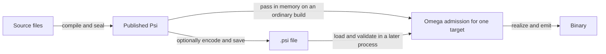
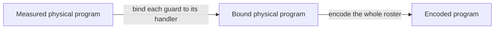

# Psi and Omega representation pipeline

**Psi takes source files and publishes a portable Psi program. Omega takes that program for one target and produces a binary.** In an ordinary build the driver passes **Published Psi** directly to Omega in memory. Saving a `.psi` file is optional. This plan proposes giving each compiler transformation its own Rust crate again, named for the form it reads and the form it writes (`X → Y`, or `Y → Y` for a pass), with Psi and Omega each numbering their own stages from `00`. A stage that refuses a program reports a diagnostic and that route ends.

## The rule for every compiler change

**A → B → C. The stage that produces C must be able to run from B alone.** This holds for every adjacent pair of public stages in Psi and Omega. A stage may compute a new fact from its input. An existing fact that can change meaning, target choices, diagnostics, work charged, authority or emitted bytes must arrive in that input.

```text
A ── first transformation ──▶ B ── second transformation ──▶ C
```

**Example.** Suppose A owns an import that C needs. The first transformation issues B with the import identity and evidence C needs. The second consumes B. If the driver has to remember the import and pass it alongside B, the B contract is incomplete. Putting a callback to the driver inside B, or giving B a key that retrieves the old program from a registry, leaves the same reach-around. A stable identity that refers to a record carried in B is fine. [Existing object handoff][object-side]

**When B appears insufficient**, trace the missing fact to its first legitimate producer. If already known, carry the narrow fact and its provenance through B. If it becomes knowable later, defer the decision, reorder the work, or put the coupled operations under one public stage owner. Record the counterexample on the board before improvising a new path. An internal loop can earn one stage. Per-file streaming reuses storage while each parser still receives its file’s tokens. At the Omega entrance, admit Published Psi, target inputs and receiving-host authority into the first representation. The ordinary route then follows the same adjacent-stage rule.

**What earns a checked box.** For each public transformation, identify the real caller that hands over B and the implementation that issues C. Show that required earlier producers, driver state, registries and callbacks are unavailable to that implementation. Exercise it using a legitimately issued B with its declared data, keeping earlier producer services inaccessible. Check the result or refusal against its fixture and inspect the production dependency graph and API for alternate paths. Compile-time visibility, dependency checks and the isolation test cover different ways an apparently linear signature can still reach around. Apply this rule on the in-memory route; isolation does not require serializing every stage.

**Status · proposed migration, one implementation PR.** This draft covers the Rust reference compiler used by the CLI. The implementation checkpoints share one branch. The destination is two independently browsable pipelines joined by Published Psi, the sealed portable program whose on-disk encoding is `.psi`. Four boundaries still need experiments before the directory names can be fixed: resolution and typing, target realization, where callable demand closes, and handler binding. No feasibility or acceptance result is claimed here. The owner requested one integrated migration. Exact stage splits are proposals pending the experiments below. This document is a planning handoff. [Migration checklist](#migration-checklist) · [Laws learned from repairs](#architecture-laws-learned-from-repairs) · [Why the dependencies exist](#why-the-pipeline-reaches-back) · [Current work and next action](#current-work-and-next-action)

*judgment* marks a proposed design. *unverified* marks a property nobody has demonstrated yet. Source links are pinned to `aa8030676ef2`, which includes #4030 and the authored-syntax change #4053. `045a2345054b` is the commit just before #4030 and supplies the old directory names. `main` was at `0b90bdbaaa6d` when this page was revised; that one later commit changes only `checking/prove.rs`. [Source tree][current] · [Earlier Psi stages][old-psi] · [Earlier Omega stages][old-omega]

## Current work and next action

Maintain this table in the working copy of the plan. Update it at the end of each checklist item, experiment or coherent batch, including work that stops midway. On resuming after an interruption, open this table first.

| Field | Current entry |
| --- | --- |
| Objective | Separate browsable Psi and Omega pipelines. Each stage reads one form and produces one form. Source streams per file. Published Psi crosses the normal boundary in memory. |
| Phase | First implementation checkpoint verified on Linux x86-64. The temporary branch carries the verified code and this handoff. |
| Last verified result | At `8c8a6933f62b`, the entry owner, refusal, calling applications and scalar ELF matched the parent. The source-release regression passed. The physical inventory at `aa8030676ef2` reconciled all 40,692 tracked entries. The 55 broader checklist boxes remain open. [Inventory and limits](#physical-line-inventory-at-the-reviewed-revision) |
| Active item | Review the verified Linux entry custody change. Parent `aa8030676ef2`, candidate `8c8a6933f62b`. [Evidence and local replay](#review-record-for-the-linux-entry) |
| Next action | Fetch the temporary branch using the local handoff below. At review, inspect the entry handoff. The next open reach-back to trace is provider demand in portable publication. [First reviewable slice](#first-reviewable-slice-native-entry-declaration-custody) |
| Open questions | Resolution and typing, target realization, transitive callable closure, and handler binding still need experiments. The direct handoff and fresh-process route both need proof. [Dependency explanations](#why-the-pipeline-reaches-back) |

### Local agent handoff

Start in an existing Omega clone. Create this worktree once, then reuse it across edits. The branch includes the verified compiler commit and this Markdown.

```bash
git fetch origin refs/heads/slice/native-entry-custody
git worktree add -b work/representation-pipeline ../omega-pipeline-local FETCH_HEAD
cd ../omega-pipeline-local
git merge-base --is-ancestor 8c8a6933f62bd6b5c5c9a0377e53130edd67f48a HEAD
```

1. Read the current-work table, the [entry comparison](#review-record-for-the-linux-entry), and the [verification laws](#verification-laws-learned-from-the-entry-slice). The hashes there are the reusable Linux baseline. Use the qualified mbx version in `tools/mbx-version`. For first-time setup follow the [repository commands](AGENTS.md#commands).
2. For a local smoke check of this handoff, run `mbx test --locked -p omega --test native_entry_custody`. Compare Linux executable bytes on a matching Linux x86-64 host. Record a different host separately. On the 32-core machine, start with the local scheduler and available memory. This cloud run used two compile jobs. Local throughput is unmeasured.
3. The next open item is `omega-rust/omega/compilation/pipeline/02_portable-publication/src/provider_demand.rs`. Trace what it reads from `source_selections()`, who first knows each fact, and which public representation could carry it. Record the actual consumer and choose a fixture that exercises it before changing that boundary. The entry test proves only entry custody.
4. Before switching tasks, update the current-work table and the affected checklist row in this file. Record the commit, observed result, work still open and the next command. Keep newly discovered reach-backs visible here.

### Check a compiler edit without rebuilding the world

| When | Check | Evidence it supplies |
| --- | --- | --- |
| While editing the handoff | Inspect the issuer, the consumer and their production dependencies. Run the already-built `mbx xtask check-boundary` when an interface or ownership rule changes. | Reveals a reach-back or an unreviewed contract before paying for native compilation. |
| When the handoff compiles | Run the smallest integration test that uses the production issuer and reader. Exercise success, substitution and loss of the earlier owner in one fixture. Reuse the normal CLI crate's build graph when it already exposes those APIs. | Demonstrates who supplies the fact and what the consumer refuses. |
| When the slice is ready for review | Use the same target, inputs and flags as the pinned parent. Compare the selected outcomes and full calling plans, emit the scalar executable once, compare bytes, and run that executable. | Detects changed behavior that a dependency check or a successful compilation would miss. |
| When scope expands or the migration reaches merge review | Run the affected package, codec, authorization, platform or multi-host checks listed under acceptance. Record the owner and reason for each added run. | Covers the newly affected behavior and the integrated release gates. |

Use one warm worktree, target directory and profile for the edit loop. For this slice the routine command is `mbx test --locked -p omega --test native_entry_custody`. The observer and image comparison belong at the review checkpoint. Console is useful when Console or package settlement changes. Record cold compile time separately from test execution time so a cache miss is visible.

**Reuse the parent.** Record the Git revision, fixture and library tree IDs, host and target, Rust and mbx versions, feature set, build flags, input, exit status and expected result hashes in the row. Reuse matching evidence on later candidates. Refresh the affected baseline when a key changes or a run proved nondeterministic. Compare the saved facts and image hash for each new candidate. A cached compile alone supplies no behavioral result.

### Return to the plan after each work unit

1. **Before starting**, read the A → B → C rule, the current entry, the relevant checklist row and its acceptance test. Write the active row and revision in the table. Choose an observable result that would decide the question.
2. **After the work**, return to that same row. Record what actually happened, the revision, fixture or inventory command, and a link to its result. Check the box when its stated evidence exists. For partial work, record the last successful observation, the first failure or missing fact, and the exact next check.
3. **Account for discoveries before switching tasks.** Attach a new caller, side input or counterexample to the affected row. Add a row when no existing one owns it. If it changes stage ownership, update the stage table, diagram and experiment record together. Keep the evidence that superseded the earlier decision.
4. **Set the next action and reread it.** Update the table above with the last verified result and one concrete next action. At a phase boundary, compare the affected rows with the [work order](#work-order) and [acceptance criteria](#acceptance). At final handoff, reconcile every open row, exception and pending host run. A fresh agent should be able to reproduce the last result and take the next action using the plan alone.

**One shared board.** A solo agent uses the current-work table and checklist directly. With several agents, the coordinator records each active assignment below and remains the writer of the board. Workers can investigate different parts of the same question. Give each a named deliverable and record file overlap before assigning edits. Workers return their revision, evidence, counterexample or blocker, and next action. The coordinator reconciles those results against the checklist. A worker finishing its assignment closes only the part its evidence covers.

| Active checklist row or subtask | Agent | Files or investigation scope | Evidence or next action |
| --- | --- | --- | --- |
| Native entry declaration custody | Codex | Psi portable publication → Omega executable entry preparation | Verified. Review checkpoint reached. The scalar ELF, full plans and refusal matched the parent. |

## Why change the compiler #4030 just merged

PR #4030 removed several backward dependencies, kept streaming and produced tested binaries. It also did two things this plan wants to undo. [Merge][merge]

1. **It put all seven Psi transformations inside one crate.** `01_source-compilation` holds lexing, parsing, resolution, typing, preparation, lowering and checking as modules under [`src/operations/`][source-ops]. Only lexing, parsing and `source-syntax` have their own `Cargo.toml`. A reader opening the folder no longer sees the order of the forms, and Rust cannot stop one operation from reaching into another's private state.
2. **It left program facts travelling beside the native stages.** The driver still passes a proposal, an artifact, optimization choices, permissions and imports separately into planning. [Caller][native-caller] The [side-input table](#close-the-side-inputs) lists nine such cases.

The old folder names were not accurate either, which is why this plan does not simply restore them. In the old native driver, allocation and post-allocation planning ran in their numbered stages, and then the driver itself called `machine_emission::stage_function_frame` before stage 07 could encode. The folder sequence hid a real transformation. [Historical frame construction][old-frame] The rule this plan follows: keep a historical name only when the receiving code can run on exactly that named input.

**This reverses a recorded recommendation.** [Question Q-C](https://github.com/CathedralOS/Omega/blob/aa8030676ef29dd7506dbb2111e4f1ae57e81004/atlas/questions.md) recommends one source-settlement stage that owns all of Psi 00–06, because resolution and typing alternate and a coordinator wrapped around the old stage calls "is not the replacement". #4030 implemented that. Separate resolution and typing earn separate numbers only if their public handoff is forward-only. The [resolver and typer loop](#the-resolver-and-typer-loop) describes the fallback.

## Migration decisions

- **Owner direction from the planning discussion.** Keep Psi and Omega independently browsable, preserve the streamed first stages, use one input and one output representation per public transformation, and deliver one integrated migration. An ordinary build passes Published Psi in memory. Saving a file is optional. Exact crate splits and the placement of shared definitions still need evidence.
- **Landing.** Deliver the direct Published Psi handoff and optional file loader, both stage trees, production callers, enforcement and documentation in one PR. The first source-free build is an internal checkpoint. Capture the exact pre-migration parent before editing. Inside the PR, steps 0–2 come first: they fix the stage list for both trees, and no directory moves until this page records that list.
- **Stage ownership.** Proposed default: one crate per public transformation, one local counter per pipeline, and an explicit invariant for each same-form pass. Lexing and parsing keep their per-file schedule.
- **Resolution and typing.** Prove the forward handoff on real deferred bodies. If it changes observable work, activation or diagnostics, give the same-revision iteration one public owner, `syntax-trees-to-typed-trees`. Later Psi numbers shift by one. Generated bytes still enter through a new source revision.
- **Scope.** The Omega-written compiler under `source/psi/pipeline/` has different final forms. Record the difference in the architecture map. Implementation here targets the Rust compiler. [Omega-written Psi][self-psi]
- **Atlas decisions.** Keep Q-C open until the deferred-body proof settles its owner. Keep Q-F open until executable-body closure and late binding are proved. Keep Q-G open until a named Omega stage demonstrably joins target bindings to checked candidates, produces ABI plans and closes provider demand. Link each answer to the working caller and a falsifying test. [Earlier questions](https://github.com/CathedralOS/Omega/blob/aa8030676ef29dd7506dbb2111e4f1ae57e81004/atlas/questions.md)

## Why the pipeline reaches back

For each suspect edge, ask **“When could the producing stage first know this fact?”** If it knew the fact before returning, specify what its output must carry. If the fact first becomes knowable later, identify the event that reveals it. Deferring a decision, changing the order, or giving two operations one public owner are all possible outcomes. The observations below describe the pinned implementation. Proposed repairs and tests remain open.

| Question | Why the current compiler does it | Decision and evidence needed to close it |
| --- | --- | --- |
| Does parsing send an AST back to the lexer? | The ordinary worker lexes one file and parses its tokens immediately. Generated **new bytes** can start another source revision. The observed **same-revision** feedback is resolution and typing of deferred bodies. [Streamed caller][stream] · [Generated-source handoff][generated-selection] | Preserve per-file token reuse and error precedence. Exercise a generated-source extension separately from deferred-body activation. Record which revision, selections and work charges the continuation owns. |
| Why does typing call the resolver again? | Resolution retains pending bodies. Typed symbols, domains and service reach can supply allocation facts needed to complete them. The driver asks the resolver to finish selected bodies, types the results, and repeats. Eagerly activating everything could expose an unused invalid body or consume the caller’s budget. [Allocation preparation][typed-feedback] · [Actual loop][feedback] | Compare the parent and candidate on the same unused invalid body, then activate it. Record activation order, diagnostic and work at the budget threshold. Keep separate stages only if a forward handoff preserves these results. Otherwise one public stage owns the iteration. |
| Why can Omega still ask Psi about a call? | The checked source owns frozen typed trees. Omega publication uses source selections for entry custody, and provider preparation reads those selections plus package custody for permissions. A weak pointer compares producer identity. The actual reads identify the facts that need new owners. [Checked owner][checked-owner] · [Publication][published] · [Provider and permission reads][provider-reads] | Use a provider-dependent program. Drop the typed owner **before publication**, then release the frontend and live Build session before Omega admission. Record each missing fact. Source choices and identities belong to Published Psi. Target bindings and receiving-host authority enter with the invocation. Classify package permissions by issuer and subject. Repeat through the saved-file route with authorization withheld. |
| Why can planning a body reveal another provider or callback? | Selecting a provider can expose requirements in its body. Planning the root and its callbacks reveals surviving private references transitively. Optimization can erase executable work while the portable program still owes pre-optimization semantic checks. [Provider closure and policy inputs][closure-question] · [Private-reference walk][callback-walk] · [Portable semantic history][semantic-history] | Select a provider that introduces another requirement. Prune an unsupported callback, then keep it reachable. Compare three parent results independently: obligations checked, provider and ABI choices admitted, and bodies emitted. Record the last pass that changes each set. If their owners differ, name both handoffs before fixing the numbers. |
| Why does instruction selection need a frame measurement? | The installer emits a stack guard for **another body**, the handler. The guard needs that handler’s measured stack requirement. Constants used in the guard can affect later instruction rewrites. Moving the number later could change the code being measured. [Selection read][guard-requirement] · [Stack check][guard-stack-check] · [Constant rewrite][guard-opt] | Compare reachable handler and installer pairs around actual stack and encoding thresholds. Record selected instructions, frame sizes, charged work and final bytes. Keep late binding if these remain stable. Otherwise bind at the point where they become stable or give the coupled operations one owner. |
| Why do objects, images and products still take earlier inputs? | The driver attaches imports after constructing the object. Image verification needs semantic obligations as well as final byte ranges and currently receives earlier artifacts separately. Build attaches runtime provisions after finishing the native artifact. These are distinct handoffs with different evidence needs. [Object construction][object-side] · [Image inputs][late-psi] · [Late provisions][late-provisions] | Have the object issuer own its imports and references. Carry checkable obligations to their final ranges and preserve independent verification. Issue a complete requested product. Swap an import, occurrence, byte range or runtime provision and require the appropriate receiver to refuse it. See the [side-input tests](#close-the-side-inputs). |

### How to recognize a recurring boundary problem

Compare traces of **one fact at a time**. Record the fact and subject, where it first becomes knowable, where it is issued, the first reader that needs it, and how that reader actually gets it. Count distinct producers and handoffs. Several CLI commands reaching the same helper are evidence about route coverage and share one underlying handoff.

| Observation in the trace | Hypothesis | Test that distinguishes it |
| --- | --- | --- |
| The predecessor already owns the fact, but a later reader asks the driver for it. | The predecessor’s output is incomplete. | Carry only the owned fact in the output. Remove access to the driver’s copy. Compare behavior, authority and work with the parent. |
| The reader receives an earlier compiler owner to answer a narrow question. | The boundary exposes more state than the consumer needs. | Project the required fact with its subject identity, drop the earlier owner, then try both the valid subject and a substituted one. |
| A later choice reveals work for an earlier operation on the same subject. | The split may hide a genuine feedback loop. | Trace dormant and activated variants. Try the forward handoff and compare activation, diagnostics and work. If that fails, record the counterexample and test a single public owner. |
| The apparent feedback refers to a different subject or revision. | The issue may be cross-body scheduling or newly admitted input. | Record both identities. For a handler, test late binding against real frame thresholds. For generated source, trace its fresh input revision and charged work. |

For each proposed pattern, write down what it predicts on a second, independently traced handoff and one case where the rule should fail. For example, carrying an already known import can complete an object. That remedy would require a different argument for a handler stack size that only becomes known after measurement. Record the observed outcome, revision and fixture beside the hypothesis. One counterexample can disprove a universal stage split. Repetition alone cannot establish a shared crate or justify another stage.

## Names and directory ownership

**Omega** names the whole compiler and also its target-specific half. Write **the Omega pipeline** for the second meaning wherever both are in play. **Psi** names the frontend and its portable format. **Terminal Psi** is the internal form the frontend checks before publication. Published Psi owns the checked program and its portable evidence. Its public `.psi` encoding supports saving, inspection and separate consumption. "Native emission" describes work inside Omega.

*judgment*. Keep the existing domain paths. Opening either `pipeline/` folder should show its transformations in order. [Current Psi tree][current-psi] · [Current Omega tree][current-omega]

```text
omega-rust/
  psi/compilation/pipeline/
    00_source-files-to-tokens/
    01_tokens-to-syntax-trees/
    02_syntax-trees-to-symbol-resolved-trees/
    03_symbol-resolved-trees-to-typed-trees/
    04_typed-trees-to-typed-trees/
    05_typed-trees-to-terminal-psi/
    06_terminal-psi-to-checked-terminal-psi/
    07_checked-terminal-psi-to-published-psi/
  omega/compilation/pipeline/
    00_native-invocation-to-admitted-psi/        # proposed
    01_admitted-psi-to-target-bound-program/     # proposed realization owner
    … see the Omega table for the candidate handoffs
```

**A stage is named for the Rust type it emits.** Psi means the portable, target-neutral form, so a form that already carries a target's bindings and ABI plans is not called Psi; "target-bound program" is a placeholder until step 2 names the real type. On the Psi side, today's type for the checked form is `AcceptedTerminalSource`. Confirm `checked-terminal-psi` and `published-psi` against the types stages `06` and `07` actually return.

Three placements are still open and each needs an answer in [step 1](#work-order):

- **Today's `00_compilation-inputs`.** It admits target names, product options, rollback requests and installation assumptions "before an individual target starts source or native planning". [Stage 00 today][inputs-stage] It runs before Psi but lives under `omega/`, and today Psi's `01` and Omega's `00`, `02`–`10` share one counter. With two counters, say which requests belong to the Psi invocation, which to the Omega invocation, and where the code that admits each one lives. Psi may not import it from `omega/`.
- **The drivers.** The top-level driver composes the two public entrances. The Psi driver schedules streamed files. The Omega driver advances one target-scoped program. Name the crate for each and say what `compiler/`, `native-compiler/` and `products/` keep.
- **Omega's first stage name.** The first two candidate names separate receiving-host admission from target realization. Finalize the split against their input types, invariants and production callers.

Each stage exposes one transformation, its input and result types, and a benchmark. Measure the real streamed lex-then-parse pair as well as each stage alone, so the timing includes buffer reuse.

## The whole route

The overview shows both ways to reach the same Omega entrance.



The two maps below summarize the proposed ordinary build. Some arrows group several adjacent transformations for readability. The stage tables and their issuing and receiving APIs determine the individual handoffs. The four arrows whose label says *prove* are the boundaries step 2 has to settle.

Psi, one file at a time per worker until the syntax pages are complete:


Omega, for one target invocation:


These diagrams use only the syntax the atlas builder accepts: `flowchart LR`, `id[label]` and labeled `-->` arrows. Node colors come from `atlas/artifacts/diagrams.json`, not from the Markdown.

**Reading the two entrances.** Syntax pages accumulate while each worker reuses its token buffer. A Build that admits new source starts a new Psi revision. At the other entrance, a target invocation carries the published artifact, receiving-host authority, target description, bindings, policy, budgets and declared binary dependencies. Omega’s stages receive their successive forms from there. The default Psi route selects no Psi optimization. A nonempty selection currently refuses before publication. [File loop][stream] · [Publication refusal][opt-refusal] · [Admission contract][host-admission]

**Follow one call.** Source calls `Console::write`. Psi records the exact requirement application and its checked candidates in the public program. Given that published program and the Linux invocation, Omega joins the matching Build binding to the eligible candidate, admits the calling plan, then lowers the reached call. For a Linux x86-64 binding that realizes write as system call 1, that number belongs to target realization. A Windows invocation supplies its own binding for the same portable demand. A changed Build source set is a different comparison. [Portable product][portable-spec] · [Current demand projection][projection]

The historical [colored pipeline map](https://github.com/CathedralOS/Omega/blob/aa8030676ef29dd7506dbb2111e4f1ae57e81004/atlas/artifacts/pipeline-map/original.html) is retained as a reference.

### What qualifies as one representation

- The caller passes one current program value. Every input that can change the program's meaning, the decisions taken, the verdict or the output bytes has a named producer. A fact enters either at invocation or at the stage that computes it, and then travels in each later form until its last reader.
- The result has one owner and a documented invariant. For a `Y → Y` pass, say what it improves or checks and what input would show the pass is missing. Each stage can be run with only the previous stage's output.
- A `Context` holding the earlier syntax tree, a Build handle, a provider registry and a callback fails this rule even when it is the only Rust argument. An `Arc`, weak pointer or identifier that can open those objects is also a dependency. A representation may contain tables, bodies and owned provenance that together describe the current program.
- A worker may use private scratch space and stream one file or chunk at a time. Trace collection watches the call from outside. If a validation request changes what must be kept, the request and the evidence it needs travel in the representation. A validator can refuse a result. Only the stage that produces a form can issue the next one.

## Proposed Psi stages

*judgment*. Use the old spellings where their handoffs are accurate. Each row gets a real Cargo crate, an input type, an output type and a caller in the tree. The links show where the code is today.

| Proposed Psi directory | What the stage must own | Code to separate |
| --- | --- | --- |
| `00_source-files-to-tokens` | For one admitted file: the bytes, source identity, span coordinates and literal data its parser needs. | [Lexer][lexer] and [the streamed caller][stream]. |
| `01_tokens-to-syntax-trees` | Read that file's tokens, produce its syntax page, then recycle scratch. Keep the authored spelling and roots. | [Parser][parser] and [exact-byte adoption][adopt]. Package discovery can reuse the same parsed page. |
| `02_syntax-trees-to-symbol-resolved-trees` | Publish scoped declarations, stable authored identities, lexical uses and the finite candidates for uses that depend on types. Keep unresolved facts at their occurrence. | [Resolver][resolver]. Today the deferred route receives selections and allocation state back from typing. |
| `03_symbol-resolved-trees-to-typed-trees` | Type the resolved program. Typed selections and generated specializations get identities that do not require rewriting resolver tables. | [Typing][typing] and [today's loop back into resolution][feedback]. |
| `04_typed-trees-to-typed-trees` | Finish requested preparation and evaluation. Keep the exact work charged, a frozen typed form and any refusal. | [Preparation][prep] and [source judgment entrance][source-judge]. |
| `05_typed-trees-to-terminal-psi` | Produce the complete input to the lowered-form checker, including demanded generic bodies, witnesses and installation reach. Tie each checked program to its provenance. | [Structural lowering][lowering] takes a separate compilation roster and publication mode today. The [factory][factory] still adjusts conditional reach before judgment. |
| `06_terminal-psi-to-checked-terminal-psi` | The lowered-form checker decides acceptance of the exact unoptimized module. Preserve rejection, incomplete work and invalid input. | [Judgment][judge] · [Accepted source][factory] |
| `07_checked-terminal-psi-to-published-psi` | Seal the accepted subject, its verdict, portable requirements and declared evidence into a self-contained Published Psi value. The combined driver hands that value to Omega directly. A caller requesting a saved artifact uses its canonical encoding. Empty selection performs no pass or second check. A nonempty selection retains its current refusal. | [`SourcePublication::publish`][psi-publish] in Psi, and the parts of Omega's `02_portable-publication` that describe the portable program. [Manifest][pub-manifest] · [Public product][portable-spec] · [Selection refusal][opt-refusal] |

**Optimization contract.** The specified future route checks the unoptimized module, runs selected Psi passes in canonical order, checks the resulting module, then publishes evidence for that exact result. A failure of the second check is a compiler defect. This migration preserves the current refusal for a nonempty selection. Its tests distinguish that refusal from a source error and from the successful empty-selection route. [Specification][opt-order]

**Streaming is part of the contract.** Workers can overlap files in a batch. On one worker, file A is lexed and immediately parsed before the token storage serves file B. Keep three behaviors: a later lexical error outranks an earlier parse error, reused pages are checked by exact bytes and index, and #4053's authored transitions, assembly and token spellings survive. Test a changed file with the same name, and a reused page under a different scope. [File loop][stream] · [Reuse controls][reuse-tests] · [Authored assembly][asm-tests]

### The resolver and typer loop

**Typing calls back into resolution today, twice.** This is the main obstacle to giving resolution and typing distinct public stages.

- When generated source extends the program, the Psi driver takes authored declaration selections from typing and passes them to the resolver. [Generated-source handoff][generated-selection]
- When the driver activates deferred bodies, it loops: typing prepares allocation state from typed symbols, domains and service reach; the resolver completes the selected machine bodies; typing types them; repeat until none are pending. [Allocation handoff][typed-feedback] · [The loop][feedback]

Part of the protection this plan wants already exists. `lower_seeded_extension` refuses a continuation paired with another resolved base (`CrossPairedResolvedBase`) and one whose retained roots changed (`RetainedResolvedRootsChanged`). [Existing refusals][continuation-refusals] Step 1 lists which refusals exist before step 2 adds tests.

*judgment*. Try the forward design first: the resolver publishes stable identities and every admissible candidate, and the typer finishes the selection without calling the resolver. New source bytes always start a new revision at the Psi entrance. If the forward design changes which bodies run, an error message or the charged work, record the exact program that shows it. In that case the same-revision iteration belongs inside one merged public stage. In either design the resolver receives only named data for the program it already authenticated. [Copied tables][resolved-tables]

### Build can supply new source

Record when Build itself is compiled and evaluated, what value and cost come back, and which newly admitted bytes become a new source input. A child compilation has its own source and enters through the normal entrance. Require exact provenance and cost when the parent resumes, including on failure. If a source body can only be activated after typing, show its forward contract on real Build and package fixtures before fixing the boundary. Reading unused invalid source eagerly would change the language's behavior. The package diagnostic path that rescans bundled build files also needs a named producer for its spelling inventory. [Build continuation][build-resume] · [Import discovery][discovery]

## What Psi publishes and what Omega supplies

*judgment*. Write down the published artifact and its independent reader first. Psi publishes the executable program, its identities, its declared external requirements, calling declarations, and evidence a reader can check on its own. Psi publishes the logical requirement and any body choice source semantics already fixed. Omega binds the open requirements and chooses how each reached call is realized on the selected target; the concrete ABI, instruction or system-call number is attached there. Specify the version, decoding limits and identity and compatibility rules. Source-oriented debug information stays optional and inert: a reader must have no way to use it to restart the source compiler.

| Owner | Can provide | Proof of the boundary |
| --- | --- | --- |
| Psi publisher | A sealed portable program with its identity, declared requirements and evidence. | Drop the typed-source owner before publication. Exercise the in-memory handoff, then separately save and load the value and check its canonical identity. |
| Native invocation | Receiving-host authorization for the exact artifact digest and producer, one target, its admitted description, bindings, policy, budgets and permitted imports for this run. | Freeze a target-scoped first input. Different targets may choose different providers from identical portable bytes. The native stages never consult live Build state. |
| Omega compiler | A binary from the portable program for that invocation. | Link a native-only consumer against the published Psi format. Build and run it with the source compiler crates and source files unavailable. |
| Shared definitions | Only definitions that named producers and consumers actually need. The portable wire schema, stable identifiers and a bounded codec are candidates. | Record which side writes and reads each shared definition, why a side-local definition cannot serve, and the limits of any executable method. |

**The in-memory handoff.** The combined driver gives Omega the sealed value and the admitted invocation inputs. It requires neither a temporary Psi file nor an encode/decode round trip. A caller requesting persistence invokes the writer. A file consumer performs bounded decoding and structural validation, recovers the same portable program identity, then uses the same Omega admission and lowering code. Both routes bind authorization to the exact program and producer. The file carries no host authorization of its own. [Portable product][portable-spec] · [Separate consumption][host-admission]

**Receiving-host authority.** Inspection uses bounded canonical decoding and structural checks. Native consumption also requires the receiving host to authorize this artifact and producing process. Admit that authority once into the target invocation and carry its subject forward. A digest copied from the file cannot issue host authority. Cover standalone, combined and embedding entrances with the same admission rule. [Separate consumption][host-admission]

**The format crates already exist.** `terminal-psi`, `terminal-psi/wire` and `terminal-psi/codec` sit under `psi/compilation/representations/` and do not depend on the source compiler. [Codec manifest][codec-manifest] Step 3 starts by checking whether these three are already the "smallest Psi format crate both sides can use", and names what is missing if they are not. Do not create a new format crate before that check.

**Publication has to cross the firewall.** Psi stage `07` cannot import Omega crates, and today's publication crate is an Omega crate. `02_portable-publication` lives under `omega/` and depends on four Omega crates: `target`, `effects` (`native-effects`), `backend-plan` (`provider-plans`) and `package-compilation`. [Manifest][pub-manifest] Psi already owns `SourcePublication::publish`, which produces the `PortableTerminalProgram`. [Psi publication][psi-publish] Step 1 sorts the Omega crate's contents into two groups: what describes the portable program moves to Psi `07` or the format crates, and what needs a target, a provider plan or a package stays with Omega's entrance or realization stage. `provider_demand.rs` is the first file to classify. [Published provider demand][projection]

**How far the source compiler reaches into Omega today.** Seven Omega crates take `source-compiler` (`01_source-compilation`) as a normal dependency: `build-settings`, `compiler`, `02_portable-publication`, `products`, `build-declarations`, `package-compilation` and `review-evidence`. Two more take it only for tests: `03_native-program-planning` builds its fixtures by calling `source_compiler::lowering::lower_bodies` and `source_compiler::checking::discharge` [Fixture][native-test-fixture], and `image-emission` declares it as a dev-dependency. Compute the native-only consumer’s production dependency closure to identify which edges must move. A combined driver can legitimately depend on both compilers. Use prebuilt published fixtures to exercise the source-free route independently of tests that compile source. Reproduce the list from the repository root:

```bash
grep -rl --include=Cargo.toml '01_source-compilation"' omega-rust
```

**The clearest single case.** `PublishedProgram` holds a `Weak` pointer to the source compiler's `PortableTerminalProgram`. Its constructor reads source selections and projects entry custody, and its crate imports the source compiler and package compilation. The weak pointer does not prove the compiler re-reads source at run time. It does mean the published type depends on a source-side Rust identity. Split source-local deduplication from the portable data and prove custody against the sealed artifact's identity. Keep every existing refusal for substituted programs and grants. [Published type and constructor][published] · [Manifest][pub-manifest]

**Values that depend on the target need a home.** If Build chooses a different entry or source set, record the new input. If a value depends on a target's address model or a selected provider, carry the demand in the published Psi program and settle it against the native invocation. Say how the Psi interpreter binds the same demand. Build orchestration completes scalar demands for the root and for individual components today; reproduce the exact charge, result and refusal for a demand that is actually reached. A folded target-dependent value must never silently become a portable constant. [Build caller][component-scalars] · [Scalar evaluator][scalar-eval] · [Published provider demand][projection]

The CLI can already write and inspect a `.psi` file, which proves readback for inspection. The standalone native build from that file is *unverified*. Define one Omega entrance for a sealed Published Psi value. The combined command supplies it in memory. The file loader supplies it after validating the encoded artifact. If the existing portable bytes omit a required fact, first name its owner and the compatibility cost; any wire-format change needs an explicit decision and old-format tests. [Public inspection test][inspect-test] · [Portable product specification][portable-spec]

**A boundary Rust can enforce.** Psi owns its writer and its transformations. Omega owns its native loader and transformations. A combined CLI depends on both. A Cargo build of the Omega stages must succeed with the Psi stage crates physically absent, and with no source compiler hidden behind a workspace feature, re-export or build script.

## Proposed Omega stages

*judgment*. These are the historical names, used as a starting vocabulary to test against the real representations. A new invariant or program form earns a new stage. Final names and numbers follow the sequence step 2 verifies, including any binding or framing stage it shows is needed.

| Historical Omega directory | What must cross the boundary in the repaired compiler |
| --- | --- |
| New entrance and realization before the historical `00` | Candidate new `00_native-invocation-to-admitted-psi` verifies the exact artifact and host authority and freezes target inputs. Candidate new `01_admitted-psi-to-target-bound-program` joins each reached requirement to its checked candidate and binding, evaluates admitted calling policies, and issues provider and ABI plans for that subject. Demonstrate transitive provider demand and refusal for a missing or cross-paired binding before settling Q-G. |
| Historical `00_terminal-psi-to-abstract-operations` | Its new predecessor would be the target-bound program. The proposed consumer reads the sealed choices and produces abstract operations. Renumber it and all successors consecutively after the proofs. Historical numbers below describe the old tree. |
| `01_abstract-operations-to-abstract-operations` | Transform abstract operations using their admitted choices, proof obligations and work budget. Keep the semantic identity and name the invariant of each rewrite. |
| `02_abstract-operations-to-target-operations` | Lower all demanded bodies to target operations. Candidate point for closing the callable roster. Establish exact agreement with post-optimization private references in the transitive callback experiment below. No later lookup into portable code can create a new body. |
| `03_target-operations-to-selected-instructions` | Select instructions for the whole roster. Keep symbolic guard and entry references whose locations become known later. |
| `04_selected-instructions-to-selected-instructions` | Apply instruction rewrites while keeping register and effect requirements, provenance and the complete callable roster. |
| `05_selected-instructions-to-register-homes` | Assign homes and spills for the selected instructions and the admitted target register model. Carry the exact assignment, frame requirements and machine identities forward. |
| `06_register-homes-to-post-allocation-machine` | Produce executable physical alternatives and frame recipes. Handlers demanded independently need measured costs for the later binding of their installers. |
| `07_post-allocation-machine-to-selected-form-encoding` | Take the fully framed and bound program and encode every body, bridge and entry. Name a separate framed or bound form if the producer and consumer establish one; the old driver called the framer outside these stages. [Historical call][old-frame] |
| `08_selected-form-encoding-to-resolved-layout` | Place encoded alternatives and fixups for all kept bodies. Carry the bytes and patch fields branch relaxation needs. |
| `09_resolved-layout-to-resolved-layout` | Relax eligible branches and recheck frame-dependent distances. Publish resolved offsets and evidence for the finished layout. |
| `resolved-layout-to-objects`, then `objects-to-image` (unnumbered until the sequence is fixed) | Objects carry sections, symbols, imports and relocation evidence. Image construction places the sealed objects and completes the executable bytes. File installation receives a finished image and issues a receipt only after a successful write. |

Today `03_native-program-planning` does work from several early rows. `04_physical-program-planning` does selection, optimization, allocation and physical planning. `07_native-layout` combines placement and relaxation. Recover the operations and their invariants before renaming anything. Compare the old [Omega tree][old-omega] with [native body planning][native-plan], [physical planning][physical], [encoding][encoding] and [layout][layout].

## Close the side inputs

The classifications and destinations here are *judgment*. Each row pairs a place in today's code with a test that would disprove the proposed repair.

| Observed on the reviewed revision | Required ownership | Test that would disprove it |
| --- | --- | --- |
| The driver passes a native proposal and artifact alongside optimization choices, permissions, imports, scalars and installation assumptions. [Caller][native-caller] | Admit external choices at the entrance. The producing stage carries their exact program, target, provenance and remaining uses. The next stage reads one target-bound program. | Run the same portable bytes under two targets. Swap a binding, scalar address model or grant from the other run. Require the intended refusal. |
| Instruction selection reads each handler's measured stack requirement while it selects the installer, so the root waits for handler bodies to be planned first. Later binding takes a frame, resources, handler table and root as four separate arguments. [Requirement read][guard-requirement] · [Handler order][handler-loop] · [Binding][bind] · [Caller][bind-caller] | Keep a symbolic guard with known effects, register constraints and encoding alternatives. After every body's frame is measured, bind the guard from the measured program that stage emits. This earns a new form only if it changes an invariant of the whole program. | Reject a mutated measurement with identical total bytes, a swapped placement or root, and a demanded cycle. Check shared handlers, unreachable cycles and the exact stack threshold. Prove a late value cannot change instruction selection or frame size. |
| The root can already have a native plan when the driver asks for plans for private callables. [Root and callback route][callback-caller] · [Callable lowering][callables] | Carry candidate identity and the facts possible calls need. Close the *demanded* roster at the last operation that can select it, before physical planning. Keep lazy refusal and per-body costs. | A callback the target cannot support, pruned by optimization, stays unused. The same callback when reached refuses. No callback can re-enter an earlier producer. |
| The driver keeps imports and private references beside the object and attaches them later. [Object handoff][object-side] | Encoding owns generated bytes, layout owns placement, and the object issuer owns the complete symbols, imports and relocations the image reads. | Remove or exchange one import or private identity. Require an object or image refusal. Force the last object to fail and check that no image was installed. |
| The shared `native-effects` crate resolves selected grants against candidate plans and declaration identities. [Grant resolution][grants] · [Trust caller][trust] | Put the decision in its real numbered stage. An independent verifier can check an issued row against its stated evidence. Shared grant or layout records need documented producers and consumers. | Exercise duplicate, missing, wrong-package and wrong-application grants. A shared record whose API can make a fresh selection fails review. |
| The runtime can construct an installation from a proposal. Stage 10 also calls image code to install a macOS package. [Runtime][runtime] · [Publication][product-write] · [Image installer][image-write] | Compiler and native admission issue the completed installation. The runtime binds host resources to it. Only the publishing host writes finished files and records a completed installation. | Run Psi-only and retained-image routes. Change the target or manifest, or remove the native layout. Refuse the affected operation. A failed write or missing path cannot yield an installed-product receipt. |
| Native image publication still receives the Terminal Psi program, selected plans, provider evidence and physical originals separately. Physical evidence derivation reads the Terminal module to recover occurrence identities. [Image entrance][late-psi] · [Evidence derivation][semantic-evidence] | Carry each reached body's independently checkable semantic obligations through lowering, then bind them to real object ranges and final image bytes. Record unresolved proof obligations. | Swap the Terminal occurrence or the final linked range while keeping the producer's reported digest. The receiver must detect the mismatch. Test ordinary output and explicit replay. |
| Build can attach runtime provisions after it receives the native product. [Caller][late-provisions] · [Product setter][published-add] | Make the complete runtime installation part of the requested product when it is issued. Attaching transient host resources has its own execution boundary. | A component grant, target or roster from another build cannot amend an already issued product. |
| Explicit validation can keep earlier forms for replay. [Retained object][object-side] · [Object verifier][audit] | Admit a named validation request at entry. Check each transition while its real inputs and outputs exist. Carry identity-bound evidence for later independent checks. Normal output cannot grant access to an earlier compiler stage. | Validated and ordinary builds emit identical program bytes. Missing requested originals, mismatched owners or mutated facts still refuse. Disable all producer callbacks in a verifier-only build. |



This handoff is earned only if the stage that produces the measured program has already tied every reached handler's measurement to its physical body and placement. Renaming a tuple of four driver references would keep the existing dependency.

**The symbolic guard is not yet shown to be possible.** Instruction selection reads the handler's measured `required_bytes()` in `validate_stacks`, and guard values become ordinary machine constants: `aligned` materializes `alignment - 1`. [Stack check][guard-stack-check] · [Alignment mask][guard-materialization] Two later steps treat such constants specially. Spilling can copy a `MaterializeI64` literal, and a physical optimization rewrites an exact zero to an `xor`. [Spill path][spill-materialization] · [Zero rewrite][guard-opt] A placeholder value could therefore change register use, instruction bytes or the accepted budget. Trace the real guard constants through these decisions and test values on each side of a rewrite threshold. The byte and refusal tests in the table decide whether the design is viable.

**Transitive callback experiment.** Pin a program whose root retains callback A, whose A retains callback B, and whose candidate C is unsupported on this target. In the first variant optimization prunes C. Record the exact retained identities, reference edges, per-body work, diagnostics and output on the parent. In the twin, keep C reachable and record its refusal. Require the proposed closure stage to reproduce both outcomes and include B without any later stage asking for a newly lowered body. If a later pass changes an edge, move closure to the last transformation that can change demand or combine those transformations under one owner. Keep this experiment separate from proving that an installer can bind measured handler resources. [Root and recursive callback walk][callback-walk]

## What can stay shared

For each shared public type or function, record its definition, its real writer, every production reader and the exact fact they must agree on. Follow trait implementations, conversions, constructors, re-exports and methods on data records. Record why ownership by the producing stage plus a narrow published definition is not enough. Default to stage ownership until the evidence names real readers in more than one stage. [Existing contract inventory][ledger]

A candidate worth defending is the layout record with a machine identity, offset and length. Layout computes the values, objects carry them, and the image reader checks concrete bytes and relocations independently. Record encoding and bounds checks belong with the data definition. Searching for a provider, choosing a new deployment or synthesizing instructions changes a program and needs a numbered stage. The same rule applies to pure functions. [Layout record][layout-data] · [Producer][layout-writer] · [Image reader][layout-reader]

**`psi/foundation/` needs the same treatment.** Ruling 3 says foundation holds primitives only. It still has eight crates (`arena`, `bignum`, `compiler-storage`, `diagnostics`, `execution-admission`, `graphs`, `source-text`, `wire`), and 63 Omega manifests reference it. Step 1 classifies each as a primitive or as something with compiler meaning that belongs to a stage. This plan does not claim any of them is misplaced; nobody has checked.

The Omega-written Psi compiler is outside this migration’s proposed implementation scope. Its typing operation takes both syntax trees and name resolution as arguments. [Omega-written Psi][self-psi] · [Typing caller][self-call]

## Migration checklist

**Start here after a handoff.** The boxes track implementation and verification. Implementation and verification boxes are open. The pinned physical inventory below has been generated and reconciled. Use the [causal explanations](#why-the-pipeline-reaches-back) for the reasons, the [work order](#work-order) for sequencing, and the [acceptance criteria](#acceptance) for the expected results. A checked box must point to evidence on the candidate revision. Baseline evidence belongs to its own revision.

For each box, record the accountable crate or boundary, the actual caller, the fixture or inventory command, the revision and the result. While incomplete, leave it unchecked and add a one-line note with the last verified result and next action. If an experiment combines two stages, retain both checklist entries and point them to their common owner and counterexample. If an old entry disappears, record its replacement or removal evidence.

### Establish the coverage baseline

- [ ] **Pin the comparison.** Record parent and candidate revisions, toolchain, targets, features, flags, bindings, budgets and fixture hashes. Capture parent successes, existing refusals and known failures separately.
- [ ] **Enumerate contracts.** The reviewed ledger at `aa8030676ef2` lists 52 roots and 1,746 distinct file/item pairs. They comprise 926 carried records, 488 definitions, 166 producers, 94 checkers, 41 test-support items and 31 host operations. Regenerate counts on the actual parent. Account for every old pair as retained, moved, split, merged or removed, and every new pair as an addition or successor. [Pinned ledger][ledger]
- [ ] **Find what the ledger omits.** Independently enumerate workspace manifests, normal and build dependencies, applicable target and feature variants, public entrances, drivers and stage constructors. Walk production callers from the CLI, Build, packages, embedding APIs and runtime. Check re-exports, trait implementations, callbacks and feature-gated paths. Compare by identity with the ledger. A production caller outside its roots becomes a new inventory row. [Existing boundary checker][boundary-checker]
- [ ] **Map both directions.** For each form, trace forward from its issuer to every reader and backward from each reader to the origin of every decision-bearing field. Record when a fact becomes knowable, where it is carried, its last reader, and any external permission used. Check cached handles, closures, driver collections and late setters. File moves alone leave this box open.
- [ ] **Place shared and host code.** Classify the drivers, compilation inputs, format crates, foundation crates, and definitions shared by multiple stages. Record real writers/readers and any methods that choose or transform a program. Classify test-only routes separately. Record the Omega-written compiler’s scope and map its stage-name differences.

Use one row per discovered item or handoff in the inventory. A single fixture may cover many rows if its trace identifies each one.

| Parent file/item or new item | Route and actual caller | Producer → input form → reader | Candidate owner and disposition | Positive result and negative control or justified exception | Evidence revision and status |
| --- | --- | --- | --- | --- | --- |
| Starting example: `provider_demand.rs::capture_origins` | Portable publication and provider preparation; trace all callers on the parent | Source selections, package custody and invocation bindings → provider origins | Proposed split between Published Psi and Omega admission; trace issuer of each permission | Provider-dependent program after source-owner drop; withhold or cross-pair authority | Open · [parent reads][provider-reads] |

### Physical line inventory at the reviewed revision

The file-by-file inventory is reproducible from Git. Its path/object pairs were compared with an independent listing of the pinned Git tree. All 40,692 entries matched. To inspect the baseline or candidate, run the command below from the Omega checkout. It prints one row per tracked path and the totals to standard error. Change the revision argument for the candidate. Use the table in this document for decisions and checklist status.

```bash
python3 - aa8030676ef29dd7506dbb2111e4f1ae57e81004 <<'PYTHON'
import csv
import json
import subprocess
import sys
from collections import Counter
from pathlib import PurePosixPath

rev = sys.argv[1]
tree = subprocess.check_output(["git", "ls-tree", "-rz", "--full-tree", rev])
entries = []
for entry in tree.split(b"\0"):
    if entry:
        header, name = entry.split(b"\t", 1)
        mode, kind, oid = header.decode().split()
        entries.append((name.decode(), mode, kind, oid))

ledger = json.loads(subprocess.check_output(
    ["git", "show", rev + ":omega-rust/pipeline-contracts.json"]))
items = Counter(row["file"] for row in ledger["items"])
manifests = {PurePosixPath(name).parent for name, *_ in entries
             if name.endswith("/Cargo.toml")}
writer = csv.writer(sys.stdout, delimiter="\t", lineterminator="\n")
writer.writerow(["path", "git_object", "kind", "physical_lines",
                 "line_range", "nearest_manifest", "ledger_items"])
totals = Counter()
cache = {}
with subprocess.Popen(["git", "cat-file", "--batch"], stdin=subprocess.PIPE,
                      stdout=subprocess.PIPE) as reader:
    for name, mode, kind, oid in entries:
        totals["entries"] += 1
        line_count = None
        label = "gitlink"
        if kind == "blob":
            if oid not in cache:
                reader.stdin.write((oid + "\n").encode())
                reader.stdin.flush()
                size = int(reader.stdout.readline().split()[2])
                data = reader.stdout.read(size)
                assert len(data) == size and reader.stdout.read(1) == b"\n"
                try:
                    data.decode("utf-8")
                    is_text = b"\0" not in data
                except UnicodeDecodeError:
                    is_text = False
                cache[oid] = (data.count(b"\n") + int(bool(data) and
                              not data.endswith(b"\n"))) if is_text else None
            line_count = cache[oid]
            label = "text" if line_count is not None else "binary/non-UTF8"
            if mode == "120000":
                label = "symlink"
        totals[label] += 1
        totals["physical lines"] += line_count or 0
        if name.startswith("omega-rust/") and name.endswith(".rs") and label == "text":
            totals["omega-rust Rust files"] += 1
            totals["omega-rust Rust lines"] += line_count
            totals["omega-rust Rust files with ledger items"] += int(name in items)
        manifest = next((str(d / "Cargo.toml") for d in PurePosixPath(name).parents
                         if d in manifests), "")
        writer.writerow([name, oid, label, line_count,
                         f"1-{line_count}" if line_count else "", manifest, items[name]])
    reader.stdin.close()
    assert reader.wait() == 0
print(dict(totals), file=sys.stderr)
PYTHON
```

The scan read 40,612 text files with 3,048,738 physical lines, including comments, blanks, tests, documents and fixture data. It classified 79 binary or non-UTF-8 files separately and recorded the pinned submodule at `samples/apps/squalr`. The submodule contents, untracked files and build-generated outputs fall outside this Git snapshot. Counts use LF delimiters and include a final unterminated line. The file inventory counts each path once even when paths share a blob.

Under `omega-rust/`, 2,802 Rust files contain 1,681,655 physical lines. Only 61 of those files contain items named in the contract ledger. Together those 61 files contain 13,950 lines. Ledger entries describe selected definitions and do not establish coverage of every line in those files. All behavior-review entries remain open. The memory/file, authority and linearity experiments still need independent evidence.

| Area under `omega-rust/` | Rust files including tests | Physical Rust lines | Files with ledger items |
| --- | ---: | ---: | ---: |
| `host-support` | 2 | 934 | 0 |
| `omega/application` | 80 | 10,409 | 0 |
| `omega/build-system` | 53 | 14,913 | 1 |
| `omega/compilation/compiler` | 93 | 40,489 | 5 |
| `omega/compilation/native-compiler` | 22 | 5,393 | 5 |
| `omega/compilation/pipeline` | 291 | 331,667 | 11 |
| `omega/compilation/products` | 27 | 4,108 | 4 |
| `omega/compilation/representations` | 326 | 188,428 | 18 |
| `omega/compilation/target-description` | 132 | 44,816 | 0 |
| `omega/compilation/verification` | 95 | 42,946 | 1 |
| `omega/host-support` | 33 | 4,755 | 0 |
| `omega/interpreter` | 61 | 21,216 | 4 |
| `omega/packages` | 612 | 102,119 | 7 |
| `psi/compilation/access-admission` | 8 | 3,823 | 0 |
| `psi/compilation/layout-planning` | 1 | 121 | 0 |
| `psi/compilation/pipeline` | 616 | 478,846 | 5 |
| `psi/compilation/proof-admission` | 41 | 61,804 | 0 |
| `psi/compilation/representations` | 217 | 218,020 | 0 |
| `psi/compilation/terminal-installation` | 9 | 10,018 | 0 |
| `psi/evaluation` | 15 | 5,703 | 0 |
| `psi/foundation` | 30 | 15,162 | 0 |
| `psi/interpreter` | 19 | 63,459 | 0 |
| `psi/runtime` | 11 | 11,634 | 0 |
| `test-support` | 8 | 872 | 0 |

**Gaps to trace first.** Psi terminal-installation serves interpretation, compiler evaluation and native realization. Psi artifact-evaluation consumes admitted code and supplies. Target-description carries target-specific facts into Omega. Build scripts also affect compiler identity and bundled-library custody. For each of these, inspect callers, features and generated inputs before assigning stage ownership. A zero in the ledger column identifies an inventory gap, not an architectural violation. [Installation consumers][line-installation] · [Evaluation contract][line-evaluation] · [Compiler build identity][line-build] · [Package build inputs][line-package]

- [ ] **Reconcile line ranges.** On the implementation parent and candidate, assign each in-scope file a boundary owner and disposition. For mixed files split into contiguous ranges by declaration or responsibility, including tests, generated sections, comments and blanks. Record path, blob, first/last line, classification, owner and evidence. Check that sorted ranges cover line 1 through the recorded last line with zero gaps or overlaps. For an out-of-scope file record the reason and any production callers that still depend on it.
- [ ] **Trace the areas beyond numbered stages.** Check Psi representations, admission, evaluation, interpreter, runtime and foundation, plus Omega target-description, verification, packages, host support and CLI. Distinguish source producers, consumers, independent verifiers, fixtures and inert data. Record actual dependency direction and line-range evidence.
- [ ] **Account for build-time code.** Map build scripts, proc macros, included and generated Rust, environment-dependent features, and bundled-library discovery to their consuming configurations. Record the producing input and reviewed output when a generated expansion affects production. Classify the submodule and binary assets by actual compiler dependency before expanding scope.
- [ ] **Enforce the candidate comparison.** Regenerate the physical inventory on the candidate. Recheck ranges on every new or changed blob, track moved and deleted files, and review configuration-specific behavior separately. A line can be physically accounted for while its behavior or test evidence is open.

### Account for every public route

- [ ] Source checking and declaration-only products, including incomplete work and a real refusal.
- [ ] Authored source, package import discovery, reused syntax pages, generated Build revisions and child compilation accounting.
- [ ] Ordinary native build from Published Psi in memory, with Psi file I/O and round-trip decoding disabled.
- [ ] Explicit save/load and standalone native compilation without source files, source crates or the Build session. Cover tampered bytes and authorization tied to the exact producer and artifact.
- [ ] Psi interpretation, native execution, combined execution, runtime-only admission and execution of retained products.
- [ ] Published-file inspection, named validation, replay, embedding APIs and saved permissions. Include untrusted inspection and refused native execution of the same artifact.
- [ ] Target-scoped checks, package and component builds, exports, foreign adapters, independent component authority, and install/write failure at a protected destination.
- [ ] Add every additional production entrance found by the independent caller walk. Give each route a normal caller, a reachable success or documented existing refusal, and a negative control at its own boundary.

### Account for each proposed transformation

Each box below covers the actual production caller, input/output type, invariant, work charged, and the receiving stage. Historical Omega numbers and provisional splits are described in the [Omega table](#proposed-omega-stages). Record the final directory name on each row once ownership is proved.

**Psi**

- [ ] Source files → tokens. Preserve per-file token storage reuse and lexical error precedence.
- [ ] Tokens → syntax trees. Verify authored spellings, scope and exact-byte page reuse.
- [ ] Syntax trees → symbol-resolved trees. Account for candidate identities and deferred occurrences.
- [ ] Symbol-resolved trees → typed trees. Run the dormant/activated body pair. Record whether resolution and typing share an owner.
- [ ] Typed trees → typed trees. Prove preparation, evaluation, refusal and exact work at the threshold.
- [ ] Typed trees → Terminal Psi. Carry the requested roster, witnesses, reach and provenance into checking.
- [ ] Terminal Psi → checked Terminal Psi. Compare acceptance, rejection and incomplete work on the exact subject.
- [ ] Checked Terminal Psi → Published Psi. Drop the typed owner before publication. Preserve the empty-selection path and current nonempty-selection refusal. Check optional encoding separately.

**Omega**

- [ ] Native invocation → admitted program. Freeze target inputs and host authority. Cross-pair artifact and issuer.
- [ ] Admitted program → target-bound program. Trace the selected provider, its transitive requirement and exact ABI plan.
- [ ] Target-bound program → abstract operations. Consume the sealed choices and verify the generated entry.
- [ ] Abstract operations → abstract operations. Account for each enabled pass, its invariant and budget.
- [ ] Abstract operations → target operations. Compare semantic obligations, admitted choices and emitted bodies on pruned/reachable callback twins.
- [ ] Target operations → selected instructions. Include effects and symbolic references for reached handlers, bridges and adapters.
- [ ] Selected instructions → selected instructions. Exercise rewrite thresholds and preserve required registers and effects.
- [ ] Selected instructions → register homes. Account for allocation, spills and frame requirements.
- [ ] Register homes → post-allocation machine. Measure reachable physical bodies and their frame recipes.
- [ ] Framing and handler binding. Record which stage owns each operation and test placement, cycles and stack thresholds. If a new form is necessary, enter it in the ordered map.
- [ ] Framed and bound program → encoding. Account for every body, bridge, entry and helper.
- [ ] Encoding → resolved layout. Verify placement, alternatives and fixups.
- [ ] Resolved layout → resolved layout. Exercise relaxation and distance thresholds.
- [ ] Resolved layout → objects. Seal sections, symbols, imports, relocations and private references.
- [ ] Objects → image. Bind semantic obligations to final byte ranges. Complete publication and installation at their documented owners.

### Close each observed side input

Use the corresponding source links and falsifying test from the [side-input table](#close-the-side-inputs). The four experiments settle resolution/typing, realization, callable closure and handler binding. Record counterexamples and the resulting owner in the [experiment record](#next-session).

- [ ] Native proposal, artifact, policy, scalar/address model, imports and installation assumptions. Verify their issuer, target and last reader.
- [ ] Handler measurement and four-argument installation binding. Swap a measurement or placement and exercise the exact threshold.
- [ ] Root and private callable planning. Exercise transitive reach with an unsupported callback pruned, then reachable.
- [ ] Imports and private references attached after object construction. Swap or drop an import and fail the last object before installation.
- [ ] Grant decisions in shared native-effects code. Check wrong-owner, wrong-application, duplicate and missing grants.
- [ ] Runtime reconstruction and filesystem installation. Check retained-image and Psi-only routes, and failed writes without an installation receipt.
- [ ] Image emission receiving Terminal Psi, provider plans and physical originals separately. Change an occurrence or final byte range and verify refusal.
- [ ] Runtime provisions attached after product issuance. Reject amendments from another build.
- [ ] Replay and validation retaining earlier forms. Compare ordinary and validated output, reject mismatched originals, and run the verifier without producer callbacks.

### Verify the candidate and reconcile the map

- [ ] Record matching-host results separately for **linux_x86_64**, **linux_arm64**, **macos_arm64**, and **windows_x86_64**. For each, compare the direct build and authorized saved-file build independently to the parent on pinned native fixtures. Record output and exit code, deterministic bytes, refusals and work as applicable.
- [ ] Verify the separate source-only fixtures for streaming, error order, generated revisions and budgets. Record target coverage where the result depends on target input.
- [ ] Run the clean native-only build and boundary checks across supported feature and target configurations. Negative clients must fail to import earlier producers, mint successors or inject unissued facts. Apply the [adjacent-stage isolation check](#the-rule-for-every-compiler-change) to every public transformation, including same-form passes. Link the actual caller, isolation fixture and dependency/API evidence to its row.
- [ ] Re-run the independent inventory on the candidate merge tree. List the identities present on only one side of each comparison: discovered callers vs mapped callers, ledger items vs classified items, map arrows vs implemented transitions, and claimed routes vs test evidence. Resolve each difference or record its scope and supporting evidence. Equal totals alone can conceal a missing item and an unrelated addition.
- [ ] Update the full architecture map, stage directories, contract ledger, rulings, questions, Atlas page registry and diagram metadata, plus the other files under [what this plan replaces](#what-this-plan-replaces). Rebuild the map and follow one Console call across both pipelines. Check that the direct and optional file routes are visible.
- [ ] Record all outstanding failures, exclusions, unavailable host runs and unverified positives in the [resume point](#next-session). An open compiler contract or unverified in-scope route remains visible when handing the work to another session.

## First reviewable slice: native entry declaration custody

Test one fact on one Linux x86-64 program with an actual native entry. The fact is which authenticated declaration owns the selected entry schema. On the pinned parent, Omega’s publication constructor queries the frontend’s `source_selections()` and stores the result by declaration ID. Executable preparation later reads that stored result to settle the entry calling plan. Dropping the source after the current constructor returns would exercise the existing cache and miss the dependency. [Current projection][published] · [Production reader][pilot-entry-reader]

1. Capture the parent’s selected declaration, custody, entry calling plan, executable result and exact diagnostics for the supported negative fixture. Verify that the fixture hits the production reader.
2. Trace whether Published Psi already carries enough authenticated data to answer that one question. Use it if it does. Otherwise identify the missing fact and its issuer. Keep host authorization and target bindings explicit. Preserve the current per-declaration refusal behavior when an entry is unused.
3. Route the ordinary consumer through the proposed handoff. In the isolation fixture, make the frontend selection service unavailable **before Omega constructs or reads its entry metadata**. Compare the valid declaration and calling plan with the parent. Try a missing or substituted declaration for the same test and require refusal at the appropriate boundary. Run the ordinary Linux executable fixture as a separate regression check.
   If construction still needs a source owner for unrelated fields, isolate the entry-custody projection itself, report the other dependencies by name, and limit the evidence claim to that field.
4. Pause here for review. Show the old and new call paths, the smallest diff, and a short parent/candidate results table with reproducible commands. An unchanged executable accompanied by another driver argument, context lookup or callback to source fails the architectural test. Record any required wire-format decision before expanding the slice.

This checkpoint sits on the migration branch. Its result establishes one declaration handoff. Provider-demand closure, complete source-free native compilation and other targets retain their own checklist entries.

### Review record for the Linux entry

The parent is `aa8030676ef29dd7506dbb2111e4f1ae57e81004`. The verified compiler commit is `8c8a6933f62bd6b5c5c9a0377e53130edd67f48a`, with Git tree `4f199332c1ba63b8de1a151875f7705e070049f9`. The local test run used commit `be9c27692505e7a79fc4fcba3e0a430c6d907495`. GitHub email privacy required new commit metadata for the push. The tested and published compiler trees have the identical tree ID above. The temporary branch adds this handoff in a subsequent documentation commit. [Local checkout instructions](#local-agent-handoff)

| Boundary | Pinned parent | Candidate |
| --- | --- | --- |
| When Psi publishes a portable program | Retains the source selection service beside the artifact. | Reads the authenticated custody of each distinct entry-schema declaration, preserving either its owner or the existing refusal. Publishes those results in memory. |
| When Omega constructs its publication | Calls the selection service to reconstruct an entry table. | Retains the exact entry metadata issued by Psi. The lookup at executable preparation still takes the selected schema ID. |
| When Omega settles the entry | Uses the schema owner with the accepted target binding and declaration permissions. | Uses the issued owner with those same binding and permission checks. |

**Acceptance results recorded November 18, 2026.** Both trees used Linux x86-64, GNU host, default workspace features and the same scalar source, Build file and library. The test drives the production entry selection, custody reader and calling-plan settlement functions. The image command goes through the ordinary CLI.

| Observation | Parent `aa8030676ef2` | Candidate `8c8a6933f62b` |
| --- | --- | --- |
| Selected entry schema and custody | ID 734, `toolchain-contract::LinuxX86_64Application`, `ToolchainContract` | Identical |
| Substitute the selected machine's declaration for the schema | `selected declaration has no authenticated source custody` | Identical |
| Semantic and physical calling applications | 31,542 bytes of raw plan text, SHA-256 `af34dbdd9690ab2cc3d068639a8b365292302a45da5616902b2ad6d417fecd9c` | Byte-identical |
| Complete plan, including storage | Ordered map comparison SHA-256 `45535c63cb844e5c62ed8aab9910542099d022607f57ee5e9911a59e04d7c826` | Identical keys, values and ordered sequences |
| Scalar executable and execution | 65,536 bytes, SHA-256 `2144b478b5defe4655ee74336b27f3b99e36c387404f6bc175972304c7dec83c`. Exit 0, empty output. | Byte-identical. Exit 0, empty output. |
| Release frontend selections before the Omega custody lookup | The parent's bridge constructs the entry table by querying source selections. | Verified the bridge retains Psi's exact metadata allocation and the weak selection reference expires before lookup. The positive, refusal and calling-plan settlement all passed. |

The pinned parent also passed Console `run --both` with native and interpreter exit 0. The candidate comparison used the scalar executable. The full workspace suite, saved-file route, other targets and provider-demand closure remain open. The cold candidate CLI build took 13m 22s with two jobs and 83 misses. Building the two targeted tests with the warm CLI dependencies took 5.17s. Their actual executions took 32.23s and 33.27s. The permanent test alone is the ongoing edit-loop check. Before the temporary-branch push, all-target Clippy passed for the four changed crates (`omega`, `terminal-psi`, `source-compiler`, and `portable-publication`) in 2m 31s with warnings denied.

**Fixture selection.** The custody witness is `tests/fixtures/run/calls/scalar_contract_route_exit/main.omg`, which explicitly binds the Linux entry. The parent also ran `samples/cli/basics/cli_mvp/main.omg`, which requests the standard library through Build. The ordinary executable comparison uses the same scalar fixture as the custody witness. A first attempt to use that Console sample through bare `orchestration::check_source` failed on the parent with `dependency requests require coordinator settlement before Product compilation`. The ordinary CLI runs package settlement. The regression test uses the standalone scalar fixture at the custody boundary.

**Review scope.** The serialized schema records a declaration ID and can record a package identity. That does not establish every custody variant, including `ToolchainContract`. The source issuer therefore records the authenticated outcome in the portable program held in memory. An absent source selection retains the parent refusal. The test exercises a substituted declaration. It does not demonstrate a saved-file positive. Omega's bridge still reads artifact, evidence and application presence from its source publication and keeps a weak owner identity for its cross-pairing check. Provider demand still reads source selections separately.

**Reproduce on Linux x86-64.** Use the repository's qualified `mbx` for each checkout. The comparison used `mbx 1.29.2-omega.1` and `nightly-2026-09-04`, dev and test opt-level 1, debug info disabled and incremental compilation disabled. The scalar fixture tree is `3e7fdd8af4972fe7a3ba1c6ae4c1b03b7988ca06`, the Console tree is `2ad20517bc98221b66c041ab233e938725474daa`, and the bundled library tree is `04a3cbef3a6a053200594fb29ff5070331dc0c77`.

```bash
export CARGO_PROFILE_DEV_OPT_LEVEL=1 CARGO_PROFILE_TEST_OPT_LEVEL=1
export CARGO_PROFILE_DEV_DEBUG=0 CARGO_PROFILE_TEST_DEBUG=0 CARGO_INCREMENTAL=0
export OMEGA_LIBRARY_ROOT="$PWD/source/library"
mbx build --locked -p omega
# OMEGA_BIN names the debug/omega produced by this build.
"$OMEGA_BIN" --target linux_x86_64 --build-dir "$OUT/product" tests/fixtures/run/calls/scalar_contract_route_exit/main.omg
"$OUT/product/omega-program"
sha256sum "$OUT/product/omega-program"
```

For a direct comparison of both complete calling plans, save the following observer as `omega-rust/omega/application/tests/entry_slice_observation.rs` in each review worktree. Set `ENTRY_SLICE_RESULT` to a distinct absolute output prefix for each tree. Run `mbx test --locked -p omega --test entry_slice_observation -- observe_selected_entry --exact`. Compare the `.subject` files with `cmp`. The semantic and physical calling applications compare byte-for-byte in the raw plan dump. The attached storage plan contains one unordered `HashMap<Box<str>, ProviderIdentityId>` in `declaration-contracts/src/service_surface.rs`. Its entries printed in different orders. For the complete plan, sort just those full key/value rows with the comparison below, then use `cmp` on the resulting `.ordered-plans` files. Remove the temporary observer after comparison. The persistent candidate regression is `mbx test --locked -p omega --test native_entry_custody`.

<details>
<summary>Parent and candidate observer</summary>

```rust
// Temporary observation harness compiled against both trees, without changing production code.
#[test]
fn observe_selected_entry() {
    use std::path::PathBuf;
    std::thread::scope(|scope| {
        compiler::checked::spawn_compile_worker(scope, || {
            let main = PathBuf::from(env!("CARGO_MANIFEST_DIR"))
                .ancestors()
                .nth(3)
                .unwrap()
                .join("tests/fixtures/run/calls/scalar_contract_route_exit/main.omg");
            let checked = orchestration::check_source(
                &mut compiler::CompilationSession::default(),
                compiler::CheckedCompileRequest::new(&main, Some("linux_x86_64")),
            )
            .result
            .unwrap_or_else(|failure| panic!("{:?}", failure.into_diagnostics()));
            let published = checked.into_published().unwrap();
            let program = published.program();
            let selection = products::PublishedNativeEntry::for_program(
                program.artifact(),
                published.execution(),
            )
            .unwrap();
            let schema = selection.schema_declaration();
            let name = program
                .artifact()
                .semantic_module()
                .identities
                .text(schema)
                .unwrap();
            let custody = program.entry_schema_custody(schema).unwrap();
            let module = program.artifact().semantic_module();
            let contract = module.program_entry_contract("linux_x86_64").unwrap();
            let other = module
                .machine(contract.entry)
                .unwrap()
                .declaration
                .as_ref()
                .unwrap()
                .semantic_declaration;
            assert_ne!(schema, other);
            let refusal = program.entry_schema_custody(other).unwrap_err();
            let binding = selection
                .binding_role()
                .and_then(|role| published.package_inputs().accepted_semantic_binding(role));
            let entry = selection
                .settle_calling_plans(
                    custody,
                    binding,
                    published.package_inputs().declaration_permissions(),
                )
                .unwrap();
            let plans = entry.calling_plans().expect("both native calling plans");
            let prefix = std::env::var("ENTRY_SLICE_RESULT").unwrap();
            std::fs::write(
                format!("{prefix}.subject"),
                format!("{schema:?}\n{name}\n{custody:?}\n{refusal}\n"),
            )
            .unwrap();
            std::fs::write(format!("{prefix}.plans"), format!("{plans:#?}\n")).unwrap();
        })
        .unwrap()
        .join()
        .unwrap();
    });
}
```

</details>

<details>
<summary>Reproduce the full plan comparison</summary>

Save as `order_slots.py` and run `python3 order_slots.py parent.plans candidate.plans` followed by `cmp parent.ordered-plans candidate.ordered-plans`. The parser fails if the map shape changes. Every key, value, ordered sequence and surrounding byte is preserved.

```python
import re
import sys
from pathlib import Path

for arg in sys.argv[1:]:
    path = Path(arg)
    data = path.read_text()
    start = "                    slots: {\n"
    end = "                    },\n"
    assert data.count(start) == 1, "expected one provider identity lookup table"
    before, table = data.split(start)
    entries, after = table.split(end, 1)
    rows = re.findall(r'^                        ".*": ProviderIdentityId\(\n                            \d+,\n                        \),\n', entries, re.M)
    assert rows and "".join(rows) == entries, "unexpected lookup-table shape"
    path.with_suffix(".ordered-plans").write_text(before + start + "".join(sorted(rows)) + end + after)

```

</details>

## Work order

Each step has a result that closes it and a condition that stops the plan. Steps 1 and 2 change no directory names.

**Size as proposed.** The two trees name 8 Psi stages and 14 Omega stages (two new, ten historical, objects and image). They replace one Psi stage crate and ten numbered Omega stage directories. Acceptance compares native fixtures per applicable target and source-only fixtures in their relevant source configurations. Before starting a step, write down how many crates it creates or moves and how many test programs and target builds it needs, and apply the [host build budget](https://github.com/CathedralOS/Omega/blob/aa8030676ef29dd7506dbb2111e4f1ae57e81004/tools/docs/build_slot.md).

| Step | Work | Closes when | Stop and return to the owner if |
| --- | --- | --- | --- |
| 0 | Pin the exact parent of the migration and capture its normal source and combined-build results for the comparison fixtures. Record toolchain, target, input hashes, bindings, budgets and flags. Record baseline failures and any nondeterministic fields before comparing outputs. | Independent reference results and reproducible commands are retained for acceptance 5. | The parent fails a comparison fixture it should pass, or two identical parent runs differ in a field the comparison needs. |
| 1 | **Inventory the entrances.** For each public stage record the Rust input and return type, every program-affecting field and its producer, the real caller, the next reader, and what an ordinary build may keep. Cover source, generated Build, checked and imported Psi, target-scoped checks, runtime-only, native, components and validators. Place `00_compilation-inputs`, the drivers and the `psi/foundation` crates. List the refusals that already exist. | Every row cites `file:line` at one pinned revision, and counts come from a script under `evidence/scripts/`. | The inventory finds a side input this plan has no row for. Add the row first. |
| 2 | **Prove the four candidate boundaries** on real routes: deferred resolution and typing, target realization from checked candidates and bindings through issued ABI plans, transitive callable closure after pruning, and symbolic handler binding. Where a counterexample requires it, merge the resolver and typer stage, move callable closure, or relocate handler binding. | Each experiment reproduces its parent positive and negative outcomes, or supplies a counterexample and a revised stage owner that passes them. This page then records the final stage list for both trees. | A counterexample changes what a program means, which diagnostic appears or what work is charged, and no stage ownership keeps the parent's behavior. |
| 3 | **Publish the portable contract.** Check the three existing format crates. Exercise the normal in-memory entrance with Psi file I/O and round-trip decoding disabled. Separately save the same value as a real `.psi` file for a source-free consumer. Test source deletion, a fresh process, receiving-host authorization and withdrawal, cross-paired producer or artifact, target substitution, tampered bytes and missing bindings. | Acceptance 1 passes. | The existing portable bytes lack a fact Omega needs. That is a wire-format decision. |
| 4 | **Restore the stage crates and their callers.** Implement the two domain trees, crate boundaries, exact successor forms and the shared-definition inventory together. Keep streamed file scheduling. Give each Omega stage the complete representation for its point in the route. After demand closes, carry the complete retained roster. | Acceptance 2 and 3 pass, and the final stage names are recorded against tested invariants. | A stage needs an input its predecessor does not produce. |
| 5 | **Remove the alternative routes.** Retire the broad producer facades, earlier-form accessors, side collections, late setters and runtime reconstruction the inventory found. Keep independent rejection authority and atomic filesystem failure. | Every row of the side-input table has its disproving test in the tree and passing. | — |
| 6 | **Enforce and reconcile.** Enforce permitted dependency closures across Cargo features, target and build dependencies and public APIs through `mbx xtask check-boundary`. Compile negative clients that try to import a producer, inject a side input or mint a successor. Update every document under [what this plan replaces](#what-this-plan-replaces). | Acceptance 4 and 5 pass. | — |

Steps 0–6 belong to one migration PR. Keep the regression fixtures and boundary checks in that PR. Merge after the ordinary callers, their receiving boundaries and the independent parent comparison pass.

## Acceptance

1. **Portable independence.** For one target-independent program, release the typed-source owner before publication, then release the frontend and Build session. Run the ordinary build from the sealed Published Psi value with a test observer that fails on any attempt to save or load a Psi file or round-trip the program through the codec. Omega must still emit the executable with the supplied authority and target inputs. For the separate-consumption test, explicitly save that same value once. Use the exact file for every fresh-process invocation and verify that loading it reproduces the in-memory program’s canonical identity. In a fresh native-only process, make the original sources, library source and Build session unavailable. Give each invocation its receiving-host authority, admitted bindings and independently acquired binary dependencies. With identical file, bindings and target, authorize the exact producer and artifact and require success. Withhold authority and require native refusal while bounded inspection still succeeds. Independently substitute a producer, change the bytes, and remove a required binding. Attribute each refusal to its actual boundary. Compile those bytes for `linux_x86_64`, `linux_arm64`, `macos_arm64` and `windows_x86_64` from their separately admitted target configurations. Compare emitted bytes, and execution on the matching host, with the combined `omega` route. A missing required target binding refuses and never falls back to source.
2. **Source semantics.** Exercise per-file scratch reuse, error precedence, exact-byte discovery reuse, authored and generated-body identity, overload selection, scope substitution, unused invalid declarations, incomplete proof and a genuine lowered-form refusal. Test exact work and a budget one unit short. A check nobody requested must not activate extra source. For an accepted program and empty Psi pass selection, assert one lowered-form check and portable evidence bound to the exact sealed subject. Exercise canonical byte output when the writer is requested. With a nonempty selection require the pinned publication refusal and no artifact. Preserve rejection of an invalid unoptimized program on the ordinary route.
3. **Native semantics.** Compare reached provider identity, ABI and entry, callback and handler demand, frames, branch thresholds, fixups, optional optimization and the complete object roster. Run both transitive callback variants with a provider that introduces another requirement. Record semantic obligations, admitted provider and ABI choices, and emitted bodies independently. Run the handler measurement threshold twins. Verify the named realization stage maps the exact portable requirement and selecting declaration to the admitted target body and ABI. Substitute a binding from another program or target and require the existing refusal. Mutate independently supplied facts to test issuer, target and program mismatches. The ordinary positive set includes the real Console sample, a nonzero result, a selected provider on each host and a nonempty linked layout. Include entry bridges, exports, foreign adapters and platform helpers in the roster when reached. Exercise a real app with several private bodies, then make the last one fail before any image is written. [Export transport][export-transport] · [Foreign adapters][foreign-adapter]
4. **Public products.** Exercise source check, native and Psi execution, loading published Psi, inspection, named validators, saved permissions, unsupported or missing provider evidence, exported components and protected output destinations. Prove a successful independently produced component with real authority before marking that path verified. Keep the precise earlier refusals while that positive is open.
5. **Independent regression reference and closure.** Run the exact pre-migration parent and revised combined route on identical inputs and target configuration. For cases the parent accepts, compare each revised route to the parent separately: deterministic bytes, execution output and exit code, and observable work charges. For baseline refusals compare diagnostics, subject, precedence and charged work at the same budget. Compare equivalent emitted products per target. Record any genuinely nondeterministic field and compare the corresponding structural fact. Parent-only compilation of the original sources provides the independent reference for a standalone route newly enabled by this change. Route-to-route equality is a separate check for source-free independence. Reconcile every ledger row to the candidate merge tree, a normal caller and a positive and negative test, or a justified data-only exception. Run the stage boundary checks and a clean native-only build. Compare any incoming failure with the exact parent commit. An unexplained failure, unexplained import or unchecked public route stays open.

## Baseline evidence

Each line names the commit the run actually checked out. These runs establish behavior for the programs they recorded and nothing wider.

| Claim | Run | Commit the run checked out |
| --- | --- | --- |
| The real Console sample ran and the four host images matched their pinned digests. | [Exact merge rerun][squash] | `5b223b02120b`, the #4030 squash itself. The workflow tests `git rev-parse HEAD` against that revision. |
| All target-supply tests and workspace Clippy passed. | [Target-supply checks][supply] | `ba6f2878314d`, a commit on the #4030 branch. Its tree (`f83445b2e4ec`) differs from the squash tree (`a1fc9fc0bbbd`), so this is evidence for the branch, not for `main`. |
| The selected-provider fixture built and ran on four matching hosts. | [Native host runs][hosts] | The head of `work/compiler-linear-pipeline-host-proof`, `edc830ed21a3`. Also a branch commit. |

The Linux entry slice ran against `aa8030676ef2` and `8c8a6933f62b`. The broader migration acceptance suite has not run on those revisions or on current `main`. The fresh-process build from a published Psi file, the strict stage boundaries, and a positive source-built independent component are *unverified*. [Earlier validation details](https://github.com/CathedralOS/Omega/blob/aa8030676ef29dd7506dbb2111e4f1ae57e81004/atlas/plans/foundation-and-backend.md#compiler-verification)

The earlier [Console checkpoint][console] records other revisions and provides fixture input and expected output. Capture a new parent baseline for this migration.

## Architecture laws learned from repairs

These laws live in this plan. They guide experiments and review during the migration. Repository-wide adoption is a separate owner decision. The root instructions on the pinned revision already describe the Psi/Omega firewall and adjacent-stage rule. [Existing instructions](https://github.com/CathedralOS/Omega/blob/aa8030676ef29dd7506dbb2111e4f1ae57e81004/AGENTS.md#L350-L395)

### Historical repairs and recurrence checks

This is a growing register of verified examples from May through November 2026. The historical column describes the recorded change. The last column proposes how an agent should catch a recurrence in the code it touches.

| Law | What happened | What to check now |
| --- | --- | --- |
| **May · Preserve mutation and aliasing across calls.** | An owner can be mutated through a call while a view is live. The May repair added a refusal for that case and corrected inclusive-range overlap. [Repair](https://github.com/CathedralOS/Omega/commit/cbc11b4af2aa9ebe151351ea54242254a0358375) | Exercise the indirect mutation and the boundary where two ranges share an endpoint. |
| **June · Preserve the language contract when repairing a fixture.** | Twenty-two samples failed on the same exact-arithmetic overflow obligation. The repair declared the intended overflow domain in the samples. [Repair](https://github.com/CathedralOS/Omega/commit/e04afc24fd8bac879545388cee3a16be011d6062) | Write down the intended semantics first. Preserve the refusal for the exact domain and exercise the corrected domain. |
| **July · Carry the identity of the claim as well as its provenance.** | The compiler introduced distinct permission-claim identity and provenance. A consumer needs to establish which claim it is acting on. [Repair](https://github.com/CathedralOS/Omega/commit/6d2e46ee00b3bd84bc18825870d97cf1c7fe39e0) | Swap the subject or issuer while keeping similar-looking provenance. Check the receiving boundary rejects the substitution. |
| **August · Make dependencies visible at the use site.** | Package resolver custody code replaced inherited wildcard imports with explicit dependencies. That exposed which components acquired, checked and published source. [Repair](https://github.com/CathedralOS/Omega/commit/244eadfe1c6dc949efa656d38bca088f1d6853ef) | Trace every decision-bearing input back to its real producer, including imports inherited from a parent module. |
| **September · Preserve occurrence identity during replay.** | The byte-store plan already carried its source statement. Replay dropped the coordinate, so a mutable alias could not rejoin its validated loan. [Repair](https://github.com/CathedralOS/Omega/commit/8b9593862eb3837f3c577344ab3c1fbe7f747eaa) | Run the valid alias case and substitute a different loan root. Record which host ran the test. |
| **October · Give a decision one issuer.** | Stage 08 consolidated duplicated unresolved-field custody checks. Duplicated decision logic gives future edits two places to drift. [Repair](https://github.com/CathedralOS/Omega/commit/daf7ca5b3f7e0b49e90b8cdc6c61fe7b9ea74868) | Name the issuer and compare its callers. Preserve independent receiving-boundary checks where they establish a separate trust claim. |
| **November · Consume the current form.** | Native object construction kept stage 02 and, through it, stage 01 alive beside finished machine code. The repair narrowed ordinary emission inputs and retained earlier forms for explicit validation. [Repair](https://github.com/CathedralOS/Omega/commit/3ee2ce1232cdfb7d8e8b22fa3d56e7cedd1fee6c) | Drop the earlier owners on the ordinary route. Exercise explicit replay separately. |
| **November · Decode a language fact once.** | In the Omega-written compiler, the lexer, resolver-side identity check and typer each scanned integer literal digits. The fix carried the lexer’s decoded value forward. [Repair](https://github.com/CathedralOS/Omega/commit/4b87bd928e4708f87302e12d88e1547d892efecc) | Vary base, separators, suffix and overflow. Compare the downstream identity and value against the issued token. |

### Verification laws learned from the entry slice

These are workflow rules for this migration. Each addresses a cost we observed on November 18. Times are measurements from this host. The acceptance obligations for each affected route still apply. [Results and fixture details](#review-record-for-the-linux-entry)

| What slowed this run | Law for the next agent |
| --- | --- |
| The cold parent CLI build took 8m 40s, with 131 cache misses. The resulting reference can serve multiple candidates. | **Capture the parent once per configuration.** Before building it, look up the revision, fixture and library tree IDs, target, toolchain, flags and expected hashes in this board. Rebuild the affected witness when those inputs change or its result cannot be reproduced. |
| Console took about nine minutes on the parent. Its Build needs standard-library package settlement. The scalar fixture directly binds a Linux entry and also yields an executable we can compare. | **Choose the fixture by the boundary it exercises.** Write down the claim, real reader, expected success and expected refusal first. Add Console when a change can affect Console or package settlement. |
| The entry data type lives in `terminal-psi`. Its consumers had to rebuild. The candidate CLI took 13m 22s with 83 misses and two jobs. | **Estimate rebuild scope from the dependency graph.** Before editing a widely used representation, identify its downstream crates. Keep one worktree, profile and cache warm across edits. Record actual build time, cache misses and job count separately from fixture runtime. |
| Using the CLI's existing crate dependencies let both test binaries build in 5.17s on the warm graph. The permanent source-release test then ran in 33.27s. | **Keep one focused test in the edit loop.** Use the production entry point and its existing build graph. At review, compare the complete affected plans, emit once, and execute that artifact. Run wider gates at their documented checkpoints or when the changed behavior calls for them. |
| Raw debug output differed in the order of one Rust hash map. Its complete key/value pairs matched. Both calling applications already matched byte-for-byte. | **Compare the contract's ordering.** Preserve sequence order and exact values. Normalize only a field proven unordered by its type. Keep the comparison procedure beside the baseline so cosmetic differences do not trigger another compile. |

### How a lesson becomes a law

When an agent finds a recurrence, add the commit, caller or failing fixture to the existing row. For a distinct failure, add a row with the lost fact or authority, when it was first knowable, the affected consumer and a control that would catch the mistake again. Use the [pattern test](#how-to-recognize-a-recurring-boundary-problem) before generalizing across stages. Keep suspected failures labeled unverified until a trace or counterexample establishes them. Record historical exceptions and superseding decisions beside the original lesson. Prioritize entries that change an implementation or review decision.

## What this plan replaces

The single implementation PR updates the following records where the merged behavior or ownership changes. Search for the old terms before landing.

- [rulings.md](atlas/rulings.md): record any newly adopted stage-ownership rulings with their dates and evidence. The integrated delivery and in-memory handoff are already recorded in this plan.
- `atlas/artifacts/diagrams.json`: add an entry for each of this page's four diagrams (claim, node kinds, edge labels).
- [questions.md](atlas/questions.md): close Q-C, Q-F and Q-G individually when their implementation proofs pass. Record the owning stages, positive and negative fixtures, and remaining exceptions.
- [foundation-and-backend.md](atlas/plans/foundation-and-backend.md): mark it historical. Its design history stays readable.
- The [00–10 map](atlas/artifacts/architecture.md) and the table in the atlas [README](atlas/README.md). Register this Markdown source in the Atlas builder’s page list and rebuild with `python3 atlas/build_pages.py`.
- Record any divergence between the final stage map and the existing root instructions in this plan for owner review. Keep the migration laws in this Markdown.
- `omega-rust/pipeline.md` and `omega-rust/psi/compilation/pipeline/README.md`: every "stage 01" and `01_source-compilation` reference.
- `TASKS.md`: **PIPELINE-ARCHITECTURE-ENFORCEMENT**, which names "the connected 00–10 route".
- [`pipeline-contracts.json`][ledger], the ledger `check-boundary` reads.

## Next session

Resume from [Current work and next action](#current-work-and-next-action). Read the linked checklist row and experiment evidence. Compare the actual checkout with the recorded revision before relying on line numbers or continuing partial work.

**Verified experiment.** Linux native entry declaration custody passed on local candidate `8c8a6933f62b`. Psi owns issuance and Omega consumes it at executable preparation. [Parent/candidate comparison and patch transfer](#review-record-for-the-linux-entry)

**Experiment record.** Append an entry here whenever an experiment settles or changes an ownership decision. Include the question, parent and candidate SHAs, fixture and reproducible command, target and budget, observed results on both revisions, chosen stage owner, and the next unresolved fact. Link to the test or run. If an approach fails, keep the counterexample and explain which assumption failed. If work stops mid-experiment, record the last verified result and the next check. A proposed test alone keeps the question open.

```bash
git ls-tree -d --name-only aa8030676ef29dd7506dbb2111e4f1ae57e81004:omega-rust/psi/compilation/pipeline
git ls-tree -d --name-only aa8030676ef29dd7506dbb2111e4f1ae57e81004:omega-rust/omega/compilation/pipeline
```

[adopt]: https://github.com/CathedralOS/Omega/blob/aa8030676ef29dd7506dbb2111e4f1ae57e81004/omega-rust/psi/compilation/pipeline/01_source-compilation/src/source_parsing.rs#L294-L338
[asm-tests]: https://github.com/CathedralOS/Omega/blob/aa8030676ef29dd7506dbb2111e4f1ae57e81004/omega-rust/psi/compilation/pipeline/01_source-compilation/src/operations/parsing/tests/unit/inline_assembly.rs#L6-L27
[audit]: https://github.com/CathedralOS/Omega/blob/aa8030676ef29dd7506dbb2111e4f1ae57e81004/omega-rust/omega/compilation/verification/published-objects/src/lib.rs#L146-L174
[bind]: https://github.com/CathedralOS/Omega/blob/aa8030676ef29dd7506dbb2111e4f1ae57e81004/omega-rust/omega/compilation/pipeline/05_installation-binding/src/lib.rs#L79-L95
[bind-caller]: https://github.com/CathedralOS/Omega/blob/aa8030676ef29dd7506dbb2111e4f1ae57e81004/omega-rust/omega/compilation/native-compiler/src/pipeline.rs#L105-L124
[build-resume]: https://github.com/CathedralOS/Omega/blob/aa8030676ef29dd7506dbb2111e4f1ae57e81004/omega-rust/omega/compilation/compiler/src/checked/checking/build_continuation.rs#L634-L681
[callables]: https://github.com/CathedralOS/Omega/blob/aa8030676ef29dd7506dbb2111e4f1ae57e81004/omega-rust/omega/compilation/pipeline/03_native-program-planning/src/callable_planning.rs#L169-L251
[callback-caller]: https://github.com/CathedralOS/Omega/blob/aa8030676ef29dd7506dbb2111e4f1ae57e81004/omega-rust/omega/compilation/native-compiler/src/realization/object_emission.rs#L54-L95
[codec-manifest]: https://github.com/CathedralOS/Omega/blob/aa8030676ef29dd7506dbb2111e4f1ae57e81004/omega-rust/psi/compilation/representations/terminal-psi/codec/Cargo.toml#L12-L17
[component-scalars]: https://github.com/CathedralOS/Omega/blob/aa8030676ef29dd7506dbb2111e4f1ae57e81004/omega-rust/omega/build-system/orchestration/src/compile/native_completion.rs#L108-L172
[console]: https://github.com/CathedralOS/Omega/blob/aa8030676ef29dd7506dbb2111e4f1ae57e81004/atlas/evidence/checkpoints/public-console.json
[continuation-refusals]: https://github.com/CathedralOS/Omega/blob/aa8030676ef29dd7506dbb2111e4f1ae57e81004/omega-rust/psi/compilation/pipeline/01_source-compilation/src/operations/typing/src/lowerer.rs#L860-L870
[current]: https://github.com/CathedralOS/Omega/tree/aa8030676ef29dd7506dbb2111e4f1ae57e81004
[current-omega]: https://github.com/CathedralOS/Omega/tree/aa8030676ef29dd7506dbb2111e4f1ae57e81004/omega-rust/omega/compilation/pipeline
[current-psi]: https://github.com/CathedralOS/Omega/tree/aa8030676ef29dd7506dbb2111e4f1ae57e81004/omega-rust/psi/compilation/pipeline
[discovery]: https://github.com/CathedralOS/Omega/blob/aa8030676ef29dd7506dbb2111e4f1ae57e81004/omega-rust/omega/packages/package-compilation/src/source/source_imports/package_selection.rs#L313-L369
[encoding]: https://github.com/CathedralOS/Omega/blob/aa8030676ef29dd7506dbb2111e4f1ae57e81004/omega-rust/omega/compilation/pipeline/06_native-encoding/src/lib.rs#L24-L55
[export-transport]: https://github.com/CathedralOS/Omega/blob/aa8030676ef29dd7506dbb2111e4f1ae57e81004/omega-rust/omega/compilation/native-compiler/src/realization/component_exports.rs#L285-L319
[factory]: https://github.com/CathedralOS/Omega/blob/aa8030676ef29dd7506dbb2111e4f1ae57e81004/omega-rust/psi/compilation/pipeline/01_source-compilation/src/operations/production/src/accepted.rs#L51-L91
[feedback]: https://github.com/CathedralOS/Omega/blob/aa8030676ef29dd7506dbb2111e4f1ae57e81004/omega-rust/psi/compilation/pipeline/01_source-compilation/src/source_compilation.rs#L1333-L1385
[foreign-adapter]: https://github.com/CathedralOS/Omega/blob/aa8030676ef29dd7506dbb2111e4f1ae57e81004/omega-rust/omega/compilation/native-compiler/src/realization.rs#L155-L194
[generated-selection]: https://github.com/CathedralOS/Omega/blob/aa8030676ef29dd7506dbb2111e4f1ae57e81004/omega-rust/psi/compilation/pipeline/01_source-compilation/src/source_compilation.rs#L1027-L1044
[grants]: https://github.com/CathedralOS/Omega/blob/aa8030676ef29dd7506dbb2111e4f1ae57e81004/omega-rust/omega/compilation/representations/native-effects/src/provider_grants.rs#L181-L238
[guard-materialization]: https://github.com/CathedralOS/Omega/blob/aa8030676ef29dd7506dbb2111e4f1ae57e81004/omega-rust/omega/compilation/pipeline/04_physical-program-planning/src/instruction_selection/selection_interrupts.rs#L733-L745
[guard-opt]: https://github.com/CathedralOS/Omega/blob/aa8030676ef29dd7506dbb2111e4f1ae57e81004/omega-rust/omega/compilation/pipeline/04_physical-program-planning/src/machine/optimization.rs#L205-L229
[guard-requirement]: https://github.com/CathedralOS/Omega/blob/aa8030676ef29dd7506dbb2111e4f1ae57e81004/omega-rust/omega/compilation/pipeline/04_physical-program-planning/src/instruction_selection/selection_interrupts.rs#L124-L137
[guard-stack-check]: https://github.com/CathedralOS/Omega/blob/aa8030676ef29dd7506dbb2111e4f1ae57e81004/omega-rust/omega/compilation/pipeline/04_physical-program-planning/src/instruction_selection/selection_interrupts.rs#L1160-L1183
[handler-loop]: https://github.com/CathedralOS/Omega/blob/aa8030676ef29dd7506dbb2111e4f1ae57e81004/omega-rust/omega/compilation/native-compiler/src/realization/callback_thunks.rs#L162-L205
[hosts]: https://github.com/CathedralOS/Omega/actions/runs/44227027634
[image-write]: https://github.com/CathedralOS/Omega/blob/aa8030676ef29dd7506dbb2111e4f1ae57e81004/omega-rust/omega/compilation/pipeline/09_image-construction/native-artifact/src/package_publication.rs#L280-L319
[inputs-stage]: https://github.com/CathedralOS/Omega/blob/aa8030676ef29dd7506dbb2111e4f1ae57e81004/omega-rust/omega/compilation/pipeline/00_compilation-inputs/src/lib.rs#L1-L3
[inspect-test]: https://github.com/CathedralOS/Omega/blob/aa8030676ef29dd7506dbb2111e4f1ae57e81004/omega-rust/omega/application/tests/named_psi_inspection.rs#L48-L75
[judge]: https://github.com/CathedralOS/Omega/blob/aa8030676ef29dd7506dbb2111e4f1ae57e81004/omega-rust/psi/compilation/pipeline/01_source-compilation/src/operations/checking/src/verdict.rs#L1554-L1585
[late-provisions]: https://github.com/CathedralOS/Omega/blob/aa8030676ef29dd7506dbb2111e4f1ae57e81004/omega-rust/omega/build-system/orchestration/src/compile/native_completion.rs#L170-L184
[late-psi]: https://github.com/CathedralOS/Omega/blob/aa8030676ef29dd7506dbb2111e4f1ae57e81004/omega-rust/omega/compilation/pipeline/09_image-construction/native-artifact/src/native_artifact.rs#L173-L217
[layout]: https://github.com/CathedralOS/Omega/blob/aa8030676ef29dd7506dbb2111e4f1ae57e81004/omega-rust/omega/compilation/pipeline/07_native-layout/src/lib.rs#L66-L128
[layout-data]: https://github.com/CathedralOS/Omega/blob/aa8030676ef29dd7506dbb2111e4f1ae57e81004/omega-rust/omega/compilation/representations/machine-code/src/code_layout.rs#L6-L24
[layout-reader]: https://github.com/CathedralOS/Omega/blob/aa8030676ef29dd7506dbb2111e4f1ae57e81004/omega-rust/omega/compilation/pipeline/09_image-construction/image-emission/src/image.rs#L675-L701
[layout-writer]: https://github.com/CathedralOS/Omega/blob/aa8030676ef29dd7506dbb2111e4f1ae57e81004/omega-rust/omega/compilation/pipeline/07_native-layout/function-layout/src/code_layout.rs#L75-L115
[ledger]: https://github.com/CathedralOS/Omega/blob/aa8030676ef29dd7506dbb2111e4f1ae57e81004/omega-rust/pipeline-contracts.json
[lexer]: https://github.com/CathedralOS/Omega/blob/aa8030676ef29dd7506dbb2111e4f1ae57e81004/omega-rust/psi/compilation/pipeline/01_source-compilation/src/operations/lexing/lexer.rs#L64-L84
[lowering]: https://github.com/CathedralOS/Omega/blob/aa8030676ef29dd7506dbb2111e4f1ae57e81004/omega-rust/psi/compilation/pipeline/01_source-compilation/src/operations/lowering/src/compilation.rs#L19-L45
[merge]: https://github.com/CathedralOS/Omega/pull/4030
[native-caller]: https://github.com/CathedralOS/Omega/blob/aa8030676ef29dd7506dbb2111e4f1ae57e81004/omega-rust/omega/compilation/native-compiler/src/compile.rs#L91-L120
[native-plan]: https://github.com/CathedralOS/Omega/blob/aa8030676ef29dd7506dbb2111e4f1ae57e81004/omega-rust/omega/compilation/pipeline/03_native-program-planning/src/body_planning.rs#L51-L77
[native-test-fixture]: https://github.com/CathedralOS/Omega/blob/aa8030676ef29dd7506dbb2111e4f1ae57e81004/omega-rust/omega/compilation/pipeline/03_native-program-planning/src/abstract_optimization/verified_unit.rs#L592-L608
[object-side]: https://github.com/CathedralOS/Omega/blob/aa8030676ef29dd7506dbb2111e4f1ae57e81004/omega-rust/omega/compilation/native-compiler/src/pipeline.rs#L467-L507
[old-frame]: https://github.com/CathedralOS/Omega/blob/045a2345054bae0a1bad6ecd369675de4bae9fc3/omega-rust/omega/compilation/native-compiler/src/pipeline.rs#L201-L221
[old-omega]: https://github.com/CathedralOS/Omega/tree/045a2345054bae0a1bad6ecd369675de4bae9fc3/omega-rust/omega/compilation/pipeline
[old-psi]: https://github.com/CathedralOS/Omega/tree/045a2345054bae0a1bad6ecd369675de4bae9fc3/omega-rust/psi/compilation/pipeline
[parser]: https://github.com/CathedralOS/Omega/blob/aa8030676ef29dd7506dbb2111e4f1ae57e81004/omega-rust/psi/compilation/pipeline/01_source-compilation/src/operations/parsing/parser.rs#L57-L79
[physical]: https://github.com/CathedralOS/Omega/blob/aa8030676ef29dd7506dbb2111e4f1ae57e81004/omega-rust/omega/compilation/pipeline/04_physical-program-planning/src/lib.rs#L120-L172
[portable-spec]: https://github.com/CathedralOS/Omega/blob/aa8030676ef29dd7506dbb2111e4f1ae57e81004/wiki/spec/terminal-psi/product.md
[prep]: https://github.com/CathedralOS/Omega/blob/aa8030676ef29dd7506dbb2111e4f1ae57e81004/omega-rust/psi/compilation/pipeline/01_source-compilation/src/operations/preparation/src/driver.rs#L146-L173
[product-write]: https://github.com/CathedralOS/Omega/blob/aa8030676ef29dd7506dbb2111e4f1ae57e81004/omega-rust/omega/compilation/pipeline/10_product-publication/src/lib.rs#L101-L128
[projection]: https://github.com/CathedralOS/Omega/blob/aa8030676ef29dd7506dbb2111e4f1ae57e81004/omega-rust/omega/compilation/pipeline/02_portable-publication/src/provider_demand.rs#L1-L38
[pub-manifest]: https://github.com/CathedralOS/Omega/blob/aa8030676ef29dd7506dbb2111e4f1ae57e81004/omega-rust/omega/compilation/pipeline/02_portable-publication/Cargo.toml#L7-L18
[published]: https://github.com/CathedralOS/Omega/blob/aa8030676ef29dd7506dbb2111e4f1ae57e81004/omega-rust/omega/compilation/pipeline/02_portable-publication/src/lib.rs#L10-L83
[published-add]: https://github.com/CathedralOS/Omega/blob/aa8030676ef29dd7506dbb2111e4f1ae57e81004/omega-rust/omega/compilation/pipeline/10_product-publication/src/output.rs#L301-L314
[resolved-tables]: https://github.com/CathedralOS/Omega/blob/aa8030676ef29dd7506dbb2111e4f1ae57e81004/omega-rust/psi/compilation/pipeline/01_source-compilation/src/source_resolved/src/continuations.rs#L24-L65
[resolver]: https://github.com/CathedralOS/Omega/blob/aa8030676ef29dd7506dbb2111e4f1ae57e81004/omega-rust/psi/compilation/pipeline/01_source-compilation/src/operations/resolution/resolver.rs#L47-L108
[reuse-tests]: https://github.com/CathedralOS/Omega/blob/aa8030676ef29dd7506dbb2111e4f1ae57e81004/omega-rust/psi/compilation/pipeline/01_source-compilation/tests/unit/reused_sources.rs#L39-L76
[runtime]: https://github.com/CathedralOS/Omega/blob/aa8030676ef29dd7506dbb2111e4f1ae57e81004/omega-rust/omega/interpreter/terminal-runtime/src/execution.rs#L263-L286
[scalar-eval]: https://github.com/CathedralOS/Omega/blob/aa8030676ef29dd7506dbb2111e4f1ae57e81004/omega-rust/omega/build-system/build-settings/src/activation/scalar_completion.rs#L95-L125
[self-call]: https://github.com/CathedralOS/Omega/blob/aa8030676ef29dd7506dbb2111e4f1ae57e81004/source/psi/pipeline/03_symbol-resolved-trees-to-typed-trees/calls.omg#L156-L177
[self-psi]: https://github.com/CathedralOS/Omega/blob/aa8030676ef29dd7506dbb2111e4f1ae57e81004/source/psi/README.md#L13-L23
[semantic-evidence]: https://github.com/CathedralOS/Omega/blob/aa8030676ef29dd7506dbb2111e4f1ae57e81004/omega-rust/omega/compilation/pipeline/09_image-construction/native-artifact/src/physical/derivation/evidence.rs#L127-L152
[source-judge]: https://github.com/CathedralOS/Omega/blob/aa8030676ef29dd7506dbb2111e4f1ae57e81004/omega-rust/psi/compilation/pipeline/01_source-compilation/src/source_checking.rs#L118-L163
[source-ops]: https://github.com/CathedralOS/Omega/tree/aa8030676ef29dd7506dbb2111e4f1ae57e81004/omega-rust/psi/compilation/pipeline/01_source-compilation/src/operations
[spill-materialization]: https://github.com/CathedralOS/Omega/blob/aa8030676ef29dd7506dbb2111e4f1ae57e81004/omega-rust/omega/compilation/pipeline/04_physical-program-planning/src/allocation/runtime_spill_and_split.rs#L333-L345
[squash]: https://github.com/CathedralOS/Omega/actions/runs/44246232412/job/134605748977
[stream]: https://github.com/CathedralOS/Omega/blob/aa8030676ef29dd7506dbb2111e4f1ae57e81004/omega-rust/psi/compilation/pipeline/01_source-compilation/src/source_parsing.rs#L91-L132
[supply]: https://github.com/CathedralOS/Omega/actions/runs/44241626718
[trust]: https://github.com/CathedralOS/Omega/blob/aa8030676ef29dd7506dbb2111e4f1ae57e81004/omega-rust/omega/compilation/verification/provider-correspondence/src/trust/admission_settlement.rs#L71-L91
[typed-feedback]: https://github.com/CathedralOS/Omega/blob/aa8030676ef29dd7506dbb2111e4f1ae57e81004/omega-rust/psi/compilation/pipeline/01_source-compilation/src/operations/typing/src/lowerer.rs#L812-L833
[typing]: https://github.com/CathedralOS/Omega/blob/aa8030676ef29dd7506dbb2111e4f1ae57e81004/omega-rust/psi/compilation/pipeline/01_source-compilation/src/operations/typing/src/lowerer.rs#L845-L874

[opt-order]: https://github.com/CathedralOS/Omega/blob/aa8030676ef29dd7506dbb2111e4f1ae57e81004/wiki/spec/terminal-psi/product.md#L296-L330
[host-admission]: https://github.com/CathedralOS/Omega/blob/aa8030676ef29dd7506dbb2111e4f1ae57e81004/wiki/spec/terminal-psi/product.md#L168-L193
[opt-refusal]: https://github.com/CathedralOS/Omega/blob/aa8030676ef29dd7506dbb2111e4f1ae57e81004/omega-rust/psi/compilation/pipeline/01_source-compilation/src/source_publication.rs#L104-L119
[callback-walk]: https://github.com/CathedralOS/Omega/blob/aa8030676ef29dd7506dbb2111e4f1ae57e81004/omega-rust/omega/compilation/pipeline/03_native-program-planning/src/callable_planning.rs#L199-L246
[psi-publish]: https://github.com/CathedralOS/Omega/blob/aa8030676ef29dd7506dbb2111e4f1ae57e81004/omega-rust/psi/compilation/pipeline/01_source-compilation/src/source_publication.rs#L128-L161

[checked-owner]: https://github.com/CathedralOS/Omega/blob/aa8030676ef29dd7506dbb2111e4f1ae57e81004/omega-rust/psi/compilation/pipeline/01_source-compilation/src/operations/production/src/accepted.rs#L10-L21
[provider-reads]: https://github.com/CathedralOS/Omega/blob/aa8030676ef29dd7506dbb2111e4f1ae57e81004/omega-rust/omega/compilation/pipeline/02_portable-publication/src/provider_demand.rs#L41-L73
[closure-question]: https://github.com/CathedralOS/Omega/blob/aa8030676ef29dd7506dbb2111e4f1ae57e81004/atlas/questions.md#L107-L137
[semantic-history]: https://github.com/CathedralOS/Omega/blob/aa8030676ef29dd7506dbb2111e4f1ae57e81004/wiki/spec/terminal-psi/product.md#L46-L74

[boundary-checker]: https://github.com/CathedralOS/Omega/blob/aa8030676ef29dd7506dbb2111e4f1ae57e81004/tools/xtask/src/boundary/linear_pipeline.rs

[line-installation]: https://github.com/CathedralOS/Omega/blob/aa8030676ef29dd7506dbb2111e4f1ae57e81004/omega-rust/psi/compilation/terminal-installation/src/lib.rs
[line-evaluation]: https://github.com/CathedralOS/Omega/blob/aa8030676ef29dd7506dbb2111e4f1ae57e81004/omega-rust/psi/evaluation/artifact-evaluation/src/lib.rs
[line-build]: https://github.com/CathedralOS/Omega/blob/aa8030676ef29dd7506dbb2111e4f1ae57e81004/omega-rust/omega/compilation/compiler/build.rs
[line-package]: https://github.com/CathedralOS/Omega/blob/aa8030676ef29dd7506dbb2111e4f1ae57e81004/omega-rust/omega/packages/package-compilation/build.rs

[pilot-entry-reader]: https://github.com/CathedralOS/Omega/blob/aa8030676ef29dd7506dbb2111e4f1ae57e81004/omega-rust/omega/compilation/compiler/src/executable.rs#L23-L45
