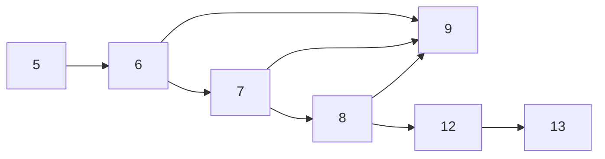

# IND08 fixed-operand recovery frontier

IND08 ownership is retained. This is a bounded diagnosis and implementation
plan, not an application acceptance, handoff, or allocator repair. Main inspected
and rebased: `a5d20d6a7faeaf56acabe903a4e78275760d0cee`. Claims status timed out;
no claim registration succeeded. The prior unsuccessful route patch remains
reverted. No permission or custody guard was changed.

## Observed boundary

The current-main diagnostic runner SHA256 is
`d84efccd3dc60595cf5623c0caa1963861bc0fe57630f52ebb7bc719da83e614`.
The hook prints facts and assignment errors only and is reverted in the
candidate. Its exact patch and binary identity are retained in the Library
bundle. The original intended-valid program still expects stdout exactly
`1120` and native/Terminal exit 70. It fails with
`RuntimeSpill(Homes(UnresolvedEntryTransitions { function: 2, register: 7, count: 2 }))`.
Before that, assignment repeatedly reports real pressure in function 1; the
formatter's unchanged function-2 facts are reached after that pressure.

The actual relevant live-range graphs are **acyclic**, although the Omega
formatter has state loops. Register 6 has nine fragments, ten connectors and
common legal view `{0}` over every point. Register 7 has eight fragments,
nine connectors, no globally common view, and fixed uses requiring view 10
at point 38/instruction 19/operand 1, then view 0 at point 82/instruction
41/operand 0. Both have three predecessors (6, 7 and 8) entering block 9.
There are no fragment-less connector targets in these two graphs.

An independent all-predecessor domain calculation confirms that register 6
needs no split: every closing domain is `{0}`. Register 7 needs one factual
boundary at block 13/point 82, from `{10}` to `{0}`. `range-summary.json` and
`independent-domain-audit.json` retain the exact facts and calculation. This
calculation supplies no copy, home, or compiler admission authority.

Replacing the 32-term pressure expression with one term, independently
expected to total 4, preserves the original formatter and stdout `1120`.
This smaller complete source directly reaches
`FixedSegments(SplitRequirements(UnsupportedCrossBlockRange { function: 2, register: 6 }))`.
The default route is therefore obstructed even without the earlier pressure.
`topology::tree` rejects the second connector into block 9 before considering
its compatible domain. This is a join limitation, not demonstrated inability
to allocate a cyclic live range.

The separate `single_condition` diagnostic removes the short-circuit join
and deliberately omits zero digits, with independently frozen stdout `112`
and exit 70. It rejects at
`UnauthenticatedDomainBreak { function: 2, register: 7, point: 74 }`.
This variant's register numbering differs from the original. Its register 7
has a generic source fragment in block 6, points 48..62. At point 55 the legal
views are `[5,36,40,44,52,56]`; a later operand-Use at block 9/point 74,
instruction 37/operand 0, requires view 0. Its entry-transition roster is
empty. `single-condition-break.json` records those facts. The source for this
variant is diagnostic evidence; the application and original formatter are
unchanged.

Neighbor controls on the same current-main runner completed: trapping-add
pressure returned native/Terminal 70; bounded-dividend remainder returned
native/Terminal 0. No rejected diagnostic variant was recorded as a success.

## Missing recovery invariant

A semantic value must remain available in one compatible physical home along
all copy-free transports. At a join, **every** incoming connector participates
in that equality; selecting one predecessor or discarding the others is
unsound. An authentic fixed operand constrains its occurrence, not the value's
entire lifetime. When that occurrence needs a different view, a real typed
copy must establish a temporary in the required view while preserving any
still-live resident value. That copy may originate in a generic legal resident
domain; it does not require an earlier pinned singleton.

The current contracts do not establish this general invariant:

* `fixed_precolored_split_requirements/compute/topology.rs` admits only trees.
* `partition.rs` propagates one parent's closing domain; segment openings
  carry one `LiveRangeEdgeConnector`. `fixed_precolored_segment_homes/domains.rs`
  builds homes by looking up that previously constructed single parent.
* `allocation_legality/compute/fixed_views.rs` licenses only movements between
  distinct pinned views. `cuts.rs::require_transition` cannot authenticate the
  generic resident-to-fixed use in the minimized second case.
* The existing fixed-view-copy policy's `admitted_source` accepts only 64-bit
  integer source types. The application formatter is authored with `i32`.
  This is a statically identified transport-contract restriction, not an
  additional observed rejection: the earlier guards stop first.
* `register_allocation.rs` branches on the first assignment error. Spill
  recovery accepts `NoCompatibleHome` but cannot compose later unresolved
  structural fixed-view obligations. A route preflight alone just exposes
  the unsupported join earlier.

Deleting the topology guard, keeping one incoming edge, inventing a source
view, widening the application's types, or registering rejection as success
would leave the invariant unproved.

## Concrete general repair

Implement mandatory fixed-occurrence materialization in the selected X-to-X
owner before home assignment. Keep semantic resident registers available
across their existing CFG transports; use fresh short-lived physical
registers at fixed occurrences. This avoids making required correctness depend
on the optional tree-shaped segmented-copy policy.

1. Collect fixed Use, Def and UseDef obligations from the exact admitted target
   constraint rows across all functions. Group actual ties and early-clobber
   requirements by register units. These obligations must be established before
   allocation can classify residual exhaustion as pressure; function order must
   not decide whether a structural obligation is noticed.
2. Add one general typed register-payload transport constructor. It preserves
   the exact source scalar type, source value/definition lineage, carrier class,
   width and bits. Select the move from the validated target catalog. The
   selector already constructs typed carrier copies; reuse that contract rather
   than treating `i32` as a semantic `i64` conversion. Keep address/structural
   lineage distinctions and unsupported target classes explicit. Raw-copy
   compatibility needs a carrier proof, not a relaxed type-name guard.
3. Materialize a fixed Use with a fresh temporary immediately before its
   consumer. Materialize a fixed Def in its required temporary, then establish
   the resident result before later uses. UseDef and tied operands share the
   required temporary when their authentic constraints require it; no fixed
   occurrence may clobber an independently live resident value. Compiler
   scratches and architectural implicit units remain distinct from semantic
   scalar residents.
4. Preserve semantic bindings, source provenance, return/fuel metadata and
   successor transports. Allocate fresh dense IDs under the ordinary work
   budget. Local placement must be correct on every predecessor path; no
   source-block-name or formatter-shape recognizer is allowed. Original
   identities remain available for semantic bindings even when their physical
   ranges become empty.
5. Publish a selected transformation and full manifest prefix, then fresh
   liveness, ranges and legality. After materialization, home assignment sees
   residents free of incompatible fixed-use pins and short-lived temporaries
   with exact compatible constraints. Runtime spills operate only over those
   current facts. Rewrites that introduce new fixed occurrences must preserve
   or re-establish this normal form; use an idempotent, finite obligation roster.
6. Exercise the existing independent source/target and copy-lineage audits in
   the corpus. Do not add verifier replay to the ordinary compile route.
   Preservation discovery and final frame realization consume the rewritten
   current program and its checked homes.

A future shared-copy optimization may reuse dominating temporaries. The
required baseline has a correct local transport route first. Remove the
required default tree-policy fallback once general materialization supplies
that route; retain genuinely declared optional policies under their own
contracts rather than weakening their evidence.

This crosses four contracts: typed selected transport/provenance, target copy
carrier selection, current allocation/manifests with pressure composition, and
independent native establishment/audit. It exceeds a bounded route repair.
This design is the retained next implementation frontier under IND08; no new
worker or per-function handoff is required.

## Acceptance and stopping point

First run all three complete reproductions through the ordinary native and
Terminal routes, enforcing their frozen stdout and exit oracles. Include the
existing trapping-pressure and bounded-remainder controls, plus a source
variation with compatible join predecessors, a fixed use after a call, tied
operands, and a result that remains live after a fixed definition. Cover the
32-bit typed carrier and the existing 64-bit carrier. Existing exact-division
and ownership rejection controls must retain their reasons. Run affected crate
check/Clippy, format, and scoped corpus source/native/Terminal gates; attribute
pre-existing lint findings by source evidence.

Then compile the original operating envelope, reuse its verified native
executable serially over all ten geometry and twelve invalid-runtime fixtures,
and compare Terminal where supported. The independent validator must verify
vertices, CCW order, area, status, every inequality certificate, and every
active pair against the unchanged frozen oracle. Check the complete
intended-invalid radius application separately. Only after actual outputs and
ordinary gates pass is the candidate eligible for independent review and the
normal main-only landing queue. Independent review has not occurred; no
additional reviewer worker was spawned under the user's restriction.

The geometry oracle remains
`7dd3788aec16d4870152fcce959069808534df441029a14eb2628d8f805707c3`.
