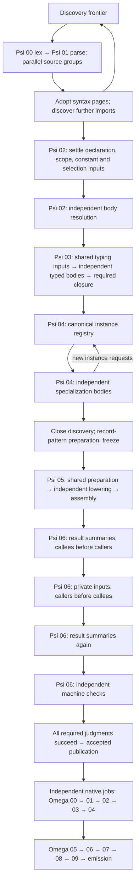

# Compiler work ownership and bounded parallelism

Omega can lose the benefit of parallel parsing when later stages copy unrelated
program storage or serialize independent bodies through one mutable owner.
This draft proposes shared interfaces and independently owned body results so
expensive work can run concurrently without multiplying worker pools.

**Status: the full flow remains a design.** Final machine checks after Psi 06
inference now share the invocation's existing workers; the
[measurement report](../measurements/parallel_machine_checks_2026_11_15.md)
separates generated-workload scaling from ordinary compilation. The other
proposed body boundaries below are not implemented by that change.
The [repair queue](../../../OWNER_CODE_CONCERNS.md#entries) records
observed defects; this note supplies the proposed direction and acceptance
criteria. The [visual comparison](https://squalr-omega-parallelism.zcanann.chatgpt.site)
shows the full proposal beside Squalr. The repository note is the reviewable
source of the proposal; the hosted illustration may change independently.

## What Squalr contributes

The inspected scan path gathers region bytes, prepares shared scan inputs, then
scans independent spans with local encoders. Nested Rayon tasks share workers;
a task hierarchy is not a hierarchy of new thread pools. Compact result batches
remain useful without flattening them merely to cross a handoff.

The compiler analogue is settled interfaces plus owned bodies. Unlike captured
memory, some compiler inputs must be inferred from other bodies. Those dependency
edges are real; a whole stage being single-threaded is not automatically required.
The goal is to make shared preparation compact and independent work separable,
not to remove every synchronization point or imitate memory-scanner SIMD.

## Observed implementation and proposed boundaries

The observations below were checked at `a8f13149a1ecf9f43012a8ca169627884f2c5043`
and reconciled at `2e5ca2da570`. Links name stage owners; the proposed splits
are not already served APIs. The Psi 05 and 06 rows were checked again at
`d0e4a86579627`; the final-check batch described here is the subsequent change.

| Stage | Observed ownership or dependency | Proposed work boundary |
| --- | --- | --- |
| Psi 00–01 | [Source groups](../../../omega-rust/psi/compilation/source-compiler/src/lib.rs) lex then parse each file with reusable scratch; groups run concurrently on the invocation's [execution budget](../../../omega-rust/psi/foundation/execution-admission/README.md). Logical-module discovery parses each file into a standalone page that admission adopts under the admitted source identity instead of parsing again. | Keep semantic source authority separate from retained syntax. |
| Psi 02 | [Resolution](../../../omega-rust/psi/compilation/pipeline/02_syntax-trees-to-symbol-resolved-trees/src/resolution.rs#L2496) orders normalization, identities, constants and selections through a mutable owner. A later phase needs facts established earlier. | Prepare declaration/scope/selection inputs, then resolve independent body uses into owned tables. Preserve each phase's preconditions; do not declare all resolution independent. |
| Psi 03 | [Typing](../../../omega-rust/psi/compilation/pipeline/03_symbol-resolved-trees-to-typed-trees/src/lowerer.rs#L1596) loops through declaration families with one mutable lowerer and then closes the cohort. Shared-snapshot completion can clone owned arenas. | Share immutable declaration/type/signature tables; produce body-local tables and explicit closure inputs. Retain necessary cohort closure before consumers use its results. |
| Psi 04 | [Specialization](../../../omega-rust/psi/compilation/pipeline/04_typed-trees-to-typed-trees/src/passes/specialization.rs#L83) appends generated machines and scans prior instances linearly. [Record-pattern preparation](../../../omega-rust/psi/compilation/pipeline/04_typed-trees-to-typed-trees/src/passes/record_patterns.rs) follows it. | Deduplicate canonical instance requests through an exact key index, reserve identities, and generate independent bodies through a bounded work queue once `LOWERED-FORM-CHECKER` stabilizes Psi 04. Keep pass ordering and stop/refusal behavior. |
| Psi 05 | [Structural lowering](../../../omega-rust/psi/compilation/pipeline/05_typed-trees-to-terminal-psi/src/lib.rs#L882) prepares shared signatures, outcomes, compact SCC call components (#3201) and records. `lower::machine` returns owned results but also mutates the module's qualification and identity catalog. `outcome.rs` settles outcomes callee-first over the components, iterating only inside a cycle. | Give qualification publication an explicit preparation/join owner before trying body fanout. If lowering cost warrants it, dynamically schedule independent lowering jobs and assemble in `MachineId` order. Preserve recursive-component relationships and source correspondence. |
| Psi 06 | [Discharge](../../../omega-rust/psi/compilation/pipeline/06_terminal-psi-to-terminal-psi/src/lib.rs#L380) runs result inference, private-input inference, then result inference again, and prepares indexed per-machine branch and carried-proof inputs (#3212). Dominance storage is now a linear-sized forest and proof origins expand on demand. Final checks over disjoint `MachineTables` now use the invocation budget. | Keep the three inference passes ordered. Later, if measured critical-path cost warrants it, schedule independent ready summary branches under the same budget. Preserve cycle policy and proof admission. |
| Omega 00–09 | Native jobs traverse the [numbered representation pipeline](../../../omega-rust/pipeline.md#connected-program-route); native completion runs at most four jobs at a time on the same invocation execution budget as Psi parsing. | Keep the stage sequence inside a native job; no pool per native stage. |

## Full proposed flow

This diagram preserves stage handoffs. It does not promise cross-stage streaming
or removal of a whole-program barrier before its actual dependencies are known.
It shows the eventual ownership direction, not a scheduler implementation
checklist: remove repeated work first, trial one existing independent boundary,
and defer specialization discovery and summary concurrency until justified.

Summary inference can have independent ready branches inside each ordered step.
A recursive group must retain a defined deterministic treatment; scheduling must
never assume an unproved summary around a cycle. Private input inference is
inference, not evidence. The final checker and acceptance closure remain required.

## Representation and execution contract

**Shared interfaces, owned bodies.** Dense stable declaration IDs address
immutable declaration, signature and type tables. Body-local IDs or owned pages
address expressions, statements, lowered operations and checking scratch.
Cross-body references use explicit declaration identities. Validate owner and
generation before indexing. A directory adopts completed body pages without
cloning untouched bodies or flattening every output into a new global arena.
Shared interned types and signatures still need canonical identity; body-local
allocation must not make equal instances acquire inconsistent meanings.

The stage output carries facts its next consumer needs. Worker scratch is
private, not a second semantic sidecar or a callback into an earlier stage.
Freeze only the shared inputs needed at that boundary. This is an ownership
contract, not a requirement to replace every bounded Vec with paged storage.

**Ownership unit versus scheduling unit.** A body owns its tables, but the job
boundary follows the dependencies of the particular operation:

| Work | Initial scheduling unit |
| --- | --- |
| Ordinary lowering or final checking | One demanded body/check form, or a batch of small ones |
| Specialization, if later parallelized | One exact template application, deduplicated by canonical arguments |
| Recursive summary inference, if later parallelized | The relevant dependency group with its defined cycle treatment |
| Expressions, statements and ordinary obligations | Sequential work inside the owning job |

Two mutually dependent summaries may need group treatment without forcing every
later pass over those bodies to be serial. Conversely, distinct bodies are not
independent while one still needs facts inferred from the other. Unlike Squalr's
uniform captured byte spans, compiler body cost is heavy-tailed: one state
machine with deep branching, borrows or proof obligations can take orders of
magnitude longer than dozens of small helpers. Body parallelism must therefore
work-steal individual large machines dynamically (batching only genuinely tiny
bodies), rather than slicing `1..=N` into static equal-count chunks like
`par_chunks_mut`.

Semantic identity is separate from storage coordinates. Canonical declarations
and exact specialization applications need stable identity; local nodes can use
ordinary dense vectors and body-local IDs. Do not introduce global interning or
canonical-number assignment in every hot loop. Deterministic publication happens
at the appropriate ownership join.

Discovery retention is selective: retain compact module/import information and
reusable syntax where it avoids work, then release unneeded syntax when ownership
permits. Invocation-scoped reuse does not mean retaining every discovered file's
full tree until the invocation ends.

**One execution budget across the Psi/Omega firewall.** Invocation-wide admission
covers source groups, product/target jobs and machine batches. Because `psi/`
cannot import `omega/` crates, the shared worker budget lives in the
target-neutral [`execution-admission`](../../../omega-rust/psi/foundation/execution-admission/README.md)
foundation crate. The CLI creates one `ExecutionBudget` per invocation and runs
the command on it; lexing, parsing and native completion fan out onto those
same workers, so the invocation's active workers and their 256 MiB stacks are
bounded once. The budget bounds workers, not memory: native completion keeps
its own in-flight cap of four jobs beneath it. The 256 MiB stacks exist for
recursive syntax and type walks; widening concurrency further pairs with moving
those walks onto flat tables (`PIPELINE-ARCHITECTURE-ENFORCEMENT`) so stack
reservations do not multiply across workers. Prefer existing coarse independent work when it fills
the budget; expose ready body jobs when it does not. Nested operations reuse
admission or stay inline. Never hold every permit while waiting for child jobs
that require those permits. Body walks and obligation loops remain sequential
inside a job; small jobs are batched. No universal query engine is required to
start.

Bound active workers, queued payloads and in-flight intermediate bytes. Final
retained program storage necessarily grows with input size; the bounded quantity
is additional live work, not total program size. Define oversized-job behavior
explicitly so backpressure cannot deadlock or silently discard a compilation.
Queued jobs hold lightweight keys and shared references; substantial job-local
tables and proof contexts are materialized only after admission. Distinguish
estimated memory reservations used to choose concurrency from enforced limits:
proof work can grow after admission, so an estimate is not a hard memory bound.
Use the applicable resource-limit/refusal handling for actual exhaustion; report
any missing enforcement rather than claiming estimates guarantee containment.

**Deterministic ownership joins.** Reserve or derive canonical identities from
stable inputs, never task completion order. Merge diagnostics in defined source
or machine order, and publish only the exact module/evidence accepted by checking.
Where sequential loops currently short-circuit via `?` in `1..=N` `MachineId`
order (both `lower::machine` in Psi 05 and `machine` in Psi 06), parallel
execution must still select the lowest failing `MachineId` rather than whichever
worker errs first—for example, by tracking an atomic `first_failed_machine_id`
watermark so workers skip only strictly higher `MachineId`s and join results in
`MachineId` order. Cancellation or rejection must release reservations and
scratch without exposing partial output as accepted.
Thread scheduling must not decide which proof receives its logical work allowance:
a shared race-consumed proof-fuel counter can change acceptance with worker count.
Allocate logical allowances independently of completion order. Likewise, the first
error to finish must not accidentally become the selected diagnostic.

## Experiments and acceptance

A smooth CPU graph and a fixed number of hourglass pinches are not acceptance
criteria. Extra work can saturate CPUs; a faster algorithm may use fewer CPU
seconds. Measure elapsed critical-path time and explain remaining waits.

### Evidence proportional to the repair

| Change | Required evidence |
| --- | --- |
| Remove repeated work | Preservation tests; fewer relevant visits, copies or allocations; a focused benchmark and no material regression in the affected path |
| Refactor ownership | Untouched storage remains shared; selected changes do not copy unrelated bodies; preservation tests and appropriate time/memory checks |
| Introduce concurrency | The scheduling baseline and closure protocol below: end-to-end benefit, scaling, bounded execution, memory and scheduling-independent outcomes |

The full multi-worker and idle-state tracing protocol applies when concurrency
changes. Indexing per-machine inputs does not by itself require a scheduler study.
Combined changes satisfy the evidence for each kind; do not hide a concurrency
change inside a storage refactor.

### Optional adjacent-stage overlap

After independently owned body outputs exist, distinguish cheap output
combination, waiting for unrelated stragglers, and necessary shared-fact closure.
A stage boundary need not be a whole-program scheduling barrier: a body may
advance only when its declared input and required shared facts are settled.
Keep cheap joins that strand no material downstream work. An API accepting one
whole-program owner is not, by itself, evidence that every consumer needs that
barrier.

Trial one adjacent pair with no unresolved cross-body inference, using the same
transforms and execution budget while retaining the other joins. The driver may
continue directly into the next ready transform without a queue handoff; stages
still consume their declared representations. Blocked work releases workers and
permits, and backpressure bounds in-flight storage. Preserve settled-summary and
final-acceptance gates. Keep the overlap only if it meets the elapsed-time,
CPU-work, memory and determinism criteria below. This is a follow-on experiment,
not a scheduler-rewrite requirement or another repair-queue defect without a
concrete unnecessary dependency.

### Baseline and decision before changing scheduling

Select a small workload set, not a new fixture corpus: a representative large
program with many independent bodies; a dependency-heavy case with helper chains,
recursion and repeated specialization requests; and a tiny invocation that exposes
scheduler overhead. Prefer existing runnable programs. If a missing capability
blocks a workload, report that limit and use a clearly labeled focused workload;
do not claim full compiler throughput from a stage-only benchmark.

Record exact source commits, commands, compiler profile, host/target, CPU budget,
memory limit and input sizes. Use fresh invocations under the compiler-storage
contract; distinguish warm OS file cache from cold input runs. Hold those
conditions fixed. Compare the base, candidate at one worker, and candidate at
several worker counts up to the allowed host budget. Use at least five timed runs
per chosen configuration, report individual results and median/spread, and account
for host interference rather than selecting the best run.

After collecting the baseline and before evaluating the candidate, record numeric
limits for the primary elapsed-time improvement, tiny-input regression, peak
memory and scheduling overhead. Derive them from baseline cost and variability.
Until those limits and actual results exist, a threading experiment has no
performance acceptance claim. Do not adjust the limits afterward to fit a result.

### Closure criteria for an implementation

| Criterion | Required evidence |
| --- | --- |
| Elapsed-time benefit | Primary workload meets its predeclared improvement target; tiny and dependency-heavy controls meet their regression limits. Report stage times and end-to-end time, including preparation, joins and publication. |
| Useful scaling | One/few/budget-worker results identify where speedup stops. Account for dependency depth, memory bandwidth, allocation, locking, scheduling and insufficient ready work; high CPU use alone passes nothing. |
| Bounded execution | Trace maximum active workers, queued payloads and actual in-flight jobs/bytes across nested compilation. Separate estimated reservations from enforced limits and exercise the applicable resource-exhaustion path. Rejection/cancellation and oversized units terminate without reservation leaks or deadlock. |
| Ownership and work | Changed-body continuation retains untouched storage. Count parsing, graph visits, metadata scans and copied bytes for the relevant repair. No whole-program clone, hot central mutation lock or mandatory flatten/rebuild is introduced to enable threads. |
| Semantic preservation | Worker counts and perturbed completion orders preserve accepted/rejected outcomes, required diagnostic ordering and canonical artifact identity where specified. Focused negatives exercise actual obligations, including recursive and inferred-contract cases. No proof or validation-subject coverage is removed. |
| Explained idle time | A trace distinguishes running jobs, ready jobs waiting for admission, dependency-blocked jobs and input waits. Investigate each interval above a predeclared materiality threshold; no unexplained serialization of independent bodies remains in the repaired path. |

Every concurrency implementation PR reports total CPU time and peak resident/live working
memory alongside elapsed time. A table records each remaining material pinch,
its dependency, critical-path duration and disposition. There is no target pinch
count. Final acceptance is a legitimate join; expensive preparation that repeatedly
walks all bodies is a candidate repair, not automatically an unavoidable join.

### Implementation order

1. Remove demonstrated repeated sequential work first. Compact SCC call
   components in Psi 05 (#3201) and indexed per-machine branch/carried-proof
   inputs in Psi 06 (#3212) have already landed. Continue with the remaining
   high-leverage sequential repairs in [OWNER_CODE_CONCERNS.md](../../../OWNER_CODE_CONCERNS.md#entries).
   Linear-sized dominance forests (`06/src/graph.rs`) and compact proof origins
   (`06/src/known.rs`) have landed. Indexed specialization lookup remains
   relevant when its producer serves the surviving route.
   Invocation-scoped syntax reuse across logical-module discovery has landed.
   Validate each
   as a standalone sequential repair without a scheduler rewrite.
2. Re-measure the cheaper compiler on the surviving lowered-form route. Note
   that historical ~3,200-second Psi 05 measurements (#2788) belonged to the
   deleted checked-tree producer; on the surviving route, Psi 05 is linear
   structural lowering while post-inference Psi 06 runs obligation
   reconstruction and proof discharge over disjoint `MachineTables`. Compare
   post-inference Psi 06 against Psi 05 on current workloads and choose one
   boundary only when measured compile time justifies threading.
3. The first batch now runs post-inference Psi 06 checks on the shared invocation
   budget (`execution-admission`). Jobs queue borrowed machine tables and build
   proof scratch only when running. Individual bodies remain stealable; results
   join in identity order. A structural refusal skips only not-yet-started higher
   identities, while lower identities finish so the same first refusal wins.
   One-worker and one-machine calls keep the sequential path. Use the linked
   measurements to assess this boundary; they do not establish a speedup for
   the entire proposed pipeline.

Keep sequencing aligned with `LOWERED-FORM-CHECKER` ([TASKS.md](../../../TASKS.md)):
while Psi 02–04 are under heavy daily churn to finish language coverage on the
lowered route, avoid invasive frontend storage splits (`TypedTrees` / `Lowerer`
body paging, parallel specialization queues, or parallel summary inference)
unless a measured critical-path bottleneck demands one. Cross-stage streaming
must likewise earn its complexity through a measured critical-path bottleneck.

## Actionable repair references

Open entries in [OWNER_CODE_CONCERNS.md](../../../OWNER_CODE_CONCERNS.md#entries)
directly tied to this ownership direction:

- **Body ownership:** remove whole-program cloning for selected body completion;
  preserve unchanged pages and explicit signature/summary dependencies once
  `LOWERED-FORM-CHECKER` frontend churn settles.

Already landed sequential prerequisites from the initial queue:

- **Call graph (#3201):** replaced all-pairs reachability and duplicated
  component lists in `05_typed-trees-to-terminal-psi/src/components.rs` with one
  compact SCC graph.
- **Checking inputs (#3212):** grouped branches and carried-proof associations
  once in `06_terminal-psi-to-terminal-psi/src/lib.rs` so each machine borrows
  only its own prepared inputs.
- **Outcome propagation:** `05_typed-trees-to-terminal-psi/src/outcome.rs`
  settles call outcomes callee-first over the #3201 components, so a body
  outside a cycle is walked once instead of once per whole-program round.
- **Dominance and proof preparation:** per-machine dominance uses a linear-sized
  forest, and proof facts retain compact origins until a query needs evidence.
- **Execution admission:** lexing, parsing, final Psi 06 checking and native completion share one
  `execution-admission` budget created per invocation, replacing the parser's
  process-global pool and native completion's private threads. Final checking
  adds no pool or stack reservation of its own. The remaining 256 MiB stack
  cost belongs to the shared budget (`PIPELINE-ARCHITECTURE-ENFORCEMENT`).

Resolution scheduling, specialization queues and summary scheduling remain
design hypotheses here, not extra queue entries implying that parallelism is
itself a missing language feature.

The governing contracts remain [compiler storage](../../spec/build/compiler_storage.md),
[validation subjects](../../spec/build/validation_subjects.md),
[local call summaries and state contracts](../../spec/language/state_contracts.md),
[generic identity](../../spec/language/generics.md), and
[pipeline ownership](../../../omega-rust/pipeline.md).
No persistent compiler cache, reduced validation closure, new assumption, or
changed language semantics is proposed.
