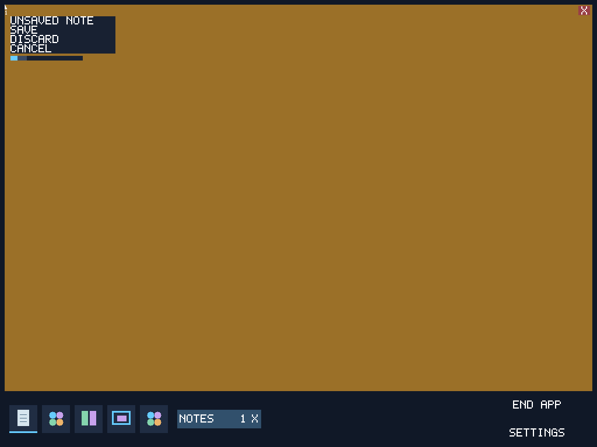

# Full Cathedral build and boot, 2026-10-28

The default mixed Rust/Omega Cathedral desktop compiled, booted, and passed the
existing `tools/boot-harness-rs/desktop_test.py` test, including a cold reboot.
The separate Omega-written kernel did not compile and produced no image.

## Observed desktop result

The default composition includes the Rust kernel and Omega chooser, chooser
session, matrix, Notes, Colors, and both shared UI exports. No Rust chooser
fallback or prebuilt component override was selected. All six native-component
receipts were regenerated for compiler SHA256
`67358c0345be22e6831c005dd92eb2ee03b21b77809a1a1eedcd15b639409c27`
and their output digests were checked after the run.

The full build, storage preparation, interaction checks and two boots took
**170.639 seconds**. This is a workflow measurement with retained caches and
package review already completed, not a clean build or compiler-only benchmark.
The first ready marker arrived 2.596 seconds after QMP connection; the second
arrived after 4.342 seconds. QEMU launch-to-QMP adds 1.189 and 0.182 seconds,
respectively. These emulator boot times do not measure compiler performance.

The automated runtime checks passed independent Notes drafts, three instances,
switching, capacity refusal, protected close, slot reuse, save/discard/cancel,
Colors, user selection and saved state after cold reboot. The persisted-store
oracle verified 1,661 records. The fresh EFI image is 14,110,720 bytes, SHA256
`887bf272dd52b21b1bb66c7ac29be0cd7617c62d3071ba0c52fe303a39da86d8`.

Cathedral commit `9a856bc1` contains the desktop source migration and the missing
chooser index / Colors return bounds. Those contracts retain exact arithmetic
and are exercised by this boot. Its parent `0737c5da` contains the shared UI
compilation path. The source manifest and component receipts bind the tested
inputs. Both original primary checkouts remain untouched.

## Omega kernel result

The first run failed while capturing a pinned Git dependency on Windows because
portable slash spelling reached a native canonical-path check. The compiler fix
converts validated Git paths to native separators while retaining raw Git bytes
for identity. The new regression failed before the fix; all 14 focused Git
object tests passed afterward.

The old dependency pin also contained retired Build syntax. The isolated kernel
migration updates both allocator and firmware-vocabulary pins to the fixed
compiler baseline `608307c1ee2e9d6aa20c71d0fc3afcf1210050e5`, retires source
states and explicit domain subjects, and states empty boundary reach ceilings.
It preserves the domain predicates and storage-authority requirements.

The final attempt stops during checked package compilation:

> generic machine `placed_write` has a static selection, but its complete
> type/const/machine/conformance specialization tuple cannot be derived

The occurrence is `BootHandoff::publish::header`, `boot_handoff.omg:80`.
The same optimized producer independently reproduces that failure in the
existing `placed_primitive_generic_concrete`, `extent_view_external_write`, and
`resident_array_field_access` fixtures. This is current evidence, distinct from
the older documented kernel domain-evidence failures: the current run does not
reach those later checks. No check was relaxed and no old EFI image was booted.
The unfinished kernel migration remains uncommitted and is retained in
`kernel-migration-incomplete.patch.gz`; it is not accepted kernel functionality.

## Evidence and limits

[result.json](result.json) records commands, digests, cache state and artifact
locations. Compressed logs retain the failed attempts, focused tests and the
successful desktop run; both boot serial logs and timing records are adjacent.
`compiler-source.patch.gz` binds the local compiler fix to its recorded base.
The Cathedral source-layout check passed (74 Omega and 151 Rust package edges).

This establishes the default desktop on Windows-hosted QEMU TCG. It does not
establish an Omega-only OS boot, physical-hardware boot, remote-main acceptance,
or sub-second full compilation. No unfiltered corpus/workspace sweep or remote
publication was performed.
